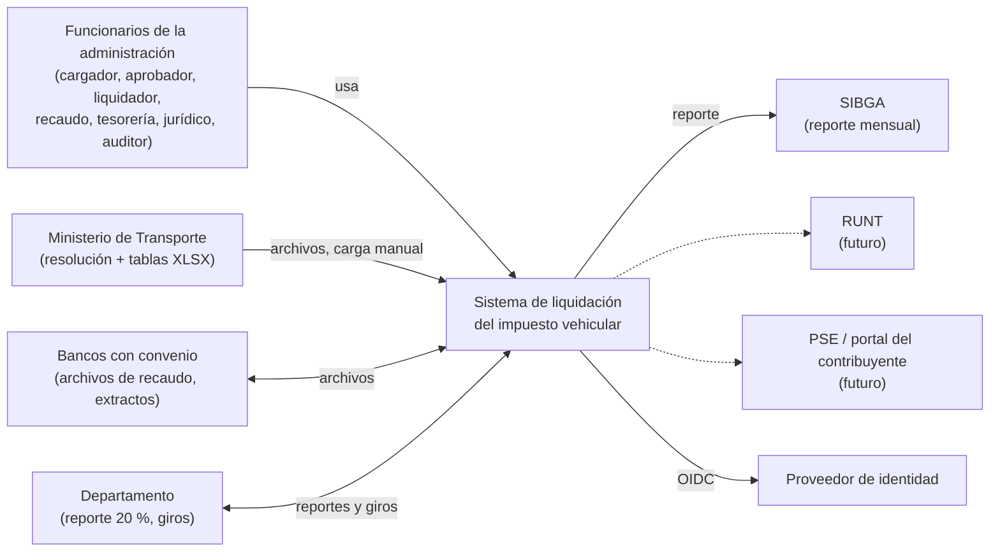
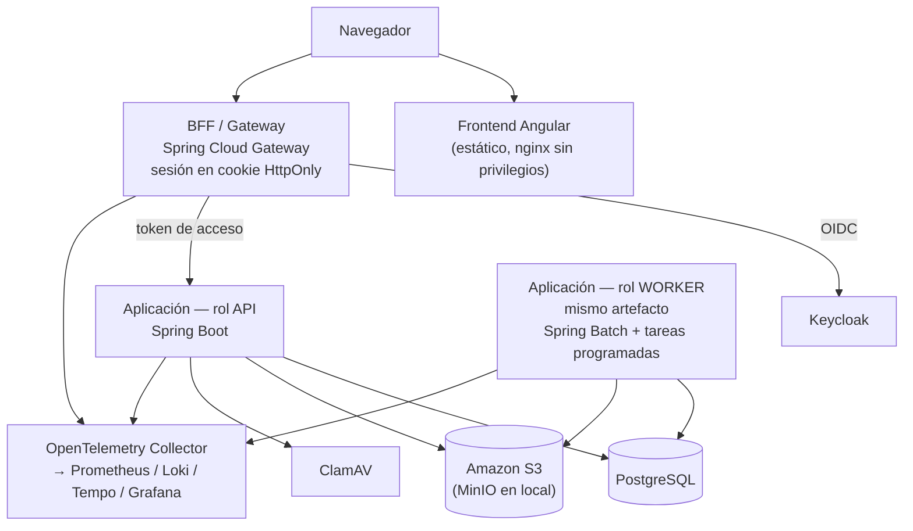
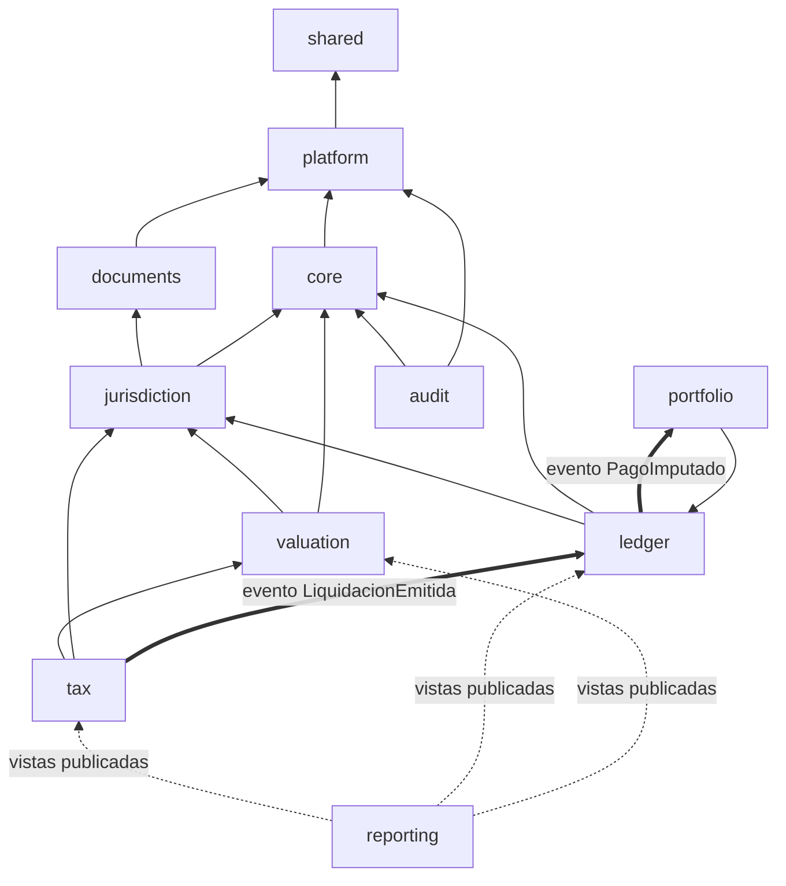
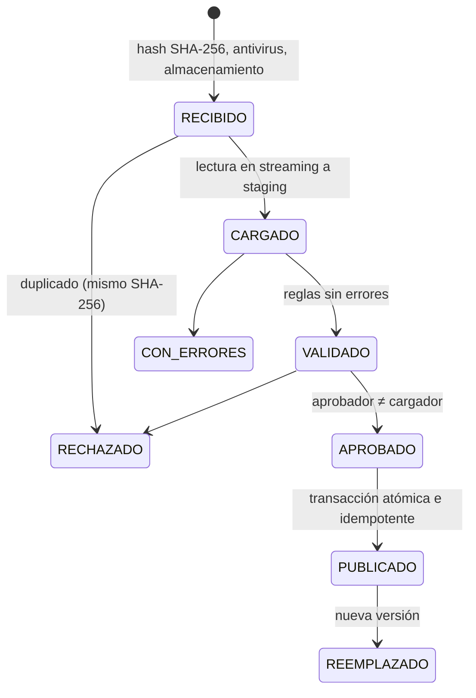
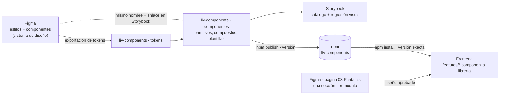

# Arquitectura 01 — Arquitectura de software

> **Proyecto:** Liquidación del impuesto anual de vehículos automotores
> **Depende de:** `00_Decisiones_y_Hoja_de_Ruta.md` (ADR 0002, 0003, 0005, 0006, 0008, 0009, 0012, 0013, 0016, 0017)
> **Versión:** 1.0 — **Aprobado** el 2026-11-01 (ADR 0001–0020 aceptados)
> **Alcance:** vistas de contexto y contenedores, módulos, arquitectura interna, motor de reglas, patrones, datos, API, frontend, procesos masivos, integraciones y estructura del repositorio. Sin código.

---

## 1. Vista de contexto (C4 nivel 1)



Las integraciones iniciales son **por archivo** cargado por un funcionario. Las integraciones en línea (RUNT, PSE) quedan previstas como puertos, sin implementar (P8, P9 en 00 §7).

---

## 2. Vista de contenedores (C4 nivel 2)



| Contenedor | Responsabilidad | Escala |
|---|---|---|
| Frontend | Archivos estáticos de Angular con cabeceras de seguridad | Réplicas detrás del balanceador |
| BFF | Inicio de sesión OIDC, sesión del usuario, reenvío del *token* a la API, limitación de tasa | Horizontal, sin estado (sesión en BD) |
| API | Casos de uso interactivos, validaciones, consultas, encolado de trabajos | Horizontal, sin estado |
| Worker | Importaciones, corridas masivas, imputación diaria, conciliación, exportaciones, distribución, alertas | Horizontal por particiones del trabajo |
| PostgreSQL | Datos transaccionales, RLS, registro de eventos (*outbox*), repositorio de Spring Batch | Vertical + réplica de lectura para reportes |
| Amazon S3 (MinIO en local) | Archivos originales, soportes, exportaciones generadas | Según volumen |

Todos los contenedores corren en AWS (ECS sobre Fargate, RDS for PostgreSQL, S3), según P1 y el ADR 0020 (doc. 03 §5).

API y worker son **el mismo artefacto** con distinto perfil de ejecución: una sola base de código, despliegue y escalado independientes.

---

## 3. Monolito modular

### 3.1 Módulos

Un módulo por contexto de negocio, alineado con los esquemas del ERD y con el menú funcional.

| Módulo | Esquema | Menú | Responsabilidad | Plantilla (§4) |
|---|---|---|---|---|
| `shared` | — | — | Núcleo compartido, tipos de valor comunes: `Dinero`, `Tasa`, `Vigencia`, `CodigoDane`, `AdministracionId`, `Periodo`, reloj inyectable, errores con código de regla | Librería pura |
| `platform` | `platform` | — | Transversal técnico: seguridad, contexto de inquilino, auditoría, motor genérico de ingesta (§6), exportación a Excel, almacenamiento, trabajos asíncronos | Técnico |
| `core` | `core` | 1.1, 1.2, 2.x | Entidades territoriales, administraciones, contribuyentes, vehículos, matrículas, vínculos de propiedad, estado tributario | CRUD simplificado + reglas puntuales |
| `documents` | `documents` | 1.3 | Normas, soportes y expediente documental | CRUD simplificado |
| `jurisdiction` | `jurisdiction`¹ | 1.5.9 | Configuración de jurisdicción: ingesta del YAML, validador CJ01–CJ14, publicación, *snapshot* inmutable de reglas | Hexagonal completo |
| `valuation` | `valuation` | 1.5.2–1.5.4, 2.6 | Catálogos de avalúos, importación de tablas del Ministerio, homologación vehículo ↔ avalúo | Hexagonal completo |
| `tax` | `tax` | 1.4, 1.5.5–1.5.8, 3.x | Vigencias, tarifas, calendario, beneficios, motor de liquidación, liquidación individual, simulador, corridas masivas | Hexagonal completo |
| `ledger` | `ledger` | 4.x | Obligaciones, recibos, pagos, conciliación, imputación, saldos a favor, reversiones, distribución, participación 20 % | Hexagonal completo |
| `portfolio` | `portfolio` | 5.x (futuro) | Intereses, sanciones, prescripción, apertura de cartera histórica | Hexagonal completo |
| `collection`, `enforcement` | idem | futuro | Cobro persuasivo y coactivo, bienes y medidas cautelares | Hexagonal completo |
| `audit` | `audit` | consultas de auditoría | Bitácora inmutable y eventos de integración | Técnico |
| `reporting` | — (solo lectura) | 1.6.x, 3.6, 4.7 | Consultas transversales, exportaciones, reporte SIBGA (1.6.7) | Lectura (jOOQ sobre vistas publicadas) |

¹ El Doc. 03 §5.6 ubica `jurisdiction_config` en el esquema `core`. Se propone un esquema propio para cumplir la regla "un módulo, un esquema"; es un ajuste al modelo de datos a validar.

### 3.2 Reglas de dependencia



| Regla | Verificación automática |
|---|---|
| Las dependencias forman un grafo acíclico; las flechas de la figura son las únicas permitidas | Spring Modulith (`ModularityTest`) |
| Un módulo usa a otro solo a través de su **paquete raíz** (fachadas y eventos publicados); sus subpaquetes son internos | Spring Modulith (`ModularityTest`) |
| Cuando el efecto puede ser asíncrono o va "hacia atrás", la comunicación es por **evento de dominio**, no por llamada directa. Ej.: `tax` publica `LiquidacionEmitida` y `ledger` crea la obligación | Revisión de diseño (gate H2 del doc. 05) |
| `reporting` no lee tablas internas: solo vistas `v_*` que cada módulo publica como contrato de lectura | Permisos de BD del rol de reportes + ArchUnit |
| Un módulo nuevo, o una dependencia nueva entre módulos, exige un ADR | `ModuleCatalogTest` (catálogo de módulos) + revisión |

Los eventos usan el registro persistente de Spring Modulith (*outbox* en PostgreSQL): el evento se guarda en la misma transacción que el cambio y se entrega al menos una vez. Todo consumidor es **idempotente**.

---

## 4. Arquitectura interna de cada módulo

Todos los módulos de negocio usan las **cuatro capas que el equipo ya conoce**: `api`, `application`, `domain` e `infrastructure` (ADR 0021). `ModuleCatalogTest` impide crear otras. Lo que un módulo ofrece a los demás (fachadas y eventos publicados) va en su **paquete raíz**; las capas son internas y Spring Modulith lo verifica.

### 4.1 Plantilla "hexagonal completo"

Para módulos con reglas de negocio: `jurisdiction`, `valuation`, `tax`, `ledger` (y `portfolio`, `collection` y `enforcement` cuando existan).

```
tax/
├── TaxAssessments.java       ← paquete raíz: fachadas y eventos publicados (LiquidacionEmitida…)
├── api/                      ← adaptador de entrada HTTP
│   ├── controller/           (implementa las interfaces generadas desde el OpenAPI)
│   └── dto/
├── application/              ← casos de uso: orquestan, abren transacción, autorizan
│   └── service/
├── domain/                   ← Java puro: sin Spring, sin JPA, sin jOOQ
│   ├── model/                (agregados, entidades, objetos de valor)
│   ├── rules/                (pasos del motor, políticas, especificaciones)
│   ├── enums/ · exception/
│   └── port/                 (interfaces de salida: repositorios, catálogos)
└── infrastructure/           ← adaptadores de salida y técnicos
    ├── persistence/          (entidades JPA, repositorios, consultas jOOQ: implementan los puertos)
    ├── batch/ · scheduler/   (jobs de Spring Batch y tareas programadas)
    ├── client/ · file/       (integraciones y lectores o escritores de archivos)
    └── config/               (@ConfigurationProperties)
```

| Capa | Puede depender de | No puede |
|---|---|---|
| `domain` | `shared` | Spring, JPA, jOOQ, HTTP, reloj del sistema, otros módulos |
| `application` | `domain` (incluidos sus puertos), paquete raíz de otros módulos | `infrastructure`, `api` |
| `api` | `application` | `infrastructure` |
| `infrastructure` | `domain` (implementa sus puertos), `application` (jobs que llaman casos de uso) | `api` |

### 4.2 Plantilla "CRUD simplificado"

Para registros con poca lógica (`core`, `documents`, `audit`, `reporting`): las mismas cuatro capas, pero se permite el estilo habitual del equipo: entidades JPA en `domain/entity` y servicios de `application` que usan los repositorios de `infrastructure/persistence` directamente. Si un registro adquiere reglas de negocio propias, se migra a la plantilla completa mediante un cambio SDD. La plantilla de cada módulo está en el `AGENTS.md` del backend para que los agentes no la elijan por su cuenta.

---

## 5. Motor de reglas de liquidación

Es el corazón del sistema y donde más se protege la calidad.

### 5.1 Principios

| # | Principio | Origen |
|---|---|---|
| M1 | **Función pura:** `liquidar(entrada, reglas) → resultado + traza`. Sin acceso a BD, reloj ni red dentro del motor; todo lo necesario se carga antes en un *snapshot* | D9 |
| M2 | **Ninguna constante tributaria en el código:** tarifas, rangos, porcentajes de ajuste, fechas, descuentos y redondeo vienen de `ReglasJurisdiccion`, el *snapshot* inmutable de la configuración publicada | D2 |
| M3 | **Versión del motor** con versionado semántico (`rule_version`), guardada en cada liquidación junto con `jurisdiction_config_id` y la versión del catálogo | LM‑07 |
| M4 | **Traza de cada paso** (entrada, regla aplicada, salida, norma de soporte), guardada como JSONB y exportable ("Incluir traza de cálculo", Doc. 02 §B.14) | Doc. 02 §B.6 |
| M5 | **Excepciones como resultado**, no como error técnico: una liquidación puede terminar en `EXCEPCION` con su código `LQ-Exx` sin abortar una corrida | LM‑06 |
| M6 | **Precisión:** cálculos intermedios con escala ≥ 6; redondeo una sola vez, en el paso final, con el método de la configuración | LQ‑C01, LQ‑C02 |

### 5.2 Pipeline

Implementa el flujo de Doc. 02 §B.2 como una cadena de pasos. Cada paso es una estrategia independiente y probada por separado, que recibe un contexto inmutable y devuelve uno nuevo más su entrada de traza.

```mermaid
flowchart LR
    P1[Prerrequisitos<br/>LQ-P01..P04] --> P2[Causación]
    P2 --> P3[Competencia y<br/>sujeto pasivo]
    P3 --> P4[Base gravable<br/>estrategia por origen]
    P4 --> P5[Ajustes de base<br/>orden configurable]
    P5 --> P6[Categoría y tarifa<br/>+ conservación]
    P6 --> P7[Meses gravables]
    P7 --> P8[Impuesto bruto]
    P8 --> P9[Beneficios]
    P9 --> P10[Redondeo]
    P10 --> R[Resultado + traza]
```



El mismo diseño (cadena de pasos puros con traza) se aplica a:

- la **cascada de homologación** de 8 niveles (Doc. 03 §4): cada nivel es un eslabón que resuelve o pasa al siguiente;
- la **imputación** de pagos (Doc. 04 §5): proporcional dentro de la obligación según el art. 804 ET;
- la **distribución del recaudo** (Doc. 04 §7): una estrategia por modalidad activa;
- el **validador de la configuración** (CJ01–CJ14) y los validadores de archivos (R0xx, F0xx).

### 5.3 Configuración de jurisdicción como contrato

- El esquema de la configuración es del backend: vive en `backend/contracts/jsonschema/config-jurisdiccion/<esquema_version>.json` y se publica con cada versión del backend.
- El CI del backend valida sus configuraciones de prueba contra el esquema; el CI de la raíz valida los ejemplos de `docs/funcional/anexos/` contra el esquema **publicado** (doc. 04 §2, regla IN‑11).
- Un cambio de esquema incrementa `esquema_version` y obliga a migrar la plantilla y las configuraciones existentes en el mismo cambio.
- Al publicarse, la configuración se materializa en las tablas (`tax.tax_rate`, `tax.tax_calendar`…) **y** se conserva el contenido completo en JSONB. El motor usa el *snapshot* publicado, nunca el archivo.

---

## 6. Motor genérico de ingesta (staging)

El patrón aparece al menos cinco veces (D4). Se construye una sola vez en `platform` y cada módulo aporta las piezas variables.



| Pieza común (`platform`) | Pieza variable (módulo) |
|---|---|
| Recepción, SHA‑256, antivirus, almacenamiento inmutable | Lector del formato (XLSX del Ministerio, YAML, archivo del banco, reporte del departamento, cartera) |
| Máquina de estados y segregación cargador ≠ aprobador | Conjunto de reglas de validación con sus códigos |
| Registro de filas originales (`original_data`) y normalizadas | Publicador: qué escribe en las tablas definitivas |
| Reporte de errores y advertencias, vista previa, exportación | Reglas de reconocimiento de advertencias |
| Auditoría de cada transición | — |

| Uso | Menú | Módulo |
|---|---|---|
| Tablas del Ministerio | 1.5.3 | `valuation` |
| Configuración de jurisdicción | 1.5.9 | `jurisdiction` |
| Archivo de recaudo del banco | 4.2.2 | `ledger` |
| Reporte del departamento (20 %) | 4.6.1 | `ledger` |
| Cartera histórica | 5.x | `portfolio` |

---

## 7. Catálogo de patrones de diseño

Se usan patrones donde resuelven un problema documentado, no por costumbre.

| Patrón | Dónde | Por qué |
|---|---|---|
| **Strategy** | Origen de la base gravable (`INVOICE`, `IMPORT_DECLARATION`, `OFFICIAL_TABLE`, `SIMILAR`); métodos de redondeo; plazos de vehículos nuevos (`FIN_DE_VIGENCIA`, `DIAS_DESDE_CAUSACION`, `FECHA_FIJA`); distribución por modalidad | Cada variante viene de la configuración; agregar una variante no modifica las existentes |
| **Chain of Responsibility / Pipeline** | Motor de liquidación; cascada de homologación; reglas de validación | Pasos ordenados, cada uno con su traza y su prueba |
| **Specification** | Reglas R0xx, F0xx, CJxx, LQ‑Pxx; sujeción al impuesto | Reglas combinables, con nombre y código, probables una a una |
| **State** | Lote, configuración, liquidación, corrida masiva, pago, saldo a favor | Las transiciones permitidas están en el dominio, no dispersas en `if` |
| **Template Method** | Motor de ingesta (§6) | Flujo fijo con pasos variables por tipo de archivo |
| **Adapter (puertos y adaptadores)** | Formatos de banco (Asobancaria o propio), almacenamiento, IdP, RUNT/PSE futuros | El dominio no conoce formatos ni proveedores |
| **Factory** | Creación de liquidaciones, obligaciones y movimientos con sus invariantes | Un objeto nunca nace en estado inválido |
| **Repository** | Puertos de persistencia por agregado | Dominio independiente de JPA/jOOQ |
| **Domain Events + Outbox** | `LiquidacionEmitida`, `PagoConciliado`, `PagoImputado`, `ConfiguracionPublicada` | Desacople entre módulos sin perder consistencia |
| **Value Object** | `Dinero`, `Tasa`, `Placa`, `CodigoDane`, `Vigencia`, `Periodo`, `ReferenciaRecibo` | Validación en un solo lugar; imposible mezclar pesos con miles o tasas con porcentajes |
| **Facade** | Paquete `api` de cada módulo | Superficie pública mínima |
| **Ledger *append‑only*** (inspirado en *event sourcing*, sin adoptarlo completo) | `ledger.tax_account_movement`, `audit.audit_event` | Saldo derivado, reversos en vez de borrados (Doc. 04 §2) |
| **Test Data Builder / Object Mother** | Pruebas | Fixtures legibles y consistentes |

**Sobre Singleton:** los *beans* de Spring ya son instancias únicas, gestionadas por el contenedor e inyectables. **Se prohíbe el Singleton manual** (estado estático global), porque oculta dependencias, impide pruebas aisladas y rompe el multi‑inquilino. Los datos inmutables compartidos (catálogo publicado, *snapshot* de reglas) se exponen mediante un puerto con caché, no mediante una instancia estática.

### 7.1 SOLID aplicado

| Principio | Regla concreta en este proyecto |
|---|---|
| **S** — Responsabilidad única | Un caso de uso por clase (`EmitirLiquidacion`, `AprobarLote`); un paso del motor por clase |
| **O** — Abierto/cerrado | Una nueva modalidad, método de redondeo o formato de banco es una nueva estrategia registrada, sin modificar las existentes |
| **L** — Sustitución de Liskov | Toda implementación de un puerto pasa la misma suite de pruebas de contrato (p. ej. almacenamiento en memoria, MinIO y Amazon S3) |
| **I** — Segregación de interfaces | Puertos pequeños por necesidad (`ConsultaCatalogoPublicado`, `RegistroMovimientos`), no repositorios genéricos gigantes |
| **D** — Inversión de dependencias | El dominio define los puertos; la infraestructura los implementa; inyección por constructor (prohibida la inyección por campo) |

---

## 8. Concurrencia e idempotencia

| Situación | Mecanismo |
|---|---|
| Edición concurrente de agregados mutables (borradores, bandejas) | Bloqueo optimista (columna `version`) + `If-Match`/ETag en la API |
| Aprobaciones y publicaciones | Transición de estado condicionada al estado esperado (falla si otro usuario ya actuó) |
| Distribución de trabajo entre workers | `SELECT … FOR UPDATE SKIP LOCKED` por bloque; particiones de Spring Batch |
| Reintentos y reinicios | Claves de idempotencia: `file_sha256`, `(batch_id, source_row_number)`, `idempotency_key` del pago, vehículo + vigencia ya emitido (LM‑05) |
| Tareas programadas en varias réplicas | ShedLock |
| Eventos entregados más de una vez | Consumidores idempotentes con registro de eventos procesados |

---

## 9. Modelo de datos y persistencia

| Tema | Convención |
|---|---|
| Esquemas | Uno por módulo. Un módulo solo escribe en su esquema. La lectura cruzada se hace mediante las fachadas del paquete raíz del módulo o mediante vistas `v_*` publicadas |
| Nombres | `snake_case` en inglés, como el ERD |
| Claves primarias | UUID versión 7 (ordenado en el tiempo, mejor para índices) |
| Dinero | `NUMERIC(18,2)` almacenado; intermedios con escala ≥ 6 solo en memoria y en la traza |
| Tasas | `NUMERIC(9,6)` como fracción (0,015 = 1,5 %), igual que la configuración |
| Fechas | `DATE` para fechas de negocio (causación, vencimiento); `TIMESTAMPTZ` para instantes |
| Estados | `CHECK` con los valores de la máquina de estados; valores de dominio administrables en `ref.domain_value` (Doc. 01 §10) |
| Invariantes en BD | FK compuestas con `administration_id` (ERD hallazgo 2); UNIQUE parciales (Doc. 01 §10, Doc. 03 §5.6); `EXCLUDE USING gist` para rangos de tarifa sin solapamiento; `CHECK` de signo por tipo de movimiento (Doc. 04 §11) |
| Inmutabilidad | Al rol de la aplicación se le revoca UPDATE y DELETE sobre movimientos del libro, auditoría y catálogos publicados (doc. 02 §5) |
| Migraciones | Flyway, nombre `V<AAAAMMDDHHmm>__<modulo>_<descripcion>.sql` (marca de tiempo para evitar colisiones entre ramas y agentes). Una migración aplicada **nunca** se edita. Cambios sin interrupción con *expand/contract* |
| JPA vs. jOOQ | JPA para cargar y guardar agregados; jOOQ para consultas con filtros, reportes, exportaciones y escrituras masivas. jOOQ genera su código desde el esquema migrado en CI, así que un SQL incompatible falla en compilación |
| Particionamiento | `ledger.tax_account_movement` y `audit.audit_event` particionadas por año cuando el volumen lo justifique (03 §2) |
| Saldos | Nunca almacenados como dato editable. Vista materializada `ledger.v_obligation_balance` recalculable (Doc. 04 §11) |

---

## 10. Contrato de API

| Tema | Definición |
|---|---|
| Estilo | REST sobre JSON, *contract‑first*: primero se escribe y aprueba el OpenAPI, luego se genera el código |
| Ubicación | `backend/contracts/openapi/<modulo>.yaml`, uno por módulo. El backend es el dueño y lo publica como artefacto versionado; el frontend usa una copia fijada en `frontend/api-spec/` (§14.1, IN‑04) |
| Versionado | Prefijo `/api/v1`. Los endpoints entre servicios que no se publican hacia el navegador usan `/internal/v1` (ADR 0025). Un cambio incompatible (detectado en CI con un comparador de OpenAPI) exige nueva versión o aprobación explícita |
| Generación | Interfaces de servidor Spring generadas en el backend desde su OpenAPI; cliente Angular generado en el frontend desde su copia fijada. **El código generado no se edita a mano** |
| Errores | Problem Details (RFC 9457). El campo de código lleva el código de la regla (`LQ-P04`, `R014`, `CJ12`, `OB-02`) para que la interfaz y las pruebas lo identifiquen |
| Paginación y filtros | Convención única para todas las consultas (página, tamaño, orden, filtros tipados), igual en las 1.6.x, 3.6 y 4.7 |
| Operaciones largas | Patrón asíncrono: `202 Accepted` + recurso del trabajo (validación de lote, corrida, exportación) consultable hasta terminar |
| Idempotencia | Cabecera `Idempotency-Key` en operaciones que crean dinero o movimientos (registro manual de pago, reversos) |
| Concurrencia | ETag / `If-Match` en aprobaciones y ediciones |
| Capacidades | Un recurso devuelve al frontend las opciones de menú visibles según los permisos del usuario y las modalidades activas de la jurisdicción (Doc. 04 §1). El frontend no recalcula esa lógica |

---

## 11. Frontend Angular

| Tema | Definición |
|---|---|
| Estructura | Workspace de Angular con la aplicación, que instala la **librería de componentes `liv-components`** (§11.1) desde npm. La aplicación tiene `core/` (autenticación, interceptores, manejo de errores) · `features/<area>/` (administración, homologación, liquidación, cuenta corriente, consultas), con carga diferida por ruta · `api/` (cliente generado desde `api-spec/`, no editable). El frontend es un proyecto autónomo que no depende de ningún archivo del backend (§14.1) |
| Fronteras | Una *feature* no importa a otra; solo `core`, `api` y `liv-components` (solo su API pública). Ningún archivo importa otro proyecto del monorepo. Verificado con ESLint |
| Componentes | Inteligentes (orquestan datos) y de presentación (solo `input`/`output`). Estado con *signals* y servicios por *feature*; NgRx SignalStore solo si un ADR lo justifica |
| Datos | Ningún componente usa `HttpClient` directamente: solo servicios de datos sobre el cliente generado |
| Lógica de negocio | **El frontend no calcula impuestos, descuentos ni saldos.** Muestra lo que calcula el backend (incluido el simulador 3.3). Las validaciones del formulario son de forma; las de negocio vienen del backend con su código |
| Formularios | Formularios reactivos tipados |
| Seguridad | Las guardas de ruta por rol son solo de experiencia de usuario; la autorización real está en el backend |
| Componentes de interfaz | Componentes Angular propios, todos en la librería `liv-components` (§11.1). No hay librería de componentes de terceros. Las pantallas de la aplicación solo **componen** componentes de la librería; no crean componentes visuales propios |
| Estilos | Tailwind CSS, sin atributo `style` ni utilidades escritas en la plantilla. Cada componente declara sus clases en su propio `.component.css`. Los *tokens* de diseño nacen en la librería y `frontend/src/styles.css` los importa del paquete (`liv-components/styles/theme.css`); ese archivo concentra solo lo reutilizado en toda la interfaz (*tokens*, *layout* y clases compartidas). Colores, tipografías, espaciados y radios se usan **solo** por *token*, nunca con valores escritos a mano |
| Diseño previo | Toda pantalla nueva tiene un diseño en Figma aprobado antes de implementarse, salvo la excepción de §11.2 |
| Accesibilidad | WCAG 2.1 AA (Resolución MinTIC 1519 de 2020, a validar), verificada con axe‑core en Playwright y en el catálogo de la librería |
| Localización | `es-CO`: separador de miles con punto, decimales con coma, moneda COP, fechas `dd/mm/aaaa`. Los formateadores (*pipes* de moneda y fechas) viven en la librería |
| Pruebas | Identificadores `data-testid` estables para Playwright (convención en doc. 04) |

### 11.1 Librería de componentes `liv-components`

**Objetivo:** una sola línea de componentes reutilizables para todo el sistema. Un ajuste en un componente se refleja en todas las pantallas que lo usan, sin tocar las pantallas.

| Tema | Definición |
|---|---|
| Ubicación | **Proyecto autónomo en la raíz del monorepo (`ui/`)**, al mismo nivel que `backend/` y `frontend/` y separable en su propio repositorio (ADR 0022). Es un workspace de Angular que solo contiene la librería (`ui/projects/liv-components/`), con su propio código, pruebas, catálogo, versión y propietarios |
| Distribución | Paquete **público** en npm con el nombre **`liv-components`** (el *scope* `@liv` pertenece a otra organización). Versionado semántico, etiquetas `ui-vX.Y.Z` y `CHANGELOG.md`. La versión nueva se prepara en un PR y, una vez integrada en `main`, la publica un humano con permiso en npm (`npm owner add`) mediante `npm run release`, que antes verifica rama, sesión, permiso, número de versión y `CHANGELOG.md`. Proceso completo en `ui/README.md`; con F0‑07 lo hará el *pipeline* de `ui/` |
| Consumo | El frontend la instala desde npm con **versión exacta** en su `package.json`, como cualquier dependencia. Cada desarrollador la recibe con `npm install`; para adoptar una versión nueva se cambia el número, se ejecuta `npm install` y se suben `package.json` y `package-lock.json`. Un cambio en un componente llega a todas las pantallas al adoptar la nueva versión. El frontend **nunca** lee `../ui`. El portal del contribuyente (P9) o cualquier otra aplicación la usaría igual |
| API pública | Solo lo exportado en el punto de entrada público de la librería. Prohibidas las importaciones a archivos internos |
| Contenido | **Tokens** (colores, tipografía y sombras generados desde los estilos locales de Figma; espaciado y radios, desde la colección de variables `Layout` de Figma) · **Primitivos** (botón, campo de texto, selector, casilla, ícono, insignia de estado) · **Compuestos** (campo de formulario con mensaje de error y código de regla, tabla de datos con filtros, orden, paginación y exportación, panel de filtros de consulta, diálogo de confirmación, asistente por pasos, carga de archivo con progreso, visor de errores y advertencias de validación, línea de tiempo de estados, tarjeta de totales, monto en COP) · **Plantillas de pantalla** (consulta con filtros + tabla + exportar; bandeja de aprobación; asistente de carga de archivo; detalle con traza de cálculo; formulario de parámetros) · **Formateadores** (moneda COP, fechas, porcentajes) |
| Sin lógica de negocio | La librería es solo de presentación: no usa `HttpClient`, no conoce el cliente de la API, no calcula impuestos ni decide permisos. Recibe datos y textos por `input` y emite eventos por `output` |
| Variantes | La personalización se hace solo con las entradas y variantes que el componente define (tamaño, tono, estado). Prohibido redefinir los estilos de un componente de la librería desde una pantalla (sin `::ng-deep`, sin sobrescribir sus clases) |
| Estados | Cada componente define y documenta sus estados: normal, foco, deshabilitado, cargando, vacío, error, sin permiso |
| Accesibilidad | Cada componente cumple WCAG 2.1 AA por sí mismo (roles, etiquetas, foco, contraste), para que toda pantalla que lo use lo herede |
| Catálogo | Storybook con una historia por componente y por variante y estado. Es la referencia viva para desarrolladores, quien diseñe y los agentes de IA |
| Correspondencia con Figma | Cada componente de la librería tiene su componente equivalente, con las mismas variantes, en la página `02 Componentes` del archivo LIV‑Diseño (§11.2). Las plantillas de pantalla no tienen página propia en Figma: su diseño de referencia es la primera pantalla aprobada que usa esa estructura, en la página `03 Pantallas`. El plan de Figma es Professional con Dev Mode, sin Code Connect (P10): el enlace es por **nombre idéntico** (componente, variantes y propiedades) y cada historia de Storybook enlaza a su componente en Figma. Los desarrolladores y agentes inspeccionan medidas y estilos en Dev Mode o con el servidor MCP |
| Cambios | Un componente nuevo nace primero en Figma, luego en la librería con su historia y sus pruebas, y solo después se usa en una pantalla. Modificar un componente existente es un **cambio crítico** (doc. 05 §3.3): afecta todas las pantallas y exige regresión visual completa y la aprobación del líder de frontend y de un responsable funcional |
| Propietarios | Líder de frontend + responsable funcional (CODEOWNERS sobre `ui/`). No hay diseñador dedicado (P10) |
| Excepción (ADR 0024) | Las páginas de acceso del tema de Keycloak (FreeMarker) no pueden usar los componentes Angular: reproducen los componentes aprobados con el CSS compilado desde los *tokens* del paquete `liv-components` (versión exacta) y pasan una prueba visual contra Figma en cada versión de la librería. `Keycloak/BrandPanel` y `Keycloak/Step` existen solo en el tema |



### 11.2 Diseño en Figma antes de cada pantalla

**Regla:** ninguna pantalla nueva se implementa sin un diseño en Figma aprobado.

| Tema | Definición |
|---|---|
| Archivo de Figma | Un único archivo oficial: **LIV‑Diseño** — <https://www.figma.com/design/s2r2Kdu31sQW5CmVeQNyZb/LIV-Dise%C3%B1o> (clave `s2r2Kdu31sQW5CmVeQNyZb`). Ningún diseño de pantalla se aprueba fuera de este archivo |
| Organización por páginas | `00 Guía` (convenciones, estados de aprobación) · `01 Fundamentos` (marco `Fundamentos`: hoja de muestras de color, tipografía y efectos, enlazadas a los estilos locales, de modo que se actualizan solas cuando cambia un estilo; los textos de valor hexadecimal y descripción se corrigen a mano → *tokens* de `liv-components`) · `02 Componentes` (alineado 1 a 1 con `liv-components`, mismas variantes y nombres) · `03 Pantallas` (**todos** los diseños de pantalla del sistema, en una sola página, agrupados en una sección de Figma por módulo: M1 Administración, M2.6 Homologación, M3 Liquidación, M4 Cuenta corriente, y las que se agreguen) · `99 Archivo` (diseños reemplazados). No se crean páginas adicionales para pantallas. Cada pantalla se nombra con su número y nombre de menú (p. ej. "1.5.3 Cargar archivo de avalúos"). Si el archivo crece demasiado, separar el sistema de diseño en un archivo de librería propio requiere ADR |
| Estilos locales | Visibles en el panel derecho de Figma y obligatorios en todo diseño: ningún color, texto o sombra se aplica sin estilo. Nombres en inglés, iguales a los *tokens* del código; descripción de uso en español en cada estilo. **Color (26):** `text/*` (primary, secondary, muted, disabled, inverse, link) · `bg/*` (canvas, surface, subtle, inverse, overlay) · `border/*` (default, strong, focus) · `action/primary*` (base, hover, pressed, subtle) · `status/*` (success, warning, danger, info, cada uno con su variante `-subtle` de fondo). **Texto (11, Inter y JetBrains Mono):** `heading/h1`–`h3`, `body/lg`, `body/md`, `body/md-strong`, `body/sm`, `label/md`, `label/sm`, `button/md`, `code/sm`. **Efecto (5):** `elevation/sm`–`xl`, `focus/ring`. Paleta inicial propuesta sobre las escalas de Tailwind (slate, blue, green, amber, red, sky), con contraste AA para texto; ajustable por el equipo con aprobación del responsable funcional, y el cambio se propaga a todo lo que usa el estilo |
| Contenido mínimo de un diseño | Todos los estados de la pantalla (vacío, cargando, con datos, error de validación, sin permiso, éxito), los textos reales en español, y los componentes **de la librería** (instancias del sistema de diseño, no dibujos sueltos) |
| Autoría y aprobación | No hay diseñador dedicado (P10): diseñan el equipo o los agentes con el servidor MCP de Figma, y **aprueba el responsable funcional del módulo**. El *frame* se marca como listo para desarrollo en Figma y su enlace (con el identificador del nodo) se registra en la sección "Diseño de interfaz" del `plan.md` de la feature (doc. 05 §3) |
| Componente faltante | Si el diseño necesita un componente que no existe en la librería, primero se diseña en el sistema de diseño y se implementa en `liv-components` como un cambio aparte; luego se implementa la pantalla |
| Implementación | La pantalla se construye a partir del diseño aprobado (los agentes leen el *frame* con el servidor MCP de Figma) usando solo componentes de la librería. Una diferencia visual con el diseño es un defecto |
| Cambios posteriores | Si una pantalla cambia de estructura, primero se actualiza su diseño en Figma y se vuelve a aprobar |

**Única excepción:** una pantalla para otro módulo que **copia la estructura** de una pantalla existente y solo cambia su contenido (campos, columnas, textos, datos). Ejemplo: una consulta 4.7 que reutiliza la estructura de la consulta 1.6.1 (filtros + tabla + exportar) con otras columnas y filtros.

| Condición para aplicar la excepción | Si no se cumple |
|---|---|
| La pantalla de origen existe y tiene su diseño aprobado en Figma | Se diseña en Figma |
| Se usan los mismos componentes y la misma disposición (o la misma plantilla de pantalla de la librería) | Se diseña en Figma |
| No se necesita ningún componente nuevo ni ninguna variante nueva | Primero el cambio en la librería, con su diseño |
| El `plan.md` de la feature declara "Reutiliza la estructura de: <pantalla de origen> (<enlace al frame de Figma>)" y lista el contenido que cambia | El revisor rechaza el diseño en el gate H2 |

---

## 12. Procesos asíncronos y masivos

| Proceso | Disparador | Mecanismo | Idempotencia / reinicio |
|---|---|---|---|
| Lectura y validación de archivos grandes (avalúos, banco, cartera) | Carga del usuario | Job de Spring Batch en el worker | Por `file_sha256` y número de fila |
| Pre‑liquidación y emisión masiva (3.2) | Usuario + aprobación | Job particionado por bloques de vehículos (p. ej. 1.000, LM‑05) | Un vehículo ya emitido en la vigencia se omite; reinicio desde el último bloque confirmado |
| Imputación automática diaria (4.3.1) | Programada | Job con ShedLock | IM‑06: sin imputaciones duplicadas |
| Conciliación bancaria (4.2.4) | Carga del extracto | Job | Por archivo y partida |
| Exportaciones > 50.000 filas | Usuario | Job + `export_job` + archivo en S3 con expiración | Por solicitud |
| Planilla de distribución, alertas de giro tardío y de SIBGA | Programada | Job | Por período |

El repositorio de ejecuciones de Spring Batch vive en PostgreSQL. El progreso de cada trabajo se expone por API para la interfaz. Los *snapshots* inmutables (catálogo publicado, reglas de jurisdicción) se cargan una vez por ejecución, sin consultas fila a fila.

---

## 13. Integraciones

| Integración | Hoy | Diseño |
|---|---|---|
| Tablas del Ministerio | Archivo XLSX cargado por un funcionario | Lector en `valuation` sobre el motor de ingesta |
| Recaudo bancario | Archivo por banco (formato por confirmar, Doc. 04 §14) | Un adaptador por formato, seleccionado por `recaudo.archivo_banco` de la configuración |
| Reporte del departamento (modalidad C) | Archivo | Adaptador en `ledger` |
| SIBGA | Archivo Excel + ZIP de soportes generado | `reporting` (1.6.7) |
| RUNT, PSE, firma digital | Futuro | Puertos definidos; adaptadores con tiempo de espera, reintentos con *backoff* y cortocircuito (Resilience4j) |

Toda llamada o intercambio con un sistema externo se registra en `audit.external_integration_event` con su `correlation_id`.

---

## 14. Estructura del repositorio (monorepo separable)

El repositorio es un **monorepo temporal**: backend, frontend y la librería de componentes conviven en él, pero cada uno es un **proyecto autónomo** que más adelante se separa en su propio repositorio sin cambios de código (ADR 0013, ADR 0022). Lo que no es de ninguno de ellos (documentación, SDD, pruebas de sistema e infraestructura compartida) se queda en este repositorio, que pasa a ser el repositorio de **plataforma y documentación**.

```
/                               ← se queda como repositorio de plataforma y documentación
├── README.md                   ← mapa del repositorio
├── AGENTS.md · CLAUDE.md       ← reglas para agentes (doc. 05)
├── ESTADO.md                   ← estado del proyecto y bitácora
├── docs/
│   ├── funcional/              ← documentos 01–04 y ERD
│   │   └── anexos/             ← YAML de jurisdicción (plantilla e Ipiales) y prevalidación 2026
│   ├── arquitectura/           ← esta serie 00–05
│   ├── adr/                    ← ADR-NNNN-*.md (Fase 0)
│   └── operacion/runbooks/     ← cuando exista operación
├── spec/                       ← SDD: constitución y features (spec/README.md)
├── e2e/                        ← Playwright contra el sistema completo (solo HTTP e imágenes)
├── perf/                       ← escenarios k6
├── infra/                      ← compose del sistema completo, realm de Keycloak para e2e, IaC compartida de AWS
├── tools/                      ← verificaciones de documentación y SDD (trazabilidad de reglas)
├── .github/                    ← workflows backend-*, frontend-*, ui-*, sistema-*; CODEOWNERS por carpeta
│
├── backend/                    ← PROYECTO AUTÓNOMO → futuro repositorio liv-backend
│   ├── README.md · AGENTS.md   ← cómo trabajar en el backend sin depender de la raíz
│   ├── pom.xml · mvnw · .mvn/  ← un artefacto Maven (liv-api): roles api y worker con perfiles
│   ├── contracts/
│   │   ├── openapi/            ← contratos OpenAPI, uno por módulo (el backend es su dueño)
│   │   └── jsonschema/         ← esquema de la configuración de jurisdicción
│   ├── src/main/java/co/com/sapenlinea/liv/
│   │   └── shared/ · platform/ · core/ · documents/ · jurisdiction/ · valuation/ · tax/ · ledger/ · audit/ · reporting/
│   ├── src/main/resources/db/migration/ ← migraciones Flyway
│   ├── src/test/…/architecture/ ← guardias de arquitectura
│   ├── bff/                    ← BFF (Spring Cloud Gateway) como proyecto Maven propio, cuando se cree
│   ├── identity/               ← realm de Keycloak como código, tema e imágenes (ADR 0024)
│   ├── dev/                    ← compose con sus dependencias (PostgreSQL, Keycloak, MinIO, ClamAV) y datos de prueba
│   ├── deploy/                 ← definición de sus servicios en AWS (ECS)
│   ├── Dockerfile              ← contexto de construcción: la carpeta backend/
│   └── .editorconfig, .gitignore, .gitattributes, CHANGELOG.md
│
├── frontend/                   ← PROYECTO AUTÓNOMO → futuro repositorio liv-frontend
│   ├── README.md · AGENTS.md   ← cómo trabajar en el frontend sin depender de la raíz
│   ├── api-spec/               ← copia fijada del OpenAPI publicado por el backend, con su versión
│   ├── src/                    ← la aplicación: core/, features/, api/ (cliente generado desde api-spec/)
│   ├── src/styles.css          ← importa Tailwind y los tokens del paquete liv-components
│   ├── deploy/                 ← definición de su servicio en AWS
│   ├── Dockerfile              ← contexto de construcción: la carpeta frontend/
│   └── package.json (liv-components con versión exacta), angular.json, .nvmrc, .editorconfig, .gitignore, CHANGELOG.md
│
└── ui/                         ← PROYECTO AUTÓNOMO → futuro repositorio liv-components; se publica en npm
    ├── README.md · AGENTS.md   ← cómo trabajar y publicar la librería sin depender de la raíz
    ├── projects/liv-components/ ← la librería (lo que se publica en npm)
    │   ├── package.json        ← nombre, versión y exportaciones del paquete
    │   └── src/
    │       ├── public-api.ts   ← única superficie pública
    │       ├── styles/theme.css← tokens generados desde los estilos de Figma (no editar a mano)
    │       └── lib/            ← componentes primitivos y compuestos y plantillas, cada uno con su historia y sus pruebas
    ├── .storybook/             ← catálogo de la librería (con el primer componente)
    └── package.json, angular.json, .nvmrc, .editorconfig, .gitignore, CHANGELOG.md
```

El backend sigue la base que el equipo ya usa (Maven, un artefacto, módulos como paquetes, capas `api`/`application`/`domain`/`infrastructure`, pruebas guardianas), con las mejoras del ADR 0021: Maven en la raíz del proyecto, migraciones en la ubicación estándar de Flyway, dominio puro en los módulos con reglas de negocio, catálogo de módulos y límites de tamaño sin excepciones, y fronteras verificadas con Spring Modulith.

### 14.1 Reglas de independencia entre proyectos

El objetivo es que separar cada proyecto en su repositorio sea **mover la carpeta**, no rehacer nada.

| # | Regla | Por qué |
|---|---|---|
| IN‑01 | Ningún archivo de `backend/`, `frontend/` o `ui/` referencia algo fuera de su carpeta (rutas, *imports*, *scripts*, `../`) | Al separarlos, esas rutas dejarían de existir |
| IN‑02 | No hay herramienta de build en la raíz que abarque a varios proyectos: ni `package.json` raíz, ni *workspaces* de npm/pnpm, ni `pom.xml` agregador en la raíz, ni Nx o Turborepo | Cada proyecto se construye solo, con sus comandos y desde su carpeta |
| IN‑03 | Cada proyecto tiene sus propios `README.md`, `AGENTS.md`, versiones de herramientas, `.editorconfig`, `.gitignore`, configuración de *lint* y formato, ganchos de Git, `Dockerfile` (con contexto en su carpeta), entorno de desarrollo, `CHANGELOG.md` y versión | Nada se hereda de la raíz |
| IN‑04 | **El único contrato entre los dos es el OpenAPI.** El backend es su dueño (`backend/contracts/openapi/`) y su CI lo publica como artefacto versionado. El frontend guarda una copia fijada en `frontend/api-spec/` (con la versión) y la actualiza con un *script* propio que descarga el artefacto publicado. **Nunca lee `../backend`** | El frontend se actualiza a una versión del contrato de forma explícita, igual que lo haría con repositorios separados |
| IN‑04b | **La librería se comparte solo como paquete npm** (`liv-components`). El frontend la declara con versión exacta y la recibe con `npm install`; adoptar una versión nueva es cambiar el número y subir `package.json` y `package-lock.json`. **Nunca lee `../ui`** | La librería se publica y se versiona como cualquier dependencia, también cuando esté en otro repositorio |
| IN‑05 | El frontend puede trabajar sin el backend: un servidor simulado generado desde su copia de `api-spec/` sirve para desarrollo y pruebas de componentes | Independencia de equipos y de pipelines |
| IN‑06 | Versiones independientes: etiquetas `backend-vX.Y.Z`, `frontend-vX.Y.Z` y `ui-vX.Y.Z`, `CHANGELOG.md` por proyecto y despliegues separados. La compatibilidad la dan la versión de la API (`/api/v1`) y la versión del contrato fijada en el frontend | Cada proyecto se publica a su ritmo |
| IN‑07 | Un PR toca **un solo proyecto**. Una feature que cambia varios se entrega en PR separados, en orden: primero el backend con el contrato y la librería con su nueva versión publicada, luego el frontend que los adopta; todos citan la misma feature `NNN` | Después de separar no existen commits que cambien los dos repositorios a la vez |
| IN‑08 | Workflows de CI separados por proyecto (`backend-*.yml`, `frontend-*.yml`, `ui-*.yml`), con filtro de rutas y `working-directory` en su carpeta; solo llaman *scripts* del propio proyecto y no comparten workflows reutilizables entre ellos | Al separar, el workflow se mueve con un cambio mínimo de rutas |
| IN‑09 | Las pruebas de sistema (`e2e/`, `perf/`) y la infraestructura compartida (`infra/`) usan los proyectos **solo como imágenes publicadas y por HTTP**: el compose del sistema completo usa imágenes por etiqueta, nunca `build: ../backend` | Siguen funcionando cuando los proyectos ya están en otros repositorios |
| IN‑10 | La documentación funcional, la arquitectura y `spec/` viven en la raíz. Cada `AGENTS.md` de proyecto resume las reglas que le aplican y enlaza a este repositorio, para que al separarlo siga siendo autosuficiente | Los agentes trabajan bien en cualquiera de los repositorios |
| IN‑11 | Lo que es de un proyecto no se comparte por carpeta: los *tokens* de diseño y los componentes son de `ui/` (y llegan al frontend como paquete); el esquema de la configuración de jurisdicción es del backend. Los ejemplos de configuración de `docs/funcional/anexos/` se validan contra el esquema **publicado** por el backend | Ninguna carpeta compartida que obligue a mantener los dos repositorios sincronizados |

**Separación (cuando se decida):** extraer `backend/`, `frontend/` y `ui/` con su historial (`git filter-repo --subdirectory-filter`), mover sus workflows y CODEOWNERS, configurar la publicación del OpenAPI desde el nuevo repositorio del backend y apuntar el *script* del frontend a esa publicación. Este repositorio conserva `docs/`, `spec/`, `e2e/`, `perf/`, `infra/` y `tools/`.

---

## 15. Lenguaje ubicuo

El código usa los nombres en inglés del ERD; la interfaz, la documentación y los nombres de las pruebas, en español. Para que humanos y agentes hablen igual, `docs/glosario.md` es obligatorio y se amplía en cada cambio que introduzca un término.

| Español (negocio) | Inglés (código y BD) |
|---|---|
| Vigencia | `fiscal_year` |
| Liquidación | `assessment` (`tax_assessment`) |
| Corrida masiva | `assessment_run` |
| Avalúo / base gravable | `valuation` / `taxable_base` |
| Homologación | `vehicle_reference_match` |
| Causación | `accrual` (`accrual_date`) |
| Obligación | `obligation` |
| Movimiento de la cuenta corriente | `account_movement` |
| Imputación | `allocation` |
| Saldo a favor | `credit_balance` |
| Recibo de pago | `payment_receipt` |
| Cartera | `portfolio` |
| Administración tributaria | `tax_administration` |
| Configuración de jurisdicción | `jurisdiction_config` |
