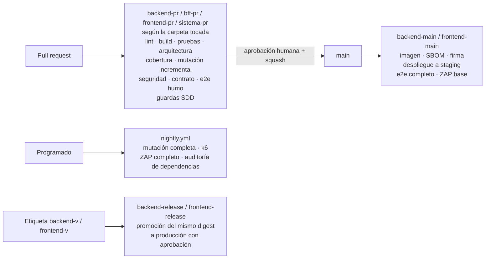

# Arquitectura 04 — Calidad de código, TDD, pruebas y CI

> **Proyecto:** Liquidación del impuesto anual de vehículos automotores
> **Depende de:** `00_Decisiones_y_Hoja_de_Ruta.md` (ADR 0014, 0015, 0016) · `01_Arquitectura_de_Software.md`
> **Versión:** 1.0 — **Aprobado** el 2026-11-01 (ADR 0001–0020 aceptados)

---

## 1. Reglas de código limpio para este proyecto

No se repiten principios genéricos; estas son las reglas concretas que se verifican en revisión y, cuando es posible, con herramientas.

| # | Regla | Verificación |
|---|---|---|
| CC‑01 | Ningún valor tributario en el código (tarifas, rangos, porcentajes, fechas, múltiplos de redondeo). Todo viene de la configuración publicada | ArchUnit (constantes `BigDecimal` en dominio) + revisión |
| CC‑02 | Dinero siempre como `Dinero` (sobre `BigDecimal`); prohibidos `float` y `double` en `domain` y `application` de `tax`, `ledger`, `valuation`, `portfolio`, `jurisdiction` | ArchUnit |
| CC‑03 | Prohibido leer el reloj del sistema en dominio y aplicación: se inyecta un `Clock` | ArchUnit |
| CC‑04 | Objetos inmutables por defecto (*records*); los agregados mutables exponen comandos, no *setters* | Revisión + Sonar |
| CC‑05 | Sin `null` como valor de retorno: `Optional` o tipos de resultado. Anotaciones de nulabilidad verificadas | Error Prone + NullAway |
| CC‑06 | Errores de negocio con código de regla (`LQ-P04`, `R014`); nunca excepciones genéricas para casos de negocio | Revisión + ArchUnit |
| CC‑07 | Controladores sin lógica: traducen la petición, llaman al caso de uso y traducen la respuesta | ArchUnit |
| CC‑08 | Inyección solo por constructor | ArchUnit |
| CC‑09 | Los comentarios explican el **porqué** y citan la regla o norma (`// LQ-C04, Doc. 02 §B.8`); no repiten lo que dice el código | Revisión |
| CC‑10 | Nombres del glosario (doc. 01 §15); un término nuevo se agrega al glosario en el mismo cambio | Revisión |
| CC‑11 | Funciones cortas y de un solo nivel de abstracción; clases de máximo 400 líneas, controladores de 200 y máximo 8 dependencias por constructor, sin listas de excepciones | `CodeSizeGuardTest` + Sonar (complejidad cognitiva) |
| CC‑12 | Código generado (OpenAPI, jOOQ) nunca se edita a mano | Ruta excluida + CODEOWNERS |

---

## 2. Formato, análisis estático y validación de datos

| Ámbito | Herramientas | Momento |
|---|---|---|
| Java | Spotless con Google Java Format (2 espacios), Error Prone + NullAway, Sonar | Gancho de *pre‑commit* (formato) y CI |
| TypeScript / Angular | ESLint (angular‑eslint, reglas de fronteras), Prettier, TypeScript en modo estricto | *Pre‑commit* y CI |
| Hojas de estilo | Stylelint: valores de color, tipografía, espaciado y radio solo por *token*; sin `::ng-deep`; sin sobrescribir clases de `liv-components` | *Pre‑commit* y CI |
| SQL de migraciones | sqlfluff (dialecto PostgreSQL) + convención de nombres de Flyway | CI |
| Configuraciones de jurisdicción | Validación de cada YAML contra el JSON Schema de su `esquema_version` y ejecución del validador CJ | CI del backend para sus configuraciones de prueba y el esquema (`backend/contracts/jsonschema/`); CI de la raíz para los ejemplos de `docs/funcional/anexos/`, contra el esquema publicado |
| OpenAPI | Spectral (estilo y convenciones de doc. 01 §10) + comparador de cambios incompatibles | CI |
| YAML y Markdown | yamllint, markdownlint, verificación de enlaces | CI |
| Commits | commitlint (Conventional Commits) | Gancho `commit-msg` y CI |
| Todo | EditorConfig | Editor |

Los ganchos de Git se gestionan con una herramienta única (lefthook o pre‑commit) instalada en la Fase 0, para que humanos y agentes ejecuten exactamente lo mismo.

---

## 3. Reglas de arquitectura automatizadas

Son pruebas que fallan el build. Constituyen la principal defensa contra la erosión de la arquitectura, venga de humanos o de agentes.

### 3.1 Backend (Spring Modulith + ArchUnit)

| Regla | Detalle |
|---|---|
| Fronteras de módulo | Solo se usa el paquete raíz de otro módulo (fachadas y eventos); sin ciclos (`ModularityTest`) |
| Capas | Los módulos de negocio solo usan `api`, `application`, `domain` e `infrastructure` (`ModuleCatalogTest`). En los módulos hexagonales, `domain` no depende de Spring, JPA ni jOOQ y `application` no depende de `infrastructure`; en todos, `api` no depende de `infrastructure` |
| Dinero y reloj | CC‑02 y CC‑03 |
| Persistencia | Repositorios y jOOQ solo en `infrastructure/persistence` |
| Controladores | Solo dependen de `application` |
| Eventos | Los eventos publicados son *records* inmutables en el paquete raíz del módulo |
| Nombres | Casos de uso, puertos y adaptadores siguen la convención del módulo |
| Inyección | Sin inyección por campo |
| Singleton manual | Sin campos estáticos mutables |

### 3.2 Frontend (ESLint)

| Regla | Detalle |
|---|---|
| Fronteras | Una *feature* no importa otra *feature* |
| Librería de componentes | El frontend importa `liv-components` solo por su API pública (y su tema `liv-components/styles/theme.css`) y nunca archivos de otro proyecto del monorepo. La librería no importa nada de una aplicación, de un cliente de API ni de `HttpClient` |
| Componentes visuales | Los componentes de `features/` solo componen componentes de `liv-components`; un elemento visual reutilizable creado fuera de la librería es una violación (regla de ESLint sobre plantillas + revisión) |
| Acceso a datos | `HttpClient` solo en servicios de datos; los componentes no lo usan |
| Cliente generado | No se edita; solo se importa |
| Seguridad | Prohibido saltar la sanitización de Angular sin excepción aprobada |

---

## 4. Desarrollo guiado por pruebas (TDD)

### 4.1 Ciclo obligatorio

1. **Rojo:** escribir la prueba que expresa la regla de la especificación y verla fallar por el motivo correcto.
2. **Verde:** escribir el código mínimo que la hace pasar.
3. **Refactorizar:** limpiar con todas las pruebas en verde.

| Ámbito | Obligatoriedad |
|---|---|
| `domain` y `application` de todos los módulos | Obligatorio |
| Adaptadores (persistencia, archivos, REST) | Prueba de integración escrita antes o junto con el adaptador |
| Frontend | Obligatorio en servicios y componentes con lógica; pruebas de componente para flujos críticos |
| Configuración e infraestructura | Verificación automática (esquemas, *healthchecks*, e2e de humo) |

### 4.2 Evidencia del ciclo

- En el historial del PR, el commit `test:` con la prueba en rojo precede al commit `feat:` o `fix:` que la pone en verde. Para los agentes es obligatorio (doc. 05).
- La prueba de mutación (§5) detecta pruebas que no verifican nada (tautológicas), un riesgo típico del código generado.

### 4.3 Trazabilidad en las pruebas

- Cada prueba de regla lleva el **código de la regla** en su nombre visible y como etiqueta (p. ej. nombre "LQ‑C04: el descuento por pronto pago no reduce la obligación", etiqueta `LQ-C04`).
- Los criterios de aceptación de los documentos funcionales (`CA-4.01`… y las tablas de "Criterios de aceptación" de los Docs. 01 y 02) se etiquetan igual en las pruebas de integración y e2e.
- Una herramienta en `tools/` cruza los códigos de regla de `docs/funcional/` con las etiquetas de las pruebas y publica la matriz de cobertura de requisitos (doc. 05 §8).

---

## 5. Estrategia de pruebas

| Nivel | Herramientas | Alcance | Ejecución | Objetivo |
|---|---|---|---|---|
| Unitarias de dominio | JUnit 5, AssertJ | Pasos del motor, políticas, máquinas de estado, objetos de valor | Cada commit | Cobertura de líneas ≥ 90 % en `domain` |
| Basadas en propiedades | jqwik | Invariantes: rangos de tarifa continuos y sin solapamiento; Σ imputaciones = pago; redondeo idempotente; distribución suma 100 %; saldo = Σ movimientos | Cada PR | Todas las invariantes de dinero cubiertas |
| *Golden* (ejemplos de la documentación) | JUnit parametrizado con fixtures | Doc. 02 §B.9, Doc. 03 §9.3, Doc. 04 §5.2 y CA‑4.xx: entrada → resultado esperado al peso | Cada PR | 100 % de los ejemplos documentados |
| Mutación | PIT | `domain` de `tax`, `ledger`, `valuation`, `jurisdiction` | Incremental en cada PR; completa nocturna | Puntaje de mutación ≥ 80 % |
| Integración | Testcontainers (PostgreSQL real, MinIO), pruebas de módulo de Spring Modulith | Adaptadores, migraciones, RLS, eventos entre módulos, jobs | Cada PR | Toda migración, política RLS y adaptador cubiertos |
| Seguridad funcional | JUnit parametrizado | Matriz de autorización, aislamiento entre administraciones, segregación de funciones (doc. 02 §4–§5) | Cada PR | 100 % de la matriz |
| Contrato | Spectral, comparador de OpenAPI, validación de respuestas contra el contrato en pruebas de integración | API | Cada PR | Sin cambios incompatibles no aprobados |
| Frontend | Vitest + Angular Testing Library | Servicios, componentes con lógica, formularios | Cada PR | Cobertura ≥ 80 % en código nuevo |
| Librería `liv-components` | Vitest + Angular Testing Library; Storybook; regresión visual con Playwright sobre cada historia; axe‑core sobre cada historia | Cada componente, variante y estado | Cada PR que toque la librería | Cobertura ≥ 90 %; toda variante con historia, captura de referencia y verificación de accesibilidad |
| Fidelidad al diseño | Revisión contra el *frame* de Figma aprobado + capturas de la pantalla en los e2e | Pantallas nuevas o modificadas | Cada PR con pantallas | Sin diferencias visuales frente al diseño aprobado |
| Extremo a extremo | Playwright + axe‑core | Flujos críticos por módulo contra el Compose completo | Humo en cada PR; completa en `main` y nocturna | Cada criterio de aceptación con interfaz tiene un e2e |
| Rendimiento | k6 | Objetivos de doc. 03 §1 | Nocturno y antes de cada versión | Dentro de objetivo |
| Migraciones | Flyway + datos de la versión anterior | Actualización desde la última versión publicada | Cada PR que toque migraciones | Migración y validación sin errores |

### 5.1 Pruebas *golden*

Los ejemplos numéricos de los documentos funcionales son la especificación ejecutable del motor:

- se transcriben a archivos de datos versionados (entrada, configuración usada, resultado esperado);
- la fuente de verdad es el documento funcional: si una regla cambia, se actualiza el documento **y** el archivo *golden* en el mismo cambio;
- se escriben en la Fase 0, en rojo, antes de que exista el motor (F0‑11).

### 5.2 Playwright

| Tema | Definición |
|---|---|
| Entorno | Docker Compose con perfiles `core` + `app` + `seed` (doc. 03 §4.2) |
| Autenticación | Estado de sesión por rol, obtenido una vez con los usuarios de prueba de Keycloak |
| Organización | Por módulo y menú; *fixtures* y objetos de página para pantallas reutilizadas |
| Selectores | `data-testid` estables o roles accesibles; prohibidos selectores por CSS de maquetación |
| Datos | Cada prueba crea sus datos o usa el *seed* versionado; las pruebas son independientes y paralelizables |
| Accesibilidad | Verificación axe‑core en cada pantalla visitada |
| Diagnóstico | Traza, video y captura en fallos, publicados como artefacto de CI |
| Escala | Particionado (*sharding*) en CI |
| Prioridad | Primero los flujos con dinero y segregación: cargar → validar → aprobar (otro usuario) → publicar; liquidar; generar recibo; imputar; reversar |

### 5.3 Datos de prueba

- *Test Data Builders* y *Object Mothers* por módulo, con valores por defecto válidos.
- Contribuyentes, placas y documentos **sintéticos**; las tablas del Ministerio y la configuración de Ipiales se usan tal cual porque son públicas o propias del proyecto.
- Prohibido copiar datos de producción a cualquier entorno de pruebas.

---

## 6. Compuertas de calidad (bloqueantes)

Un PR no se integra si falla cualquiera:

| # | Compuerta | Umbral |
|---|---|---|
| Q01 | Compilación, formato y *lint* | Sin errores |
| Q02 | Pruebas unitarias, de propiedades, *golden*, integración, seguridad funcional y contrato | 100 % en verde; prohibido desactivar pruebas sin *issue* y aprobación |
| Q03 | Reglas de arquitectura (§3) | Sin violaciones |
| Q04 | Cobertura de código nuevo | ≥ 80 % general; ≥ 90 % en `domain` |
| Q05 | Mutación incremental en `domain` crítico | ≥ 80 % |
| Q06 | Sonar | Sin incidencias nuevas críticas o mayores; duplicación < 3 % en código nuevo |
| Q07 | Seguridad (doc. 02 §11 y §13) | Sin críticas ni altas |
| Q08 | OpenAPI | Sin cambios incompatibles no aprobados |
| Q09 | Configuraciones de jurisdicción | Válidas contra su esquema y sin errores CJ |
| Q10 | e2e de humo | En verde |
| Q11 | Trazabilidad SDD | El PR referencia su carpeta `spec/features/NNN-nombre-feature/` con `spec.md` y `plan.md` aprobados (salvo cambios triviales, doc. 05 §3.3) |
| Q12 | Tamaño del PR | Advertencia sobre 400 líneas cambiadas (sin contar código generado); requiere justificación |
| Q13 | Commits | Conventional Commits |
| Q14 | Librería `liv-components` | Toda variante tiene historia; regresión visual sin diferencias no aprobadas (una diferencia esperada se aprueba actualizando la captura de referencia, con visto bueno del líder de frontend y de un responsable funcional); accesibilidad sin errores |
| Q15 | Diseño previo | Todo PR que agregue una ruta o pantalla nueva tiene en el `plan.md` de su feature un enlace a un *frame* de Figma aprobado o la declaración de reutilización de estructura (01 §11.2) |

Los umbrales solo se modifican mediante ADR. Bajarlos para "hacer pasar" un PR está prohibido.

---

## 7. Definición de terminado (general)

Un cambio está terminado cuando:

- cumple todos los requisitos de su especificación y cada uno tiene una prueba en verde que lo demuestra;
- todas las compuertas de §6 están en verde;
- la documentación afectada está actualizada (funcional, arquitectura, ADR, glosario, *runbooks*);
- `ESTADO.md` refleja el nuevo estado de la tarea y su entrada en la bitácora;
- un humano revisó y aprobó el PR (dos humanos en rutas críticas, §8);
- la feature está cerrada: criterios de `spec.md` marcados y feature en "Hecho" en `spec/constitution/roadmap.md` (doc. 05 §3).

---

## 8. Flujo de Git

| Tema | Definición |
|---|---|
| Modelo | *Trunk‑based development*: `main` siempre desplegable; ramas cortas (≤ 2 días de vida ideal) |
| Nombres de rama | `<tipo>/<NNN-nombre-feature>-<proyecto>` (p. ej. `feat/003-cargue-tablas-avaluos-backend`); los cambios triviales usan `<tipo>/<descripcion-corta>` |
| Integración | Solo por PR; *squash merge*; prohibido el *push* directo a `main` |
| Aprobaciones | 1 humano como mínimo; **2** en rutas críticas definidas en CODEOWNERS: motor de liquidación (`tax`), `ledger`, `jurisdiction`, seguridad, migraciones, contratos OpenAPI, workflows de CI |
| Commits | Conventional Commits, en español o inglés de forma consistente (a decidir en la Fase 0) |
| Versiones | Etiquetas semánticas **por proyecto** (`backend-vX.Y.Z`, `frontend-vX.Y.Z`); *changelog* y notas de versión por proyecto, generados automáticamente |
| Alcance de un PR | Un PR toca un solo proyecto (`backend/`, `frontend/` o la raíz). Una feature que cambia backend y frontend se entrega en PR separados, primero el del contrato (doc. 01 §14.1, IN‑07) |
| Protección | Reglas de rama con las compuertas de §6 como verificaciones requeridas; historial lineal |

---

## 9. Pipelines de GitHub Actions

| Workflow | Disparador | Trabajos | Notas |
|---|---|---|---|
| `backend-pr.yml` · `bff-pr.yml` · `frontend-pr.yml` · `ui-pr.yml` · `sistema-pr.yml` | PR hacia `main`, con filtro de ruta (`backend/**`, `backend/bff/**`, `frontend/**`, `ui/**`, resto) | Cada uno solo con los trabajos de su proyecto: backend (build, pruebas, arquitectura, contrato OpenAPI, esquema de configuración, seguridad); BFF (`backend/bff/`, proyecto Maven aparte: build, formato, pruebas, arquitectura); frontend (build, pruebas, seguridad); ui (build, *lint*, pruebas, historias, regresión visual y accesibilidad de la librería, empaquetado); sistema (`docs`, ejemplos de configuración, `sdd-guard`, e2e de humo) | Los workflows de un proyecto solo ejecutan *scripts* de su carpeta (doc. 01 §14.1, IN‑08). Una nueva versión de `liv-components` adoptada por el frontend ejecuta además el e2e **completo**, porque afecta a todas las pantallas |
| `backend-main.yml` · `frontend-main.yml` | *Push* a `main` con cambios en su proyecto | Construcción de su imagen, SBOM, firma, publicación (el backend publica además el OpenAPI versionado), despliegue de ese proyecto a *staging*; luego e2e completo y ZAP de línea base | Un fallo en *staging* bloquea la promoción |
| `nightly.yml` | Programado | Mutación completa, rendimiento, ZAP completo, Trivy completo, verificación de enlaces de documentación | Crea *issues* automáticamente |
| `backend-release.yml` · `frontend-release.yml` | Etiqueta `backend-vX.Y.Z` o `frontend-vX.Y.Z` | Promoción a producción del *digest* probado de ese proyecto; migraciones (backend); verificación posterior | Entorno protegido con aprobación manual; cada proyecto se publica por separado |
| `ui-release.yml` | Etiqueta `ui-vX.Y.Z` | Compila y publica `liv-components` en npm con un *token* guardado como secreto; la versión de la etiqueta debe coincidir con la del `package.json` de la librería | Entorno protegido con aprobación manual; mientras no exista, publica un humano con `npm run release` |
| `sdd-guard` (trabajo dentro de `pr.yml`) | Cada PR | Verifica la referencia a la carpeta de la feature, que los archivos tocados estén dentro del alcance declarado en su `tasks.md`, que no se toquen rutas protegidas sin aprobación (doc. 05 §5) y que toda pantalla nueva tenga su diseño o su declaración de reutilización (Q15) | Clave contra el *vibe coding* |

**Portabilidad (P4):** el repositorio está en GitHub y podría migrar a Bitbucket. por eso la lógica de cada paso vive en comandos de Maven, *scripts* de npm y herramientas de `tools/`, y los workflows solo las orquestan. Migrar a Bitbucket Pipelines debe ser reescribir la orquestación, no la lógica. Lo que solo existe en GitHub (entornos protegidos, *dependency review*, CodeQL, *secret scanning*) tiene que tener un equivalente identificado antes de migrar.

**Buenas prácticas de los workflows:**

- acciones de terceros fijadas por SHA;
- `permissions` mínimos por workflow;
- autenticación por OIDC con AWS (rol de IAM por entorno) y con ECR, sin claves de larga duración;
- caché de Maven y npm;
- `concurrency` para cancelar ejecuciones obsoletas del mismo PR;
- workflows reutilizables para no duplicar pasos entre backend y frontend;
- los workflows son ruta crítica: cambios con dos aprobaciones.
