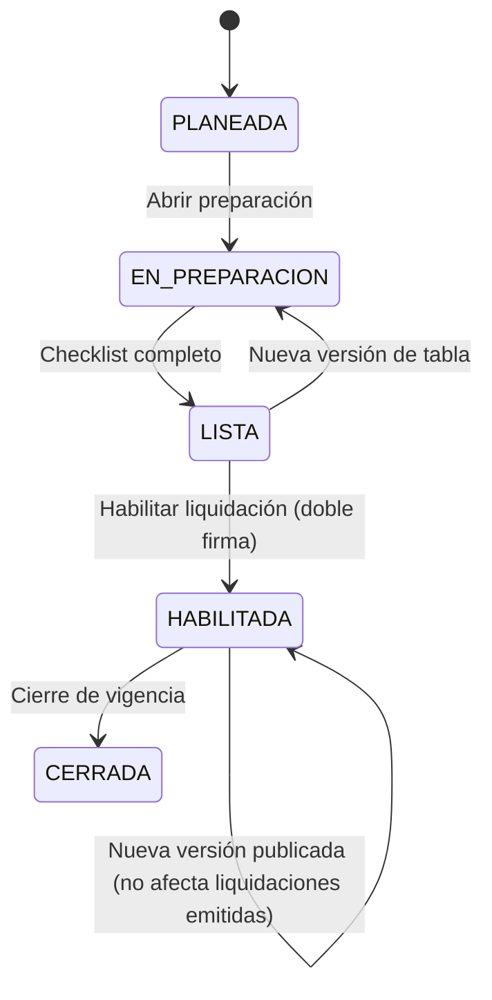
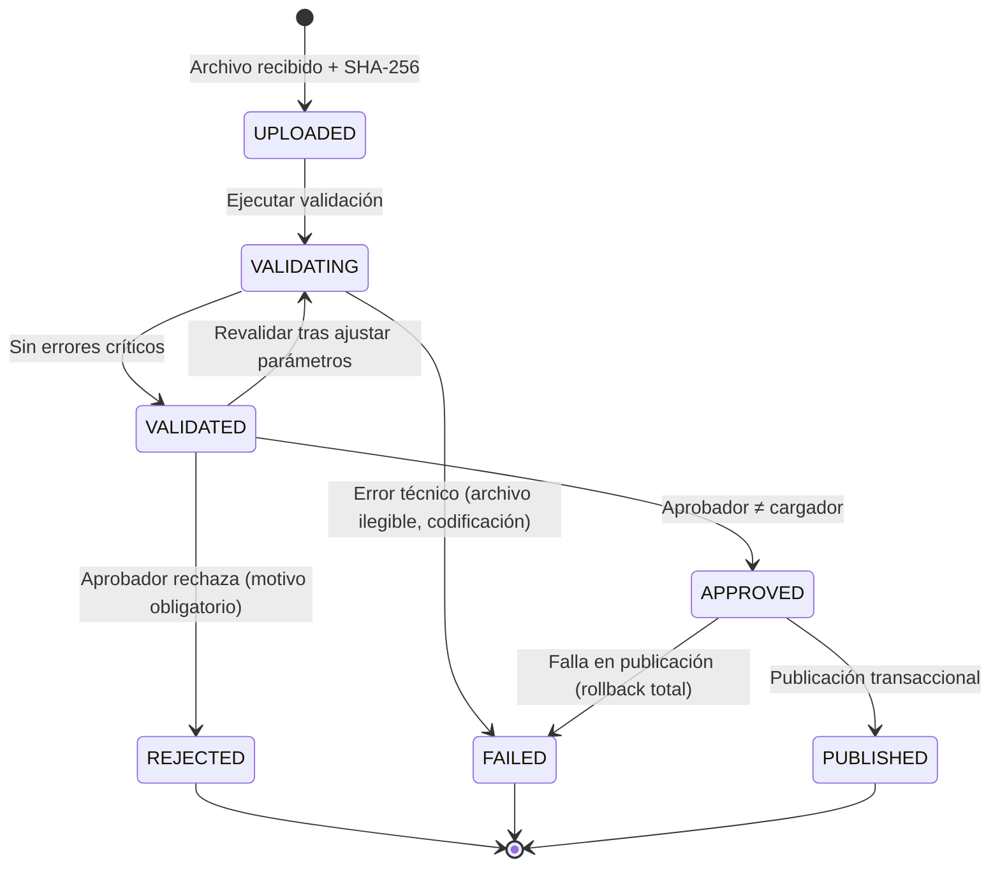

# Módulo 1 — Menú del sistema y cargue anual de tablas base de liquidación

> **Proyecto:** Liquidación del impuesto anual de vehículos automotores
> **Documento base:** `ERD_impuesto_vehicular_definitivo_v2_CSV_cartera.md` (79 tablas desde su versión 2.2, esquemas `core`, `documents`, `valuation`, `tax`, `ledger`, `portfolio`, `collection`, `enforcement`, `audit`)
> **Alcance de esta entrega:** (1) lógica de negocio general y mapa de menú, (2) detalle de **Administración → Cargue de tablas base por vigencia**, (3) consultas con filtros y exportación a Excel del proceso de cargue.
> **Versión:** 0.4 — el menú 5 (§3) remite al Doc. 05 y agrega su opción 5.6, y el documento base pasa a las 79 tablas del ERD 2.2 (feature 005). La versión 0.3 agregó la matriz de permisos de consulta del menú (§4.1), aprobada en H2 de la feature 001 (2026-11-01). La versión 0.2 la ajustó con la estructura real de las tablas 2026 y la configuración por jurisdicción (Doc. 03)

---

## 1. Objetivo

Disponer de un proceso controlado, auditable e idempotente para incorporar **año por año** las tablas oficiales con las que se liquida el impuesto:

| Tabla base | Fuente | Destino en el modelo |
|---|---|---|
| Base gravable / avalúos comerciales por marca, línea, clase, cilindraje y año modelo | Resolución anual del Ministerio de Transporte (anexo CSV/Excel + PDF) | `valuation.valuation_catalog` → `valuation.valuation_catalog_entry` → `valuation.vehicle_valuation` |
| Rangos de avalúo y tarifas | Norma vigente para la vigencia (a confirmar fuente exacta por año) | `tax.tax_rate` |
| Calendario de vencimientos y descuentos | Acto de la administración territorial | `tax.tax_calendar` |
| Beneficios / descuentos autorizados | Acto de la administración territorial | `tax.tax_benefit` |

La liquidación (`tax.tax_assessment`) **solo puede ejecutarse** sobre una vigencia cuyas tablas base estén **publicadas** y cuya vigencia tenga `assessments_enabled = true`.

---

## 2. Principios de negocio transversales

1. **Inmutabilidad de lo publicado:** un catálogo `PUBLISHED` nunca se modifica. Cualquier corrección genera una nueva versión (`version_number + 1`) y la anterior pasa a `SUPERSEDED`. Las liquidaciones ya emitidas conservan el `valuation_id` con el que se calcularon.
2. **Staging obligatorio:** ningún archivo escribe directamente en tablas productivas; pasa por `valuation_import_batch` / `valuation_import_row` / `valuation_import_error`.
3. **Segregación de funciones:** quien carga (`uploaded_by`) no puede aprobar (`approved_by`) el mismo lote.
4. **Trazabilidad completa:** archivo original en almacenamiento documental con SHA‑256, fila física de origen, columna/encabezado de origen de cada avalúo, unidad monetaria y norma de soporte.
5. **Idempotencia:** un mismo archivo (mismo `file_sha256`) no puede publicarse dos veces en el mismo catálogo y versión.
6. **Coherencia de vigencia:** `vehicle_reference_match.fiscal_year` debe coincidir con `valuation_catalog.fiscal_year` del avalúo seleccionado.
7. **Aislamiento territorial:** toda operación se filtra por la `administration_id` del usuario (RLS).
8. **Soporte normativo:** el CSV no sustituye la resolución; publicar exige `legal_instrument_id` registrado con su PDF.
9. **Auditoría:** toda acción (carga, validación, aprobación, rechazo, publicación, exportación) se registra en `audit.audit_event`.

---

## 3. Mapa general del menú

```
SISTEMA DE LIQUIDACIÓN DE IMPUESTO VEHICULAR
│
├── 1. ADMINISTRACIÓN                                  ← (detallado en este documento)
│   ├── 1.1 Entidades y administraciones tributarias   core.territorial_entity / core.tax_administration
│   ├── 1.2 Usuarios, roles y permisos                 core.admin_user
│   ├── 1.3 Normas y soportes                          documents.legal_instrument / documents.document
│   ├── 1.4 Vigencias fiscales                         tax.fiscal_year
│   ├── 1.5 Cargue de tablas base por vigencia  ★
│   │   ├── 1.5.1 Asistente de preparación de vigencia (checklist)
│   │   ├── 1.5.2 Catálogos de avalúos (versiones)
│   │   ├── 1.5.3 Cargar archivo de avalúos (CSV)
│   │   ├── 1.5.4 Bandeja de lotes (validar / aprobar / publicar / rechazar)
│   │   ├── 1.5.5 Tarifas por rango                    tax.tax_rate
│   │   ├── 1.5.6 Calendario tributario                tax.tax_calendar
│   │   ├── 1.5.7 Beneficios y descuentos              tax.tax_benefit
│   │   ├── 1.5.8 Reglas de sanción                    tax.penalty_rule
│   │   └── 1.5.9 Configuración de jurisdicción (YAML) core.jurisdiction_config — incluye competencia, calendario y plazos (Doc. 03 §5 y §9)
│   ├── 1.6 Consultas y exportación de tablas base ★
│   │   ├── 1.6.1 Consulta de lotes de importación
│   │   ├── 1.6.2 Consulta de filas en staging
│   │   ├── 1.6.3 Consulta de errores y advertencias
│   │   ├── 1.6.4 Consulta de catálogo publicado (avalúos)
│   │   ├── 1.6.5 Comparativo entre vigencias / versiones
│   │   ├── 1.6.6 Consulta de tarifas y calendario
│   │   └── 1.6.7 Reporte mensual SIBGA (art. 11 Res. 2026)   (ver Doc. 03 §6)
│   ├── 1.7 Referencias vehiculares normalizadas       valuation.vehicle_reference
│   └── 1.8 Parámetros generales (redondeo, multiplicadores, separadores por defecto)
│
├── 2. REGISTRO AUTOMOTOR Y CONTRIBUYENTES
│   ├── 2.1 Vehículos · 2.2 Matrículas/traslados · 2.3 Contribuyentes
│   ├── 2.4 Propietarios/poseedores · 2.5 Estado tributario del vehículo
│   └── 2.6 Homologación vehículo ↔ avalúo (vehicle_reference_match)
│
├── 3. LIQUIDACIÓN
│   ├── 3.1 Liquidación individual · 3.2 Liquidación masiva por vigencia
│   ├── 3.3 Simulador · 3.4 Declaraciones privadas · 3.5 Determinación oficial
│
├── 4. CUENTA CORRIENTE Y RECAUDO                    (detalle en Doc. 04)
│   ├── 4.1 Obligaciones · 4.2 Recibos y pagos · 4.3 Imputación · 4.4 Saldos a favor · 4.5 Distribución
│   ├── 4.6 Control de participación 20 % (solo si la modalidad PARTICIPACION_20 está activa)
│   └── 4.7 Consultas, estado de cuenta, paz y salvo y exportación a Excel
│
├── 5. CARTERA                                       (detalle en Doc. 05)
│   ├── 5.1 Apertura de cartera histórica (lote independiente)
│   ├── 5.2 Intereses de mora · 5.3 Sanciones · 5.4 Prescripción · 5.5 Cortes de cartera
│   └── 5.6 Consultas y exportación a Excel
│
├── 6. COBRO (persuasivo / coactivo) · 7. MEDIDAS CAUTELARES
│
├── 8. DOCUMENTOS Y NOTIFICACIONES
│
└── 9. AUDITORÍA E INTEGRACIONES
    ├── 9.1 Bitácora de eventos · 9.2 Integraciones externas (RUNT, bancos)
```

> Los módulos 2 a 9 se detallarán en entregas posteriores. Aquí solo se fija su ubicación para que el diseño del módulo 1 sea consistente.

---

## 4. Roles y permisos del módulo

| Rol | Descripción | Permisos clave |
|---|---|---|
| `ADMIN_SISTEMA` | Configura entidades, usuarios, parámetros | Todo lo de configuración; **no** aprueba lotes por defecto |
| `CARGADOR_TABLAS` | Funcionario que recibe y carga los archivos | Crear catálogo borrador, cargar CSV, ejecutar validación, corregir parámetros de formato, anular lote propio no aprobado |
| `APROBADOR_TABLAS` | Responsable técnico‑jurídico | Revisar, aprobar, rechazar, publicar; **no puede** aprobar lotes que él mismo cargó |
| `CONSULTA` | Usuarios de liquidación, cartera, control interno | Consultas y exportación a Excel (solo datos de su administración) |
| `AUDITOR` | Control interno / auditoría | Consultas, exportación, bitácora completa, descarga del archivo original |

**Matriz de acciones**

| Acción | ADMIN | CARGADOR | APROBADOR | CONSULTA | AUDITOR |
|---|:-:|:-:|:-:|:-:|:-:|
| Crear / abrir vigencia fiscal | ✔ | | | | |
| Registrar norma y adjuntar PDF | ✔ | ✔ | ✔ | | |
| Crear catálogo (versión borrador) | | ✔ | | | |
| Cargar CSV | | ✔ | | | |
| Validar lote | | ✔ | ✔ | | |
| Aprobar / rechazar lote | | | ✔ (≠ cargador) | | |
| Publicar catálogo | | | ✔ | | |
| Habilitar liquidación de la vigencia | ✔ + APROBADOR (doble firma) | | | | |
| Consultar y exportar | ✔ | ✔ | ✔ | ✔ | ✔ |
| Descargar archivo original | | ✔ | ✔ | | ✔ |

### 4.1 Permisos de consulta del menú (feature 001)

Qué opciones del menú ve cada rol. La aprobó el responsable en H2 de la feature 001 (2026-11-01), como pide `docs/arquitectura/02` §4.4. Vive en `platform.role_permission`. Una prueba la compara con una tabla esperada escrita en las pruebas, que debe mantenerse igual a esta: si cambia una, cambia la otra. Las acciones de cada opción (cargar, aprobar, publicar…) las definen sus features. «Origen» dice de dónde sale cada fila: de un documento funcional, de una propuesta o es provisional hasta su módulo.

| Opción | Permiso | Roles | Origen |
|---|---|---|---|
| 1.1 Entidades y administraciones | `core.administration.read` | ADMIN_SISTEMA, AUDITOR | Propuesta |
| 1.2 Usuarios, roles y permisos | `core.user.read` | ADMIN_SISTEMA, AUDITOR | Propuesta |
| 1.3 Normas y soportes | `documents.legal-instrument.read` | ADMIN_SISTEMA, CARGADOR_TABLAS, APROBADOR_TABLAS, CONSULTA, AUDITOR | Derivado de §4 («Consultar y exportar») |
| 1.4 Vigencias fiscales | `tax.fiscal-year.read` | ADMIN_SISTEMA, CARGADOR_TABLAS, APROBADOR_TABLAS, CONSULTA, AUDITOR | Derivado de §4 («Consultar y exportar») |
| 1.5 Cargue de tablas base (1.5.1–1.5.8) | `valuation.batch.read` · `tax.rate.read` | ADMIN_SISTEMA, CARGADOR_TABLAS, APROBADOR_TABLAS, CONSULTA, AUDITOR | Derivado de §4 («Consultar y exportar») |
| 1.5.9 Configuración de jurisdicción | `jurisdiction.config.read` | ADMIN_SISTEMA, CARGADOR_TABLAS, APROBADOR_TABLAS, JURIDICO, AUDITOR | Derivado de §4 + propuesta (JURIDICO por Doc. 03 §5.3) |
| 1.6 Consultas y exportación | `valuation.catalog.read` | ADMIN_SISTEMA, CARGADOR_TABLAS, APROBADOR_TABLAS, CONSULTA, AUDITOR | Derivado de §4 («Consultar y exportar») |
| 1.7 Referencias vehiculares | `valuation.vehicle-reference.read` | ADMIN_SISTEMA, CARGADOR_TABLAS, APROBADOR_TABLAS, CONSULTA, AUDITOR | Derivado de §4 («Consultar y exportar») |
| 1.8 Parámetros generales | `core.parameter.read` | ADMIN_SISTEMA, AUDITOR | Propuesta |
| 2. Registro automotor y contribuyentes | `core.vehicle.read` | LIQUIDADOR, APROBADOR_LIQUIDACION, RECAUDO, CONSULTA, AUDITOR | Propuesta |
| 3. Liquidación | `tax.assessment.read` | LIQUIDADOR, APROBADOR_LIQUIDACION, CONSULTA, AUDITOR | Propuesta |
| 4. Cuenta corriente y recaudo | `ledger.obligation.read` | RECAUDO, TESORERIA, APROBADOR_RECAUDO, CONSULTA, AUDITOR | Doc. 04 §10 + propuesta (AUDITOR por `docs/arquitectura/02` §4.2) |
| 5. Cartera | `portfolio.balance.read` | RECAUDO, TESORERIA, APROBADOR_RECAUDO, JURIDICO, CONSULTA, AUDITOR | Provisional |
| 6. Cobro · 7. Medidas cautelares | `collection.case.read` · `enforcement.measure.read` | JURIDICO, AUDITOR | Provisional |
| 8. Documentos y notificaciones | `documents.document.read` | Todos los roles | Provisional |
| 9. Auditoría e integraciones | `audit.event.read` | AUDITOR, ADMIN_SISTEMA | `docs/arquitectura/02` §9 (AUDITOR) + propuesta (ADMIN_SISTEMA) |

- Un módulo se muestra si el rol puede ver al menos una de sus opciones. «Inicio» no exige permiso.
- Una opción que aún no está construida se muestra deshabilitada; abierta por URL, dice «Próximamente».
- Una opción sin permiso, abierta por URL o por su API, responde «Sin permiso» (403), aunque esté oculta en el menú.

---

## 5. Opción 1.4 — Vigencias fiscales (prerrequisito)

**Tabla:** `tax.fiscal_year (year PK, starts_on, ends_on, status, assessments_enabled)`

**Estados de la vigencia**



**Reglas**

- V‑01: `year` único; `starts_on` = 1 de enero y `ends_on` = 31 de diciembre del año (parametrizable si la norma lo exige).
- V‑02: no se puede crear la vigencia N+1 si la N no existe (salvo carga histórica autorizada).
- V‑03: `assessments_enabled = true` solo si el checklist 1.5.1 está completo.
- V‑04: una vigencia `CERRADA` no admite nuevos catálogos; correcciones posteriores requieren reapertura justificada y auditada.

---

## 6. Opción 1.5 — Cargue de tablas base por vigencia

### 6.1 Asistente de preparación de vigencia (1.5.1)

Pantalla tipo checklist por `fiscal_year` + `administration_id`. Cada ítem muestra estado (✔ / pendiente / con observación) y enlace a la opción correspondiente.

| # | Requisito | Verificación automática |
|---|---|---|
| 1 | Vigencia creada en estado `EN_PREPARACION` | `tax.fiscal_year.status` |
| 2 | Resolución de avalúos registrada con PDF | `documents.legal_instrument` + `documents.document` con SHA‑256 |
| 3 | Catálogo de avalúos **publicado** para la vigencia | Existe `valuation_catalog` con `import_status = PUBLISHED` y `fiscal_year = N` |
| 4 | Tarifas por rango registradas y sin solapamientos | `tax.tax_rate` cubre de 0 a ∞ sin huecos ni traslapes por `vehicle_category` |
| 5 | Calendario tributario registrado | `tax.tax_calendar` con `payment_deadline` |
| 6 | Beneficios configurados (opcional) | `tax.tax_benefit` |
| 7 | Reglas de sanción (opcional para liquidación inicial) | `tax.penalty_rule` |
| 8 | Prueba de liquidación de muestra sin errores | Simulación sobre N vehículos aleatorios |
| 9 | Configuración de jurisdicción publicada (obligatorio) | `core.jurisdiction_config` con `status = PUBLICADA` para la vigencia (Doc. 03 §5) |

Al completar 1–5, 8 y 9, el botón **“Habilitar liquidación”** queda activo (requiere ADMIN + APROBADOR).

### 6.2 Catálogos de avalúos — versiones (1.5.2)

**Tabla:** `valuation.valuation_catalog`

Campos que captura el usuario al crear la versión:

| Campo | Obligatorio | Regla |
|---|:-:|---|
| `fiscal_year` | ✔ | Vigencia existente, no cerrada |
| `legal_instrument_id` | ✔ | Resolución del Ministerio registrada en 1.3 |
| `catalog_name` | ✔ | Sugerido: `AVALUOS_{AÑO}_v{N}` |
| `source_url` | | URL oficial de publicación |
| `version_number` | auto | `max(version_number)+1` para la vigencia |
| `import_status` | auto | Inicia en `DRAFT` |

**Estados del catálogo:** `DRAFT` → `PUBLISHED` → `SUPERSEDED`  (o `DRAFT` → `DISCARDED`).

- C‑01: solo puede haber **un** catálogo `PUBLISHED` vigente por `fiscal_year` (y administración, si aplica tabla territorial).
- C‑02: al publicar la versión N, la versión N‑1 pasa a `SUPERSEDED` en la misma transacción.
- C‑03: una versión `SUPERSEDED` sigue consultable y referenciada por liquidaciones antiguas.

### 6.3 Cargar archivo de avalúos (1.5.3)

> **Actualización (Doc. 03 §3):** las tablas oficiales llegan en **XLSX** (9 archivos, hoja `Bases Gravables`, encabezado en filas 4–5, datos desde la fila 6), y el importador las acepta de forma nativa. El **multiplicador monetario es 1000** y se toma de la configuración de jurisdicción. La **llave de la referencia es el CTR**. El layout real de columnas reemplaza la tabla supuesta de esta sección.

**Asistente en 5 pasos**

| Paso | Pantalla | Acción del sistema |
|---|---|---|
| 1. Seleccionar catálogo | Lista de catálogos `DRAFT` de la vigencia | Valida que no tenga otro lote en curso |
| 2. Subir archivo | Arrastrar/seleccionar `.csv` (y opcional `.xlsx` que se convierte a CSV) | Calcula SHA‑256, guarda en almacenamiento documental (`source_storage_key`), crea `valuation_import_batch` en `UPLOADED` |
| 3. Parámetros de formato | Codificación (UTF‑8 por defecto, detecta BOM), delimitador (`;` / `,`), separador decimal, **multiplicador monetario** (1 = pesos, 1000 = miles de pesos), fila de encabezado | Autodetección con posibilidad de corrección manual |
| 4. Mapeo de columnas | Columnas detectadas ↔ campos del modelo; detección de columnas **año modelo** (encabezados numéricos de 4 dígitos, p. ej. `2010 … 2027`) | Guarda plantilla de mapeo reutilizable por año |
| 5. Vista previa | Primeras 50 filas originales y normalizadas, conteo de años modelo detectados | Botón **“Ejecutar validación”** |

**Estructura esperada del archivo (layout lógico — a confirmar con el anexo real)**

| Campo origen | Campo destino | Tipo | Obligatorio |
|---|---|---|:-:|
| Código Ministerio | `catalog_entry.ministry_reference_code` | VARCHAR(50) | ✔ |
| Clase | `original_vehicle_class` | VARCHAR(60) | ✔ |
| Marca | `original_brand` | VARCHAR(100) | ✔ |
| Línea | `original_line` | VARCHAR(150) | ✔ |
| Cilindraje | `original_engine_cc` | INTEGER | ✔ (salvo eléctricos/remolques) |
| Carrocería | `vehicle_reference.body_type` | VARCHAR(50) | |
| Combustible | `vehicle_reference.fuel_type` | VARCHAR(30) | |
| Servicio | `vehicle_reference.service_type` | VARCHAR(30) | |
| Columnas `AAAA` (una por año modelo) | `vehicle_valuation.model_year` + `commercial_value` (× multiplicador) + `source_column` + `source_value` | NUMERIC(18,2) | Al menos una con valor |

**Normalización:** cada fila del CSV genera 1 `valuation_import_row` y, en `normalized_data` (JSONB), un arreglo con un elemento por año modelo con valor:

```json
{
  "ministry_reference_code": "01234567",
  "brand": "MARCA X", "line": "LINEA Y", "vehicle_class": "AUTOMOVIL", "engine_cc": 1600,
  "valuations": [
    {"model_year": 2024, "source_column": "2024", "source_value": "58.300", "commercial_value": 58300000.00},
    {"model_year": 2023, "source_column": "2023", "source_value": "54.100", "commercial_value": 54100000.00}
  ]
}
```

### 6.4 Flujo de estados del lote de importación



- L‑01: un lote con **≥ 1 error de severidad `ERROR`** no puede pasar a `VALIDATED` (queda en `VALIDATED_WITH_ERRORS` para consulta, sin opción de aprobar).
- L‑02: las **advertencias** (`WARNING`) permiten aprobar solo si el aprobador marca *“Revisé las advertencias”* y registra observación.
- L‑03: `REJECTED` y `FAILED` son terminales; para reintentar se crea un lote nuevo (el archivo puede ser el mismo).
- L‑04: no puede haber dos lotes activos (`UPLOADED`…`APPROVED`) sobre el mismo catálogo.

### 6.5 Reglas de validación (motor de validación)

> **Actualización (Doc. 03 §3.3):** se agregan F009, F010 (control del multiplicador por mediana del lote), F011 y R014–R018, y R009 se ajusta a un rango extremo. Aplicadas a las tablas 2026: 0 errores, 13 advertencias.

Cada hallazgo se graba en `valuation_import_error (error_code, field_name, description, severity)`.

**A. Validaciones de archivo**

| Código | Regla | Severidad |
|---|---|---|
| `F001` | Archivo vacío o sin filas de datos | ERROR (lote → FAILED) |
| `F002` | Codificación no decodificable con la declarada | ERROR (FAILED) |
| `F003` | SHA‑256 ya publicado en otro catálogo de la misma vigencia | ERROR |
| `F004` | SHA‑256 ya publicado en vigencia distinta | WARNING (posible archivo equivocado) |
| `F005` | Falta columna obligatoria (código, marca, línea, clase) | ERROR |
| `F006` | No se detectó ninguna columna de año modelo | ERROR |
| `F007` | Año modelo de encabezado > vigencia + 1 o < vigencia − 40 | WARNING |
| `F008` | Número de columnas inconsistente entre filas | ERROR en la fila afectada |

**B. Validaciones por fila**

| Código | Regla | Severidad |
|---|---|---|
| `R001` | Código Ministerio vacío | ERROR |
| `R002` | Código Ministerio duplicado dentro del archivo | ERROR |
| `R003` | Marca / línea / clase vacías | ERROR |
| `R004` | Cilindraje no numérico o negativo | ERROR |
| `R005` | Cilindraje = 0 en clase que no lo admite | WARNING |
| `R006` | Fila sin ningún valor de año modelo | ERROR |
| `R007` | Valor no numérico tras aplicar separadores | ERROR |
| `R008` | Valor ≤ 0 | ERROR |
| `R009` | Valor fuera de rango esperado (p. ej. < $1.000.000 o > $5.000.000.000 tras multiplicador) | WARNING (indica multiplicador errado) |
| `R010` | Para un mismo código, avalúo de año modelo más antiguo **mayor** que el más reciente | WARNING |
| `R011` | Clase no existe en el catálogo de clases homologadas | WARNING (se crea homologación pendiente) |
| `R012` | Variación vs. vigencia anterior del mismo código > ±30 % | WARNING |
| `R013` | Código existía en la vigencia anterior y no aparece en la actual | Informativo (reporte de bajas) |

**C. Validaciones de conjunto (totales)**

| Código | Regla | Severidad |
|---|---|---|
| `T001` | `total_rows` ≠ `valid_rows + error_rows` | ERROR técnico |
| `T002` | Total de avalúos normalizados ≠ suma de celdas con valor | ERROR técnico |
| `T003` | Unicidad `(catalog_id, ministry_reference_code, model_year)` | ERROR |

Al terminar la validación se actualizan en el lote: `total_rows`, `valid_rows`, `error_rows`, `warning_rows`, y se presenta un **resumen** con: filas leídas, referencias únicas, avalúos generados, rango de años modelo, mínimo/máximo/promedio por clase, conteo de errores por código.

### 6.6 Bandeja de lotes: aprobación y publicación (1.5.4)

**Pantalla de aprobación** (solo `APROBADOR_TABLAS`, distinto del cargador):

- Resumen del lote y del catálogo destino.
- Enlace a la resolución (PDF) para contraste.
- Muestra aleatoria de 20 referencias con su valor normalizado para cotejo visual contra el PDF.
- Comparativo con la vigencia anterior (altas, bajas, variaciones > umbral).
- Lista de advertencias con check de revisión.
- Botones: **Aprobar** / **Rechazar** (motivo obligatorio) / **Exportar resumen a Excel**.

**Publicación transaccional (una sola transacción):**

1. Bloquear catálogo (`SELECT … FOR UPDATE`) y verificar `import_status = DRAFT` y lote `APPROVED`.
2. Verificar idempotencia: no existe publicación con mismo `file_sha256` + `catalog_id` + `version_number`.
3. Por cada fila válida:
   - Buscar o crear `vehicle_reference` (normalizando marca, línea, clase, cilindraje, carrocería, combustible, servicio).
   - Insertar `valuation_catalog_entry` con datos originales, `source_sheet`, `source_row_number`, `row_checksum`.
   - Insertar un `vehicle_valuation` por año modelo (`status = ACTIVE`, `valuation_method = OFFICIAL_TABLE`, `source_column`, `source_value`).
4. Verificar totales (entradas = filas válidas; avalúos = celdas válidas).
5. Marcar versión anterior `SUPERSEDED`, catálogo actual `PUBLISHED` con `approved_by`, `approved_at`, `imported_at`, `file_sha256`.
6. Lote → `PUBLISHED`. Registrar `audit_event`.
7. Si cualquier paso falla → **ROLLBACK total**, lote → `FAILED` con detalle.

### 6.7 Tarifas, calendario, beneficios y sanciones (1.5.5 – 1.5.8)

Se registran por vigencia mediante formulario o carga simple (CSV/Excel), con el mismo patrón de staging cuando la carga es por archivo.

**Tarifas (`tax.tax_rate`)**

| Regla | Descripción |
|---|---|
| TR‑01 | Por `fiscal_year` + `administration_id` + `vehicle_category`, los rangos `[base_min, base_max]` no se solapan ni dejan huecos; el último rango puede tener `base_max` nulo (∞). |
| TR‑02 | `rate` expresado como fracción (0,015 = 1,5 %), con 6 decimales. |
| TR‑03 | `legal_instrument_id` obligatorio. |
| TR‑04 | Opción **“Copiar desde vigencia anterior”** para iniciar el registro, quedando en borrador hasta ajustar valores y aprobar. |

**Calendario (`tax.tax_calendar`):** `discount_deadline ≤ payment_deadline`; ambas dentro o después de la vigencia; un registro por `taxpayer_group` (p. ej. último dígito de placa) si aplica.

**Beneficios (`tax.tax_benefit`) y sanciones (`tax.penalty_rule`):** soporte normativo obligatorio; intervalos `valid_from/valid_to` sin solapamientos por tipo.

---

## 7. Opción 1.6 — Consultas con filtros y exportación a Excel

### 7.1 Comportamiento común a todas las consultas

- **Filtros** combinables (AND), con chips visibles y botón “Limpiar”.
- **Paginación** del lado servidor (25 / 50 / 100 / 500 filas), ordenamiento por cualquier columna.
- **Búsqueda rápida** de texto libre sobre campos marcados como buscables.
- **Seguridad:** RLS por `administration_id`; el auditor puede ver todas las de su entidad territorial.
- **Exportar a Excel (.xlsx)** de **todo el resultado filtrado** (no solo la página visible):
  - Hoja 1 **“Parámetros”**: nombre de la consulta, filtros aplicados, usuario, fecha/hora, número de registros, hash del catálogo/lote consultado.
  - Hoja 2 **“Datos”**: encabezados en español, fila congelada, autofiltro, columnas monetarias como **número** con formato `#,##0.00`, fechas como fecha real, códigos como texto (para no perder ceros iniciales).
  - Si el resultado supera 1.000.000 filas → se divide en hojas `Datos_1`, `Datos_2`…
  - Hasta 50.000 filas: descarga inmediata. Más de 50.000: **exportación en segundo plano** con notificación y enlace de descarga (vigencia 7 días).
  - Nombre del archivo: `{consulta}_{vigencia}_{aaaammdd_hhmm}.xlsx`.
  - Cada exportación genera `audit_event` con `operation = EXPORT` y los filtros en `new_values`.
- Opción secundaria de exportar a **CSV** (UTF‑8 con BOM, `;`) para volúmenes muy grandes.

### 7.2 1.6.1 Consulta de lotes de importación

**Fuente:** `valuation_import_batch` ⋈ `valuation_catalog` ⋈ `admin_user`

| Filtro | Tipo |
|---|---|
| Vigencia (`fiscal_year`) | Selector múltiple |
| Catálogo / versión | Selector |
| Estado del lote | Múltiple (`UPLOADED`, `VALIDATING`, `VALIDATED`, `APPROVED`, `PUBLISHED`, `REJECTED`, `FAILED`) |
| Rango de fecha de carga / aprobación | Fecha desde–hasta |
| Cargado por / aprobado por | Usuario |
| Nombre de archivo | Texto (contiene) |
| SHA‑256 | Texto exacto |
| Con errores / con advertencias | Sí / No |

**Columnas:** vigencia, catálogo, versión, archivo, SHA‑256 (abreviado), estado, filas totales, válidas, con error, con advertencia, multiplicador, delimitador, codificación, cargado por, fecha carga, aprobado por, fecha aprobación.
**Acciones por fila:** ver detalle, ver filas, ver errores, descargar original (según rol), exportar resumen.

### 7.3 1.6.2 Consulta de filas en staging

**Fuente:** `valuation_import_row`

| Filtro | Tipo |
|---|---|
| Lote | Obligatorio |
| Estado de validación (`VALID`, `WARNING`, `ERROR`) | Múltiple |
| Número de fila desde–hasta | Numérico |
| Código Ministerio, marca, línea, clase | Texto (sobre `normalized_data`) |
| Cilindraje desde–hasta | Numérico |

**Columnas:** fila origen, estado, código, marca, línea, clase, cilindraje, n.º años modelo, rango de años, valor mínimo/máximo, n.º errores, n.º advertencias.
**Detalle:** vista lado a lado `original_data` vs `normalized_data`.
**Excel:** opción “Formato ancho” (una columna por año modelo, como el archivo original) o “Formato largo” (una fila por referencia × año modelo).

### 7.4 1.6.3 Consulta de errores y advertencias

**Fuente:** `valuation_import_error` ⋈ `valuation_import_row`

| Filtro | Tipo |
|---|---|
| Lote | Obligatorio |
| Severidad | `ERROR` / `WARNING` / `INFO` |
| Código de error | Múltiple (catálogo de §6.5) |
| Campo | Selector |

**Columnas:** fila origen, código, severidad, campo, descripción, valor original del campo, código Ministerio, marca, línea.
**Vista agregada:** conteo por código de error y severidad (gráfico de barras + tabla).
**Excel:** hoja “Resumen por código” + hoja “Detalle”. Pensado para devolver al proveedor de datos o corregir el archivo.

### 7.5 1.6.4 Consulta de catálogo publicado (avalúos)

**Fuente:** `vehicle_valuation` ⋈ `valuation_catalog_entry` ⋈ `valuation_catalog` ⋈ `vehicle_reference`

| Filtro | Tipo |
|---|---|
| Vigencia | Obligatorio (por defecto la actual) |
| Versión | Por defecto la `PUBLISHED`; permite `SUPERSEDED` |
| Clase de vehículo | Múltiple |
| Marca | Autocompletar, múltiple |
| Línea | Autocompletar (dependiente de marca) |
| Cilindraje desde–hasta | Numérico |
| Año modelo desde–hasta | Numérico |
| Avalúo desde–hasta | Monetario |
| Combustible, servicio, carrocería | Múltiple |
| Código Ministerio | Texto exacto o lista pegada |
| Estado del avalúo | `ACTIVE` / otros |

**Columnas:** vigencia, versión, código Ministerio, clase, marca, línea, cilindraje, carrocería, combustible, servicio, año modelo, avalúo comercial, valor fuente, columna fuente, fila fuente, resolución (número y fecha).
**Excel:** formato largo (por defecto) o ancho (pivot por año modelo).

### 7.6 1.6.5 Comparativo entre vigencias / versiones

**Entradas:** vigencia/versión A, vigencia/versión B, mismos filtros de §7.5, umbral de variación (%).
**Resultado por (código Ministerio, año modelo):** avalúo A, avalúo B, diferencia, variación %, estado (`ALTA`, `BAJA`, `SIN_CAMBIO`, `VARIACION > umbral`).
**Excel:** hojas “Altas”, “Bajas”, “Variaciones”, “Resumen por clase”.
Uso típico: soporte de la aprobación (§6.6) y control de calidad.

### 7.7 1.6.6 Consulta de tarifas y calendario

Filtros: vigencia, administración, categoría de vehículo, grupo de contribuyente. Columnas: rango mínimo/máximo, tarifa %, norma, vigencia desde/hasta; fechas de descuento y vencimiento. Exportación con el mismo patrón.

---

## 8. Auditoría del módulo

| Evento | `entity_name` | Datos registrados |
|---|---|---|
| Crear vigencia / cambiar estado | `tax.fiscal_year` | estado anterior/nuevo |
| Crear catálogo | `valuation.valuation_catalog` | vigencia, versión, norma |
| Cargar archivo | `valuation.valuation_import_batch` | nombre, SHA‑256, parámetros |
| Validar | idem | totales, errores por código |
| Aprobar / rechazar | idem | usuario, motivo, advertencias aceptadas |
| Publicar | `valuation.valuation_catalog` | n.º entradas, n.º avalúos, versión reemplazada |
| Exportar | consulta | filtros, n.º filas, formato |
| Descargar original | `documents.document` | usuario, fecha |

Todos con `correlation_id` común por operación para reconstruir la secuencia.

---

## 9. Criterios de aceptación (casos de prueba mínimos)

| # | Caso | Resultado esperado |
|---|---|---|
| CA‑01 | Cargar CSV UTF‑8 con BOM y `;` | Se detecta BOM y delimitador; vista previa correcta |
| CA‑02 | Cargar CSV con valores en miles y multiplicador 1000 | Avalúos normalizados × 1000; sin advertencias `R009` |
| CA‑03 | Mismo archivo con multiplicador 1 por error | Advertencias `R009` masivas; aprobador puede rechazar |
| CA‑04 | Archivo con código duplicado | `R002`, lote no aprobable |
| CA‑05 | Cargador intenta aprobar su propio lote | Acción bloqueada y auditada |
| CA‑06 | Publicar lote aprobado | Entradas y avalúos creados; versión anterior `SUPERSEDED` |
| CA‑07 | Forzar fallo a mitad de publicación | Rollback total, ningún registro parcial, lote `FAILED` |
| CA‑08 | Volver a publicar el mismo SHA‑256 en la misma vigencia | Bloqueado (`F003`) |
| CA‑09 | Publicar versión 2 con liquidaciones ya emitidas en v1 | Liquidaciones conservan su `valuation_id` de v1 |
| CA‑10 | Consulta de catálogo con filtros marca + año modelo y exportar | Excel con hoja Parámetros y Datos; montos numéricos; códigos como texto |
| CA‑11 | Exportación > 50.000 filas | Proceso en segundo plano y notificación |
| CA‑12 | Usuario de otra administración consulta lotes | No ve registros ajenos (RLS) |
| CA‑13 | Tarifas con rangos solapados | Rechazo con `TR‑01` |
| CA‑14 | Habilitar liquidación con checklist incompleto | Botón inhabilitado, lista de faltantes |

---

## 10. Ajustes sugeridos al modelo de datos

Detectados al diseñar este módulo (no rompen el ERD, lo complementan):

1. `valuation_import_batch`: agregar `header_row_number SMALLINT`, `column_mapping JSONB` (plantilla de mapeo), `rejection_reason TEXT`, `warnings_acknowledged BOOLEAN`, `correlation_id VARCHAR(80)`.
2. `valuation_catalog`: agregar `administration_id UUID NULL` (si alguna administración maneja tablas propias), `superseded_by UUID FK`, `published_at TIMESTAMPTZ`; definir catálogo de estados (`DRAFT`, `PUBLISHED`, `SUPERSEDED`, `DISCARDED`).
3. Índices únicos:
   - `UNIQUE (fiscal_year) WHERE import_status = 'PUBLISHED'` en `valuation_catalog` (más `administration_id` si aplica).
   - `UNIQUE (catalog_id, ministry_reference_code)` en `valuation_catalog_entry`.
   - `UNIQUE (catalog_entry_id, model_year)` en `vehicle_valuation`.
   - `UNIQUE (import_batch_id, source_row_number)` en `valuation_import_row`.
4. Nueva tabla de apoyo `valuation.export_job` (id, usuario, consulta, filtros JSONB, estado, filas, `storage_key`, `expires_at`) para exportaciones en segundo plano.
5. Tabla de catálogos de dominio (`ref.domain_value`) para estados, clases, combustibles, servicios y códigos de error, evitando textos libres.
6. `tax.tax_rate`: restricción de exclusión (`EXCLUDE USING gist`) sobre `numrange(base_min, base_max)` por vigencia/administración/categoría.

---

## 11. Pendientes por confirmar con el equipo

1. ~~Layout real del anexo del Ministerio~~ **Resuelto en el Doc. 03 §3** (XLSX, miles de pesos, llave CTR, columnas 2001‑2025).
2. Fuente normativa y forma de carga de **rangos y tarifas** por vigencia en la jurisdicción (nacional vs. departamental/distrital).
3. Tratamiento de **vehículos sin referencia en la tabla** (homologación por similar, `similar_valuation_id`): se diseñará en el módulo 2.6.
4. Umbrales de las advertencias `R009`, `R012` (valores por defecto propuestos; parametrizables en 1.8).
5. Si se admite carga de **vigencias históricas** (años anteriores) para cartera, y quién la autoriza.
6. Tecnología de exportación (generación servidor con librería xlsx en streaming) y política de retención de los archivos exportados.

---

## 12. Siguiente entrega propuesta

- Módulo 2.6 — Homologación vehículo ↔ avalúo por vigencia.
- Módulo 3 — Reglas de cálculo de la liquidación (base gravable, tarifa, proporcionalidad de meses, descuentos, redondeo) y liquidación masiva.
