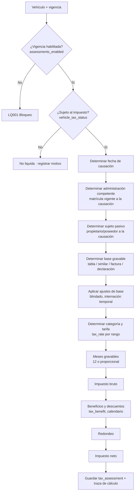
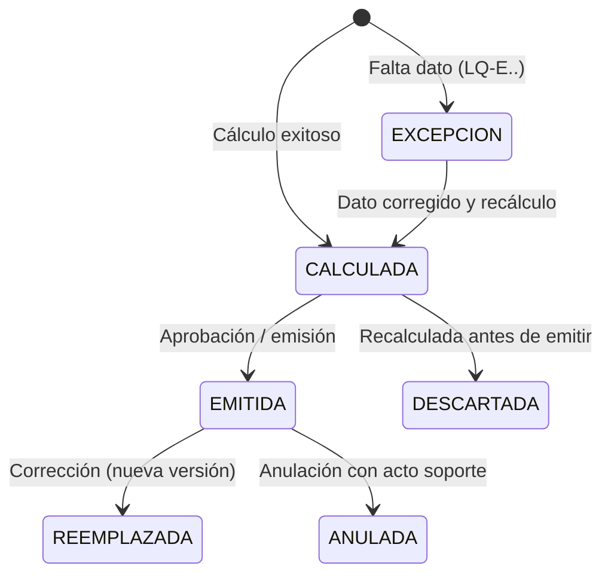
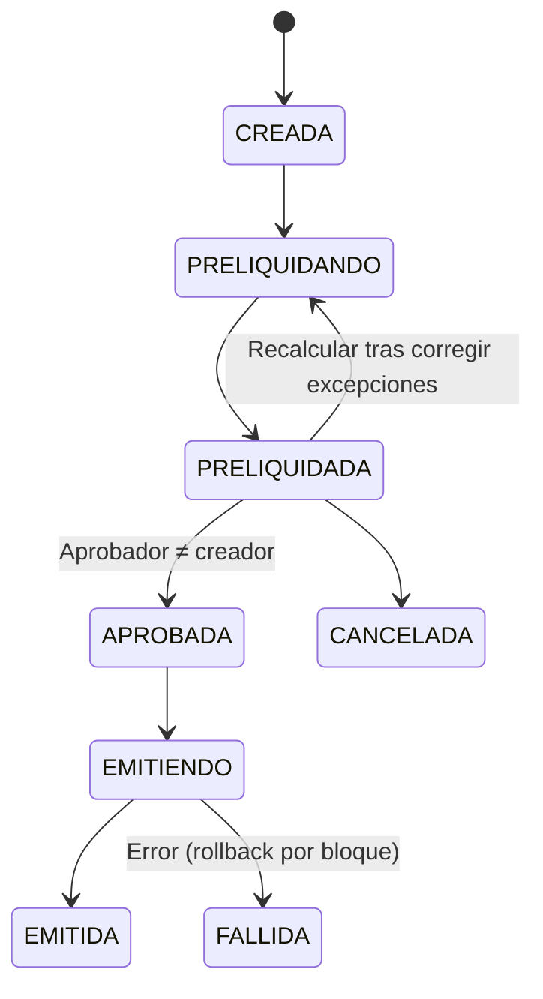

# Módulo 2.6 y Módulo 3 — Homologación vehículo ↔ avalúo y reglas de cálculo de la liquidación

> **Proyecto:** Liquidación del impuesto anual de vehículos automotores
> **Documentos base:** `ERD_impuesto_vehicular_definitivo_v2_CSV_cartera.md` · `01_Menu_y_Cargue_Tablas_Base_Liquidacion.md`
> **Alcance:** (A) Homologación de cada vehículo real con su avalúo oficial por vigencia (menú 2.6). (B) Reglas de cálculo de la liquidación individual, simulador y liquidación masiva (menú 3.1–3.3), con consultas y exportación a Excel.
> **Versión:** 0.2 — ajustada con la Resolución 2026 y la configuración por jurisdicción (Doc. 03)
> **Actualización:** todos los parámetros de este documento se leen del archivo de configuración de jurisdicción (`config_jurisdiccion_<DANE>_<AÑO>.yaml`, Doc. 03 §5).
> **Advertencia:** el marco normativo se resume para fines de diseño. Todos los porcentajes, rangos y reglas se **parametrizan por vigencia y administración**; ninguno se codifica en duro. Requiere validación del área jurídica antes de producción.

---

## 0. Marco normativo que gobierna el cálculo

| Elemento | Regla de referencia | Cómo se modela |
|---|---|---|
| Base gravable general | Valor comercial fijado por resolución del Ministerio de Transporte expedida en noviembre del año anterior al gravable (Ley 488/1998, art. 143). Ej.: vigencia 2026 → Res. 20253040048935 del 26‑nov‑2025 | `valuation.*` publicado (Módulo 1) |
| Vehículos que entran en circulación por primera vez | Base = valor de la factura de venta sin IVA; si es importación directa, valor de la declaración de importación | `base_source_type = INVOICE / IMPORT_DECLARATION` + documento soporte |
| Vehículos no incluidos en la tabla | Valor según el procedimiento de la resolución (vehículo de características similares) | `vehicle_valuation.similar_valuation_id` + `valuation_method = SIMILAR` |
| Ajustes especiales de la resolución 2026 | Blindados: base +10 %. Internados temporalmente: base = 50 % del valor de la tabla | Tabla `tax.base_adjustment_rule` (nueva, §10) |
| Rangos de tarifa | Valores absolutos reajustados cada año por el Gobierno Nacional (MinHacienda), art. 145 par. 1. Ej.: 2026 (Decreto 1457/2025): hasta $57.349.000 → 1,5 %; más de $57.349.000 y hasta $129.032.000 → 2,5 %; más de $129.032.000 → 3,5 % | `tax.tax_rate` por vigencia |
| Tarifas territoriales especiales | Bogotá D.C. aplica tarifas propias, entre ellas tarifas diferenciales para servicio público, eléctricos y motos, además de descuentos para eléctricos | `tax.tax_rate` con `administration_id` + `tax.tax_benefit` |
| Causación | 1 de enero de cada año. Para vehículos nuevos, en la fecha de solicitud de inscripción en el registro terrestre automotor | `accrual_date` |
| Proporcionalidad | Vehículos nuevos: se liquida por los meses que restan del año; la fracción de mes cuenta como mes completo (a validar con jurídica) | `taxable_months` |
| Conservación de tarifa | La resolución 2025 dispuso que los vehículos que cambiaran de rango por el aumento de la base pagaran con el porcentaje del año anterior | Regla parametrizable `RATE_CARRYOVER` (§5.6) |

---

# PARTE A — Menú 2.6: Homologación vehículo ↔ avalúo por vigencia

## A.1 Objetivo

Asociar cada vehículo del inventario (`core.vehicle`) a **un único** avalúo oficial (`valuation.vehicle_valuation`) del catálogo **publicado** de la vigencia, con método, puntaje de confianza y revisión trazables. Sin homologación aprobada **no se liquida** (salvo base por factura/declaración).

**Tabla principal:** `valuation.vehicle_reference_match (vehicle_id, vehicle_valuation_id, fiscal_year, match_method, confidence_score, review_status, reviewed_by, reviewed_at)`

## A.2 Opciones del submenú

```
2.6 Homologación vehículo ↔ avalúo
├── 2.6.1 Ejecutar homologación masiva por vigencia
├── 2.6.2 Bandeja de revisión (pendientes / dudosos / sin coincidencia)
├── 2.6.3 Homologación individual (por placa)
├── 2.6.4 Asignación por vehículo similar
├── 2.6.5 Base por factura / declaración de importación (vehículos nuevos)
└── 2.6.6 Consultas y exportación a Excel
```

## A.3 Algoritmo de homologación (en cascada)

> **Actualización (Doc. 03 §4):** la cascada vigente tiene 8 niveles: se agregan `CILINDRAJE_APROXIMADO` (art. 3 par. 3, aproximación a la centena) y `GENERICA_MARCA_ANIO_BASE` (art. 6 par.), y los atributos de búsqueda dependen de cada tabla (art. 3 A–I). La tabla siguiente es la versión inicial.

Se ejecuta por vigencia sobre todos los vehículos gravados sin homologación aprobada. Cada nivel solo se intenta si el anterior no produjo resultado.

| Nivel | Método (`match_method`) | Criterio | Puntaje | Resultado |
|---|---|---|---|---|
| 1 | `MINISTRY_CODE` | El vehículo tiene código Ministerio/homologación (p. ej. desde RUNT) y existe en el catálogo publicado con su `model_year` | 100 | Auto‑aprobado |
| 2 | `CARRYOVER` | La homologación aprobada de la vigencia anterior apunta a un código que **existe** en el catálogo actual para el mismo año modelo | 98 | Auto‑aprobado |
| 3 | `EXACT_ATTRIBUTES` | Coincidencia exacta normalizada de clase + marca + línea + cilindraje + año modelo (+ combustible / carrocería si existen) y **un solo** candidato | 95 | Auto‑aprobado |
| 4 | `FUZZY` | Similitud de texto en línea (trigramas / Levenshtein) con marca, clase y año modelo exactos y cilindraje ± tolerancia | 70–94 | Pendiente de revisión |
| 5 | `MULTIPLE` | Más de un candidato con el mismo puntaje máximo | — | Pendiente de revisión |
| 6 | `NO_MATCH` | Sin candidatos ≥ 70 | 0 | Bandeja “sin coincidencia” → similar (2.6.4) |

**Normalización previa** (en vehículo y en catálogo): mayúsculas, sin tildes, espacios múltiples a uno, quitar signos, diccionario de sinónimos de marca (p. ej. `CHEVROLET`/`GM CHEVROLET`) y de clase (`CAMIONETA`/`CAMPERO` según tabla homologada). El diccionario es administrable (menú 1.7).

**Umbrales parametrizables (menú 1.8):** auto‑aprobación ≥ 95; revisión 70–94; tolerancia cilindraje ± 50 cc.

## A.4 Reglas de negocio

| Código | Regla |
|---|---|
| H‑01 | Un vehículo tiene como máximo **una** homologación `APPROVED` por vigencia. |
| H‑02 | `vehicle_reference_match.fiscal_year` = `valuation_catalog.fiscal_year` del avalúo elegido (validación transaccional). |
| H‑03 | Solo se homologa contra catálogos `PUBLISHED`. Si se publica una nueva versión, las homologaciones de la versión anterior que **no** tengan liquidación emitida se re‑apuntan automáticamente al mismo código de la nueva versión (si existe); las demás quedan para revisión. |
| H‑04 | `año modelo` del vehículo debe existir para la referencia; si no existe, el sistema propone el año modelo más cercano **solo como sugerencia** (nunca auto‑aprueba). |
| H‑05 | Revisión manual: el revisor elige entre candidatos o busca otro, registra justificación; `reviewed_by` y `reviewed_at` obligatorios. |
| H‑06 | Asignación por similar: requiere seleccionar el avalúo similar, justificación técnica y documento soporte; crea un `vehicle_valuation` con `valuation_method = SIMILAR`, `similar_valuation_id` y `supporting_document_id`; aprobación por segundo usuario. |
| H‑07 | Base por factura/declaración (vehículos nuevos en su primer año): se registra valor sin IVA, número y fecha del documento, y PDF; no requiere catálogo pero sí aprobación. |
| H‑08 | Cambiar una homologación con liquidación **emitida** obliga a una liquidación de corrección (versión nueva); nunca se modifica la liquidación existente. |
| H‑09 | Vehículos no sujetos (estado tributario excluido en `core.vehicle_tax_status`) se omiten del proceso. |

## A.5 Estados de la homologación (`review_status`)

`PROPOSED` → `APPROVED` | `REJECTED`; `APPROVED` → `SUPERSEDED` (cuando se re‑homologa). Auto‑aprobadas nacen en `APPROVED` con `reviewed_by = usuario de sistema`.

## A.6 Consultas y exportación (2.6.6)

**Filtros:** vigencia (obligatorio), estado, método, rango de puntaje, clase, marca, línea, año modelo, administración, municipio de matrícula, placa (lista pegada), revisor, fecha de revisión, “con liquidación emitida” (sí/no).

**Columnas:** placa, clase, marca, línea, cilindraje y año modelo del vehículo · código Ministerio, marca/línea/cilindraje de la tabla · avalúo · método · puntaje · estado · revisor · fecha · versión del catálogo.

**Indicadores de cabecera:** % homologado, auto‑aprobados, pendientes, sin coincidencia, por similar, por factura.

**Excel:** mismo estándar del Módulo 1 (§7.1): hoja *Parámetros*, hoja *Datos*, hoja *Resumen por método/estado*; montos numéricos, placas y códigos como texto; asíncrono si > 50.000 filas; evento de auditoría `EXPORT`.

---

# PARTE B — Módulo 3: Reglas de cálculo de la liquidación

## B.1 Opciones del menú

```
3. LIQUIDACIÓN
├── 3.1 Liquidación individual (por placa / documento)
├── 3.2 Liquidación masiva por vigencia
│   ├── 3.2.1 Crear corrida (parámetros y universo)
│   ├── 3.2.2 Pre‑liquidación y validación
│   ├── 3.2.3 Aprobación y emisión
│   └── 3.2.4 Bandeja de excepciones
├── 3.3 Simulador (no genera registros oficiales)
├── 3.4 Declaraciones privadas            (entrega posterior)
├── 3.5 Determinación oficial             (entrega posterior)
└── 3.6 Consultas y exportación a Excel
```

## B.2 Flujo general de cálculo



## B.3 Paso 1 — Prerrequisitos y sujeción

| Código | Regla |
|---|---|
| LQ‑P01 | `tax.fiscal_year.assessments_enabled = true` y estado `HABILITADA`. |
| LQ‑P02 | El vehículo tiene estado tributario vigente a la fecha de causación. Si es **no sujeto/excluido** (según lista parametrizada por la norma: p. ej. ciertas motocicletas por cilindraje, maquinaria agrícola, transporte público según jurisdicción), no se liquida y se registra el motivo. |
| LQ‑P03 | Si tiene **beneficio** (exención parcial, descuento por tecnología), se liquida y el beneficio se aplica en B.8. |
| LQ‑P04 | No existe otra liquidación `EMITIDA` activa para el mismo vehículo + vigencia + administración (hallazgo 3 del ERD). Si existe, solo se permite **corrección** (nueva versión). |

## B.4 Paso 2 — Fecha de causación (`accrual_date`)

| Caso | Fecha |
|---|---|
| Vehículo matriculado antes de la vigencia | 1 de enero del año gravable |
| Vehículo nuevo (primera matrícula en el año) | Fecha de solicitud de inscripción en el registro (`core.vehicle_registration.registered_at` o campo específico de solicitud) |
| Vehículo importado directamente | Igual que nuevo, con base por declaración de importación |

## B.5 Paso 3 — Administración competente y sujeto pasivo

- **Administración:** la del municipio/departamento de matrícula **vigente a la fecha de causación** (`vehicle_registration` con `valid_from ≤ accrual_date < valid_to`). Un traslado posterior **no** cambia la administración de esa vigencia.
- **Sujeto pasivo:** propietario o poseedor con relación vigente a la causación (`vehicle_taxpayer_link`).
  - Varios propietarios: se emite **una** liquidación por vehículo con un responsable principal y los demás como responsables solidarios (tabla nueva `tax.assessment_taxpayer`, §10). No se fracciona por `ownership_pct` salvo que la norma territorial lo indique.
  - Sin propietario identificado: excepción `LQ‑E05`, a bandeja.

## B.6 Paso 4 — Base gravable (`taxable_base`)

Orden de precedencia (`base_source_type`):

| Prioridad | Tipo | Condición | Valor |
|---|---|---|---|
| 1 | `INVOICE` | Primer año de circulación, con factura registrada | Valor de factura **sin IVA** |
| 2 | `IMPORT_DECLARATION` | Primer año, importación directa | Valor de la declaración de importación |
| 3 | `OFFICIAL_TABLE` | Homologación aprobada (A.3 niveles 1–4) | `vehicle_valuation.commercial_value` |
| 4 | `SIMILAR` | Homologación por similar aprobada | Valor del avalúo similar |
| — | Sin base | Ninguna de las anteriores | Excepción `LQ‑E01` |

**Ajustes de base** (aplican sobre la base de tabla, parametrizados por vigencia en `tax.base_adjustment_rule`):

| Ajuste | Ejemplo 2026 | Fórmula |
|---|---|---|
| Blindado | +10 % | `base × 1,10` |
| Internación temporal | 50 % | `base × 0,50` |
| Antiguo / clásico | 50 % del valor del año modelo 2001 (Res. 2026 art. 4) | `base_2001 × 0,50` |
| San Andrés, Providencia y Santa Catalina | 45 % (Res. 2026 art. 8) | `base × 0,45`, solo para la jurisdicción DANE 88 |
| Autoliquidación voluntaria superior | Valor declarado por el contribuyente (art. 12) | Solo si es mayor que la base de tabla |

La base se guarda **antes** y **después** de ajustes en la traza de cálculo.

## B.7 Paso 5 — Categoría, tarifa y meses

**Categoría (`vehicle_category`)** derivada de clase y servicio del vehículo, mediante tabla de mapeo administrable: p. ej. `PARTICULAR`, `MOTO`, `PUBLICO`, `ELECTRICO`, `CARGA`… (las categorías válidas dependen de la jurisdicción).

**Tarifa:** buscar en `tax.tax_rate` el registro con:
`fiscal_year = vigencia` ∧ (`administration_id = admin` **o** nulo como regla nacional, prevaleciendo la territorial) ∧ `vehicle_category = categoría` ∧ `base_min < base ≤ base_max` (último tramo con `base_max` nulo).

> Convención de bordes: los decretos usan “hasta X” y “más de X”. Por eso el tramo inferior es **inclusivo** en su límite superior: `base ≤ 57.349.000 → 1,5 %`; `57.349.000 < base ≤ 129.032.000 → 2,5 %`.

**Conservación de tarifa (`RATE_CARRYOVER`)** — parámetro por vigencia (activo/inactivo). Si está activo y el vehículo tuvo liquidación en la vigencia anterior con tarifa menor, y el cambio de rango se debe al aumento de su base, se aplica la tarifa anterior. Se registra en la traza `rate_rule = CARRYOVER`.

**Meses gravables (`taxable_months`):**
- Vehículo no nuevo: 12.
- Vehículo nuevo: `12 − mes(accrual_date) + 1` (fracción de mes = mes completo). Ej.: causación 15‑ago → 5 meses (ago–dic).

## B.8 Paso 6 — Impuesto bruto, beneficios, descuentos y redondeo

```
gross_tax      = taxable_base × applied_rate × taxable_months / 12
benefit_amount = Σ beneficios aplicables (tax_benefit)      ← sobre gross_tax, tope maximum_amount
discount       = descuento por pronto pago (tax_calendar)   ← condicionado a fecha de pago
net_tax        = redondeo(gross_tax − benefit_amount)
net_tax_with_discount = redondeo(net_tax − discount)
```

| Código | Regla |
|---|---|
| LQ‑C01 | Cálculos internos con `NUMERIC` sin pérdida (mínimo 6 decimales); el redondeo se aplica **solo** al final. |
| LQ‑C02 | Regla de redondeo parametrizable por administración/vigencia (p. ej. al múltiplo de $1.000 más cercano o superior). **Pendiente de confirmar.** |
| LQ‑C03 | Orden de aplicación: beneficios (exenciones, descuentos por tecnología) → descuento por pronto pago. Configurable si la norma territorial dispone otro orden. |
| LQ‑C04 | El descuento por pronto pago **no** se resta en la obligación contable: la obligación nace por `net_tax`; el descuento se reconoce al imputar el pago dentro del plazo (`discount_deadline`). La liquidación muestra ambos valores. |
| LQ‑C05 | Un beneficio con límite de años (p. ej. “5 años siguientes a la matrícula”) se valida contra `first_registration_date`. |
| LQ‑C06 | `net_tax` nunca negativo; si un beneficio lo supera, se limita a 0. |

## B.9 Ejemplos de cálculo (vigencia 2026, régimen nacional, sin beneficios)

| Caso | Base | Tarifa | Meses | Bruto | Observación |
|---|---:|---:|---:|---:|---|
| Automóvil particular usado | $45.000.000 | 1,5 % | 12 | $675.000 | Tramo 1 |
| Automóvil particular usado | $80.000.000 | 2,5 % | 12 | $2.000.000 | Tramo 2 |
| Camioneta particular blindada, tabla $120.000.000 | $132.000.000 (+10 %) | 3,5 % | 12 | $4.620.000 | El ajuste lo pasa al tramo 3 |
| Vehículo nuevo, factura sin IVA $100.000.000, causación 15‑ago‑2026 | $100.000.000 | 2,5 % | 5 | $1.041.666,67 | Se redondea según LQ‑C02 |
| Base exactamente $57.349.000 | $57.349.000 | 1,5 % | 12 | $860.235 | Borde inclusivo |

> Tramos 2026 tomados del Decreto 1457/2025. En Bogotá D.C. se usarían sus propias tarifas cargadas en `tax.tax_rate` con su `administration_id`.

## B.10 Estados y versionamiento de la liquidación (`tax.tax_assessment`)



| Código | Regla |
|---|---|
| LQ‑V01 | Al pasar a `EMITIDA` se crea `ledger.tax_obligation` con `original_principal = net_tax` y su componente `TAX` en `ledger.obligation_component` en la **misma transacción**. |
| LQ‑V02 | Una corrección crea `version + 1`; la anterior pasa a `REEMPLAZADA` y se generan movimientos de ajuste en `ledger.tax_account_movement` (débito/crédito por la diferencia), sin borrar nada. |
| LQ‑V03 | `tax_assessment` es un **cálculo técnico**; no constituye título ejecutivo. La firmeza jurídica se gestiona en declaración (3.4) o determinación oficial (3.5). |
| LQ‑V04 | La liquidación conserva FK a `valuation_id`, `tax_rate_id`, `calendar_id` y la **traza de cálculo** (JSONB) con todos los valores intermedios, de forma que pueda reproducirse aun si cambian las tablas. |

**Traza de cálculo (`calculation_trace`, JSONB)** — ejemplo:

```json
{
  "rule_version": "LQ-2026.1",
  "accrual_date": "2026-01-01",
  "administration": "…",
  "base": {"source": "OFFICIAL_TABLE", "valuation_id": "…", "catalog_version": 1,
           "raw": 120000000.00, "adjustments": [{"type": "ARMORED", "factor": 1.10}], "final": 132000000.00},
  "rate": {"tax_rate_id": "…", "category": "PARTICULAR", "range": [129032000, null], "rate": 0.035, "rule": "STANDARD"},
  "months": 12,
  "gross_tax": 4620000.000000,
  "benefits": [],
  "rounding": {"rule": "NEAREST_1000", "before": 4620000.00, "after": 4620000.00},
  "net_tax": 4620000.00,
  "discount": {"calendar_id": "…", "rate": 0.10, "deadline": "2026-05-15", "amount": 462000.00}
}
```

## B.11 Excepciones de liquidación

| Código | Situación | Bandeja / acción |
|---|---|---|
| `LQ‑E01` | Sin base gravable (sin homologación ni factura) | Ir a 2.6 |
| `LQ‑E02` | Homologación pendiente de revisión | Ir a 2.6.2 |
| `LQ‑E03` | No hay tarifa para la categoría/rango | Revisar 1.5.5 |
| `LQ‑E04` | Sin matrícula vigente a la causación | Registro automotor 2.2 |
| `LQ‑E05` | Sin propietario/poseedor vigente | Registro 2.4 |
| `LQ‑E06` | Categoría no mapeada | Parámetros 1.8 |
| `LQ‑E07` | Ya existe liquidación emitida | Usar corrección |
| `LQ‑E08` | Base fuera de rango razonable (alerta) | Revisión manual |
| `LQ‑E09` | Administración del vehículo distinta a la del usuario | Bloqueo (RLS) |

## B.12 Liquidación individual (3.1) y simulador (3.3)

**3.1 Individual:** buscar por placa o documento → seleccionar vigencia(s) → el sistema muestra paso a paso: sujeción, causación, administración, sujeto pasivo, base (con origen), ajustes, tarifa, meses, bruto, beneficios, redondeo, neto y valor con descuento → botones *Guardar como calculada*, *Emitir* (según rol), *Imprimir/PDF*, *Exportar traza a Excel*. Permite liquidar varias vigencias pendientes en una sola operación (cada vigencia con sus propias tablas).

**3.3 Simulador:** mismos pasos, permite sobrescribir base, categoría o fecha de causación para escenarios “qué pasaría si”. **No** guarda registros oficiales; queda log de uso. Útil para atención al ciudadano y pruebas de tablas (checklist ítem 8 del Módulo 1).

## B.13 Liquidación masiva (3.2)

**Tabla nueva:** `tax.assessment_run` (id, fiscal_year, administration_id, universe_filter JSONB, status, total, calculated, exceptions, emitted, created_by, approved_by, started_at, finished_at, rule_version).



| Código | Regla |
|---|---|
| LM‑01 | Universo por filtros: vigencia, administración, categoría, municipio, rango de placas, “sin liquidación emitida”. |
| LM‑02 | Pre‑liquidación genera `tax_assessment` en `CALCULADA` o `EXCEPCION`; nada contable. |
| LM‑03 | Panel de control: totales por categoría y tramo, impuesto total, comparación con la vigencia anterior (variación por vehículo y global), excepciones por código. |
| LM‑04 | Aprobación segregada; muestra aleatoria de 30 liquidaciones para verificación manual. |
| LM‑05 | Emisión en bloques transaccionales (p. ej. 1.000 vehículos) idempotentes: un vehículo ya emitido en la vigencia se omite. Reinicio seguro tras fallo. |
| LM‑06 | Las excepciones no bloquean la corrida; quedan en 3.2.4 y pueden emitirse después de forma individual o en una corrida complementaria. |
| LM‑07 | Toda corrida queda auditada con `rule_version` y versiones de catálogo/tarifas usadas. |

## B.14 Consultas y exportación a Excel (3.6)

| Consulta | Filtros principales | Columnas clave |
|---|---|---|
| Liquidaciones | Vigencia, administración, estado, categoría, tramo de tarifa, rango de base, rango de impuesto, placa, documento, corrida, fecha de emisión, versión | Placa, contribuyente, base y origen, tarifa, meses, bruto, beneficios, neto, valor con descuento, estado, versión |
| Excepciones | Vigencia, corrida, código de excepción, categoría, municipio | Placa, código, descripción, dato faltante, enlace a opción de corrección |
| Corridas masivas | Vigencia, estado, usuario, fechas | Totales, impuesto total, excepciones, tiempos |
| Comparativo entre vigencias | Vigencia A y B, umbral % | Base A/B, impuesto A/B, variación, motivo (cambio de base, de tramo, de beneficio) |
| Resumen de recaudo esperado | Vigencia, administración, municipio, categoría | Nº vehículos, base total, impuesto neto total, descuento potencial |

**Excel:** estándar del Módulo 1 (hoja *Parámetros* + *Datos* + hojas de resumen); opción “Incluir traza de cálculo” que añade una hoja con los valores intermedios de cada liquidación; asíncrono > 50.000 filas; auditoría `EXPORT`.

---

## 10. Ajustes propuestos al modelo de datos

1. `tax.tax_assessment`: agregar `base_source_type VARCHAR(30)`, `raw_base NUMERIC(18,2)`, `benefit_amount NUMERIC(18,2)`, `rounding_rule VARCHAR(30)`, `rate_rule VARCHAR(30)` (`STANDARD`/`CARRYOVER`), `calculation_trace JSONB`, `rule_version VARCHAR(40)`, `run_id UUID FK → tax.assessment_run`, `replaces_assessment_id UUID FK`, `source_document_id UUID FK` (factura/declaración).
   Índice único parcial: `(vehicle_id, fiscal_year, administration_id) WHERE status = 'EMITIDA'`.
2. Nueva `tax.assessment_taxpayer` (assessment_id, taxpayer_id, role `PRINCIPAL`/`SOLIDARIO`, ownership_pct).
3. Nueva `tax.assessment_run` (§B.13).
4. Nueva `tax.base_adjustment_rule` (fiscal_year, administration_id NULL, adjustment_type `ARMORED`/`TEMPORARY_IMPORT`/…, factor NUMERIC(9,6), legal_instrument_id).
5. Nueva `tax.vehicle_category_map` (fiscal_year, administration_id NULL, vehicle_class, service_type, fuel_type, → vehicle_category).
6. Nueva `valuation.reference_match_candidate` (match_id, vehicle_valuation_id, score, rank, reason) para que el revisor vea los candidatos evaluados.
7. `core.vehicle`: agregar `ministry_reference_code VARCHAR(50) NULL` (si RUNT lo suministra), `armored BOOLEAN`, `temporary_import BOOLEAN`, `registration_request_date DATE`.
8. `tax.tax_rate`: permitir `administration_id` nulo (regla nacional) y restricción de no solapamiento por (vigencia, administración, categoría).
9. Parámetros (`menú 1.8`): umbrales de homologación, regla de redondeo, `RATE_CARRYOVER`, orden de beneficios, tamaño de bloque de emisión.

## 11. Criterios de aceptación

| # | Caso | Esperado |
|---|---|---|
| CA‑H01 | Vehículo con código Ministerio existente | Homologación `MINISTRY_CODE`, 100, aprobada |
| CA‑H02 | Vehículo homologado el año anterior y código vigente | `CARRYOVER` aprobado |
| CA‑H03 | Línea escrita distinto (“SPARK GT” vs “SPARK G.T.”) | `FUZZY`, a revisión |
| CA‑H04 | Dos candidatos idénticos | `MULTIPLE`, a revisión |
| CA‑H05 | Intento de homologar contra catálogo de otra vigencia | Rechazo H‑02 |
| CA‑L01 | Base $57.349.000 (2026) | 1,5 % (borde inclusivo) |
| CA‑L02 | Base $57.349.001 | 2,5 % |
| CA‑L03 | Nuevo con causación 15‑ago | 5 meses |
| CA‑L04 | Blindado que cambia de tramo por el +10 % | Tarifa del tramo de la base ajustada |
| CA‑L05 | `RATE_CARRYOVER` activo, vehículo que sube de tramo por la nueva tabla | Tarifa anterior, traza `CARRYOVER` |
| CA‑L06 | Segunda emisión del mismo vehículo/vigencia | Bloqueo `LQ‑E07`; solo corrección |
| CA‑L07 | Corrección de base | Versión 2, versión 1 `REEMPLAZADA`, movimiento de ajuste en el libro |
| CA‑L08 | Emisión masiva interrumpida | Reinicio sin duplicados (idempotencia) |
| CA‑L09 | Reproducir liquidación antigua tras publicar nueva versión de catálogo | Mismo resultado usando la traza y FK originales |
| CA‑L10 | Exportar liquidaciones con traza | Excel con hojas Parámetros, Datos y Traza |

## 12. Pendientes por confirmar con el equipo tributario

1. **Jurisdicción objetivo:** se definió que cada jurisdicción se parametriza con su archivo de configuración (Doc. 03 §5). Falta diligenciar la primera jurisdicción real.
2. Regla exacta de **redondeo** y de **fracción de mes** en vehículos nuevos.
3. Vigencia y alcance de la regla de **conservación de tarifa** para cada año.
4. Lista oficial de **vehículos no sujetos** y beneficios por tecnología (eléctricos, híbridos, gas) con sus límites de años.
5. Tratamiento de **copropiedad** (una liquidación con solidarios vs. fraccionada).
6. Fuente del **código Ministerio** en el vehículo (RUNT u otro) para maximizar homologación automática.
7. Si se liquidan **vigencias anteriores** con este motor (requiere cargar catálogos y tarifas históricas en Módulo 1).

## 13. Siguiente entrega propuesta

- Módulo 4 — Cuenta corriente: creación de obligación, imputación de pagos con descuento por pronto pago, saldos a favor (Doc. 04).
- Módulo 5 — Cartera: intereses de mora, sanciones, prescripción y cartera histórica (Doc. 05).

---

**Fuentes consultadas para el marco normativo:**
- [Decreto 1457 de 2025 — rangos 2026 (Actualícese)](https://actualicese.com/impuesto-de-vehiculos-automotores-para-2026/)
- [Rangos de avalúo comercial 2026 (INCP)](https://incp.org.co/publicaciones/infoincp-publicaciones/impuestos/2026/01/rangos-de-avaluo-comercial-del-impuesto-de-vehiculos-2026/)
- [Resolución MinTransporte 20253040048935 de 2025 (Alcaldía de Bogotá – SISJUR)](https://www.alcaldiabogota.gov.co/sisjur/normas/Norma1.jsp?dt=S&i=191643)
- [Resumen de la Resolución 20253040048935 (Cerlatam)](https://www.cerlatam.com/normatividad/mintransporte-resolucion-20253040048935/)
- [Proyecto de resolución base gravable 2026 — texto del art. 143 Ley 488 (Redjurista)](https://www.redjurista.com/Compilaciones2018/tablas_ProyectosNormas/2025/11/14/pr_mt_0068aj_2025.pdf)
- [Decreto 2588 de 2022 — reajuste anual art. 145 par. 1 (SISJUR)](https://www.alcaldiabogota.gov.co/sisjur/normas/Norma1.jsp?i=131700)
- [Impuesto de vehículos en Bogotá (Observatorio Fiscal SHD)](https://observatoriofiscal.shd.gov.co/sites/default/files/documentos_informacion_destacada/Impuesto_Vehiculos_Automotores_Bogota.pdf)
- [Resolución base gravable 2025 — conservación de tarifa (Fenalco)](https://www.fenalco.com.co/blog/juridico-2/notijuridico-189-mintransporte-establece-la-base-gravable-de-los-vehiculos-automotores-para-la-vigencia-fiscal-2025-7747)
