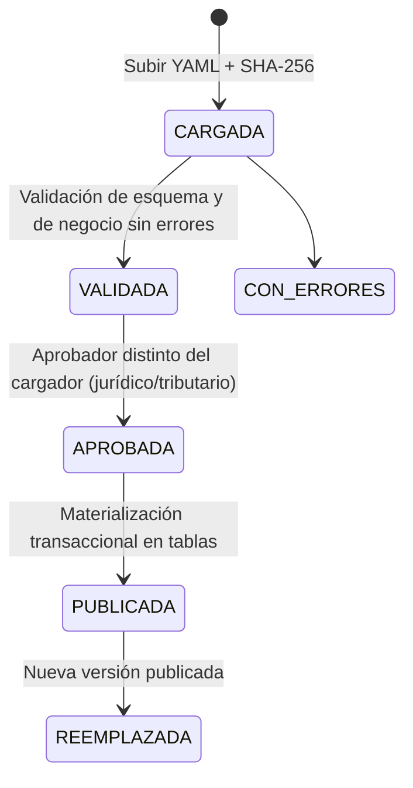

# Documento 03 — Configuración por jurisdicción y estructura real de las tablas base 2026

> **Proyecto:** Liquidación del impuesto anual de vehículos automotores
> **Documentos relacionados:** `01_Menu_y_Cargue_Tablas_Base_Liquidacion.md` · `02_Homologacion_y_Reglas_de_Liquidacion.md` · `04_Cuenta_Corriente_y_Recaudo.md` · `05_Cartera_Intereses_Sanciones_Prescripcion.md`
> **Insumos analizados:** Tablas 1 a 9 de la Resolución MinTransporte 20253040048935 del 26‑nov‑2025 (XLSX) y el texto de la resolución (PDF).
> **Entregables asociados:** `config_jurisdiccion_plantilla_2026.yaml` · `Prevalidacion_Tablas_Base_Gravable_2026.xlsx`
> **Versión:** 0.5 — agrega las secciones `recaudo` y `cartera` de la configuración, las reglas CJ15 y CJ16 y el resultado de Ipiales con CJ01 a CJ16 (antes: 0.4, criterio del 20 % por dirección declarada y descuento efectivo tras redondeo)

---

## 1. Decisiones incorporadas

| # | Decisión del equipo | Cómo queda en el diseño |
|---|---|---|
| 1.1 | La jurisdicción se soporta en un **archivo de configuración** con los parámetros y reglas de liquidación del municipio o departamento | Archivo YAML por jurisdicción y vigencia, cargado en la nueva opción **1.5.9**, con el mismo ciclo de staging, aprobación y publicación de las tablas (§5) |
| 1.2 | Las tablas del Ministerio vienen en **miles de pesos** (21.600 = $21.600.000) | `multiplicador_tablas: 1000` fijo en la configuración; el asistente de carga ya no lo pregunta, lo toma de la configuración y lo valida con la regla F010 (§3.3) |
| 1.3 | Se entregan las tablas base 2026 | Se analizó la estructura real y se prevalidaron las 9 tablas con el motor de validación (§2 y §3) |

---

## 2. Resultado de la prevalidación de las tablas 2026

Las 9 tablas pasaron las validaciones bloqueantes: **ningún error**. Pueden publicarse una vez el aprobador revise las 13 advertencias.

| Tabla | Contenido | Referencias (filas) | Avalúos (referencia × año modelo) | Filas genéricas "no incluidos" | Potencia en kW | Errores | Advertencias |
|---:|---|---:|---:|---:|---:|---:|---:|
| 1 | Automóviles | 4.836 | 117.756 | 131 | 1 | 0 | 1 |
| 2 | Camionetas y camperos | 3.373 | 82.501 | 76 | 0 | 0 | 0 |
| 3 | Camionetas doble cabina | 622 | 14.758 | 33 | 0 | 0 | 4 |
| 4 | Eléctricos | 234 | 5.850 | 0 | 118 | 0 | 0 |
| 5 | Motos, motocarros, cuatrimotos y eléctricos de dos/tres ruedas | 2.753 | 68.321 | 21 | 48 | 0 | 6 |
| 6 | Pasajeros | 874 | 21.034 | 34 | 0 | 0 | 0 |
| 7 | Carga | 3.090 | 71.610 | 235 | 0 | 0 | 2 |
| 8 | Ambulancias | 49 | 1.225 | 0 | 0 | 0 | 0 |
| 9 | Híbridos | 259 | 6.475 | 0 | 0 | 0 | 0 |
| | **Total** | **16.090** | **389.530** | **530** | **167** | **0** | **13** |

**Las 13 advertencias.** Son 12 filas que forman 6 pares con los mismos atributos de identificación (clase, marca, línea, cilindraje, tonelaje y pasajeros) pero valores distintos, más un automóvil con potencia en kW dentro de la tabla de combustión. Al homologar, el sistema no puede decidir solo entre los dos registros de cada par, así que van a revisión manual:

| Tabla | CTR | Referencia |
|---:|---|---|
| 3 | 15864 / 15865 | FORD F‑650 SUPER DUTY 7200 |
| 3 | 15873 / 15874 | FORD RANGER XL 4X4 MT 1996 |
| 5 | 11337 / 11340 | BRP CAN AM OUTLANDER 450 |
| 5 | 15457 / 16719 | KAWASAKI KLE300C 300 |
| 5 | 16771 / 16772 | TRIUMPH STREET TWIN 900 |
| 7 | 16167 / 16168 | MITSUBISHI ‑ FUSO FAV1PH2LNQA 3907 |
| 1 | 15741 | BYD SEAGULL con "55 Kw" en la tabla de automóviles (eléctrico fuera de la Tabla 4) |

El detalle fila por fila, con los 1.388 hallazgos informativos, está en `Prevalidacion_Tablas_Base_Gravable_2026.xlsx`.

---

## 3. Estructura real del archivo del Ministerio (reemplaza el layout supuesto del Doc. 01 §6.3)

### 3.1 Formato

| Aspecto | Valor real |
|---|---|
| Formato | **XLSX** (no CSV). El importador acepta XLSX de forma nativa y CSV como alternativa |
| Archivos | Uno por tabla (9 archivos); hoja única `Bases Gravables` |
| Filas 1–3 | Título: "MINISTERIO DE TRANSPORTE" y "TABLA N.‑ BASE GRAVABLE DE … PARA EL AÑO FISCAL 2026 (CIFRAS EN MILES DE PESOS)" |
| Filas 4–5 | **Encabezado en dos filas**: la fila 4 trae los grupos (CAPACIDAD (6), AÑO MODELO (7)); la fila 5 trae las subcolumnas (TONELAJE, PASAJEROS, años) |
| Fila 6 en adelante | Datos |
| Unidad | Miles de pesos, enteros, sin decimales |

### 3.2 Mapeo de columnas

| Col. | Encabezado | Destino en el modelo | Observaciones |
|---|---|---|---|
| A | `#` | `source_row_number` auxiliar | Consecutivo del Ministerio; no es llave |
| B | `CTR` | `catalog_entry.ministry_reference_code` | **Llave de la referencia.** Único en las 9 tablas (16.090 valores, sin repetidos) |
| C | `ID` | `catalog_entry.ministry_internal_id` (nuevo) | 674 filas vacías y 158 repetidas: **no sirve como llave** |
| D | `FECHA` | `catalog_entry.ministry_record_date` (nuevo) | Fecha de creación de la referencia; frecuentemente vacía |
| E | `PROYECCION` | `catalog_entry.origin_type` (nuevo) | `Inicial`, `Adición` o vacío |
| F | `TIPO (1)` | `vehicle_reference.vehicle_type` | Coincide con la tabla, salvo en las tablas 4 y 9, donde indica la tecnología (ELECTRICOS / HIBRIDOS) |
| G | `CLASE (2)` | `original_vehicle_class` | En las tablas 4 y 9 la clase es mixta (AUTOMOVIL, CAMIONETAS Y CAMPEROS, CARGA, BUS…) |
| H | `MARCA (3)` | `original_brand` | |
| I | `LINEA (4)` | `original_line` | Incluye las filas genéricas "LINEAS Y CILINDRAJES NO INCLUIDOS ANTERIORES A AÑO BASE" |
| J | `CILINDRAJE (5)` | `original_engine_cc` **o** `power_kw` (nuevo) | Numérico en cc; en eléctricos llega como texto con kW ("276 KW", "2,0 Kw", "2.7 kW / 3.63 HP") |
| K | `TONELAJE` | `vehicle_reference.load_capacity` | Decimal (p. ej. 3,4); atributo de búsqueda en la Tabla 7 |
| L | `PASAJEROS` | `vehicle_reference.passenger_capacity` | Atributo de búsqueda en la Tabla 6 |
| M | `2001 y Anteriores` | `vehicle_valuation.model_year = 2001`, `source_column = "2001 y Anteriores"` | Aplica a todo modelo ≤ 2001 (art. 6) |
| N–AK | `2002` … `2025` | `vehicle_valuation.model_year` | 24 columnas; con la M suman 25 años modelo |

**Conversión:** `commercial_value = valor_celda × 1000`. Se conservan `source_value` (texto original) y `source_column` (encabezado).

### 3.3 Reglas de validación nuevas o ajustadas (complementan el Doc. 01 §6.5)

| Código | Regla | Severidad |
|---|---|---|
| `F009` | El título (fila 2) no declara "CIFRAS EN MILES DE PESOS" o la unidad no coincide con el multiplicador configurado | ADVERTENCIA |
| `F010` | Mediana de los valores del lote × multiplicador fuera de [$1.000.000 – $500.000.000]. Detecta un multiplicador equivocado sin generar miles de advertencias por fila | ERROR |
| `F011` | Encabezado de dos filas no reconocido o columnas fuera de posición | ERROR |
| `R009` | (ajustada) Valor fuera de un rango extremo: < $50.000 o > $10.000 millones; en la Tabla 5, < $10.000. Los avalúos bajos de modelos antiguos (p. ej. 90 = $90.000) son reales y no se marcan | ADVERTENCIA |
| `R014` | Dos o más filas con los mismos atributos de identificación. Con valores distintos es ADVERTENCIA (homologación ambigua); con valores idénticos es INFO | ADVERTENCIA / INFO |
| `R015` | ID del Ministerio vacío o repetido | INFO |
| `R016` | Fila genérica "no incluidos": solo tiene valor en "2001 y Anteriores" y se marca `is_generic_brand_row = true` | INFO |
| `R017` | Potencia en kW dentro de una tabla de combustión (Tablas 1–3 y 6–9) | ADVERTENCIA |
| `R018` | Texto con minúsculas, tildes o espacios extra, cilindraje numérico guardado como texto o potencia en formato mixto: se normaliza sin bloquear | INFO |

> Con la regla R009 original (mínimo $1.000.000) las tablas 2026 habrían generado 1.241 advertencias falsas por avalúos bajos legítimos de modelos antiguos. Por eso el rango se volvió extremo y la detección del multiplicador pasó a la regla de lote F010.

### 3.4 Situaciones de datos con regla de negocio propia

| Situación | Tratamiento |
|---|---|
| **No hay columna de año modelo 2026** (las tablas llegan hasta 2025) | Un modelo 2026 que entra en circulación por primera vez en 2026 se liquida con la factura sin IVA (Ley 633/2000 art. 90). Un modelo 2026 matriculado en 2025 que llega a la vigencia 2026 como usado se trata como vehículo no incluido: similar o inclusión en SIBGA (art. 10). **Por confirmar con jurídica.** |
| Fila genérica de marca | Solo se usa para modelos ≤ 2001 cuya línea o cilindraje no aparezca (art. 6 par.). Nunca se elige para modelos ≥ 2002 |
| Eléctricos | La Tabla 4 se busca por tipo, clase, marca y línea (sin cilindraje, art. 3‑D). En la Tabla 5 los eléctricos se ubican por potencia en W/kW (art. 3‑E) |
| Tabla 6 (pasajeros) y Tabla 7 (carga) | El número de pasajeros (Tabla 6) y el tonelaje (Tabla 7) son atributos obligatorios de búsqueda (art. 3‑F y 3‑G) |
| Clases en las tablas 4 y 9 | La categoría de tarifa sale de la **tecnología** (tabla 4 = eléctrico) y no de la clase |

---

## 4. Reglas de la Resolución 2026 llevadas al sistema

| Artículo | Regla | Implementación |
|---|---|---|
| 2 | La base gravable es el valor de la tabla según marca, línea, cilindraje, capacidad y año modelo | Catálogo publicado (Módulo 1) |
| 3 A–I | Atributos de búsqueda por tabla | `config.base_gravable.catalogo_ministerio.tablas[].atributos` define qué atributos usa la homologación en cada tabla |
| 3 par. 2 | Si la licencia de tránsito no trae los datos, se pide una certificación al organismo de tránsito, la factura, la declaración de importación o una certificación del importador | Homologación individual: adjunto obligatorio y causal `DATOS_INCOMPLETOS_LICENCIA` |
| 3 par. 3 | Si la línea existe pero el cilindraje no, se aproxima a la centena: cifra final < 50 baja a la centena inferior; ≥ 50 sube a la superior | **Nuevo nivel de homologación `CILINDRAJE_APROXIMADO`.** Ej.: 1.548 cc → 1.500; 1.596 cc → 1.600 |
| 3 par. 4 | El servicio público de carga y pasajeros solo se grava donde la ley lo establezca | `config.sujecion.servicio_publico` |
| 4 | Antiguos y clásicos: 50 % del valor del año modelo 2001 | Ajuste `ANTIGUO_CLASICO` sobre `VALOR_ANIO_BASE` |
| 5 | Blindados: base +10 % | Ajuste `BLINDADO` |
| 6 | Modelos ≤ 2001: valor de la columna "2001 y Anteriores"; si no hay línea, se usa la fila genérica de la marca | Nivel de homologación `GENERICA_MARCA_ANIO_BASE` |
| 7 | Internación temporal: 50 % | Ajuste `INTERNACION_TEMPORAL` |
| 8 | San Andrés, Providencia y Santa Catalina: 45 % | Ajuste `SAN_ANDRES`, solo si la jurisdicción es DANE 88 |
| 9 | La base de vigencias anteriores no se modifica; si un vehículo no estaba incluido, se usa uno similar de esa vigencia | Catálogos publicados inmutables; similar por vigencia |
| 10 | Vehículos no incluidos: uno similar o solicitud de inclusión al Ministerio | Menú 2.6.4 y registro para el reporte SIBGA |
| 11 | Las secretarías reportan cada mes al Ministerio los vehículos registrados, asimilados o ajustados | **Nueva opción 1.6.7, "Reporte mensual SIBGA"** (§6) |
| 12 | El contribuyente puede autoliquidar voluntariamente con una base mayor | Liquidación individual: `base_source_type = VOLUNTARY_HIGHER`, solo si es mayor que la de tabla |
| 14 | La resolución aplica exclusivamente a 2026 | `catalog.fiscal_year = 2026`; la liquidación de otras vigencias usa su propio catálogo |

**Cascada de homologación actualizada** (reemplaza la del Doc. 02 §A.3):

| Nivel | Método | Puntaje | Resultado |
|---|---|---|---|
| 1 | `MINISTRY_CODE` (CTR) | 100 | Auto |
| 2 | `CARRYOVER` | 98 | Auto |
| 3 | `EXACT_ATTRIBUTES` (atributos de la tabla según el art. 3) | 95 | Auto, si hay un solo candidato |
| 4 | `CILINDRAJE_APROXIMADO` (art. 3 par. 3) | 92 | Revisión (la norma dice "se podrá") |
| 5 | `GENERICA_MARCA_ANIO_BASE` (art. 6 par., solo modelos ≤ 2001) | 90 | Revisión |
| 6 | `FUZZY` | 70–89 | Revisión |
| 7 | `MULTIPLE` (incluye los pares R014) | — | Revisión |
| 8 | `NO_MATCH` | 0 | Similar (art. 10) |

---

## 5. Archivo de configuración por jurisdicción

### 5.1 Propósito

Un archivo por **jurisdicción + vigencia** (`config_jurisdiccion_<DANE>_<AÑO>.yaml`) reúne todas las reglas que cambian entre departamentos, distritos o municipios y entre años. El motor de liquidación no tiene ninguna regla escrita en el código: todo lo lee de la configuración publicada. La plantilla para 2026 es `config_jurisdiccion_plantilla_2026.yaml`.

### 5.2 Secciones

| Sección | Contenido | Se materializa en |
|---|---|---|
| `jurisdiccion` | Tipo (departamento, distrito capital, distrito o municipio), código DANE, administración, NIT, departamento padre, zona de frontera | `core.territorial_entity`, `core.tax_administration` |
| `competencia` | Modalidades activas (qué vehículos liquida o controla la administración), con su universo y distribución (§9.5) | Filtro de universo en homologación y liquidación; `ledger.revenue_distribution` |
| `vigencia` | Año, fechas, versión | `tax.fiscal_year` |
| `normas` | Resolución, decreto de rangos, leyes, estatuto territorial | `documents.legal_instrument` |
| `base_gravable` | Multiplicador 1000, llave CTR, atributos por tabla, factura sin IVA, aproximación de cilindraje, fila genérica, similar, ajustes (blindado, antiguo, internación, San Andrés) y su orden | Parámetros de importación y homologación, `tax.base_adjustment_rule` |
| `sujecion` | Vehículos no gravados, servicio público, criterio para motos eléctricas | Reglas de `core.vehicle_tax_status` |
| `categorias` | Reglas ordenadas de clasificación de tarifa | `tax.vehicle_category_map` |
| `tarifas` | Rangos (inferior exclusivo, superior inclusivo) por categoría | `tax.tax_rate` |
| `conservacion_tarifa` | Mantener la tarifa del año anterior si el vehículo sube de rango por la nueva tabla | Parámetro `RATE_CARRYOVER` |
| `causacion` | Fecha general, vehículos nuevos, proporcionalidad, fracción de mes | Motor de liquidación |
| `calendario` | Grupos (p. ej. último dígito de placa), inicio de pago, límite de descuento, **límite sin multas ni intereses**, descuento por pronto pago y plazos de vehículos nuevos | `tax.tax_calendar`; `ledger.tax_obligation.due_date` |
| `beneficios` | Descuentos y exenciones con orden, tope y años | `tax.tax_benefit` |
| `redondeo` | Momento, método y múltiplo | Motor de liquidación |
| `distribucion_recaudo` | Se deriva de las modalidades activas de `competencia` (80/20 de la Ley 488 art. 150; 100 % UEDF para internados) | `ledger.revenue_distribution` |
| `recaudo` | Canales (`canales`), bancos con convenio y su `cuenta_recaudo_ref` (referencia al gestor de secretos, nunca el número de cuenta; `docs/arquitectura/02` §6), recibo de pago, formato del archivo bancario (`formato_preferido`, `formato_alterno` y `formato_por_banco`), imputación, descuento en pagos parciales, saldo a favor, distribución y reporte del 20 % (`reporte_participacion_20`). Detalle en el Doc. 04 §12.5 | Parámetros del Módulo 4 (`ledger.payment_receipt`, `ledger.bank_file`, `ledger.payment_allocation`, `ledger.credit_balance`, `ledger.revenue_distribution`, `ledger.participation_report`) |
| `reportes` | SIBGA mensual | Opción 1.6.7 |
| `cartera` | `intereses_mora` (tasa de referencia, puntos a restar, fórmula, base y redondeo de la causación), `sanciones` (`sistema_determinacion`, `uvt`, `sancion_minima_uvt` en **UVT** y no en pesos, `requiere_acto_en_firme`, `reglas` y `estatuto_territorial`), `prescripcion` (años, inicio del término, eventos, semáforo y `competente`), `cartera_historica` y `antiguedad`. Las tasas de usura no van aquí: se cargan como datos. Detalle en el Doc. 05 | Parámetros del Módulo 5; `sanciones` se materializa en `tax.penalty_rule` (Doc. 05 §5.1) |
| `parametros_sistema` | Umbrales de homologación, rangos de importación, tamaño de bloque | Menú 1.8 |

Cada regla lleva `estado` (`VIGENTE`, `POR_CONFIRMAR` o `PENDIENTE`) y una referencia a su norma.

### 5.3 Ciclo de vida (opción 1.5.9, "Configuración de jurisdicción")

### 5.4 Validaciones del archivo

| Código | Regla |
|---|---|
| `CJ01` | El YAML es válido contra el esquema `esquema_version` |
| `CJ02` | Sin `PENDIENTE` en reglas obligatorias (jurisdicción, tarifas de las categorías usadas, redondeo, calendario, `cartera.intereses_mora` y `cartera.prescripcion`). `cartera.prescripcion.competente` no cuenta: solo hace falta para firmar el acto y CJ16 lo reporta como advertencia. Los `POR_CONFIRMAR` exigen que el aprobador marque la revisión |
| `CJ03` | Cada `norma` referenciada existe en la sección `normas` |
| `CJ04` | Los rangos de tarifa son continuos, sin huecos ni solapamientos, y el último es abierto (`null`) |
| `CJ05` | Tarifa de eléctricos ≤ 1 % (Ley 1964/2019 art. 3) |
| `CJ06` | La distribución del recaudo suma 100 % |
| `CJ07` | Reemplazada por CJ13 |
| `CJ08` | El ajuste `SAN_ANDRES` solo existe si el DANE es 88 |
| `CJ09` | El `multiplicador_tablas` coincide con la unidad declarada en el título de las tablas cargadas (F009) |
| `CJ10` | La vigencia de la configuración coincide con la del catálogo publicado |
| `CJ11` | Comparación con la versión anterior: se muestran las reglas que cambiaron, para que el aprobador las revise |
| `CJ12` | Competencia: al menos una modalidad activa; `CONVENIO_DEPTO` y `PARTICIPACION_20` son excluyentes; `UEDF_INTERNACION` exige zona de frontera; `CONVENIO_DEPTO` exige número y fechas del convenio; `ADMINISTRACION_DIRECTA` solo para departamento o distrito capital y excluyente con las dos anteriores |
| `CJ13` | Calendario: `inicio_pago ≤ limite_descuento ≤ limite_sin_intereses`; un límite posterior al 31‑dic de la vigencia genera advertencia. Las fechas son obligatorias solo si alguna modalidad activa liquida |
| `CJ14` | Vehículos nuevos: un plazo por días exige el número de días; una fecha fija exige la fecha; los días de descuento no pueden superar los días del plazo sin intereses |
| `CJ15` | Intereses de mora. Se aplica a **toda publicación nueva**, sin importar la `esquema_version` que declare, para que nadie se salte las reglas de mora declarando `"1.0"`. Excepción: volver a validar una configuración 1.0 ya publicada, que se valida con las reglas de cuando se publicó. Si alguna modalidad activa liquida (`liquida: true`), existe `cartera.intereses_mora`; su `base` incluye `TAX` y no incluye `INTEREST` (sin anatocismo, MO‑01 y MO‑03); `bloquear_si_falta_tasa` es `true`; con cualquier método de `redondeo_causacion` salvo `SIN_REDONDEO`, el `multiplo` es mayor que 0; y `inicio` coincide con `calendario.inicio_mora` |
| `CJ16` | Sanciones, prescripción y formato bancario. Se aplica a las mismas publicaciones que CJ15 (con la misma excepción). Cada sanción activa tiene `norma` y tarifa; `sistema_determinacion` en `PENDIENTE` es un **error** (no se lee como «no declara»); una regla con `aplica_si: SISTEMA_DECLARACION` no puede estar activa si `sistema_determinacion` no es `DECLARACION` (CA‑5.08); `sancion_minima_uvt > 0` exige `uvt.valor`; `requiere_acto_en_firme` es `true`; `prescripcion.declaracion` es `SOLO_POR_ACTO_ADMINISTRATIVO` (PS‑01); `anios > 0`; `semaforo_dias.rojo < semaforo_dias.amarillo`; `antiguedad.rangos_dias` crece sin repetirse. Dan **advertencia**, no error: `prescripcion.competente` en `PENDIENTE` (solo hace falta para firmar el acto, opción 5.4.4 del Doc. 05; no cuenta para CJ02) y una configuración con `recaudo.archivo_banco.formato` y también `formato_preferido` (vale `formato_preferido`; Doc. 04 §12.2) |

### 5.5 Precedencia y multijurisdicción

- Las reglas se resuelven por **jurisdicción → nacional**: si la configuración territorial define una regla, prevalece sobre la de la plantilla nacional.
- Un municipio que solo recibe la participación del 20 % no liquida; su configuración se limita a `distribucion_recaudo` y a los datos de identificación.
- El checklist de preparación de vigencia (Doc. 01 §6.1) agrega el ítem **"Configuración de jurisdicción publicada"**, que es obligatorio para habilitar la liquidación.

### 5.6 Modelo de datos

Nueva tabla `core.jurisdiction_config`: `id`, `administration_id`, `fiscal_year`, `version_number`, `file_sha256`, `source_storage_key`, `content JSONB`, `schema_version`, `status`, `uploaded_by`, `approved_by`, `uploaded_at`, `approved_at`, `published_at`, `superseded_by`.

Índice único parcial: `(administration_id, fiscal_year) WHERE status = 'PUBLICADA'`.

Cada liquidación guarda `jurisdiction_config_id` en su traza de cálculo, de modo que pueda reproducirse con la versión exacta de la configuración.

---

## 6. Nueva opción 1.6.7 — Reporte mensual SIBGA (art. 11)

| Aspecto | Definición |
|---|---|
| Universo | Vehículos del mes con homologación `SIMILAR`, base por factura o declaración (`INVOICE` / `IMPORT_DECLARATION`), `CILINDRAJE_APROXIMADO`, `GENERICA_MARCA_ANIO_BASE` o con algún ajuste de base |
| Filtros | Mes/año, método, tabla, clase, marca, estado del envío |
| Columnas | Placa, tipo, clase, marca, línea, cilindraje/kW, capacidad, año modelo, base asignada, método, CTR similar usado, soportes adjuntos |
| Salida | Excel con el estándar del Doc. 01 §7.1 y un paquete ZIP con los soportes (licencia, factura, comprobante de pago) |
| Control | Estado del envío (`GENERADO`, `ENVIADO`, `CONFIRMADO`), fecha y usuario; alerta si el mes vence sin envío |

---

## 7. Cambios aplicados a otros documentos

| Documento | Sección | Cambio |
|---|---|---|
| 01 | §3 Menú | Se agregan 1.5.9 Configuración de jurisdicción y 1.6.7 Reporte mensual SIBGA |
| 01 | §6.1 Checklist | Nuevo ítem obligatorio: configuración de jurisdicción publicada |
| 01 | §6.3 Asistente de carga | Acepta XLSX de forma nativa; el multiplicador sale de la configuración (1000); llave CTR; el layout real se remite a este documento |
| 01 | §6.5 Validaciones | Remite a las reglas F009–F011 y R014–R018 y al ajuste de R009 de este documento |
| 02 | §A.3 Homologación | Remite a la cascada de 8 niveles de este documento (§4) |
| 02 | §B.6 Base gravable | Se agregan antiguos/clásicos (50 % del valor 2001), San Andrés (45 %) y autoliquidación voluntaria superior |
| 02 | §0 y §12 | Los parámetros se leen del archivo de configuración; pendientes actualizados |

**Versión 0.5** (feature 005, que lleva al repositorio el recaudo con bancos y la cartera):

| Documento | Sección | Cambio |
|---|---|---|
| 04 | Encabezado, §4.1, §4.2, §5.1, §5.2, §6.2, §8.2, §12 (nuevo), §13, §14 y §15 | Versión 0.2: bancos con convenio, archivo bancario (Asobancaria 2001 y CSV canónico v1), reporte del 20 % (CSV de participación v1), imputación «más antigua primero» aprobada por el equipo, CA‑4.18, notas de PSE, pendientes con su estado y remisión al Doc. 05 |
| Anexos | `Formatos_Intercambio_Recaudo.xlsx` (nuevo) | Layouts del CSV canónico v1 y del CSV de participación v1 que cita el Doc. 04 §12.2 y §12.4 |
| 05 | §14 | Registra los cambios que la feature 005 aplica a otros documentos, entre ellos los de este documento |

---

## 8. Pendientes por confirmar

1. ~~Jurisdicción concreta~~ **Definida: Ipiales (§9)**, con la competencia parametrizable (§9.5).
2. Tratamiento de los **modelos 2026 usados** que no tienen columna en las tablas (§3.4).
3. Las 6 parejas de referencias duplicadas (R014): ¿se consulta al Ministerio/SIBGA o se dejan para revisión caso a caso?
4. **Orden de acumulación de ajustes** (p. ej. blindado + internación temporal).
5. Criterio de sujeción de las **motos eléctricas** sin cilindraje (la exclusión por 125 cc no aplica directamente).
6. Redacción vigente del art. 141 (motocarros, maquinaria) y del tratamiento de los vehículos **oficiales**.
7. Fecha exacta y texto del **Decreto 1457 de 2025** para registrar la norma de rangos con su soporte PDF.
8. Pendientes del recaudo con bancos (Doc. 04 §14) y de la cartera (Doc. 05 §11).

---

## 9. Primera configuración real: Municipio de Ipiales (Nariño) — vigencia 2026

**Archivo:** `config_jurisdiccion_52356_2026.yaml` (generado a partir de la plantilla).

### 9.1 Parámetros definidos por el equipo

| Parámetro | Valor | Sección del archivo |
|---|---|---|
| Jurisdicción | Municipio de Ipiales, Nariño | `jurisdiccion` (tipo `MUNICIPIO`, departamento padre DANE 52) |
| Código DANE | 52356 (municipio) · 52356000 (cabecera, código de 8 dígitos) | `jurisdiccion.codigo_dane`, `codigo_divipola_8` |
| Calendario de pago | Inicio 1‑ene‑2026; límite sin multas ni intereses 30‑abr‑2026 (parametrizable, §9.6); mora desde el día siguiente | `calendario.grupos[TODOS]` |
| Descuento por pronto pago | 10 % del impuesto neto ya redondeado, por pagos hasta el 30‑abr | `calendario.descuento_pronto_pago` |
| Redondeo | Al múltiplo de $1.000 más cercano, sobre el impuesto neto y sobre el valor con descuento; un $500 exacto sube | `redondeo` |
| Ajuste San Andrés | Retirado (solo aplica a DANE 88) | `base_gravable.ajustes` |

### 9.2 Resultado del validador (CJ01–CJ16)

Evaluado **a mano**, regla por regla, mientras no exista el validador (opción 1.5.9, que lo confirmará con código). Se evaluó sobre los dos anexos tal como los aprobó la persona que dirige el trabajo en la feature 005 (2026-11-09). Esos anexos entran en `main` después del esquema 1.1, así que este resultado vale solo para el contenido con estos SHA‑256 (calculados sobre el contenido guardado en Git, con fin de línea LF) y se rehace si cambia:

| Archivo | SHA‑256 |
|---|---|
| `config_jurisdiccion_52356_2026.yaml` | `e038e12a30223ce8944cb2220869b6dc52914c6a8cc90a93c273ec869680c872` |
| `config_jurisdiccion_plantilla_2026.yaml` | `4a0eb524449ff45813e01fcd58574ea06572c29be827423f0ebc0cd37132662e` |

- **Errores: 0.** La configuración se puede aprobar (CA‑5.13), con CJ02 evaluada sobre el `estado` de cada regla (véanse las interpretaciones al final): leída valor por valor, `jurisdiccion.administracion.nit` en `PENDIENTE` daría un error. CJ01 la confirma la prueba de esquema del backend; las demás reglas se evaluaron a mano.
- **Advertencias (17):** son los 17 valores en `PENDIENTE` que no son el `estado` de una regla obligatoria; no bloquean la publicación, el aprobador los ve y el equipo los diligencia (CJ02 se evaluó sobre el `estado`; véanse las interpretaciones al final):
  - los 6 de antes: el NIT de la administración, el número y el estado del acto que fija el calendario, el descuento y el redondeo, el criterio de sujeción de motos eléctricas, la tarifa de servicio público (solo si se grava) y el beneficio de ejemplo inactivo;
  - 6 de `recaudo`: `cuenta_recaudo_ref` de los cuatro bancos, el estado de `archivo_banco` y el de `reporte_participacion_20`;
  - 5 de `cartera`: `sanciones.estatuto_territorial`, `prescripcion.competente` (la advertencia de CJ16), y `cartera_historica.vigencias_desde`, `fecha_corte_migracion` y su estado.
- **Reglas `POR_CONFIRMAR` (19):** el aprobador debe marcarlas como revisadas.
  - Las 10 de antes:
    - las normas `DEC_MH_RANGOS_2026`, `ESTATUTO_TERRITORIAL` y `ORDENANZA_NARINO_028_2010`;
    - `sujecion.servicio_publico`, `sujecion` y `categorias`;
    - la tarifa `MOTO`, `conservacion_tarifa`, `causacion.proporcionalidad_nuevos` y `recaudo`.
  - Las 9 nuevas:
    - las normas `ET_ART_641` y `ET_ART_644`;
    - de `cartera`: `intereses_mora`, `sanciones`, `sanciones.uvt`, las dos reglas de sanción (`EXTEMPORANEIDAD_DECLARACION` y `CORRECCION_DECLARACION`), `prescripcion` y `antiguedad`.
  - La UVT, la fórmula y las tasas de los intereses y el cómputo del término de prescripción son pendientes de jurídica o de Hacienda (Doc. 05 §11).

| Regla | Resultado en Ipiales | Qué se comprobó |
|---|---|---|
| `CJ01` | Lo confirma la prueba de esquema | A mano: `esquema_version` es `"1.1"` y las claves nuevas son las de §5.2. La validación contra el esquema 1.1 la hace el backend sobre copias idénticas de los anexos |
| `CJ02` | ✅ | Reglas obligatorias: `jurisdiccion`, `calendario` y `redondeo` (`VIGENTE`); las tarifas de las categorías usadas (`PARTICULAR` y `ELECTRICO` `VIGENTE`, `MOTO` `POR_CONFIRMAR`); `cartera.intereses_mora` y `cartera.prescripcion` (`POR_CONFIRMAR`). Ninguna en `PENDIENTE`. No cuentan `prescripcion.competente`, la tarifa `PUBLICO` (no se usa: `servicio_publico.gravado: false`), `cartera_historica` ni los `PENDIENTE` de `recaudo`, que no son reglas obligatorias |
| `CJ03` | ✅ | Las 11 normas que se citan existen entre las 12 de `normas` |
| `CJ04` | ✅ | `PARTICULAR`: tres rangos continuos (hasta $57.349.000, hasta $129.032.000 y abierto); `MOTO` y `ELECTRICO`: un rango abierto. `PUBLICO` no tiene rangos (advertencia, no se usa) |
| `CJ05` | ✅ | `ELECTRICO`: 1,0 % ≤ 1 % |
| `CJ06` | ✅ | A (liquida): 100 %; B (inactiva): 80 % + 20 % = 100 %. C no liquida: su 20 % es la participación que recibe y no se reparte |
| `CJ07` | — | Reemplazada por CJ13 |
| `CJ08` | ✅ | Sin ajuste `SAN_ANDRES` (el DANE es 52356) |
| `CJ09` | ✅ al publicar | `multiplicador_tablas: 1000` coincide con las tablas 2026, que vienen en miles de pesos (§3.1). Se confirma con el catálogo cargado (F009) |
| `CJ10` | ✅ al publicar | `vigencia.anio: 2026` coincide con el catálogo 2026. Se confirma con el catálogo publicado |
| `CJ11` | — | Primera versión (`version_config: 1`): no hay nada que comparar |
| `CJ12` | ✅ | A + C (válida); B inactiva, así que no exige convenio; A con `zona_frontera: true`; sin `ADMINISTRACION_DIRECTA` |
| `CJ13` | ✅ | 1‑ene‑2026 ≤ 30‑abr‑2026 ≤ 30‑abr‑2026, dentro de la vigencia: sin advertencia |
| `CJ14` | ✅ | Plazo `FIN_DE_VIGENCIA` (no pide días ni fecha) y descuento `NO_APLICA` |
| `CJ15` | ✅ | A liquida, y existe `cartera.intereses_mora`; `base: [TAX]`; `bloquear_si_falta_tasa: true`; `redondeo_causacion` `MULTIPLO_MAS_CERCANO` con múltiplo 1.000; `inicio` es `DIA_SIGUIENTE_A_LIMITE_SIN_INTERESES`, igual a `calendario.inicio_mora` |
| `CJ16` | ✅ con una advertencia | `sistema_determinacion: LIQUIDACION_FACTURA`; las dos reglas de sanción están inactivas, así que ninguna exige norma y tarifa ni choca con `SISTEMA_DECLARACION`; `sancion_minima_uvt: 10` con `uvt.valor` presente; `requiere_acto_en_firme: true`; `declaracion: SOLO_POR_ACTO_ADMINISTRATIVO`; `anios: 5`; `semaforo_dias` 180 < 365; `rangos_dias` crece sin repetirse; sin `archivo_banco.formato`. Advertencia: `prescripcion.competente: PENDIENTE` |

La plantilla no se publica: cada jurisdicción la diligencia. Con los `PENDIENTE` que trae no pasa CJ02 ni CJ12, y tampoco CJ16 mientras `sistema_determinacion` siga en `PENDIENTE`; es lo esperado.

**Interpretaciones aplicadas** al evaluar, que el texto de las reglas no dice y la persona debe confirmar:

- CJ02 se evalúa sobre el `estado` de cada regla obligatoria, y no sobre cada valor que contiene. Por eso `jurisdiccion.administracion.nit` y `prescripcion.competente`, que están en `PENDIENTE` dentro de una regla que no lo está, cuentan como advertencias.
- CJ04 se evalúa sobre las categorías que se usan: la tarifa `PUBLICO` no se usa y no tiene rangos.
- CJ06 se evalúa sobre cada modalidad que liquida, esté activa o no: el 20 % de la modalidad C es una participación que se recibe y no se reparte.

### 9.3 Liquidaciones de prueba con la configuración de Ipiales

Calculadas con el motor de reglas a partir del archivo de configuración. Vigencia 2026, tarifas nacionales, multiplicador 1000.

> Con las modalidades iniciales (A + C, §9.5), el municipio **liquida solo la fila del vehículo internado**. Las demás filas muestran el cálculo que aplicaría si se activa el convenio con Nariño (B).

| Caso | Base gravable | Tarifa | Meses | Impuesto bruto | Neto redondeado | Descuento efectivo¹ | A pagar hasta el 30‑abr |
|---|---:|---:|---:|---:|---:|---:|---:|
| Automóvil, valor de tabla 21.600 | $21.600.000 | 1,5 % | 12 | $324.000,00 | $324.000 | $32.000 | **$292.000** |
| Camioneta, valor de tabla 80.460 | $80.460.000 | 2,5 % | 12 | $2.011.500,00 | $2.012.000 | $201.000 | **$1.811.000** |
| Camioneta blindada, valor de tabla 120.000 (+10 %) | $132.000.000 | 3,5 % | 12 | $4.620.000,00 | $4.620.000 | $462.000 | **$4.158.000** |
| Internado temporalmente, valor de tabla 45.640 (50 %) | $22.820.000 | 1,5 % | 12 | $342.300,00 | $342.000 | $34.000 | **$308.000** |
| Moto de más de 125 cc, valor de tabla 6.590 | $6.590.000 | 1,5 % | 12 | $98.850,00 | $99.000 | $10.000 | **$89.000** |
| Eléctrico, valor de tabla 83.330 | $83.330.000 | 1,0 % | 12 | $833.300,00 | $833.000 | $83.000 | **$750.000** |
| Nuevo, factura sin IVA de $100.000.000, causación 15‑ago | $100.000.000 | 2,5 % | 5 | $1.041.666,67 | $1.042.000 | — (sin descuento, §9.7) | $1.042.000 hasta el 31‑dic‑2026 |

¹ Se calcula el 10 % del neto, se redondea el valor a pagar al $1.000 más cercano, y el descuento efectivo es la diferencia (p. ej. $342.000 − $308.000 = $34.000). Así queda registrado en la cuenta corriente (Doc. 04 §4.3).

### 9.4 Puntos resueltos y pendientes

| Punto | Estado |
|---|---|
| Qué vehículos liquida el municipio | **Resuelto:** parametrizable por el administrador, con control de exclusión (§9.5) |
| Fecha máxima de pago sin multas ni intereses | **Resuelto:** parámetro propio, separado del límite del descuento (§9.6) |
| Plazo de los vehículos nuevos | **Resuelto:** la ley no fija plazo; queda como parámetro administrativo, con valor inicial al fin de la vigencia (§9.7) |
| Acto administrativo que soporta el calendario, el descuento y el redondeo, y NIT | Pendiente |

### 9.5 Competencia parametrizable (`competencia.modalidades`)

El administrador del sistema activa una o varias modalidades con `activa: true/false`. El sistema **deriva** de lo activado el universo de vehículos que entra a homologación y liquidación, y la distribución del recaudo.

| Modalidad | Qué hace el municipio | Universo | ¿Liquida? | Distribución |
|---|---|---|:-:|---|
| **A** `UEDF_INTERNACION` | Liquida solo los vehículos internados temporalmente | Internados temporalmente (base 50 %, Res. 2026 art. 7) | Sí | 100 % municipio (Ley 633/2000 art. 85) |
| **B** `CONVENIO_DEPTO` | Liquida también los matriculados, por convenio con Nariño | Matriculados en Ipiales | Sí | 80 % giro a Nariño · 20 % al municipio de la **dirección declarada** (Ipiales lo retiene; si es otro municipio, se le gira) |
| **C** `PARTICIPACION_20` | No liquida; solo controla su 20 % | Declaraciones con **dirección en Ipiales**, sin importar dónde esté matriculado el vehículo (DUR 1625/2016 art. 2.2.4.5) | No | 20 % recibido; se concilia contra los reportes de recaudo |

**Control de exclusión (CJ12):**

| Combinación | Resultado | Motivo |
|---|---|---|
| A · B · C (solas) | ✅ Válidas | — |
| A + B | ✅ Válida | Liquida internados y matriculados (B exige número y fechas del convenio) |
| A + C | ✅ Válida — **valor inicial de Ipiales** | Liquida internados y controla el 20 % de las declaraciones con dirección en Ipiales |
| B + C | ❌ Bloqueada | Excluyentes: con convenio el municipio ya recauda y retiene su 20 %; sin convenio solo lo controla |
| A + B + C | ❌ Bloqueada | Contiene B + C |
| Ninguna | ❌ Bloqueada | La administración no tendría función |

Otros controles: A exige `zona_frontera: true`. B exige número, fecha de inicio y fecha de fin del convenio, y la liquidación de matriculados se bloquea fuera de esas fechas. La plantilla incluye una cuarta modalidad, `ADMINISTRACION_DIRECTA`, para departamentos y distritos; no aplica a municipios y excluye B y C.

Se probaron las 15 variantes (combinaciones válidas e inválidas, convenio incompleto, sin zona de frontera, fechas invertidas, plazos incompletos), y el validador respondió como se esperaba en todas.

**Efecto en el menú:** con C activa se habilita una opción nueva en el módulo de cuenta corriente, **"Control de participación 20 %"**: carga del reporte periódico del departamento, cálculo del 20 % esperado, cruce contra los giros recibidos y reporte de diferencias. Con B activa, el módulo de distribución genera el giro mensual del 80 % a Nariño.

### 9.6 Fecha máxima de pago sin multas ni intereses

`calendario.grupos[].fecha_limite_pago_sin_intereses` es un parámetro independiente del límite del descuento:

| Fecha | Valor inicial Ipiales 2026 | Efecto |
|---|---|---|
| `fecha_inicio_pago` | 1‑ene‑2026 | Desde cuándo se reciben pagos |
| `fecha_limite_descuento` | 30‑abr‑2026 | Último día con descuento del 10 % |
| `fecha_limite_pago_sin_intereses` | 30‑abr‑2026 (el administrador la puede mover, p. ej. al 30‑dic) | Se registra como `due_date` de la obligación; la mora y las sanciones corren desde el día siguiente |

Regla CJ13: inicio ≤ descuento ≤ sin intereses. Si el límite sin intereses pasa del 31‑dic de la vigencia, el validador da una advertencia (no un error), para que el aprobador lo confirme.

### 9.7 Vehículos nuevos (`calendario.vehiculos_nuevos`)

La ley no fija un plazo de pago para el vehículo que se matricula durante el año, así que queda como parámetro administrativo:

| Parámetro | Opciones | Valor inicial |
|---|---|---|
| `causacion_hasta_limite_general` | Si la causación es anterior o igual al límite sin intereses general, aplican las fechas generales | `USAR_FECHAS_GENERALES` |
| `plazo_pago_sin_intereses.modo` | `FIN_DE_VIGENCIA` · `DIAS_DESDE_CAUSACION` (con `dias`) · `FECHA_FIJA` (con `fecha`) | `FIN_DE_VIGENCIA` (31‑dic) |
| `descuento.modo` | `NO_APLICA` · `DIAS_DESDE_CAUSACION` (con `dias`) | `NO_APLICA` |

Resultado con los valores iniciales:

| Fecha de causación (solicitud de matrícula) | Descuento hasta | Sin intereses hasta | Mora desde |
|---|---|---|---|
| 10‑mar‑2026 | 30‑abr‑2026 | 30‑abr‑2026 | 1‑may‑2026 |
| 15‑ago‑2026 | No aplica | 31‑dic‑2026 | 1‑ene‑2027 |
| 20‑dic‑2026 | No aplica | 31‑dic‑2026 | 1‑ene‑2027 |

> El valor inicial `FIN_DE_VIGENCIA` evita que un vehículo matriculado después del 30‑abr nazca en mora. Si la administración prefiere un plazo como "30 días desde la matrícula", basta con cambiar el modo y los días.

---

**Fuentes:**
- Resolución MinTransporte 20253040048935 del 26‑nov‑2025 y tablas 1 a 9 (archivos entregados por el equipo)
- [Rangos 2026 — Decreto 1457 de 2025 (Actualícese)](https://actualicese.com/impuesto-de-vehiculos-automotores-para-2026/)
- [Ley 1964 de 2019, art. 3 (SISJUR Bogotá)](https://www.alcaldiabogota.gov.co/sisjur/normas/Norma1.jsp?i=85510)
- [Ley 1964 de 2019 (MinAmbiente, PDF)](https://www.minambiente.gov.co/wp-content/uploads/2021/06/ley-1964-2019.pdf)
- [Concepto sobre distribución art. 150 Ley 488 (Actualícese)](https://cdn.actualicese.com/normatividad/2017/Conceptos/C001368-17.pdf)
- [Motos ≤125 cc no gravadas — concepto MinTransporte (El Carro Colombiano)](https://www.elcarrocolombiano.com/dos-ruedas/motos-de-bajo-cilindraje-exentas-de-impuesto-vehicular-esto-dice-el-ministerio-de-transporte/)
- [Vehículos oficiales no gravados — Consejo de Estado](https://www.consejodeestado.gov.co/documentos/boletines/218/05001-23-33-000-2013-01147-01.pdf)
- [Ley 633/2000 art. 85 — impuesto de internados a favor de la UEDF (concepto, Ámbito Jurídico)](https://www.ambitojuridico.com/sites/default/files/BancoMedios/Archivos/cpto-26897-17.pdf)
- [Decreto 2229 de 2017 — internación temporal en UEDF (Función Pública)](https://www.funcionpublica.gov.co/eva/gestornormativo/norma_pdf.php?i=85053)
- [Procedimiento de liquidación de internación de vehículos — Gobernación de Nariño](https://mipg.narino.gov.co/wp-content/uploads/2024/05/GFRA-P-152-PROCEDIMIENTO-DE-LIQUIDACION-PARA-LA-INTERNACION-DE-VEHICULOS-EN-EL-DEPARTAMENTO-DE-NARINO.pdf)
- [Calendario 2025 de Nariño: descuento hasta 30‑abr (Diario del Sur)](https://www.diariodelsur.com.co/?p=311118)
- [Acuerdo 028 de 2024 — modifica Estatuto de Rentas de Ipiales (CETA)](https://www.ceta.org.co/html/archivos/CETAEnlaces/Ipiales-Narino/ACUERDO%20028%20DE%202024.pdf)
