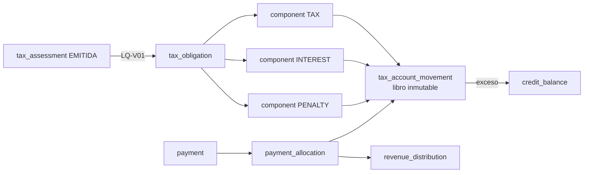
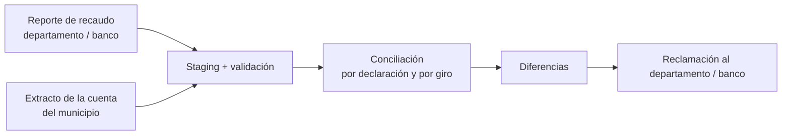

# Módulo 4 — Cuenta corriente y recaudo

> **Proyecto:** Liquidación del impuesto anual de vehículos automotores
> **Documentos relacionados:** `01_Menu_y_Cargue_Tablas_Base_Liquidacion.md` · `02_Homologacion_y_Reglas_de_Liquidacion.md` · `03_Configuracion_Jurisdiccion_y_Tablas_2026.md` · `05_Cartera_Intereses_Sanciones_Prescripcion.md` · `config_jurisdiccion_52356_2026.yaml` · `anexos/Formatos_Intercambio_Recaudo.xlsx`
> **Tablas del ERD:** `ledger.tax_obligation`, `ledger.obligation_component`, `ledger.tax_account_movement`, `ledger.payment`, `ledger.payment_allocation`, `ledger.credit_balance`, `ledger.revenue_distribution`
> **Alcance:** obligaciones, recibos y pagos, conciliación bancaria, imputación, saldos a favor, reversiones, distribución del recaudo y control de la participación del 20 %, con consultas y exportación a Excel.
> **Versión:** 0.2 — bancos, archivo bancario (Asobancaria 2001 y CSV canónico), reporte del 20 % e imputación «más antigua primero» aprobada por el equipo (§12); borrador funcional para validación
> **Fuera de alcance:** el cálculo de intereses de mora y de sanciones, que corresponde al Módulo 5 (`05_Cartera_Intereses_Sanciones_Prescripcion.md`). Este módulo los recibe ya calculados como componentes de la obligación. Tampoco incluye la pasarela de pagos en línea, que llega después del piloto (nota de §12).

---

## 0. Marco normativo verificado

| Tema | Regla | Efecto en el diseño |
|---|---|---|
| Procedimiento aplicable | Los departamentos y municipios aplican el procedimiento del Estatuto Tributario Nacional (Ley 788/2002 art. 59) | Imputación, devoluciones y compensaciones siguen el ET |
| Imputación de pagos | ET art. 804, modificado por la Ley 1066/2006 art. 6: el pago se imputa al período e impuesto que indique el contribuyente, en la misma proporción en que participan sanciones, intereses e impuesto dentro de la deuda total al momento del pago | Imputación **proporcional** dentro de cada obligación (§5) |
| Beneficiarios del 20 % | El 20 % corresponde al municipio de la **dirección informada en la declaración**, no al del organismo de tránsito (DUR 1625/2016 art. 2.2.4.5) | Distribución por dirección declarada (§7); universo de la modalidad C (§8) |
| Base de la distribución | Se distribuyen impuesto, intereses y sanciones (DUR 1625/2016 art. 2.2.4.6; Ley 488 art. 150) | Todos los componentes pagados entran a la distribución |
| Plazo de giro | Las entidades financieras abonan a los beneficiarios dentro de los 20 días siguientes al recaudo, según el convenio (Decreto 2654/1998 art. 6) | Alerta de giro tardío > 20 días (§7 y §8) |
| Competencia | Modalidades A, B y C del archivo de configuración (Doc. 03 §9.5) | Qué obligaciones nacen aquí y cómo se reparte el recaudo |

> **Corrección aplicada a la configuración y al Doc. 03:** con convenio (B), el 20 % va al municipio de la dirección declarada, que puede no ser Ipiales. La modalidad C controla las declaraciones con dirección en Ipiales, aunque el vehículo esté matriculado en otro municipio.

---

## 1. Menú del módulo

```
4. CUENTA CORRIENTE Y RECAUDO
├── 4.1 Obligaciones
│   ├── 4.1.1 Consulta de obligaciones
│   └── 4.1.2 Ajustes (solo por acto o corrección de liquidación)
├── 4.2 Recibos y pagos
│   ├── 4.2.1 Generar recibo de pago (por placa / documento / vigencias)
│   ├── 4.2.2 Cargar archivo de recaudo del banco
│   ├── 4.2.3 Registro manual de pago (ventanilla, con soporte)
│   └── 4.2.4 Conciliación bancaria
├── 4.3 Imputación
│   ├── 4.3.1 Imputación automática (proceso diario)
│   └── 4.3.2 Bandeja de pagos sin imputar / reimputación
├── 4.4 Saldos a favor
│   ├── 4.4.1 Consulta · 4.4.2 Compensación · 4.4.3 Devolución
├── 4.5 Distribución del recaudo                    (modalidades A y B)
│   ├── 4.5.1 Planilla de distribución · 4.5.2 Giros al departamento y a otros municipios
├── 4.6 Control de participación 20 %               (modalidad C)
│   ├── 4.6.1 Cargar reporte de recaudo · 4.6.2 Conciliación · 4.6.3 Reclamaciones
└── 4.7 Consultas, estado de cuenta, paz y salvo y exportación a Excel
```

Visibilidad según las modalidades activas: 4.1 a 4.4 se muestran si alguna modalidad liquida (A o B); 4.5 si A o B; 4.6 solo si C. Con el valor inicial de Ipiales (A + C) se ven 4.1–4.7. 4.5 opera solo sobre internados, que van 100 % al municipio, y 4.6 sobre las declaraciones con dirección en Ipiales.

---

## 2. Modelo de la cuenta corriente



**Principio:** el saldo de una obligación **nunca se guarda ni se edita**. Siempre se calcula como `Σ signed_amount` de sus movimientos, por componente. Ningún movimiento se borra; los errores se corrigen con un movimiento inverso (`reversal_of_id`).

### 2.1 Tipos de movimiento (`movement_type`)

| Código | Signo | Origen | Componente |
|---|:-:|---|---|
| `ASSESSMENT` | + | Emisión de la liquidación | TAX |
| `ASSESSMENT_ADJUSTMENT` | ± | Corrección de liquidación (LQ‑V02) | TAX |
| `INTEREST_ACCRUAL` | + | Causación de intereses al pagar o al hacer un corte (Módulo 5) | INTEREST |
| `PENALTY` | + | Sanción en firme (Módulo 5) | PENALTY |
| `PAYMENT` | − | Imputación de un pago | El que corresponda |
| `EARLY_PAYMENT_DISCOUNT` | − | Descuento por pronto pago reconocido | TAX |
| `BENEFIT` | − | Beneficio tributario aplicado después de la emisión | TAX |
| `CREDIT_COMPENSATION` | − | Compensación con un saldo a favor | El que corresponda |
| `OPENING_BALANCE` | + | Apertura de cartera histórica (Módulo 5) | El que corresponda |
| `WRITE_OFF` | − | Prescripción, remisión o depuración por acto | El que corresponda |
| `REVERSAL` | ∓ | Reverso de cualquiera de los anteriores | El mismo del original |

---

## 3. Opción 4.1 — Obligaciones

### 3.1 Nacimiento

Al **emitir** una liquidación (Doc. 02 LQ‑V01) se crean, en la misma transacción:

| Campo | Valor |
|---|---|
| `tax_obligation.original_principal` | `net_tax` (impuesto neto redondeado, **sin** restar el descuento) |
| `due_date` | `fecha_limite_pago_sin_intereses` del calendario. Para vehículos nuevos, la regla de `vehiculos_nuevos` (Doc. 03 §9.7) |
| `legally_payable_from` | `fecha_inicio_pago` |
| `origin_modality` (nuevo) | `UEDF_INTERNACION` o `CONVENIO_DEPTO` |
| `declared_address_municipality_id` (nuevo) | Municipio de la dirección declarada. Define el beneficiario del 20 % |
| Componente `TAX` y movimiento `ASSESSMENT` | Por `net_tax` |

### 3.2 Reglas

| Código | Regla |
|---|---|
| OB‑01 | Una sola obligación activa por vehículo + vigencia + administración + concepto, salvo responsabilidad solidaria registrada (hallazgo 3 del ERD) |
| OB‑02 | Solo nacen obligaciones de las modalidades que **liquidan** (A, B). Con C no se crean obligaciones |
| OB‑03 | Si B está activa, no nacen obligaciones de matriculados fuera de las fechas del convenio |
| OB‑04 | La obligación se ajusta solo con una corrección de liquidación o un acto administrativo; no admite edición directa |
| OB‑05 | La administración de la obligación (`administration_id`) debe ser la de la liquidación y la del usuario (integridad territorial, hallazgo 2 del ERD) |

### 3.3 Estados (derivados del saldo y de las fechas)

| Estado | Condición |
|---|---|
| `VIGENTE` | Saldo > 0 y hoy ≤ `due_date` |
| `EN_MORA` | Saldo > 0 y hoy > `due_date` |
| `PAGADA_PARCIAL` | Tiene pagos y saldo > 0 (se combina con VIGENTE o EN_MORA) |
| `PAGADA` | Saldo = 0 por pagos, descuento o compensación |
| `CON_SALDO_A_FAVOR` | Saldo < 0; el exceso pasa a `credit_balance` y la obligación queda en 0 |
| `REEMPLAZADA` / `ANULADA` | Por corrección o anulación de la liquidación |
| `DEPURADA` | Saldo extinguido por `WRITE_OFF` (Módulo 5) |

---

## 4. Opción 4.2 — Recibos y pagos

### 4.1 Recibo de pago (4.2.1)

Documento que el contribuyente lleva al banco o paga por PSE. Tiene una **referencia única** con dígito de verificación y código de barras (estándar GS1‑128, por confirmar con los bancos).

> **Nota:** el pago por PSE llega con la pasarela de pagos, después del piloto (nota de §12). En esta versión el recibo se paga en un banco con convenio o en ventanilla.

| Situación en la fecha de generación | Valor del recibo | Válido hasta |
|---|---|---|
| Antes del límite de descuento (≤ 30‑abr‑2026) | Neto − descuento, redondeado (p. ej. $308.000) | El límite de descuento |
| Después del límite de descuento y antes del límite sin intereses | Neto (sin descuento) | El límite sin intereses |
| En mora | Saldo de impuesto + sanciones + intereses calculados a la fecha de validez (Módulo 5) | El mismo día (o la fecha que elija el contribuyente; los intereses se calculan a esa fecha) |

- RP‑01: un recibo puede incluir varias vigencias del mismo vehículo; cada vigencia queda como una línea con su valor. Así el pago indica el período, como exige el art. 804 ET.
- RP‑02: el recibo se guarda inmutable (tabla nueva `ledger.payment_receipt` y sus líneas) y se anula si se genera otro para las mismas obligaciones.
- RP‑03: un pago con recibo vencido **no se rechaza**: se registra y se imputa con las reglas de §5 a la fecha real del pago. El descuento se pierde si el pago es posterior al límite.

### 4.2 Archivo de recaudo del banco (4.2.2)

Mismo patrón de staging que el Módulo 1: archivo inmutable con SHA‑256, filas originales, validación, aprobación y aplicación.

| Validación | Severidad |
|---|---|
| Archivo ya cargado (mismo SHA‑256) | ERROR |
| Referencia de recibo inexistente | ADVERTENCIA → bandeja "pagos sin imputar" |
| Pago duplicado (banco + referencia + fecha + valor = `idempotency_key`) | ERROR en la fila |
| Valor pagado distinto del valor del recibo | ADVERTENCIA (se imputa lo pagado) |
| Total del archivo distinto del total del extracto del día | ERROR del lote (va a conciliación) |

Formato del archivo: ver §12.2 (Asobancaria 2001 como preferido; CSV canónico como alternativa). Se parametriza en `recaudo.archivo_banco`.

### 4.3 Estados del pago (`ledger.payment.status`)

`RECIBIDO` → `CONCILIADO` → `IMPUTADO` (o `IMPUTADO_PARCIAL` con excedente a saldo a favor) · `RECHAZADO` · `REVERSADO`.
Solo un pago `CONCILIADO` (confirmado contra el extracto) puede imputarse (hallazgo 4 del ERD).

### 4.4 Conciliación bancaria (4.2.4)

Cruce diario de **archivo de recaudo ↔ extracto de la cuenta recaudadora**. Resultados posibles: `CONCILIADO`, `EN_ARCHIVO_NO_EN_EXTRACTO`, `EN_EXTRACTO_NO_EN_ARCHIVO`, `DIFERENCIA_VALOR`. Las partidas abiertas se escalan con antigüedad (0–5, 6–30, > 30 días).

---

## 5. Opción 4.3 — Imputación

### 5.1 Orden de aplicación de un pago conciliado

1. **Entre vigencias:** a la vigencia que indique el recibo o el contribuyente (art. 804 ET). Sin indicación, a la **más antigua primero** (parámetro `imputacion.sin_indicacion`, aprobado por el equipo y pendiente de revisión jurídica).
2. **Descuento por pronto pago:** si la fecha del pago es ≤ `fecha_limite_descuento` y lo pagado ≥ valor con descuento de esa obligación, se registra `EARLY_PAYMENT_DISCOUNT` por la diferencia entre el neto y lo pagado, y la obligación queda en 0.
   - Con `descuento_pago_parcial: NO_APLICA` (valor inicial), un pago parcial dentro del plazo **no** genera descuento: se imputa como abono.
3. **Dentro de la obligación:** proporcional a la participación de impuesto, sanciones e intereses en la deuda total a la fecha del pago (art. 804 ET). Antes, el Módulo 5 causa los intereses hasta esa fecha.
4. **Redondeo:** los componentes se calculan al peso; el residuo va al impuesto.
5. **Excedente:** lo que sobra después de saldar todas las vigencias indicadas pasa a `credit_balance`.

### 5.2 Ejemplos (Ipiales 2026, vehículo internado temporalmente)

**Ejemplo 1. Pago con descuento dentro del plazo.** Neto $342.000. Pago de $308.000 el 20‑abr‑2026.

| Movimiento | Componente | Valor | Saldo |
|---|---|---:|---:|
| `ASSESSMENT` | TAX | +342.000 | 342.000 |
| `PAYMENT` | TAX | −308.000 | 34.000 |
| `EARLY_PAYMENT_DISCOUNT` | TAX | −34.000 | **0** |

> El descuento efectivo es $34.000, no $34.200: el 10 % da $307.800, el redondeo deja el valor a pagar en $308.000 y la diferencia es lo que se reconoce como descuento.

**Ejemplo 2. Pago parcial en mora (proporcional).** Saldo al 15‑jul‑2026: impuesto $342.000 + intereses $15.000 (valor ilustrativo; lo calcula el Módulo 5). Pago de $200.000.

| Componente | Deuda | Participación | Imputado | Saldo |
|---|---:|---:|---:|---:|
| Impuesto | 342.000 | 95,80 % | 191.597 | 150.403 |
| Intereses | 15.000 | 4,20 % | 8.403 | 6.597 |
| **Total** | **357.000** | | **200.000** | **157.000** |

Con una sanción de $30.000 adicional (deuda total $387.000), el mismo pago se repartiría así: impuesto $176.744, intereses $7.752 y sanción $15.504.

> **Nota:** los $15.000 de intereses son un valor ilustrativo, porque el ejemplo prueba la imputación proporcional y no el cálculo de los intereses. Con las reglas y las tasas propuestas en el Doc. 05 (por verificar con la fuente oficial) el cálculo a esa fecha daría unos $19.000, y las cifras de la tabla cambiarían.

### 5.3 Reglas de control

| Código | Regla |
|---|---|
| IM‑01 | Σ imputaciones de un pago ≤ valor conciliado del pago (hallazgo 4 del ERD) |
| IM‑02 | El componente imputado pertenece a la obligación imputada |
| IM‑03 | Ninguna imputación deja saldo negativo en un componente; el exceso va a saldo a favor |
| IM‑04 | Cada imputación genera su `tax_account_movement` y queda enlazada en `payment_allocation.account_movement_id` |
| IM‑05 | Reimputar = reversar las imputaciones anteriores e imputar de nuevo, con motivo y doble aprobación |
| IM‑06 | El proceso es idempotente: si se reejecuta, no imputa dos veces el mismo pago |

---

## 6. Opción 4.4 — Saldos a favor y reversiones

### 6.1 Saldos a favor (`ledger.credit_balance`)

| Origen | Ejemplo |
|---|---|
| Pago en exceso | Pagó $350.000 sobre un recibo de $342.000 |
| Pago doble | Pagó dos veces el mismo recibo |
| Corrección a menor | La liquidación se corrige y baja el impuesto ya pagado |

| Uso | Regla |
|---|---|
| **Compensación** (4.4.2) | Contra otra obligación del mismo contribuyente y administración, a solicitud o por acto; genera `CREDIT_COMPENSATION`. `compensacion_automatica: false` como valor inicial |
| **Devolución** (4.4.3) | Solicitud, verificación, acto que la ordena y giro; el estado pasa por `SOLICITADA → APROBADA → GIRADA` o `RECHAZADA` |

Los plazos y requisitos de compensación y devolución se toman del procedimiento del ET (Ley 788/2002 art. 59) y quedan por confirmar con jurídica.

### 6.2 Reversiones

| Caso | Tratamiento |
|---|---|
| El banco reversa un pago (cheque devuelto, contracargo PSE) | `REVERSAL` de cada imputación; el pago pasa a `REVERSADO`; la obligación recupera su saldo y, si el descuento dependía de ese pago, también se reversa el descuento |
| Pago imputado a la vigencia equivocada | Reimputación (IM‑05) |
| Corrección de liquidación con pagos aplicados | `ASSESSMENT_ADJUSTMENT` por la diferencia; si queda saldo negativo, se traslada a saldo a favor |
| Distribución ya girada de un pago reversado | Se genera un **ajuste negativo** en la siguiente planilla de distribución (§7) |

> **Nota:** el contracargo PSE solo existe cuando llegue la pasarela de pagos, después del piloto (nota de §12). En esta versión los reversos vienen de los bancos (p. ej. un cheque devuelto).

---

## 7. Opción 4.5 — Distribución del recaudo (modalidades A y B)

Por cada imputación de un pago se crea un registro en `ledger.revenue_distribution`, según la modalidad de la obligación:

| Modalidad de la obligación | Beneficiarios |
|---|---|
| A — internado temporalmente | 100 % municipio de Ipiales |
| B — matriculado, por convenio | 80 % Departamento de Nariño · 20 % municipio de la **dirección declarada** |

- **Base:** impuesto + intereses + sanciones efectivamente pagados. El descuento no se distribuye, porque no es dinero recibido.
- **Redondeo:** el 80 % se redondea al peso y el municipio recibe el residuo, de modo que la suma siempre cuadra.
- **Giro:** se agrupa en una **planilla de distribución** por beneficiario y período (`GENERADA → APROBADA → GIRADA → CONFIRMADA`), con alerta si se superan los 20 días desde el recaudo.
- **Dirección de otro municipio:** si la dirección declarada es de otro municipio, su 20 % se gira a ese municipio; si es Ipiales, se retiene.

**Ejemplos con B activa:**

| Pago | Dirección declarada | Nariño 80 % | Municipio 20 % |
|---:|---|---:|---:|
| $2.012.000 (sin descuento) | Ipiales | $1.609.600 | $402.400 retenidos |
| $1.811.000 (con descuento) | Ipiales | $1.448.800 | $362.200 retenidos |
| $342.000 | Pasto | $273.600 | $68.400 girados a Pasto |

---

## 8. Opción 4.6 — Control de participación del 20 % (modalidad C)

Ipiales no liquida los matriculados: los recauda el departamento a través de sus bancos. El municipio verifica que reciba el 20 % de **todas las declaraciones con dirección en Ipiales**.

### 8.1 Flujo



### 8.2 Reporte de entrada (4.6.1)

Archivo CSV/XLSX del departamento o del banco. El formato está por acordar (propuesta en §12.4); los campos mínimos son: número de declaración o recibo, placa, documento del contribuyente, vigencia, fecha de pago, total pagado, desglose impuesto/intereses/sanciones, municipio de la dirección declarada, valor del 20 %, fecha y referencia del giro, y banco.

### 8.3 Conciliación (4.6.2)

| Resultado | Condición |
|---|---|
| `CONCILIADO` | 20 % esperado = valor girado y el giro aparece en el extracto |
| `DIFERENCIA_VALOR` | El girado difiere del 20 % calculado sobre impuesto + intereses + sanciones |
| `NO_GIRADO` | La declaración con dirección en Ipiales no tiene giro asociado |
| `GIRO_TARDIO` | Giro posterior a 20 días desde el recaudo (Decreto 2654/1998 art. 6) |
| `GIRO_SIN_SOPORTE` | Hay un abono en el extracto sin declaraciones que lo expliquen |

**Control complementario (informativo):** se cruzan los vehículos matriculados en el organismo de tránsito de Ipiales cuyos propietarios tienen dirección en Ipiales contra los pagos reportados. El resultado es una lista de **posibles omisos** para gestionar con el departamento. No crea obligaciones, porque la competencia es departamental.

### 8.4 Reclamaciones (4.6.3)

Cada diferencia puede agruparse en una reclamación con estado (`ABIERTA → ENVIADA → RESPONDIDA → CERRADA`), soportes y valor reclamado, y su exportación a Excel sirve como anexo del oficio.

---

## 9. Opción 4.7 — Consultas, estado de cuenta y paz y salvo

| Consulta | Filtros principales | Contenido |
|---|---|---|
| **Estado de cuenta** | Placa o documento | Por vigencia: impuesto, intereses, sanciones, pagos, descuento, saldo y estado; detalle de movimientos |
| **Paz y salvo / certificado** | Placa, vigencias | Se emite solo si el saldo es 0 en todas las vigencias exigibles; lleva código de verificación |
| Obligaciones | Vigencia, estado, modalidad, rango de saldo, municipio de la dirección, antigüedad de mora | Saldo por componente |
| Pagos | Fecha, banco, canal, estado, rango de valor, referencia | Pago, conciliación, imputación |
| Pagos sin imputar | Antigüedad, banco, causa | Para gestión de la bandeja 4.3.2 |
| Imputaciones | Pago, obligación, componente, fecha | Rastreo pago → movimiento |
| Saldos a favor | Estado, origen, contribuyente | Disponible, compensado, devuelto |
| Distribución | Período, beneficiario, planilla, estado | Valores por beneficiario y días al giro |
| Participación 20 % | Período, resultado de la conciliación, banco | Esperado vs. girado, diferencias |

**Excel:** mismo estándar del Doc. 01 §7.1 (hoja *Parámetros* + *Datos* + resúmenes, montos numéricos, placas y referencias como texto, asíncrono por encima de 50.000 filas y auditoría `EXPORT`).

---

## 10. Roles y segregación

| Acción | Recaudo | Contabilidad / Tesorería | Aprobador | Consulta |
|---|:-:|:-:|:-:|:-:|
| Generar recibo, consultar estado de cuenta | ✔ | ✔ | ✔ | ✔ |
| Cargar archivo del banco / reporte del departamento | ✔ | | | |
| Aprobar lote de recaudo y conciliación | | ✔ (≠ cargador) | | |
| Registro manual de pago | ✔ (con soporte) | | ✔ aprueba | |
| Reimputar, reversar, compensar | | ✔ propone | ✔ aprueba | |
| Aprobar devolución | | | ✔ (con acto) | |
| Aprobar y girar planilla de distribución | | ✔ | ✔ | |
| Emitir paz y salvo | ✔ | | | |

---

## 11. Ajustes al modelo de datos

1. `ledger.tax_obligation`: agregar `origin_modality VARCHAR(30)`, `declared_address_municipality_id UUID FK → core.territorial_entity`, `discount_deadline DATE` (copiada del calendario al emitir).
2. Nueva `ledger.payment_receipt` (id, referencia única, contribuyente, vehículo, fecha de generación, válido hasta, valor total, estado) y `ledger.payment_receipt_line` (recibo, obligación, valor por componente, con o sin descuento).
3. Nuevas `ledger.bank_file`, `ledger.bank_file_row` y `ledger.bank_reconciliation` (staging y conciliación, mismo patrón del Módulo 1).
4. `ledger.payment`: agregar `receipt_id FK`, `channel`, `bank_file_row_id FK`; mantener `idempotency_key` como UNIQUE.
5. `ledger.revenue_distribution`: agregar `distribution_batch_id FK`, `component_type`, `days_to_transfer`. Nueva `ledger.distribution_batch` (planilla).
6. Nuevas `ledger.participation_report`, `ledger.participation_report_row`, `ledger.participation_match` y `ledger.participation_claim` (modalidad C).
7. `ledger.credit_balance`: agregar `origin_type`, `origin_payment_id`, `status` con los estados de §6.1, y `ledger.credit_balance_use` (compensaciones y devoluciones).
8. Catálogo `ref.movement_type` con signo y componente permitido (§2.1). CHECK: `signed_amount` coherente con el signo del tipo.
9. Vista materializada `ledger.v_obligation_balance` (saldo por obligación y componente) para consultas rápidas, recalculada desde los movimientos.

---

## 12. Canales de recaudo: bancos, archivos de intercambio y reporte del 20 %

> **Alcance de esta versión:** la pasarela de pagos en línea llega después del piloto, junto con el portal del contribuyente (`spec/constitution/mission.md`; decisión P9 del doc. 00), y no hace parte de este documento: el §12.3 y los criterios CA‑4.14 a CA‑4.17 quedan reservados para ella. CA‑4.18 conserva su número.

### 12.1 Canales definidos

| Canal | Entidades | Cómo llega la información | Conciliación |
|---|---|---|---|
| Banco con convenio | Banco AV Villas, Banco Davivienda, Banco de Occidente, Bancolombia | Archivo diario de recaudo por banco (§12.2) | Archivo ↔ extracto de la cuenta de recaudo de cada banco |
| Ventanilla | Tesorería municipal | Registro manual con soporte y aprobación (4.2.3) | Arqueo diario |

Cada banco tiene su propia cuenta de recaudo y su propio lote diario. La configuración no guarda el número de cuenta: `recaudo.bancos[].cuenta_recaudo_ref` es una referencia al gestor de secretos (pendiente de diligenciar), porque las cuentas bancarias de recaudo son datos restringidos que no van en el repositorio (`docs/arquitectura/02` §6). Un pago no se imputa hasta que se concilia con el extracto (§4.3).

### 12.2 Formato del archivo bancario

El formato todavía **no está definido** con los bancos. El sistema queda preparado así:

| Opción | Descripción | Uso |
|---|---|---|
| **Asobancaria 2001** (preferido) | Estándar del sector financiero colombiano para reportar recaudos: archivo plano de registros de 220 posiciones, con encabezado de archivo, encabezado de lote, detalle, control de lote y control de archivo | Se pide primero a los cuatro bancos, porque suelen tenerlo disponible |
| **CSV canónico v1** (alterno) | Layout propio del sistema: CSV con separador `;`, registros E/D/T, referencia del recibo, valor en pesos, fecha y hora del pago, número de transacción y fecha de abono | Para el banco que no entregue Asobancaria |
| Formato propio del banco | Se agrega un adaptador que lo convierte al canónico | Solo si el banco no acepta ninguna de las dos opciones |

Los tres formatos llegan al mismo staging. Las validaciones de §4.2 se aplican al registro ya convertido, de modo que cambiar de banco o de formato no cambia las reglas.

**Qué formato rige para cada banco** (`recaudo.archivo_banco`), en este orden de precedencia (propuesta, por confirmar con los bancos; §14, punto 1a):

1. el de su entrada en `formato_por_banco`, si la tiene (`[{banco, formato}]`; vacía hasta que cada banco confirme);
2. si no la tiene, `formato_preferido`.

`formato_alterno` no se elige solo: rige para un banco únicamente cuando su entrada de `formato_por_banco` lo nombra. Si la configuración trae solo `formato` (versión 1.0), ese valor rige para todos los bancos. La clave `formato` de la versión 1.0 de la configuración sigue aceptándose, y `formato_preferido` la reemplaza. Si una configuración trae las dos, vale `formato_preferido` y el validador da una advertencia (Doc. 03 §5.4, CJ16).

El layout del CSV canónico, con un ejemplo, está en las hojas «Recaudo - layout» y «Recaudo - ejemplo» de `docs/funcional/anexos/Formatos_Intercambio_Recaudo.xlsx`, y las reglas comunes de los CSV (codificación, separador, fechas y nombre del archivo) en su hoja «Instrucciones». Ese archivo trae además una hoja y una mención sobre pagos en línea: no hacen parte de esta versión (nota de §12). Su campo `cuenta_recaudo` es un dato restringido (§12.1): cómo se valida y se protege queda como pendiente (§14, punto 1d). Dos precisiones sobre el archivo: «formatos oficiales» en su hoja «Instrucciones» debe leerse como formatos propuestos, mientras no se acuerden con los bancos y la Gobernación; y los campos `referencia_recibo` y `municipio_direccion_dane`, que el layout llama «Numérico», se tratan como texto de solo dígitos, para no perder ceros a la izquierda ni precisión.

### 12.4 Reporte del 20 % (modalidad C)

El formato tampoco está definido con la Gobernación de Nariño ni con los bancos. Se propone el **CSV de participación v1** (hojas «Reporte 20 % - layout» y «Reporte 20 % - ejemplo» de `docs/funcional/anexos/Formatos_Intercambio_Recaudo.xlsx`). Una fila por declaración pagada con dirección en Ipiales, con:
- desglose de impuesto, intereses y sanciones;
- valor del 20 %;
- fecha y referencia del giro;
- un registro de totales.

Periodicidad propuesta: mensual. Quién envía el reporte (`remitente`) es un texto libre de la configuración: en Ipiales, «Gobernación de Nariño o bancos»; en la plantilla, pendiente.

### 12.5 Parámetros en la configuración (`recaudo`)

Agregados en `config_jurisdiccion_52356_2026.yaml` y en la plantilla. En Ipiales la sección `recaudo` está en `POR_CONFIRMAR`; la lista de bancos (`estado_bancos`) está `VIGENTE`, y el formato del archivo bancario y el reporte del 20 % están en `PENDIENTE`. Los anexos con estos valores entran en `main` después del esquema 1.1 (Doc. 03 §9.2); hasta entonces, los de `main` conservan la versión anterior.

| Parámetro | Valor |
|---|---|
| `canales` | Banco con convenio, ventanilla |
| `bancos` | AV Villas, Davivienda, Occidente, Bancolombia; `cuenta_recaudo_ref` pendiente (la plantilla trae la lista vacía) |
| `recibo_pago.validez_antes_limite_descuento` / `validez_en_mora` | Hasta el límite de descuento / mismo día |
| `archivo_banco` | Preferido Asobancaria 2001; alterno CSV canónico v1; formato por banco pendiente; frecuencia diaria |
| `imputacion.entre_vigencias` / `sin_indicacion` | La que indique el contribuyente / **la más antigua primero** (aprobado por el equipo; pendiente de revisión jurídica) |
| `imputacion.dentro_de_la_obligacion` | Proporcional (art. 804 ET) |
| `descuento_pago_parcial` | `NO_APLICA` |
| `saldo_a_favor.compensacion_automatica` | `false` |
| `distribucion.base` / `dias_maximos_giro` / `redondeo` | Impuesto + intereses + sanciones / 20 / departamento redondeado, residuo al municipio |
| `reporte_participacion_20` | Formato propuesto CSV v1, mensual, remitente en texto libre, pendiente de acordar con la Gobernación |

---

## 13. Criterios de aceptación

| # | Caso | Esperado |
|---|---|---|
| CA‑4.01 | Emitir liquidación de un internado | Obligación con `due_date` 30‑abr‑2026, movimiento `ASSESSMENT` y modalidad A |
| CA‑4.02 | Pagar $308.000 el 20‑abr sobre neto $342.000 | Pago + descuento $34.000; saldo 0; estado `PAGADA` |
| CA‑4.03 | Pagar $200.000 el 20‑abr sobre neto $342.000 (parcial) | Sin descuento; saldo $142.000 |
| CA‑4.04 | Pago en mora de $200.000 con intereses de $15.000 | Imputación $191.597 / $8.403 |
| CA‑4.05 | Cargar dos veces el mismo archivo del banco | Rechazo por SHA‑256 |
| CA‑4.06 | Pago con referencia inexistente | Bandeja de pagos sin imputar |
| CA‑4.07 | Pago de $350.000 sobre recibo de $342.000 | Saldo a favor de $8.000 |
| CA‑4.08 | Reverso bancario de un pago con descuento | Reverso del pago y del descuento; saldo $342.000 |
| CA‑4.09 | Con B activa, pago de $342.000 con dirección en Pasto | $273.600 a Nariño, $68.400 a Pasto |
| CA‑4.10 | Con C activa, giro del 20 % a los 25 días del recaudo | `GIRO_TARDIO` |
| CA‑4.11 | Intentar crear una obligación de un matriculado con solo A + C activas | Bloqueo OB‑02 |
| CA‑4.12 | Paz y salvo con una vigencia en mora | No se emite; se muestra el saldo |
| CA‑4.13 | Reejecutar la imputación diaria | Sin imputaciones duplicadas (IM‑06) |
| CA‑4.18 | Archivo Asobancaria de Davivienda y CSV canónico de Occidente el mismo día | Ambos se convierten, validan y concilian con las mismas reglas |

CA‑4.18 conserva su número (véase la nota de §12) y supone que cada banco ya confirmó su formato y que la configuración lo registra en `formato_por_banco`.

---

## 14. Pendientes por confirmar

| # | Punto | Estado |
|---|---|---|
| 1 | Bancos del recaudo | **Resuelto:** AV Villas, Davivienda, Occidente y Bancolombia. La pasarela de pagos queda para después del piloto (nota de §12) |
| 1a | Formato del archivo de recaudo y su precedencia por banco (§12.2) | **Pendiente:** proponer Asobancaria 2001 a los cuatro bancos; CSV canónico como alternativa. Confirmar con la especificación de Asobancaria la versión y la longitud de sus registros |
| 1b | Cuentas de recaudo por banco, como referencia al gestor de secretos (`cuenta_recaudo_ref`) | Pendiente |
| 1c | Estándar del código de barras del recibo (GS1‑128, por confirmar con los bancos) | Pendiente |
| 1d | Tratamiento del campo `cuenta_recaudo` del archivo bancario, un dato restringido que llega en cada registro y queda en el *staging* inmutable (`docs/arquitectura/02` §6) | Pendiente |
| 1e | Clave de pago duplicado: banco + referencia + fecha + valor (§4.2) frente al número de transacción del CSV canónico, y qué pasa con dos pagos legítimos iguales el mismo día | Pendiente |
| 2 | Formato del reporte del 20 % | **Pendiente:** enviar a la Gobernación el CSV de participación v1 propuesto |
| 2a | Periodicidad del reporte del 20 % (propuesta: mensual) | Pendiente |
| 3 | Imputación entre vigencias sin indicación | **Resuelto:** la más antigua primero (aprobado por el equipo; pendiente de revisión jurídica) |
| 4 | Descuento en pagos parciales dentro del plazo | Pendiente (valor inicial: no aplica) |
| 5 | Requisitos y plazos de devolución y compensación del estatuto municipal | Pendiente |
| 6 | Requisitos del paz y salvo | Pendiente |
| 7 | Cuentas bancarias de recepción de giros (del 20 % y de la distribución), también como referencia al gestor de secretos | Pendiente |

## 15. Módulo 5 — Cartera

Los intereses de mora, las sanciones, la prescripción de la acción de cobro y la apertura de cartera histórica están definidos en `05_Cartera_Intereses_Sanciones_Prescripcion.md`. Su salida alimenta los movimientos `INTEREST_ACCRUAL`, `PENALTY`, `OPENING_BALANCE` y `WRITE_OFF` de este módulo.

---

**Fuentes:**
- [Art. 804 ET aplicable a tributos territoriales por art. 59 Ley 788/2002 (CIJUF, concepto 28046)](https://cijuf.org.co/node/5197)
- [Imputación proporcional — doctrina DIAN, oficio 17590 de 2025](https://normograma.dian.gov.co/dian/compilacion/docs/oficio_dian_17590_2025.htm)
- [DUR 1625/2016 arts. 2.2.4.5 y 2.2.4.6 — beneficiarios y distribución (Cancillería)](https://cancilleria.gov.co/sites/default/files/Normograma/docs/pdf/decreto_1625_2016_pr048.pdf)
- [Decreto 2654 de 1998 — distribución dentro de 20 días (Gobernación del Huila)](https://vehiculos.huila.gov.co/HUIVehiculos/resources/normativa/Decreto_2654_1998.pdf)
- [Concepto MinHacienda: el 20 % corresponde al municipio de la dirección declarada (Actualícese)](https://cdn.actualicese.com/normatividad/2017/Conceptos/C001368-17.pdf)
- [Asobancaria — especificaciones técnicas para reportar el recaudo (registros de 220 caracteres)](https://www.asobancaria.com/wp-content/uploads/2016/11/ESPECIFICACIONES-T%C3%89CNICAS-PARA-REPORTAR-LA-INFORMACI%C3%93N-DEL-RECAUDO-EN-EL-SECTOR-FINANCIERO-COLOMBIANO.pdf)
