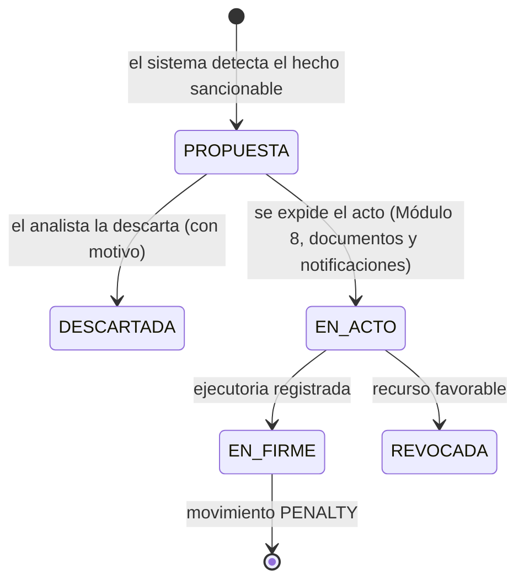

# Módulo 5 — Cartera: intereses, sanciones, prescripción y cartera histórica

> **Proyecto:** Liquidación del impuesto anual de vehículos automotores
> **Documentos relacionados:** `01_Menu_y_Cargue_Tablas_Base_Liquidacion.md` · `02_Homologacion_y_Reglas_de_Liquidacion.md` · `03_Configuracion_Jurisdiccion_y_Tablas_2026.md` · `04_Cuenta_Corriente_y_Recaudo.md` · `ERD_impuesto_vehicular_definitivo_v2_CSV_cartera.md` (versión 2.2) · `config_jurisdiccion_52356_2026.yaml` (sección `cartera`)
> **Tablas del ERD:** `portfolio.opening_balance_batch`, `portfolio.opening_balance_row`, `portfolio.opening_balance_event`, `portfolio.opening_balance_error`, `portfolio.opening_balance_application`, `portfolio.interest_rate`, `portfolio.interest_calculation`, `portfolio.interest_calculation_detail`, `portfolio.penalty_assessment`, `portfolio.prescription_event`, `portfolio.prescription_evaluation`, `portfolio.portfolio_cutoff`, `portfolio.collection_portfolio_snapshot`, `tax.penalty_rule`; escribe en `ledger.tax_obligation` y `ledger.tax_account_movement` (Doc. 04).
> **Alcance:** apertura de cartera histórica, tasas e intereses de mora, sanciones, prescripción de la acción de cobro, cortes de cartera y antigüedad, con consultas y exportación a Excel.
> **Versión:** 0.1 — borrador funcional para validación
> **Fuera de alcance:** cobro persuasivo y coactivo (Módulo 6) y medidas cautelares (Módulo 7). Este módulo solo **registra** los eventos de cobro que interrumpen la prescripción; los actos de cobro se producen en el Módulo 6.

---

## 0. Marco normativo

> **Pendiente de validación.** Este marco resume la normativa para fines de diseño y **no está validado**: falta la validación del área jurídica y la fuente oficial de la UVT, de las tasas de usura y de la fórmula de los intereses (pendientes 9, 10 y 11, §11). Lo que viene de prensa lleva «por verificar». Todo es una propuesta de diseño pendiente de revisión jurídica.

| Tema | Regla | Fuente |
|---|---|---|
| Procedimiento aplicable | Los entes territoriales aplican el procedimiento del Estatuto Tributario (ET) nacional a sus tributos. Pueden reducir el monto de las sanciones según la naturaleza del tributo. | Ley 788/2002 art. 59 |
| Tasa de mora | Tasa diaria equivalente a la **usura de crédito de consumo y ordinario** certificada por la Superfinanciera, **menos 2 puntos**. La fórmula está por verificar (pendiente 11). | ET art. 635 |
| Fórmula | Interés **simple** diario (fórmula del parágrafo del art. 590 ET, al que remite el art. 635). Por verificar (pendiente 11). | ET arts. 590 par. y 635 |
| Sanción mínima | 10 UVT. No se aplica a los intereses de mora. Con la UVT 2026 de $52.374 (**por verificar**, pendiente 9), equivale a $523.740, antes de cualquier aproximación de la conversión a pesos. | ET art. 639; Res. DIAN 000238/2025 (por verificar) |
| Extemporaneidad | 5 % del impuesto por mes o fracción de mes (por verificar). Solo aplica si existe el deber de **declarar**. | ET art. 641 |
| Facturación | En vehículos, la factura que expide la administración es la determinación oficial del tributo y presta mérito ejecutivo. | Ley 1111/2006 art. 69 (mod. Ley 1430/2010 art. 58 y Ley 1819/2016 art. 354) |
| Prescripción | La acción de cobro prescribe a los **5 años** desde la exigibilidad. Se decreta de oficio o a petición de parte. | ET art. 817 |
| Interrupción | La interrumpen la notificación del mandamiento de pago, la facilidad de pago, la admisión de un proceso de reorganización o la liquidación forzosa. El término vuelve a correr desde el día siguiente (para la reorganización y la liquidación forzosa, ver el pendiente 18). | ET art. 818 |
| Prescripción en proceso de cobro | Si ya se notificó el mandamiento de pago, la prescripción se alega como excepción. | ET arts. 830‑831 |

> **Consecuencia de diseño para Ipiales.** El impuesto se determina por **liquidación‑factura** (Doc. 02/03), no por declaración: `cartera.sanciones.sistema_determinacion` vale `LIQUIDACION_FACTURA`. Por eso, en el archivo de configuración, la sanción por extemporaneidad viene **desactivada**: no hay una declaración que se presente tarde. Lo que se genera por pagar tarde son **intereses de mora**. Si el Estatuto de Rentas de Ipiales dispone otra cosa, se activa la regla correspondiente (§5).

---

## 1. Menú del módulo

```
5. CARTERA
├── 5.1 Apertura de cartera histórica
│   ├── 5.1.1 Descargar plantilla y cargar lote        portfolio.opening_balance_batch / _row / _event
│   ├── 5.1.2 Validar lote (errores por fila)          portfolio.opening_balance_error
│   ├── 5.1.3 Conciliar contra el sistema anterior
│   └── 5.1.4 Aprobar y aplicar                         portfolio.opening_balance_application → OPENING_BALANCE
├── 5.2 Intereses de mora
│   ├── 5.2.1 Tasas mensuales (certificación SFC)       portfolio.interest_rate
│   ├── 5.2.2 Simulador de intereses (vehículo / vigencia / fecha)
│   ├── 5.2.3 Causación mensual masiva                  portfolio.interest_calculation → INTEREST_ACCRUAL
│   └── 5.2.4 Consulta de cálculos y tramos             portfolio.interest_calculation_detail
├── 5.3 Sanciones
│   ├── 5.3.1 Reglas de sanción (lectura de la configuración)   tax.penalty_rule
│   ├── 5.3.2 Propuestas de sanción (bandeja)
│   └── 5.3.3 Registrar acto y firmeza                  → PENALTY
├── 5.4 Prescripción
│   ├── 5.4.1 Eventos de interrupción y suspensión      portfolio.prescription_event
│   ├── 5.4.2 Semáforo de prescripción
│   ├── 5.4.3 Solicitudes y expedientes                 portfolio.prescription_evaluation
│   └── 5.4.4 Registrar acto que decreta la prescripción → WRITE_OFF
├── 5.5 Cortes de cartera
│   ├── 5.5.1 Generar corte mensual                     portfolio.portfolio_cutoff / collection_portfolio_snapshot
│   ├── 5.5.2 Antigüedad de cartera
│   └── 5.5.3 Conciliación cartera ↔ contabilidad
└── 5.6 Consultas y exportación a Excel
```

Todas las consultas siguen el estándar del Doc. 01 §7.1: filtros, hoja *Parámetros* con los filtros usados más hoja *Datos*, generación asíncrona por encima de 50.000 filas y registro de auditoría `EXPORT`.

Qué opciones del menú ve cada jurisdicción según sus modalidades de competencia activas queda por definir (pendiente 15): con solo la modalidad `PARTICIPACION_20` no nacen obligaciones (Doc. 04 §3.2).

---

## 2. Principios del módulo

1. **La cartera no se guarda: se calcula.** El saldo de cada obligación es la suma de sus movimientos en `ledger.tax_account_movement` (Doc. 04 §2). Este módulo no tiene tablas de saldos propias; el corte (§7) es una **foto** inmutable que sirve para informes y contabilidad.
2. **Todo valor sale de una regla con fuente.** Tasas con su resolución de la Superfinanciera, sanciones con su acto administrativo, prescripción con su acto que la decreta.
3. **Los intereses se recalculan, no se editan.** Si cambia el capital (un pago, una reliquidación, una reversión), el cálculo se rehace a partir de las causaciones reversadas (MO‑04, MO‑05). No existe un "ajuste manual de intereses".
4. **Nada se extingue por el paso del tiempo en el sistema.** La prescripción la **decreta** un funcionario competente mediante acto; el semáforo solo alerta.
5. **Segregación:** quien carga tasas o lotes no los aprueba; quien propone una prescripción no la firma.
6. **Idempotencia:** volver a ejecutar una causación o un lote no duplica movimientos (llave: obligación + fecha hasta + versión de la regla, para los cálculos vigentes que no son simulación; ver §10).

---

## 3. Opción 5.1 — Apertura de cartera histórica

Sirve para trasladar al sistema las vigencias anteriores que el contribuyente adeuda, tomadas del sistema anterior o de los archivos físicos. Se hace **una vez por vigencia migrada** y en lotes independientes del cargue de tablas.

### 3.1 Plantilla (una fila por placa y vigencia)

| Campo | Obligatorio | Regla | Campo en `portfolio.opening_balance_row` |
|---|---|---|---|
| `placa` | Sí | Normalizada (mayúsculas, sin espacios). Debe existir en el registro de vehículos o crearse antes. | `plate` |
| `vigencia` | Sí | Desde `cartera_historica.vigencias_desde` hasta la vigencia anterior a la actual. | `fiscal_year` |
| `documento_sujeto` / `tipo_documento` | Sí | Propietario o poseedor responsable de esa vigencia. | `taxpayer_document` |
| `capital_impuesto` | Sí | En pesos. > 0. | `tax_principal` |
| `sancion` | No | Solo si consta acto en firme; requiere `acto_sancion_numero` y `acto_sancion_fecha_ejecutoria`. | `penalty_balance`, `penalty_act_number`, `penalty_act_final_date` |
| `intereses_legado` | Condicional | Obligatorio si `intereses_historicos = TOMAR_DEL_LEGADO`. Calculados hasta `fecha_corte_migracion`. | `legacy_interest` |
| `pagos_parciales` | No | Total abonado. Los pagos deben venir ya restados del capital o detallados en hoja aparte. | — |
| `fecha_limite_pago` | Sí | La de esa vigencia. Inicio de la mora. | `original_due_date` |
| `numero_factura` / `fecha_notificacion` / `fecha_ejecutoria` | Sí (si falta la fecha de ejecutoria, CH‑06) | Necesarios para la exigibilidad y la prescripción (§6). | `invoice_number`, `notification_date`, `final_date` |
| `eventos_cobro` | No | Hoja aparte: tipo de evento (mandamiento, facilidad, reorganización…), número, fecha de notificación. | `portfolio.opening_balance_event` |
| `soporte` | Sí | Ruta o identificador del expediente. | `support_reference` |

La fecha de corte de la migración (`fecha_corte_migracion`) se guarda en `balance_cutoff_date`. El ERD 2.2 no tiene una columna para `tipo_documento` ni para `pagos_parciales`: la fila íntegra de la fuente queda en `original_data`.

### 3.2 Validaciones del lote

| Código | Regla | Severidad |
|---|---|---|
| CH‑01 | Archivo ya cargado (mismo SHA‑256) | ERROR del lote |
| CH‑02 | Placa + vigencia duplicadas en el lote o ya existentes en la cuenta corriente | ERROR |
| CH‑03 | Vigencia fuera del rango configurado o igual/posterior a la vigente | ERROR |
| CH‑04 | Capital ≤ 0 o no numérico | ERROR |
| CH‑05 | Sanción sin acto o sin fecha de ejecutoria | ERROR |
| CH‑06 | Falta la fecha de ejecutoria de la factura | ADVERTENCIA (la obligación queda marcada "sin exigibilidad acreditada" y aparece como "Sin dato" en el semáforo) |
| CH‑07 | Según las fechas cargadas y sin eventos de interrupción, la vigencia ya habría superado los 5 años | ADVERTENCIA "posible prescrita": se migra igual, pero va directo a la bandeja 5.4.3 |
| CH‑08 | Falta la tasa de algún mes entre `fecha_limite_pago` y la fecha de corte (si `RECALCULAR`) | ERROR del lote |
| CH‑09 | Diferencia de intereses recalculados contra el legado mayor que `tolerancia_conciliacion_pesos` | ADVERTENCIA → informe 5.1.3 |
| CH‑10 | Sujeto inexistente o documento inválido | ERROR |

### 3.3 Intereses históricos: dos modos

| Modo | Qué hace | Cuándo usarlo |
|---|---|---|
| `RECALCULAR` (recomendado) | Migra capital y sanciones. El sistema calcula los intereses desde el día siguiente a `fecha_limite_pago`, con la tabla de tasas mensual. | Si se pueden cargar las tasas desde la vigencia más antigua. Deja una sola fórmula para toda la cartera. |
| `TOMAR_DEL_LEGADO` | Migra también los intereses hasta `fecha_corte_migracion` como `OPENING_BALANCE` del componente `INTEREST`. Desde el día siguiente calcula este sistema. | Si las tasas históricas no están disponibles o el legado ya fue auditado. |

En los dos casos, 5.1.3 produce un informe de conciliación por obligación (legado vs. sistema) que el aprobador debe revisar antes de aplicar.

### 3.4 Aplicación

Al aprobar (rol `APROBADOR_CARTERA`, **propuesta**; ver §9), por cada fila válida:

1. Crea la `ledger.tax_obligation` de la vigencia, con `origin = MIGRACION` (no tiene liquidación: `assessment_id` queda nulo), `due_date = fecha_limite_pago` y `final_assessment_date` igual a la fecha de ejecutoria de la factura. Qué configuración de jurisdicción rige esa obligación (`jurisdiction_config_id`) queda pendiente (§11, pendiente 14).
2. Registra `OPENING_BALANCE` por componente (`TAX`, `PENALTY`, y `INTEREST` si aplica).
3. Registra los eventos de cobro como `portfolio.prescription_event`, a partir de `portfolio.opening_balance_event`.
4. Enlaza todo en `portfolio.opening_balance_application`.

Un lote aplicado no se edita. Una corrección se hace con `REVERSAL` de la fila (doble aprobación) y una nueva fila en otro lote.

---

## 4. Opción 5.2 — Intereses de mora

### 4.1 Tabla de tasas (5.2.1) — `portfolio.interest_rate`

Una fila por mes calendario. Se carga cuando la Superfinanciera publica la certificación (normalmente el último día hábil del mes anterior). La tasa es un dato **nacional** (`administration_id` nulo): la leen todas las administraciones. Quién la carga y quién la aprueba en un producto multi‑inquilino queda en el pendiente 17.

| Campo | Ejemplo |
|---|---|
| `valid_from` / `valid_to` (el mes calendario) | 2026‑11‑01 / 2026‑11‑30 |
| `usury_rate` (usura de consumo y ordinario, EA) | 0,2834 |
| Tasa de mora, EA (= usura − `puntos_a_restar` de la configuración; la fórmula es el pendiente 11) | 0,2634. Se **deriva**: no se guarda |
| `legal_instrument_id` (resolución de la Superfinanciera) | Res. SFC 1707 de 2026 (por verificar) |
| `support_pdf_sha256` | hash del PDF de la certificación |
| `uploaded_by` / `approved_by` | usuarios distintos |
| `status` | `BORRADOR` → `APROBADA` (inmutable), o `RECHAZADA` |

**Tasas 2026 propuestas como datos iniciales** (usura de consumo y ordinario según la prensa; **por verificar** contra las certificaciones de la Superfinanciera, pendiente 10). Entran solo por la opción 5.2.1, con su PDF y su aprobación (CA‑5.01), nunca por una migración ni por datos de arranque:

| Mes | Usura EA (por verificar) | Tasa de mora (−2 pp) |
|---|---:|---:|
| Enero | 24,36 % | 22,36 % |
| Febrero | 25,23 % | 23,23 % |
| Marzo | 25,52 % | 23,52 % |
| Abril | 26,76 % | 24,76 % |
| Mayo | 28,17 % | 26,17 % |
| Junio | 28,79 % | 26,79 % |
| Julio | 28,79 % | 26,79 % |
| Agosto | 29,66 % | 27,66 % |
| Septiembre | 29,24 % | 27,24 % |
| Octubre | 28,59 % | 26,59 % |
| Noviembre | 28,34 % | 26,34 % |

> Diciembre de 2026 se carga cuando la SFC lo certifique. Si falta la tasa de un mes, el sistema **bloquea** el cálculo que lo necesite (`bloquear_si_falta_tasa: true`), en lugar de usar la tasa del mes anterior.

### 4.2 Regla de cálculo

Los parámetros salen de `cartera.intereses_mora` (Doc. 03 §5.2). En Ipiales esa regla está en `POR_CONFIRMAR` (fórmula y tasas por verificar); la plantilla la deja en `PENDIENTE`.

```
Para cada obligación en mora:
  inicio  = día siguiente a due_date (fecha_limite_pago_sin_intereses; Doc. 03 §9.6)
  hasta   = fecha de pago, fecha de validez del recibo o fecha de corte
  tramos  = se corta en cada cambio de mes (cambia la tasa)
            y en cada fecha en que cambia el capital (abono, reliquidación, reversión)
  interés_tramo = capital_TAX_pendiente × tasa_mora_mes / días_del_año × días_del_tramo
  interés = Σ interés_tramo
            → redondeo de causación (propuesta: múltiplo de $1.000 más cercano; empate hacia arriba)
```

| Regla | Detalle |
|---|---|
| MO‑01 | **Base:** solo el capital pendiente del componente `TAX`. No se calculan intereses sobre intereses (anatocismo) ni, por defecto, sobre sanciones (`sobre_sanciones: false`, por confirmar con jurídica: pendiente 3). |
| MO‑02 | **Días:** se cuentan los días calendario desde `inicio` hasta `hasta`, ambos incluidos. `días_del_año` = 365, o 366 en año bisiesto. |
| MO‑03 | **Interés simple:** cada tramo se calcula sobre el capital, nunca sobre capital + intereses anteriores. |
| MO‑04 | **Causación incremental:** cada cálculo empieza el día siguiente a la última fecha ya causada para esa obligación (MO‑02 cuenta los dos extremos, así que ese día no se cobra dos veces). Lo causado no se recalcula, salvo que se reverse. |
| MO‑05 | **Cambio de capital retroactivo** (reliquidación, reversión de un pago): se reversan los `INTEREST_ACCRUAL` vigentes cuyo período llega hasta la fecha del cambio o la supera (`accrual_to` ≥ fecha del cambio) y se recalcula desde el inicio del período de la primera causación reversada. |
| MO‑06 | **Vehículos nuevos:** el inicio de la mora es el que resulta del modo configurado (Doc. 03 §9.7). Con `FIN_DE_VIGENCIA`, un vehículo causado el 15‑ago‑2026 entra en mora el 1‑ene‑2027. |
| MO‑07 | **Intereses en el recibo:** el recibo en mora trae los intereses calculados a su fecha de validez (Doc. 04 §4.1). Si se paga después (RP‑03), se recalcula a la fecha real del pago. |
| MO‑08 | **Momentos de causación:** (a) al imputar un pago, hasta la fecha del pago (Doc. 04 §5.1 paso 3); (b) en el corte mensual, hasta el último día del mes (`causacion_contable_mensual`); (c) al expedir un acto de cobro (Módulo 6). |
| MO‑09 | Cada cálculo guarda la traza en `portfolio.interest_calculation` (cabecera: obligación, período causado, total sin redondeo y redondeado) y `portfolio.interest_calculation_detail` (un registro por tramo: fechas, días, capital, tasa aplicada, la tasa de la resolución SFC que usó, valor sin redondeo). |
| MO‑10 | Los intereses recaudados se distribuyen igual que el impuesto (Doc. 04 §7–8). |

### 4.3 Ejemplos con las tasas propuestas de 2026

Vehículo internado temporalmente, Ipiales. Impuesto neto **$342.000**, sin pagos. Fecha límite sin intereses 30‑abr‑2026; la mora corre desde el 1‑may‑2026. Las tasas son las de §4.1, por verificar.

**Ejemplo 1. Pago total el 1‑may‑2026 (un día de mora).**
342.000 × 26,17 % / 365 × 1 = $245,21. Redondeado al múltiplo de $1.000 más cercano: **$0**.

> El redondeo a $1.000 hace que los primeros días de mora no generen cobro. Con $342.000 de capital, el interés supera $500 (y se redondea a $1.000) a partir del tercer día. Si la administración prefiere cobrar desde el primer día, se cambia `redondeo_causacion` a `SIN_REDONDEO` o a múltiplo de $1. Es una decisión pendiente (§11, pendiente 2).

**Ejemplo 2. Pago total el 30‑nov‑2026 (214 días de mora).**

| Tramo | Días | Tasa de mora | Interés ($) |
|---|---:|---:|---:|
| 01‑may a 31‑may | 31 | 26,17 % | 7.601,49 |
| 01‑jun a 30‑jun | 30 | 26,79 % | 7.530,56 |
| 01‑jul a 31‑jul | 31 | 26,79 % | 7.781,58 |
| 01‑ago a 31‑ago | 31 | 27,66 % | 8.034,28 |
| 01‑sep a 30‑sep | 30 | 27,24 % | 7.657,05 |
| 01‑oct a 31‑oct | 31 | 26,59 % | 7.723,48 |
| 01‑nov a 30‑nov | 30 | 26,34 % | 7.404,07 |
| **Total** | **214** | | **53.732,51 → $54.000** |

Valor a pagar el 30‑nov‑2026: 342.000 + 54.000 = **$396.000**.

> Si en lugar de un cálculo único se causara cada mes y se redondeara cada causación a $1.000, el total sería $55.000 (seis causaciones de $8.000 y una de $7.000), no $54.000. Si el redondeo es de cada causación o del acumulado de la obligación, queda por decidir (pendiente 12).

**Ejemplo 3. Abono de $200.000 el 15‑ago‑2026 y saldo al 30‑nov‑2026.**

1. Intereses del 1‑may al 15‑ago (107 días, 4 tramos): $26.801,18 → **$27.000** (`INTEREST_ACCRUAL`).
2. Imputación proporcional del abono (Doc. 04 §5.1), deuda total $369.000:

| Componente | Deuda | Imputado | Saldo |
|---|---:|---:|---:|
| Impuesto | 342.000 | 185.366 | 156.634 |
| Intereses | 27.000 | 14.634 | 12.366 |
| **Total** | **369.000** | **200.000** | **169.000** |

3. Del 16‑ago al 30‑nov (107 días, 4 tramos) los intereses corren solo sobre el capital pendiente, $156.634: $12.334,39 → **$12.000**.
4. Saldo al 30‑nov‑2026: 156.634 + 12.366 + 12.000 = **$181.000**.

> Los valores de este apartado son los de un **cálculo único** hasta cada fecha, sin cortes mensuales intermedios (CA‑5.03). Se recalcularon aparte con aritmética exacta al incorporar este documento. La prueba automática de CA‑5.03 la escribe la feature del Módulo 5, y estos ejemplos no son casos *golden* hasta que se resuelva el alcance del redondeo (pendiente 12). Dependen además de los pendientes 2 (redondeo a $1.000), 10 (tasas) y 11 (fórmula).

### 4.4 Simulador (5.2.2)

Recibe placa, vigencia(s) y fecha. Muestra los tramos, la tasa y la resolución SFC de cada mes, y el total. No registra movimientos. Se usa en ventanilla. Como uso futuro, después del piloto, el portal del contribuyente podrá mostrar cuánto se pagaría en una fecha futura (con la advertencia de que los meses sin tasa certificada no se pueden calcular).

---

## 5. Opción 5.3 — Sanciones

### 5.1 Reglas

Las reglas se leen de `cartera.sanciones.reglas` en el archivo de configuración y, al publicarla, **se materializan en `tax.penalty_rule`**, como las tarifas se materializan en `tax.tax_rate` (Doc. 03 §5.2). Cada una tiene norma (`legal_instrument_id`), tarifa, condición de aplicación (`applies_if`), vigencia y estado. Las opciones 1.5.5 a 1.5.8 del Doc. 01 §6.7 registran sanciones por formulario o archivo; cómo conviven con la configuración lo decide la feature de la opción 1.5.9, como ya pasa con las tarifas.

`cartera.sanciones.sistema_determinacion` (`LIQUIDACION_FACTURA`, `DECLARACION` o `PENDIENTE`) dice si la jurisdicción determina el impuesto por factura o por declaración. Una regla con `aplica_si: SISTEMA_DECLARACION` no puede estar activa si no es `DECLARACION` (CJ16, CA‑5.08).

| Regla | Estado inicial en Ipiales | Motivo |
|---|---|---|
| Extemporaneidad (ET art. 641: 5 % por mes o fracción; por verificar) | **Inactiva** | Con liquidación‑factura no hay declaración que presentar. |
| Corrección (ET art. 644) | **Inactiva** | Ídem. |
| Otras previstas en el Estatuto de Rentas de Ipiales | **Pendiente** (`estatuto_territorial: PENDIENTE`) | Se cargan cuando jurídica confirme el texto vigente (pendiente 4). |
| Sanción mínima | 10 UVT = $523.740 en 2026, antes de cualquier aproximación a pesos (UVT por verificar, pendiente 9) | ET art. 639. El Estatuto municipal puede fijar otra (Ley 788 art. 59). En la configuración se guarda en UVT (`sancion_minima_uvt`), no en pesos. |

### 5.2 Flujo



| Regla | Detalle |
|---|---|
| SA‑01 | El sistema **propone**; nunca registra una sanción sin acto. |
| SA‑02 | `PENALTY` solo se registra con número de acto, fecha de notificación y fecha de ejecutoria (`requiere_acto_en_firme: true`). La excepción es la sanción que el propio contribuyente liquida en una declaración, si la jurisdicción usa declaración. |
| SA‑03 | El valor se compara con la sanción mínima, con la UVT del año en que se liquida. |
| SA‑04 | Las reducciones (p. ej. ET art. 640) se registran como parte del acto, con su norma. |
| SA‑05 | Una sanción revocada se anula con `REVERSAL` enlazado al acto que la revoca. |

---

## 6. Opción 5.4 — Prescripción

### 6.1 Fechas que usa el sistema

| Fecha | Cómo se obtiene |
|---|---|
| **Exigibilidad** | Se **deriva** según `prescripcion.inicio_termino`: `FECHA_EJECUTORIA_FACTURA` (valor inicial: la factura es la determinación oficial y es exigible cuando queda en firme; es `final_assessment_date`), `FECHA_LIMITE_PAGO` (`due_date`) o `FECHA_PRESENTACION_DECLARACION` (para la jurisdicción que determina por declaración). Jurídica debe confirmar cuál aplica (pendiente 1). |
| **Fecha de prescripción** | Exigibilidad + 5 años (`anios`), recalculada con cada evento y registrada en el dictamen (`calculated_deadline`). Cómo se cuentan el día inicial y el final lo confirma jurídica (pendiente 13). |
| **Interrupción** | Se registra en 5.4.1 con el evento y su fecha de notificación. El término vuelve a contar completo desde el día siguiente (`reinicio: DIA_SIGUIENTE_AL_EVENTO`, por confirmar tras una reorganización o liquidación forzosa: pendiente 18). |
| **Suspensión** | Se registran las fechas de inicio y fin. Los días suspendidos se suman a la fecha de prescripción. |

La exigibilidad y la fecha de prescripción **no se guardan** en la obligación (como los saldos, se derivan): se calculan a partir de `final_assessment_date`, de `due_date` y de los eventos, siempre con la configuración que rige la obligación (`jurisdiction_config_id`) y nunca con una posterior, para que una versión nueva no mueva una fecha con efecto jurídico. Qué configuración rige una obligación migrada lo decide el pendiente 14; mientras una obligación migrada no la tenga, su exigibilidad no se deriva con la configuración vigente (ERD 2.2).

### 6.2 Eventos (`portfolio.prescription_event`)

| Tipo | Efecto | Origen |
|---|---|---|
| `NOTIFICACION_MANDAMIENTO_PAGO` | Interrumpe | Módulo 6 (automático) o migración |
| `FACILIDAD_DE_PAGO` (otorgada) | Interrumpe | Módulo 6 |
| `ADMISION_REORGANIZACION` / `LIQUIDACION_FORZOSA` | Interrumpe | Registro manual con soporte |
| `INCUMPLIMIENTO_FACILIDAD` | Informativo (el término ya se interrumpió) | Módulo 6 |
| `SUSPENSION_INICIO` / `SUSPENSION_FIN` | Suspende | Registro manual con soporte |
| `EXCEPCION_PRESCRIPCION` | Abre expediente 5.4.3 | Módulo 6 |

El efecto (`legal_effect`) es `INTERRUMPE`, `SUSPENDE` o `INFORMATIVO`. Un evento registrado no se borra; uno erróneo se anula con otro evento `ANULACION` que lo referencia (`annuls_event_id`), con motivo y aprobación de una persona distinta de la que lo propone.

### 6.3 Ejemplos

Son **ilustrativos**. Usan `FECHA_LIMITE_PAGO` como exigibilidad, mientras que la configuración de Ipiales tiene `FECHA_EJECUTORIA_FACTURA` (§6.1). Además cuentan el término desde el día siguiente a la exigibilidad o al evento, y CA‑5.09 dice «día siguiente + 5 años», que daría un día más: el cómputo es el pendiente 13.

| Caso | Exigibilidad | Eventos | Fecha de prescripción |
|---|---|---|---|
| Vigencia 2021 sin gestión | 30‑abr‑2021 (con `FECHA_LIMITE_PAGO`) | Ninguno | 30‑abr‑2026 → **ya cumplida**: va a la bandeja 5.4.3 |
| Vigencia 2021 con mandamiento | 30‑abr‑2021 | Mandamiento notificado el 10‑mar‑2024 | El término se reinicia el 11‑mar‑2024 y vence el **10‑mar‑2029** |
| Vigencia 2022 con facilidad | 30‑abr‑2022 | Facilidad otorgada el 5‑feb‑2025 | Se reinicia el 6‑feb‑2025 y vence el **5‑feb‑2030** |

### 6.4 Semáforo (5.4.2)

| Color | Condición (parámetro `semaforo_dias`) | Acción sugerida |
|---|---|---|
| Rojo | Faltan ≤ 180 días y el término no se ha cumplido | Prioridad de mandamiento de pago (Módulo 6) |
| Amarillo | Faltan 181–365 días | Cobro persuasivo |
| Verde | Faltan > 365 días | Seguimiento normal |
| Gris | Término cumplido | Expediente 5.4.3; **no** se extingue automáticamente |
| Sin dato | Falta la exigibilidad (CH‑06) o la configuración que rige la obligación (pendiente 14) | Completar la información |

### 6.5 Expediente y acto (5.4.3 – 5.4.4)

1. Se abre por petición del contribuyente, de oficio (semáforo gris) o por excepción dentro del cobro coactivo (`origin` de `portfolio.prescription_evaluation`).
2. El analista adjunta el estado de cuenta y la línea de tiempo de eventos que genera el sistema y proyecta la decisión.
3. El funcionario competente (`prescripcion.competente`, pendiente 5) firma el acto.
4. Si el acto declara la prescripción: `WRITE_OFF` por el saldo de capital, sanciones e intereses de esa vigencia, enlazado al acto (`write_off_movement_id`). Desde ese momento la vigencia deja de causar intereses.
5. Si la niega: se registra la decisión y la obligación sigue igual.

| Regla | Detalle |
|---|---|
| PS‑01 | Ningún proceso automático registra `WRITE_OFF` por prescripción. |
| PS‑02 | El rol que proyecta (`ANALISTA_CARTERA`, propuesta) es distinto del que firma (`JURIDICO` o el competente de la configuración; propuesta, ver §9), y no son la misma persona. |
| PS‑03 | Lo pagado voluntariamente sobre una obligación prescrita no se devuelve (ET art. 819); el sistema no genera saldo a favor por ese motivo. |
| PS‑04 | Toda vigencia con término cumplido aparece en el informe mensual de riesgo, aunque no tenga expediente. |

---

## 7. Opción 5.5 — Cortes de cartera y antigüedad

### 7.1 Corte mensual (5.5.1)

Proceso masivo del último día del mes:

1. Causa los intereses hasta esa fecha (MO‑08 b).
2. Crea la cabecera del corte, `portfolio.portfolio_cutoff` (estado `GENERADO`), y toma una foto inmutable por obligación en `portfolio.collection_portfolio_snapshot`: fecha de corte, vehículo (placa), sujeto, vigencia, saldo por componente, días de mora, rango de antigüedad, fecha de prescripción, color del semáforo y modalidad de competencia.
3. Calcula totales de control (en la cabecera) y los compara con la suma de los movimientos del ledger. Si no cuadran, el corte queda en `ERROR` y no se publica.
4. Un corte publicado no se regenera; si hubo un error, se genera un corte de reemplazo que referencia al anterior (`replaces_cutoff_id`). Quien publica un corte es una persona distinta de la que lo generó.

### 7.2 Antigüedad (5.5.2)

Días de mora contados desde `due_date`. Rangos de `cartera.antiguedad.rangos_dias`:

`0–30 · 31–90 · 91–180 · 181–360 · 1–2 años (361–720) · 2–3 años (721–1.080) · 3–4 años (1.081–1.440) · 4–5 años (1.441–1.800) · > 5 años (más de 1.800)`

Se muestra por vigencia, por modalidad de competencia y por rango, con número de vehículos y saldo por componente.

> Los rangos son una propuesta por confirmar con Hacienda (pendiente 19): «1 año» se cuenta como 360 días (`rangos_dias`: 30, 90, 180, 360, 720, 1.080, 1.440 y 1.800), que no es un año calendario, y «> 5 años» empieza en el día 1.801, antes de que se cumpla la prescripción.

### 7.3 Conciliación con contabilidad (5.5.3)

Informe del corte con los movimientos del mes por tipo (`ASSESSMENT`, `INTEREST_ACCRUAL`, `PENALTY`, `PAYMENT`, `WRITE_OFF`…), listo para que contabilidad registre la causación y el deterioro. La parametrización contable (cuentas y deterioro) queda pendiente (§11).

---

## 8. Opción 5.6 — Consultas y exportación

| Consulta | Filtros principales | Columnas clave |
|---|---|---|
| Cartera por vehículo | Placa, documento | Vigencia, capital, sanción, intereses a hoy, total, semáforo |
| Cartera por vigencia | Vigencia, modalidad, rango de saldo | Vehículos, saldo por componente |
| Antigüedad | Fecha de corte, rango | Igual que §7.2 |
| Intereses calculados | Fechas, obligación, proceso | Tramos, tasa, resolución SFC |
| Tasas de mora | Año | Usura, tasa de mora, resolución, estado |
| Prescripción | Color, fecha de prescripción, con o sin expediente | Exigibilidad, eventos, fecha de prescripción |
| Lotes de cartera histórica | Lote, estado | Filas, errores, conciliación |

---

## 9. Roles y segregación (propuesta)

La matriz es una **propuesta**. `ANALISTA_CARTERA`, `APROBADOR_CARTERA` y `ADMIN_PARAMETROS` no están en el catálogo de roles del Doc. 01 §4.1 ni en el código, y el Doc. 01 §4.1 da el menú 5 (provisional) a `RECAUDO`, `TESORERIA`, `APROBADOR_RECAUDO`, `JURIDICO`, `CONSULTA` y `AUDITOR`. Qué roles tendrá el módulo lo decide la feature del Módulo 5 (pendiente 16). Este documento no cambia ningún rol, permiso ni *realm*. Quién carga y aprueba las tasas, que son nacionales, queda en el pendiente 17.

| Acción | ANALISTA_CARTERA | APROBADOR_CARTERA | JURIDICO | ADMIN_PARAMETROS | AUDITOR |
|---|:-:|:-:|:-:|:-:|:-:|
| Cargar tasas SFC (quién: pendiente 17) | | | | ✔ | consulta |
| Aprobar tasas SFC (quién: pendiente 17) | | ✔ | | | consulta |
| Cargar lote de cartera histórica | ✔ | | | | consulta |
| Aprobar y aplicar lote | | ✔ | | | consulta |
| Ejecutar causación y corte mensual | ✔ | | | | consulta |
| Publicar corte | | ✔ | | | consulta |
| Registrar eventos de cobro | ✔ | | | | consulta |
| Proyectar decisión de prescripción | ✔ | | | | consulta |
| Firmar / registrar acto de prescripción o sanción | | | ✔ | | consulta |
| Exportar a Excel | ✔ | ✔ | ✔ | ✔ | ✔ |

---

## 10. Ajustes al modelo de datos

Son los de la versión 2.2 del ERD. Cada tabla nueva tiene su regla de `administration_id`, y las excepciones están en el ERD.

| Tabla | Cambio |
|---|---|
| `portfolio.interest_rate` | Dato nacional: `administration_id` nulo. Agrega `usury_rate`, `support_pdf_sha256`, `status`, `uploaded_by` y `approved_by` (CHECK: aprobador distinto del cargador). La resolución de la SFC es `legal_instrument_id`. El período es un mes calendario (`valid_from`, `valid_to`), con índice único parcial por tipo y `valid_from` solo para la tasa `APROBADA`. Se quita `annual_effective_rate`: la tasa de mora se deriva de la usura menos `puntos_a_restar`, y la tasa aplicada queda en el detalle de cada cálculo. |
| `portfolio.interest_calculation` | Agrega `reason` (`PAGO`, `CORTE`, `ACTO_COBRO`, `SIMULACION`), `accrual_from`, `accrual_to`, `total_unrounded`, `total_rounded`, `account_movement_id` (nulo solo en una simulación, que no registra movimiento) y `reversed_by_movement_id`, el `REVERSAL` que anula su `INTEREST_ACCRUAL`. Se quitan `interest_rate_id` y `applied_annual_rate` de la cabecera. La idempotencia (principio 6, CA‑5.05) es un índice único parcial por obligación, `accrual_to` y `rule_version`, solo para los cálculos vigentes que no son simulación. Un recálculo después de un reverso (MO‑05, CA‑5.06) se escribe en una sola transacción: primero el `REVERSAL` del `INTEREST_ACCRUAL` viejo, después `reversed_by_movement_id` del cálculo viejo y al final el cálculo nuevo. |
| `portfolio.interest_calculation_detail` | Un registro por tramo (`period_start`, `period_end`, `days`, `capital`, `applied_rate`, `amount`) y `interest_rate_id`, la tasa de ese tramo. |
| `portfolio.prescription_event` | Reemplaza a la tabla de eventos de cobro que proponía este documento. Agrega `annuls_event_id`, `support_document_id` y `act_number`. Sus campos: tipo (`event_type`), fecha del evento y de notificación, efecto (`legal_effect`). |
| `portfolio.prescription_evaluation` | Reemplaza a la tabla de expedientes que proponía este documento. Agrega `origin`, `case_status`, `act_number`, `act_date`, `decision` y `write_off_movement_id`. La fecha de prescripción calculada es `calculated_deadline`. |
| `portfolio.portfolio_cutoff` (nueva) | Cabecera del corte (§7.1): administración, fecha, estado (`GENERADO`, `ERROR`, `PUBLICADO`), totales de control, corte al que reemplaza y quién lo generó y lo publicó (CHECK: personas distintas). |
| `portfolio.collection_portfolio_snapshot` | Foto por obligación y fecha de corte (§7.1), no un saldo vivo. Agrega `cutoff_id`, `administration_id`, `taxpayer_id`, `vehicle_id`, `fiscal_year`, `prescription_deadline`, `traffic_light` y `origin_modality`. Particionada por fecha. |
| `portfolio.opening_balance_row` | Agrega los campos de la plantilla de §3.1 que no tenía: `invoice_number`, `notification_date`, `final_date`, `penalty_act_number`, `penalty_act_final_date`, `legacy_interest` y `support_reference`. |
| `portfolio.opening_balance_event` (nueva) | La hoja de eventos de cobro de la plantilla (§3.1), en *staging*. Al aplicar el lote se registran como `prescription_event`. |
| `tax.penalty_rule` | Para que la publicación materialice `cartera.sanciones` (§5.1): `rule_code` (reemplaza a `penalty_type`), `active`, `applies_if`, `tax_cap_rate` (reemplaza a `maximum_amount`), `minimum_uvt` (reemplaza a `minimum_amount`) y `status`. |
| `ledger.tax_obligation` | Agrega `origin` (`LIQUIDACION` o `MIGRACION`), `final_assessment_date` y `jurisdiction_config_id`, la configuración que rige la obligación. `assessment_id` solo es nulo con `origin = MIGRACION`. La exigibilidad y la fecha de prescripción no se guardan (§6.1). |
| Sin cambios de columnas | `portfolio.opening_balance_batch`, `opening_balance_error`, `opening_balance_application` y `penalty_assessment`. |

El ERD 2.2 deja abierta una decisión que este documento no resuelve: varias tablas de `portfolio` que ya existían (`interest_calculation` y su detalle, `penalty_assessment`, `prescription_event`, `prescription_evaluation`, `opening_balance_row`, `opening_balance_error` y `opening_balance_application`) no tienen `administration_id` ni RLS (ERD, «Aislamiento pendiente»). Lo decide la feature del Módulo 5 (ERD, regla 8 del esquema `ledger`).

---

## 11. Pendientes por confirmar

| # | Tema | Responsable |
|---|---|---|
| 1 | Inicio del término de prescripción: ejecutoria de la factura o fecha límite de pago | Jurídica |
| 2 | Redondeo de intereses: múltiplo de $1.000 (sin cobro los primeros días) o al peso | Hacienda |
| 3 | Si las sanciones generan intereses (`sobre_sanciones`) | Jurídica |
| 4 | Sanciones del Estatuto de Rentas de Ipiales (Acuerdo 032/2018, mod. 028/2024) y si reduce la sanción mínima | Jurídica |
| 5 | Funcionario competente para decretar la prescripción y para firmar sanciones | Hacienda |
| 6 | Primera vigencia a migrar, fecha de corte de la migración y modo de intereses históricos | Hacienda / TI |
| 7 | Tasas de usura de los años a migrar (si se usa `RECALCULAR`) | TI (carga desde certificaciones SFC) |
| 8 | Parametrización contable del corte (cuentas, deterioro) y remisión de cartera de difícil cobro (ET art. 820) | Contabilidad |
| 9 | UVT 2026 de $52.374 contra la resolución oficial de la DIAN | Jurídica |
| 10 | Tasas de usura de enero a noviembre de 2026 contra las resoluciones de la Superfinanciera (las de enero a septiembre salen de prensa; las de octubre y noviembre, sin el PDF) | TI, con los PDF |
| 11 | Fórmula de los intereses: tasa efectiva anual entre 365 (o 366), frente a la tasa diaria equivalente que nombra el art. 635 ET | Jurídica |
| 12 | Alcance del redondeo de la causación: cada causación o el acumulado de la obligación (con causación mensual, $55.000 frente a $54.000 en el ejemplo 2 de §4.3) | Hacienda |
| 13 | Cómputo del término de cinco años (día inicial y final; CA‑5.09) y exigibilidad de los ejemplos de §6.3 | Jurídica |
| 14 | Qué configuración de jurisdicción rige la cartera de una vigencia anterior y la de las obligaciones migradas, que no tienen liquidación (`ledger.tax_obligation.jurisdiction_config_id`) | Hacienda y TI |
| 15 | Qué se ve del menú 5 según las modalidades de competencia activas | Hacienda |
| 16 | Roles del Módulo 5 (la matriz de §9 es una propuesta) | Hacienda y TI |
| 17 | Quién carga y aprueba las tasas nacionales en un producto multi‑inquilino | TI |
| 18 | Reinicio del término tras la reorganización o la liquidación forzosa (art. 818 ET): ¿desde que termina el proceso? | Jurídica |
| 19 | Rangos de antigüedad: 360 días no es un año, y «> 5 años» empieza en el día 1.801, antes de la prescripción | Hacienda |
| 20 | Aplicación de un lote de cartera histórica: si es atómica o por fila, qué queda si falla en medio del proceso, y qué bloquea un «ERROR» de fila frente a un «ERROR del lote» (CH‑01 a CH‑10, §3.4, CA‑5.12) | Feature del Módulo 5, con Hacienda |
| 21 | Migración con `RECALCULAR` o `TOMAR_DEL_LEGADO`: cómo entran los abonos parciales (`pagos_parciales`, fecha e importe) al cálculo y desde cuándo causa la primera causación de lo migrado, sin cobrar dos veces los intereses | Feature del Módulo 5, con Hacienda y TI |
| 22 | Al reversar intereses (MO‑05): si se reimputan los pagos ya imputados a esos intereses; cómo se registra el `WRITE_OFF` por componente y adónde va un pago posterior a la prescripción (PS‑03 frente al Doc. 04 §5.1) | Feature del Módulo 5, con jurídica y contabilidad |
| 23 | Segregación de los eventos manuales de prescripción que interrumpen o suspenden (§6.2) y del descarte de una propuesta de sanción (§5.2), y si existe la transición `EN_FIRME → REVOCADA` (SA‑05) | Feature del Módulo 5, con jurídica |
| 24 | Corte mensual: con qué fecha se miden los movimientos del corte (fecha efectiva o de registro) y qué pasa con las causaciones de un corte que queda en `ERROR` (§7.1, CA‑5.11) | Feature del Módulo 5, con contabilidad |
| 25 | Nombres de los eventos de suspensión: los `eventos_suspension` de la configuración (`REVOCATORIA_ART_567`, `RESTABLECIMIENTO_ART_567`, `CONTENCIOSO_ART_835`) frente a los tipos `SUSPENSION_INICIO` y `SUSPENSION_FIN` de §6.2 | Feature del Módulo 5, con jurídica |
| 26 | Aislamiento por `administration_id` y RLS de las ocho tablas de `portfolio` que ya existían (ERD 2.2, «Aislamiento pendiente») | Feature del Módulo 5, con TI |
| 27 | Controles que el ERD 2.2 no tiene: aprobador distinto del cargador en `portfolio.opening_balance_batch` y PDF de soporte obligatorio para aprobar una tasa en `portfolio.interest_rate` (CA‑5.01) | Feature del Módulo 5, con TI |

---

## 12. Criterios de aceptación

| Código | Criterio |
|---|---|
| CA‑5.01 | No se puede aprobar una tasa sin soporte PDF, ni por el mismo usuario que la cargó. |
| CA‑5.02 | Si falta la tasa de un mes del período, el cálculo se bloquea con un mensaje que indica el mes. |
| CA‑5.03 | Los ejemplos 1, 2 y 3 de §4.3 dan exactamente $0, $54.000 y $181.000. Son los valores de un cálculo único, sin cortes mensuales intermedios (pendiente 12). |
| CA‑5.04 | Un abono parte el cálculo en dos tramos y el segundo usa el capital pendiente. |
| CA‑5.05 | Reejecutar la causación del mismo mes no crea movimientos nuevos. |
| CA‑5.06 | Reversar un pago reversa los `INTEREST_ACCRUAL` vigentes con `accrual_to` ≥ la fecha del cambio y recalcula desde el inicio del período de la primera reversada (MO‑05). |
| CA‑5.07 | Ningún `PENALTY` existe sin acto en firme enlazado (salvo autoliquidación). |
| CA‑5.08 | Con la configuración de Ipiales no se genera ninguna propuesta de extemporaneidad. |
| CA‑5.09 | Notificar un mandamiento recalcula la fecha de prescripción al día siguiente + 5 años (el cómputo exacto es el pendiente 13). |
| CA‑5.10 | Ninguna obligación pasa a `WRITE_OFF` por prescripción sin acto firmado por el rol competente. |
| CA‑5.11 | El total del corte mensual cuadra al peso con la suma de movimientos del ledger. |
| CA‑5.12 | Un lote de cartera histórica con una fila duplicada (placa + vigencia) no se puede aplicar. |
| CA‑5.13 | El validador de configuración ejecuta CJ15 (intereses) y CJ16 (sanciones y prescripción) sin errores para Ipiales. Se aplican a toda publicación nueva, declare la versión que declare. Volver a validar una configuración 1.0 ya publicada usa las reglas de cuando se publicó. Las define el Doc. 03 §5.4. |
| CA‑5.14 | Toda exportación registra auditoría `EXPORT` con los filtros usados. |

---

## 13. Siguiente entrega propuesta

**Módulo 6 — Cobro persuasivo y coactivo:** campañas persuasivas por semáforo y antigüedad, mandamiento de pago, facilidades de pago (con su efecto de interrupción en §6.2), excepciones y su enlace con prescripción, y el expediente de cobro.

---

## 14. Cambios aplicados a otros documentos

| Documento | Sección | Cambio |
|---|---|---|
| ERD | Encabezado, `ledger`, `portfolio` y `tax.penalty_rule` (versión 2.2) | Los ajustes de §10 y los nueve del Doc. 04 §11 (con el catálogo `ledger.movement_type` en lugar de `ref.movement_type` y la vista de saldos normal, no materializada); de 65 a 79 tablas (`portfolio` pasa de 11 a 13); `administration_id` y RLS en las tablas de `ledger` |
| 01 | Encabezado y §3 (versión 0.4) | El menú 5 remite a este documento y agrega la opción 5.6; el documento base pasa a las 79 tablas del ERD 2.2. No cambia el catálogo de roles de §4.1 ni su matriz de permisos (la matriz de §9 de este documento es una propuesta) |
| 02 | §13 | Remite a los Docs. 04 y 05 como siguientes módulos; sin cambio de regla, por lo que no sube de versión |
| 03 | Encabezado, §5.2, §5.4, §7, §8 y §9.2 (versión 0.5) | Filas `recaudo` y `cartera` de la configuración; CJ15 y CJ16 (las que cita CA‑5.13), ajuste de CJ02 y tres reglas de validación nuevas; resultado de Ipiales con CJ01 a CJ16 |
| 04 | Encabezado, §4.1, §4.2, §5.1, §5.2, §6.2, §8.2, §11, §12 (nuevo), §13, §14 y §15 (versión 0.2) | Bancos con convenio, archivo bancario (Asobancaria 2001 y CSV canónico v1), reporte del 20 % (CSV de participación v1), imputación «más antigua primero» aprobada por el equipo, CA‑4.18, clave de pago duplicado, notas de PSE, §11 alineado con el ERD 2.2 y pendientes con su estado; sin pasarela de pagos. El §15 remite a este documento |
| Anexos | `Formatos_Intercambio_Recaudo.xlsx` (nuevo) | Layouts del CSV canónico v1 y del CSV de participación v1 que cita el Doc. 04 §12.2 y §12.4 |
| `AGENTS.md` | §1.1, §3, §3.1, §5.2 y §5.3 | Documentos 01–05 y ERD 2.2 con 79 tablas; Doc. 05 en el orden de lectura; validador CJ01–CJ16; prefijos `OB-xx`, `RP-xx`, `IM-xx`, `CH-xx`, `MO-xx`, `SA-xx` y `PS-xx`; los ejemplos de §4.3 no son *golden* hasta resolver los pendientes 2, 10, 11 y 12 |
| `README.md`, `spec/constitution/tech-stack.md` y `docs/arquitectura/01` §14 | Árbol y lista de `docs/funcional/` | «Documentos 01–05» |

---

**Fuentes:**
- [ET arts. 634‑639 — intereses moratorios, remisión al par. del art. 590 y sanción mínima (normograma Colpensiones; copia de un normograma, confirmar con el texto oficial)](https://normativa.colpensiones.gov.co/colpensiones/docs/estatuto_tributario_pr026.htm)
- [Sanción mínima 2026: 10 UVT con UVT de $52.374 (Gerencie.com; prensa, falta la fuente oficial: la resolución de la DIAN)](https://www.gerencie.com/sancion-minima.html)
- [Sanción mínima 2026 y extemporaneidad del 5 % por mes o fracción (Siigo; prensa, falta la fuente oficial: la resolución de la DIAN y el texto del ET)](https://www.siigo.com/blog/obligaciones-fiscales/sancion-minima/)
- [Usura enero–mayo de 2026 y bajada a 29,24 % en septiembre (El Espectador; prensa, falta la fuente oficial: las certificaciones de la Superfinanciera)](https://www.elespectador.com/economia/la-tasa-de-usura-baja-en-septiembre-noticias-hoy/)
- [Usura junio de 2026: 28,79 % (La República; prensa, falta la fuente oficial: la certificación de la Superfinanciera)](https://www.larepublica.co/finanzas/la-usura-alcanza-28-79-y-encarece-las-compras-con-credito-para-el-mundial-4402824)
- [Usura julio de 2026: 28,79 % (Valora Analitik; prensa, falta la fuente oficial: la certificación de la Superfinanciera)](https://www.valoraanalitik.com/?p=593524)
- [Usura agosto (29,66 %) y septiembre (29,24 %) de 2026 (RCN Radio; prensa, falta la fuente oficial: las certificaciones de la Superfinanciera)](https://newsroom.rcnradio.com/colombia/tasa-de-usura-cambia-en-septiembre-de-2026-cual-es-el-nuevo-porcentaje-para-los-creditos-en-colombia)
- Octubre (28,59 %) y noviembre (28,34 %, Res. SFC 1707 de 2026): según el insumo de claude.ai, sin el PDF de la Superfinanciera; por verificar, y cargar el PDF oficial como soporte en 5.2.1.
- Ley 788/2002 art. 59, Ley 1111/2006 art. 69 y ET arts. 817‑819 y 830‑831: según el insumo de claude.ai; por verificar. Jurídica debe adjuntar la versión oficial al registrar las normas en la configuración.
