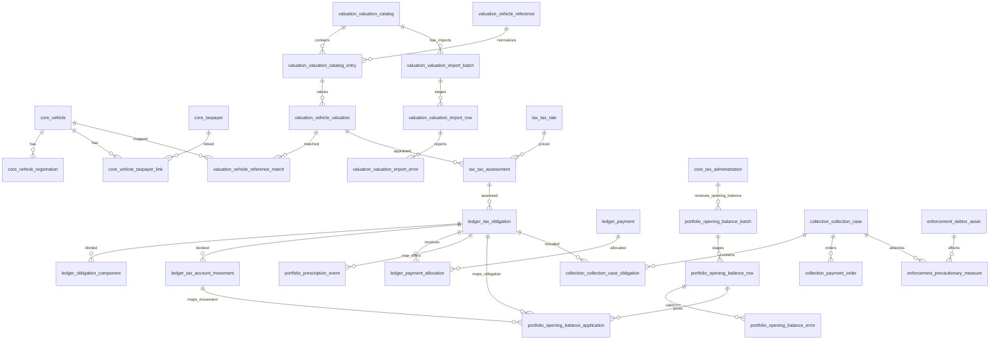
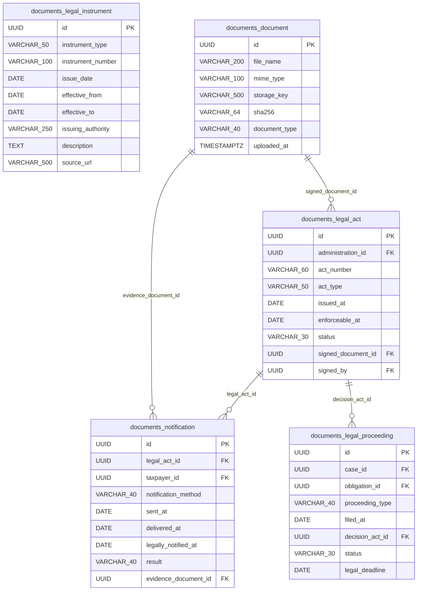
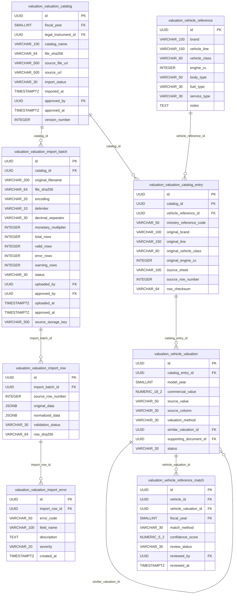
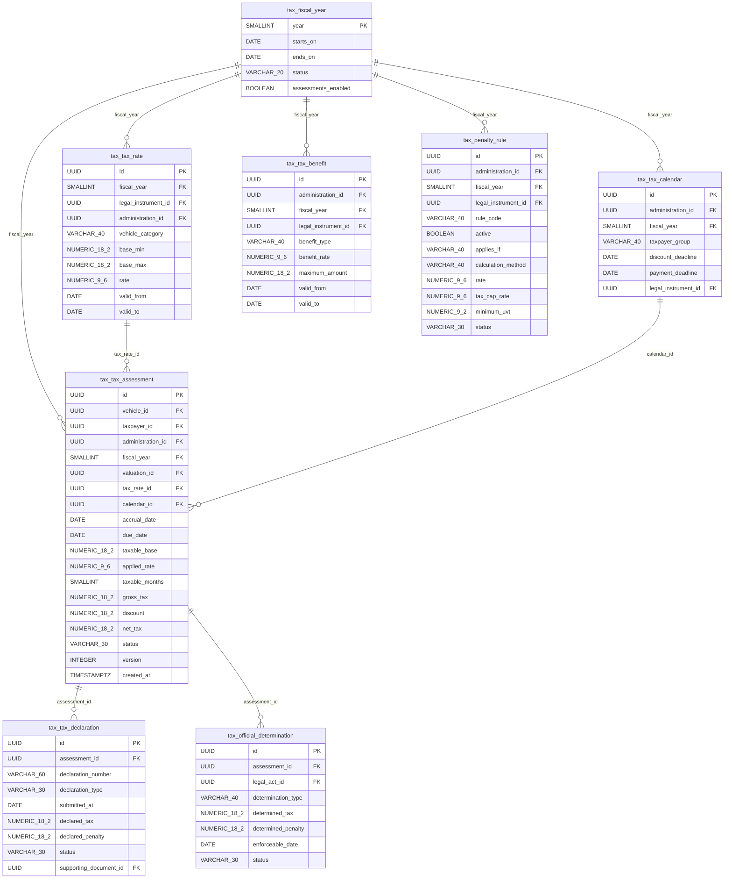
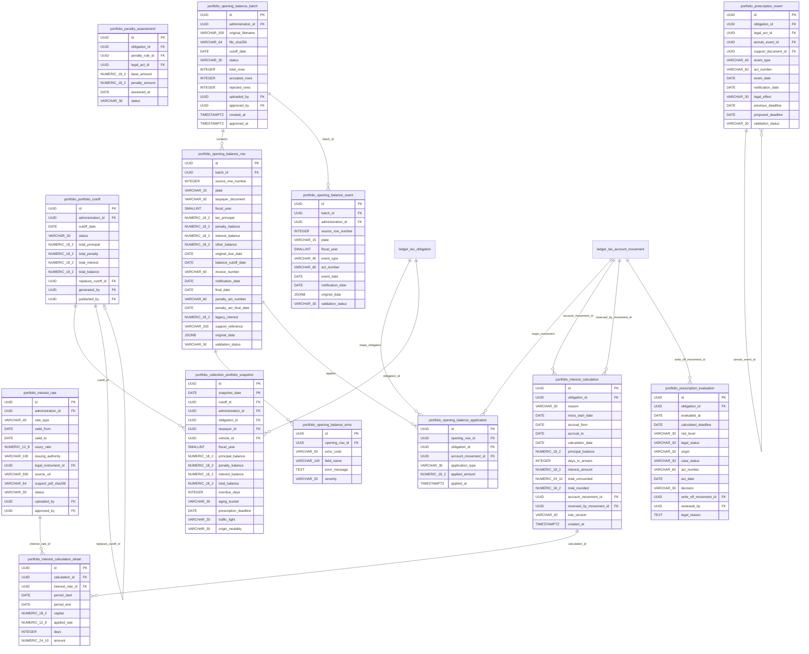
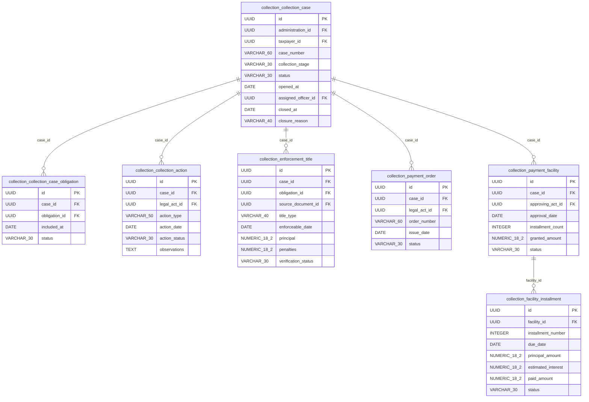
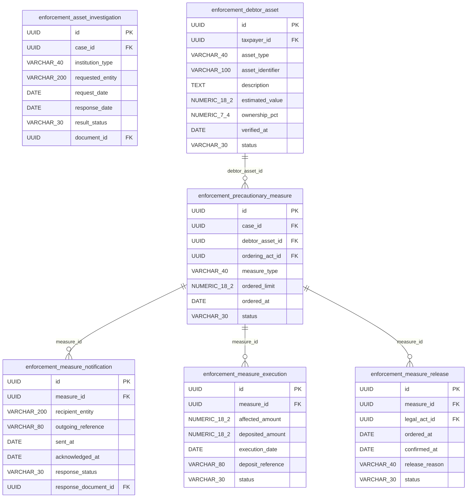
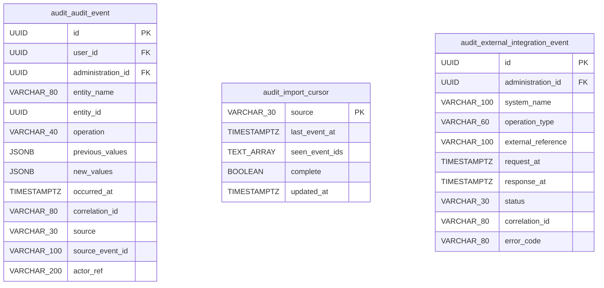
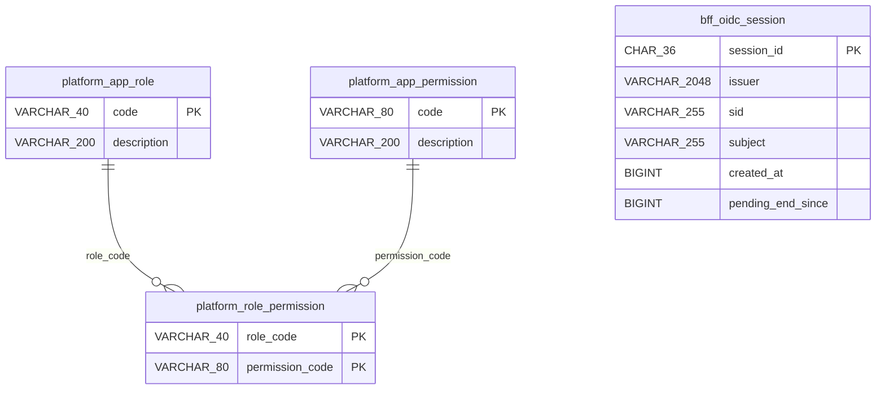

# ERD definitivo propuesto — Impuesto vehicular

> Basado en el catálogo lógico inicial de 63 tablas y 563 campos (65 tablas desde la versión 2.1 y 79 desde la 2.2). Validación estructural; no supone aprobación jurídica ni despliegue de PostgreSQL.
>
> **Versión:** 2.2 — registra los ajustes al modelo de la feature 005 · Cartera y recaudo, que el responsable funcional aprobó en la H1 (2026-11-08) y en la H2 (2026-11-09), y las decisiones de la H3 (2026-11-10), reglas 7 y 8 de `ledger`: los nueve de `docs/funcional/04_Cuenta_Corriente_y_Recaudo.md` §11 y los de `05_Cartera_Intereses_Sanciones_Prescripcion.md` §10. Es modelo lógico: las tablas se crean con las features de las Fases 4 y 5.
>
> - **Tablas:** `ledger` pasa de 7 a 19 (12 nuevas: recibos, archivos y conciliación bancaria, planillas de distribución, control del 20 %, usos de saldos a favor y el catálogo `movement_type`) y `portfolio`, de 11 a 13 (`portfolio_cutoff` y `opening_balance_event`): 65 + 12 + 2 = **79 tablas**.
> - **Columnas:** cambian las de `ledger.tax_obligation`, `payment`, `credit_balance` y `revenue_distribution`, las de varias tablas de `portfolio` y las de `tax.penalty_rule`. Además, `ledger.obligation_component`, `tax_account_movement` y `payment_allocation` reciben `administration_id`.
> - **Aislamiento:** todas las tablas de `ledger` quedan con `administration_id` y RLS, salvo el catálogo `movement_type`.
> - **Saldos:** `ledger.v_obligation_balance` es una vista normal con `security_invoker`.
> - **Desviaciones del plan, aceptadas en la H3 (2026-11-10):** `payment.idempotency_key` es única por administración (`UNIQUE` con `administration_id`), no global; las FK de movimientos, componentes e imputaciones son compuestas con `obligation_id`, también desde `portfolio`; y `ledger.tax_obligation.jurisdiction_config_id` apunta a `core.jurisdiction_config`, tabla del Doc. 03 §5.6 que queda fuera de las 79.
>
> **Versión 2.1:** registra los ajustes al modelo que el responsable funcional aprobó en H2 de la feature 001 · Inicio de sesión (2026-11-01). Agrega `core.user_session` y `audit.import_cursor`, que dejan el catálogo en 65 tablas. Cambian `core.admin_user` y `audit.audit_event`. Además, documenta los esquemas técnicos `platform` y `bff`, que no son parte del catálogo funcional (ver «Esquemas técnicos»).

## Hallazgos prioritarios de validación

1. **Avalúos:** mantener la estructura `valuation_catalog` → `valuation_catalog_entry` → `vehicle_valuation` con `model_year` en la última; preservar encabezado y posición fuente, unidades y versión de archivo.
2. **Integridad territorial:** FK compuestas o validación transaccional para evitar mezclar `administration_id` de distintas entidades en liquidaciones, pagos y expedientes.
3. **Liquidación y obligación:** impedir doble obligación activa del mismo sujeto/vehículo/vigencia/concepto salvo responsabilidad solidaria o rectificación formal; distinguir `assessment` técnico de título legal.
4. **Pagos:** validación de que la suma de imputaciones no exceda el pago confirmado y que el componente corresponda a la obligación.
5. **Años fiscales:** garantizar que `vehicle_reference_match.fiscal_year` coincida con `valuation_catalog.fiscal_year` de la referencia seleccionada.
6. **Intereses y sanciones:** registrar versiones normativas, período, tasa y bases; ningún cálculo es automáticamente una sanción exigible.
7. **Prescripción:** revisar título, hecho generador del cómputo, notificaciones e interrupciones; no automatizar declaración jurídica.
8. **Embargos:** impedir que monto ejecutado exceda límite permitido; controlar bien, destinatario, consignación y levantamiento.
9. **Notificaciones:** diferenciar fecha de expedición, entrega, notificación legal y ejecutoria con prueba.
10. **Importación CSV de avalúos:** staging con archivo inmutable (hash), separador, codificación, multiplicador de unidades, vista previa, validación, dos roles (carga/aprobación) y publicación atómica; no permitir sobrescritura del catálogo publicado.
11. **Apertura de cartera histórica:** lote CSV/Excel independiente del catálogo ministerial; importar como saldo recibido, conciliar y aprobar antes de contabilizar; soportar vigencia, sujeto, vehículo, capital, sanciones e intereses con fecha de corte; vincular al título y expediente si existen.
12. **Faltantes para producción:** catálogos de estados, controles de concurrencia, RLS, políticas de retención y vínculos de actos/facturas al título ejecutivo.

## ERD general (relaciones principales)

Es un resumen; las relaciones de cada esquema, incluidas las tablas que agrega la 2.2, están en su sección.

## CORE — Registro automotor y contribuyentes (10 tablas)

**Tablas y funciones:**

- `core.territorial_entity` — Catálogo DANE de departamentos, distritos y municipios.
- `core.tax_administration` — Autoridad competente que administra el impuesto.
- `core.taxpayer` — Contribuyentes identificados por documento.
- `core.taxpayer_address` — Historial de direcciones de contribuyentes.
- `core.vehicle` — Inventario maestro de automotores.
- `core.vehicle_registration` — Historial de matrícula, radicación y traslado.
- `core.vehicle_taxpayer_link` — Historial de propietarios, poseedores y relaciones con vehículo.
- `core.vehicle_tax_status` — Clasificación histórica de sujeción, exclusión y beneficios por vehículo.
- `core.admin_user` — Usuarios funcionarios y responsables de actos y auditoría. Feature 001:
  - `status` vale `ACTIVE` o `INACTIVE`; un usuario `INACTIVE` no entra (001-05);
  - `identity_issuer` e `identity_subject` son el vínculo con el proveedor de identidad (emisor y `sub`), único por usuario. LIV identifica al usuario por su `id`, no por el proveedor (001-21);
  - `last_login_at` es el último inicio de sesión aceptado.
- `core.user_session` — Sesiones de los usuarios (feature 001), una por sesión del proveedor (`sid`). Apunta a su usuario con la FK compuesta `(user_id, administration_id, identity_issuer, identity_subject)` → `core.admin_user`. La abre `StartSession` y la cierra `EndSession` con `end_reason`: `LOGOUT` (salir), `IDLE` (inactividad), `ABSOLUTE` (duración máxima) o `PROVIDER` (el proveedor la cerró). Cerrarla dos veces no cambia nada. La FK compuesta impide apuntar a un usuario de otra administración o a otra identidad.
- `core.territorial_entity.entity_type` (feature 001) vale `DEPARTAMENTO`, `DISTRITO_CAPITAL`, `DISTRITO` o `MUNICIPIO`, los mismos tipos de `jurisdiccion.tipo` de los YAML de jurisdicción.

**Relaciones externas:**

- `core.vehicle_tax_status.supporting_document_id` → `documents.document`

## DOCUMENTS — Normas y expediente documental (5 tablas)

**Tablas y funciones:**

- `documents.legal_instrument` — Registro de normas, resoluciones y actos regulatorios.
- `documents.document` — Repositorio de archivos electrónicos con integridad criptográfica.
- `documents.legal_act` — Actos administrativos con firma, estado y ejecutoria.
- `documents.notification` — Prueba de envío, entrega y notificación legal de actos.
- `documents.legal_proceeding` — Recursos, excepciones y controversias que afectan obligaciones o expedientes.

**Relaciones externas:**

- `documents.legal_act.administration_id` → `core.tax_administration`
- `documents.legal_act.signed_by` → `core.admin_user`
- `documents.notification.taxpayer_id` → `core.taxpayer`
- `documents.legal_proceeding.case_id` → `collection.collection_case`
- `documents.legal_proceeding.obligation_id` → `ledger.tax_obligation`

## VALUATION — Avalúos ministeriales e importación CSV (8 tablas)

**Tablas y funciones:**

- `valuation.valuation_catalog` — Versión e importación de cada tabla oficial de avalúos del Ministerio.
- `valuation.vehicle_reference` — Identidad técnica normalizada de variantes vehiculares.
- `valuation.valuation_catalog_entry` — Representa una fila original del catálogo ministerial en una vigencia.
- `valuation.vehicle_valuation` — Avalúo oficial por referencia del catálogo anual y año modelo.
- `valuation.vehicle_reference_match` — Aprobación de asociación entre un vehículo real y su avalúo por vigencia.
- `valuation.valuation_import_batch` — Un archivo CSV recibido, su origen, formato, unidades monetarias, totales de validación y aprobación.
- `valuation.valuation_import_row` — Fila de staging con datos originales y normalizados; no afecta los avalúos publicados.
- `valuation.valuation_import_error` — Errores y advertencias por fila/campo durante validación.

**Flujo del importador:** `UPLOADED` → `VALIDATING` → `VALIDATED` → `APPROVED` → `PUBLISHED`, con `REJECTED` / `FAILED` cuando corresponda. Una fila inválida bloquea la publicación del lote; una advertencia requiere política de aprobación. Solo se materializa una versión nueva de catálogo después de aprobación y publicación transaccional. Las filas del CSV con columnas por año modelo se normalizan a `vehicle_valuation` conservando encabezado, fila y unidad de origen. Los valores publicados no se sobrescriben: una corrección produce otra versión del catálogo.

**Relaciones externas:**

- `valuation.valuation_catalog.fiscal_year` → `tax.fiscal_year`
- `valuation.valuation_catalog.legal_instrument_id` → `documents.legal_instrument`
- `valuation.valuation_catalog.approved_by` → `core.admin_user`
- `valuation.vehicle_valuation.supporting_document_id` → `documents.document`
- `valuation.vehicle_reference_match.vehicle_id` → `core.vehicle`
- `valuation.vehicle_reference_match.fiscal_year` → `tax.fiscal_year`
- `valuation.vehicle_reference_match.reviewed_by` → `core.admin_user`
- `valuation.valuation_import_batch.uploaded_by` → `core.admin_user`
- `valuation.valuation_import_batch.approved_by` → `core.admin_user`

## TAX — Determinación tributaria (8 tablas)

**Tablas y funciones:**

- `tax.fiscal_year` — Apertura y cierre de vigencias fiscales.
- `tax.tax_rate` — Tarifas y umbrales por vigencia, jurisdicción y clase.
- `tax.tax_calendar` — Vencimientos y fechas de descuentos por administración y año.
- `tax.tax_benefit` — Descuentos, exenciones y alivios tributarios autorizados.
- `tax.penalty_rule` — Reglas de sanciones tributarias legalmente aplicables. En la 2.2 la publicación de la configuración de jurisdicción puede materializar en ella `cartera.sanciones`, como las tarifas se materializan en `tax.tax_rate`:
  - `rule_code` reemplaza a `penalty_type`; `active` y `status` (`VIGENTE`, `POR_CONFIRMAR` o `PENDIENTE`) dicen si la regla se aplica y con qué estado;
  - `applies_if` es la condición de aplicación (por ejemplo, `SISTEMA_DECLARACION`);
  - `tax_cap_rate` (tope como fracción del impuesto) reemplaza a `maximum_amount`, y `minimum_uvt` reemplaza a `minimum_amount`: la sanción mínima se guarda en UVT, no en pesos, porque el valor en pesos depende del año.
- `tax.tax_assessment` — Cálculo versionado del impuesto sobre un vehículo y vigencia.
- `tax.tax_declaration` — Declaraciones privadas radicadas por el contribuyente.
- `tax.official_determination` — Liquidación o determinación oficial distinta de cálculo interno.

**Relaciones externas:**

- `tax.tax_rate.legal_instrument_id` → `documents.legal_instrument`
- `tax.tax_rate.administration_id` → `core.tax_administration`
- `tax.tax_calendar.administration_id` → `core.tax_administration`
- `tax.tax_calendar.legal_instrument_id` → `documents.legal_instrument`
- `tax.tax_benefit.administration_id` → `core.tax_administration`
- `tax.tax_benefit.legal_instrument_id` → `documents.legal_instrument`
- `tax.penalty_rule.administration_id` → `core.tax_administration`
- `tax.penalty_rule.legal_instrument_id` → `documents.legal_instrument`
- `tax.tax_assessment.vehicle_id` → `core.vehicle`
- `tax.tax_assessment.taxpayer_id` → `core.taxpayer`
- `tax.tax_assessment.administration_id` → `core.tax_administration`
- `tax.tax_assessment.valuation_id` → `valuation.vehicle_valuation`
- `tax.tax_declaration.supporting_document_id` → `documents.document`
- `tax.official_determination.legal_act_id` → `documents.legal_act`

## LEDGER — Cuenta corriente y recaudo (19 tablas)

```mermaid
erDiagram
    ledger_tax_obligation {
        UUID id PK
        UUID assessment_id FK
        UUID taxpayer_id FK
        UUID vehicle_id FK
        SMALLINT fiscal_year FK
        UUID administration_id FK
        UUID jurisdiction_config_id FK
        VARCHAR_30 origin
        VARCHAR_30 origin_modality
        UUID declared_address_municipality_id FK
        DATE due_date
        DATE legally_payable_from
        DATE discount_deadline
        DATE final_assessment_date
        NUMERIC_18_2 original_principal
        VARCHAR_30 status
        TIMESTAMPTZ created_at
    }
    ledger_obligation_component {
        UUID id PK
        UUID obligation_id FK
        UUID administration_id FK
        VARCHAR_30 component_type
        NUMERIC_18_2 original_amount
        VARCHAR_30 status
        UUID source_document_id FK
    }
    ledger_movement_type {
        VARCHAR_40 code PK
        CHAR_1 sign
        VARCHAR_30 allowed_component
        VARCHAR_200 description
    }
    ledger_tax_account_movement {
        UUID id PK
        UUID obligation_id FK
        UUID administration_id FK
        UUID component_id FK
        VARCHAR_40 movement_type FK
        CHAR_1 movement_sign FK
        NUMERIC_18_2 signed_amount
        DATE effective_date
        TIMESTAMPTZ posted_at
        UUID source_document_id FK
        VARCHAR_80 external_reference
        UUID reversal_of_id FK
        VARCHAR_40 reversed_movement_type FK
    }
    ledger_payment_receipt {
        UUID id PK
        UUID administration_id FK
        VARCHAR_40 reference
        UUID taxpayer_id FK
        UUID vehicle_id FK
        TIMESTAMPTZ generated_at
        TIMESTAMPTZ valid_until
        NUMERIC_18_2 total_amount
        VARCHAR_30 status
    }
    ledger_payment_receipt_line {
        UUID id PK
        UUID receipt_id FK
        UUID administration_id FK
        UUID obligation_id FK
        VARCHAR_30 component_type
        NUMERIC_18_2 amount
        BOOLEAN with_discount
    }
    ledger_bank_file {
        UUID id PK
        UUID administration_id FK
        VARCHAR_20 bank_code
        VARCHAR_30 file_format
        VARCHAR_200 original_filename
        VARCHAR_64 file_sha256
        DATE file_date
        VARCHAR_30 status
        INTEGER total_rows
        INTEGER accepted_rows
        INTEGER rejected_rows
        NUMERIC_18_2 total_amount
        UUID uploaded_by FK
        UUID approved_by FK
        TIMESTAMPTZ created_at
        TIMESTAMPTZ approved_at
    }
    ledger_bank_file_row {
        UUID id PK
        UUID bank_file_id FK
        UUID administration_id FK
        INTEGER source_row_number
        VARCHAR_40 receipt_reference
        DATE payment_date
        NUMERIC_18_2 amount
        VARCHAR_80 bank_transaction_id
        DATE credit_date
        JSONB original_data
        VARCHAR_30 validation_status
    }
    ledger_bank_reconciliation {
        UUID id PK
        UUID administration_id FK
        UUID bank_file_id FK
        UUID bank_file_row_id FK
        DATE statement_date
        VARCHAR_80 statement_reference
        NUMERIC_18_2 statement_amount
        NUMERIC_18_2 file_amount
        VARCHAR_40 result
        VARCHAR_30 status
        UUID prepared_by FK
        UUID approved_by FK
        TIMESTAMPTZ prepared_at
        TIMESTAMPTZ approved_at
    }
    ledger_payment {
        UUID id PK
        UUID taxpayer_id FK
        UUID administration_id FK
        UUID receipt_id FK
        UUID bank_file_row_id FK
        VARCHAR_30 channel
        VARCHAR_80 bank_reference
        VARCHAR_40 payment_method
        NUMERIC_18_2 amount
        DATE payment_date
        TIMESTAMPTZ confirmed_at
        VARCHAR_30 status
        VARCHAR_80 idempotency_key
    }
    ledger_payment_allocation {
        UUID id PK
        UUID payment_id FK
        UUID obligation_id FK
        UUID administration_id FK
        UUID component_id FK
        NUMERIC_18_2 allocated_amount
        TIMESTAMPTZ applied_at
        UUID account_movement_id FK
    }
    ledger_credit_balance {
        UUID id PK
        UUID taxpayer_id FK
        UUID administration_id FK
        VARCHAR_30 origin_type
        UUID origin_payment_id FK
        NUMERIC_18_2 original_amount
        VARCHAR_30 status
        UUID source_document_id FK
    }
    ledger_credit_balance_use {
        UUID id PK
        UUID credit_balance_id FK
        UUID administration_id FK
        VARCHAR_30 use_type
        NUMERIC_18_2 amount
        VARCHAR_30 status
        UUID account_movement_id FK
        UUID legal_act_id FK
        TIMESTAMPTZ requested_at
    }
    ledger_distribution_batch {
        UUID id PK
        UUID administration_id FK
        UUID beneficiary_entity_id FK
        DATE period_start
        DATE period_end
        NUMERIC_18_2 total_amount
        VARCHAR_30 status
        UUID generated_by FK
        UUID approved_by FK
        TIMESTAMPTZ generated_at
        TIMESTAMPTZ approved_at
    }
    ledger_revenue_distribution {
        UUID id PK
        UUID payment_allocation_id FK
        UUID administration_id FK
        UUID distribution_batch_id FK
        UUID beneficiary_entity_id FK
        VARCHAR_30 component_type
        NUMERIC_9_6 share_rate
        NUMERIC_18_2 distributed_amount
        INTEGER days_to_transfer
        DATE transfer_date
        VARCHAR_30 status
    }
    ledger_participation_report {
        UUID id PK
        UUID administration_id FK
        VARCHAR_100 sender
        VARCHAR_200 original_filename
        VARCHAR_64 file_sha256
        DATE period_start
        DATE period_end
        VARCHAR_30 status
        INTEGER total_rows
        NUMERIC_18_2 total_reported
        UUID uploaded_by FK
        UUID approved_by FK
        TIMESTAMPTZ created_at
        TIMESTAMPTZ approved_at
    }
    ledger_participation_report_row {
        UUID id PK
        UUID report_id FK
        UUID administration_id FK
        INTEGER source_row_number
        VARCHAR_60 declaration_number
        VARCHAR_15 plate
        VARCHAR_30 taxpayer_document
        SMALLINT fiscal_year
        DATE payment_date
        NUMERIC_18_2 total_paid
        NUMERIC_18_2 tax_amount
        NUMERIC_18_2 interest_amount
        NUMERIC_18_2 penalty_amount
        UUID address_municipality_id FK
        NUMERIC_18_2 share_amount
        DATE transfer_date
        VARCHAR_80 transfer_reference
        VARCHAR_100 bank_name
        JSONB original_data
        VARCHAR_30 validation_status
    }
    ledger_participation_match {
        UUID id PK
        UUID administration_id FK
        UUID report_row_id FK
        UUID claim_id FK
        NUMERIC_18_2 expected_amount
        NUMERIC_18_2 transferred_amount
        VARCHAR_80 statement_reference
        VARCHAR_30 result
        TIMESTAMPTZ matched_at
    }
    ledger_participation_claim {
        UUID id PK
        UUID administration_id FK
        VARCHAR_30 status
        NUMERIC_18_2 claimed_amount
        TIMESTAMPTZ sent_at
        TIMESTAMPTZ responded_at
        UUID support_document_id FK
        TIMESTAMPTZ created_at
    }
    ledger_tax_obligation ||--o{ ledger_obligation_component : obligation_id
    ledger_tax_obligation ||--o{ ledger_tax_account_movement : obligation_id
    ledger_obligation_component ||--o{ ledger_tax_account_movement : component_id
    ledger_movement_type ||--o{ ledger_tax_account_movement : movement_type
    ledger_tax_account_movement ||--o| ledger_tax_account_movement : reversal_of_id
    ledger_payment_receipt ||--o{ ledger_payment_receipt_line : receipt_id
    ledger_tax_obligation ||--o{ ledger_payment_receipt_line : obligation_id
    ledger_payment_receipt ||--o{ ledger_payment : receipt_id
    ledger_bank_file ||--o{ ledger_bank_file_row : bank_file_id
    ledger_bank_file ||--o{ ledger_bank_reconciliation : bank_file_id
    ledger_bank_file_row ||--o{ ledger_bank_reconciliation : bank_file_row_id
    ledger_bank_file_row ||--o| ledger_payment : bank_file_row_id
    ledger_payment ||--o{ ledger_payment_allocation : payment_id
    ledger_tax_obligation ||--o{ ledger_payment_allocation : obligation_id
    ledger_obligation_component ||--o{ ledger_payment_allocation : component_id
    ledger_tax_account_movement ||--o{ ledger_payment_allocation : account_movement_id
    ledger_payment ||--o{ ledger_credit_balance : origin_payment_id
    ledger_credit_balance ||--o{ ledger_credit_balance_use : credit_balance_id
    ledger_tax_account_movement ||--o{ ledger_credit_balance_use : account_movement_id
    ledger_payment_allocation ||--o{ ledger_revenue_distribution : payment_allocation_id
    ledger_distribution_batch ||--o{ ledger_revenue_distribution : distribution_batch_id
    ledger_participation_report ||--o{ ledger_participation_report_row : report_id
    ledger_participation_report_row ||--o{ ledger_participation_match : report_row_id
    ledger_participation_claim ||--o{ ledger_participation_match : claim_id
```

**Tablas y funciones** (cada una con su regla de `administration_id`; ver «Reglas del esquema»):

- `ledger.tax_obligation` — Obligación individual por vehículo, vigencia y sujeto con control de exigibilidad. Lleva `administration_id` (ya lo tenía). Columnas de la 2.2:
  - `origin_modality`, `declared_address_municipality_id` y `discount_deadline` (Doc. 04 §11, punto 1): la modalidad de competencia, el municipio de la dirección declarada, que define el beneficiario del 20 %, y el límite de descuento copiado del calendario al emitir;
  - `origin` (`LIQUIDACION` o `MIGRACION`) y `final_assessment_date`, la fecha de ejecutoria de la factura, que es un hecho. `origin` es `NOT NULL`: `CHECK (origin IN ('LIQUIDACION', 'MIGRACION'))`. `assessment_id` solo puede ser nulo con `origin = MIGRACION`: `CHECK (origin = 'MIGRACION' OR assessment_id IS NOT NULL)`. `final_assessment_date` se completa una sola vez, de nulo a un valor, cuando la factura queda en firme: se escribe con `UPDATE … WHERE final_assessment_date IS NULL` y es, con el `jurisdiction_config_id` de las migradas, lo único de la obligación que se llena después de emitirla (OB‑04). Si otra feature crea un origen sin liquidación (por ejemplo, la declaración), amplía el CHECK;
  - `jurisdiction_config_id`: la configuración que rige la obligación. Es la de su liquidación y, en las migradas, la que decida el pendiente 14 de la feature 005 (Doc. 05 §11): `CHECK (origin <> 'LIQUIDACION' OR jurisdiction_config_id IS NOT NULL)`. Mientras una obligación migrada no la tenga, su exigibilidad no se deriva con la configuración vigente. La exigibilidad y la fecha de prescripción **no se guardan**: se derivan siempre con esa configuración (los saldos no se guardan; `AGENTS.md` §5.1). `legally_payable_from` no cambia: es la fecha de inicio de pago, no la exigibilidad.
- `ledger.obligation_component` — Desglosa impuesto, sanciones, intereses, costas y otros rubros. Recibe `administration_id`, con FK compuesta (`obligation_id`, `administration_id`) y RLS. Tiene `UNIQUE` (`id`, `obligation_id`), la clave de las FK (`component_id`, `obligation_id`) de los movimientos y las imputaciones: el componente es de la misma obligación.
- `ledger.movement_type` — Catálogo fijo de tipos de movimiento (Doc. 04 §2.1), con su signo (`+`, `-` o `±`) y su componente permitido (`TAX`, `INTEREST`, `PENALTY`, `ANY` o `ORIGINAL` para el reverso). Lo escriben las migraciones. No lleva `administration_id` (excepción declarada). Tiene `UNIQUE` (`code`, `sign`). `ASSESSMENT_ADJUSTMENT` y `REVERSAL` llevan `±`, porque no tienen un signo fijo. `liv_app` solo tiene SELECT sobre el catálogo, y las FK hacia él son `ON UPDATE RESTRICT ON DELETE RESTRICT`.
- `ledger.tax_account_movement` — Libro mayor inmutable de débitos, créditos y ajustes por obligación. Es *append‑only*. Recibe `administration_id`, con FK compuestas (`obligation_id`, `administration_id`), (`component_id`, `obligation_id`) y (`reversal_of_id`, `obligation_id`), y RLS: el componente y el movimiento reversado son de la misma obligación. Tiene `UNIQUE` (`id`, `obligation_id`) y `UNIQUE` (`id`, `movement_type`). Guarda `movement_sign` junto a `movement_type`, con FK compuesta (`movement_type`, `movement_sign`) al catálogo, y un CHECK local: `CHECK (movement_sign = '+' AND signed_amount > 0 OR movement_sign = '-' AND signed_amount < 0 OR movement_sign = '±' AND signed_amount <> 0)`. Solo un reverso lleva `reversal_of_id`: `CHECK ((movement_type = 'REVERSAL') = (reversal_of_id IS NOT NULL))`. Un movimiento se reversa una sola vez: índice único parcial (`reversal_of_id`) `WHERE reversal_of_id IS NOT NULL`. Un `REVERSAL` no se reversa (regla 7): el reverso guarda `reversed_movement_type`, el tipo del movimiento que reversa, con FK compuesta (`reversal_of_id`, `reversed_movement_type`) a `UNIQUE` (`id`, `movement_type`) de la misma tabla (`MATCH FULL ON UPDATE RESTRICT ON DELETE RESTRICT`), `CHECK ((reversal_of_id IS NULL) = (reversed_movement_type IS NULL))` y `CHECK (reversed_movement_type IS NULL OR reversed_movement_type <> 'REVERSAL')`.
- `ledger.payment_receipt` — Recibo de pago inmutable, con referencia única y vigencia (Doc. 04 §4.1; RP‑02). `administration_id`, `UNIQUE` (`administration_id`, `reference`), FK compuestas con sus hijos y RLS. Se anula (`status`) si se genera otro para las mismas obligaciones; no se edita. Registrar un pago con `receipt_id` y anular el recibo bloquean el recibo.
- `ledger.payment_receipt_line` — Una línea por obligación y componente del recibo, con o sin descuento (`with_discount`). `administration_id`, FK compuestas (`receipt_id`, `administration_id`) y (`obligation_id`, `administration_id`), y RLS.
- `ledger.bank_file` — Archivo de recaudo de un banco, en *staging* (mismo patrón del Módulo 1): archivo inmutable, `file_format` (`ASOBANCARIA_2001` o `CANONICO_CSV_V1`), totales, cargador y aprobador. `administration_id`, `UNIQUE` (`administration_id`, `file_sha256`) (CA‑4.05) y `CHECK (approved_by <> uploaded_by)`.
- `ledger.bank_file_row` — Fila íntegra del archivo del banco, ya convertida al formato canónico, con su resultado de validación. `administration_id`, FK compuesta (`bank_file_id`, `administration_id`) y `UNIQUE` (`bank_file_id`, `source_row_number`).
- `ledger.bank_reconciliation` — Cruce diario entre el archivo y el extracto de la cuenta de recaudo; una fila por partida y su resultado (Doc. 04 §4.4). `bank_file_row_id` es nulo en una partida que solo está en el extracto. `administration_id`, FK compuestas, `status` (hasta que se aprueba, la conciliación no cierra el día) y `CHECK (approved_by <> prepared_by)`; `CHECK (status <> 'APROBADA' OR approved_by IS NOT NULL)`. Quien aprueba la conciliación tampoco puede ser quien cargó el archivo (`bank_file.uploaded_by`; Doc. 04 §10).
- `ledger.payment` — Recaudos confirmados y conciliables. Agrega `receipt_id`, `channel` (`BANCO_CONVENIO` o `VENTANILLA`) y `bank_file_row_id` (Doc. 04 §11, punto 4), con FK compuestas con `administration_id`. `idempotency_key` queda `UNIQUE` (`administration_id`, `idempotency_key`): la clave es banco + referencia + fecha + valor, y una clave global haría chocar o revelaría pagos de otra administración. Es obligatoria en todos los canales (la de la ventanilla la define la feature de la opción 4.2.3). Además, `UNIQUE` (`administration_id`, `bank_file_row_id`) `WHERE bank_file_row_id IS NOT NULL`: una fila del archivo da un solo pago. Contra un archivo que el banco reenvía corregido (otro SHA‑256, otras filas) solo protege la clave de idempotencia; cómo se trata una partida reenviada con un dato corregido lo define la feature de la opción 4.2.2.
- `ledger.payment_allocation` — Imputación de cada pago a deuda y concepto. Recibe `administration_id`, con FK compuestas (`payment_id` y `obligation_id`, cada una con `administration_id`; `component_id` y `account_movement_id`, cada una con `obligation_id`, para que sean de la obligación imputada) y RLS.
- `ledger.credit_balance` — Saldos a favor y su origen (`origin_type` y `origin_payment_id`). **Guarda el monto de origen** (`original_amount`, antes `available_amount`): lo disponible se calcula restando de él los usos de `ledger.credit_balance_use` que no estén `RECHAZADA` ni `REVERSADA`. `CHECK (original_amount > 0)`.
- `ledger.credit_balance_use` — Compensaciones y devoluciones de un saldo a favor (Doc. 04 §6.1): `use_type`, `amount > 0`, `status` (`SOLICITADA`, `APROBADA`, `GIRADA` y `RECHAZADA` en una devolución; `SOLICITADA`, `APROBADA`, `RECHAZADA` y `REVERSADA` en una compensación), el `CREDIT_COMPENSATION` que genera y el acto que ordena la devolución. Una devolución no tiene movimiento: `CHECK (use_type <> 'DEVOLUCION' OR account_movement_id IS NULL)`. Un uso con movimiento no se rechaza, se reversa y queda `REVERSADA` en la misma transacción del `REVERSAL`, con lo que el saldo se restituye: `CHECK (status <> 'RECHAZADA' OR account_movement_id IS NULL)`. `administration_id` y FK compuestas, también hacia `tax_account_movement`. Cada uso se registra en una transacción que bloquea la fila del saldo (`SELECT … FOR UPDATE`), para que dos usos simultáneos no superen el monto de origen.
- `ledger.distribution_batch` — Planilla de distribución por beneficiario y período (`GENERADA → APROBADA → GIRADA → CONFIRMADA`). `administration_id`, FK compuestas y `CHECK (approved_by <> generated_by)`.
- `ledger.revenue_distribution` — Distribución del recaudo tributario según participaciones territoriales. Recibe `administration_id` y agrega `distribution_batch_id`, `component_type` y `days_to_transfer` (Doc. 04 §11, punto 5); con FK compuestas (`payment_allocation_id` y `distribution_batch_id`, cada una con `administration_id`) y RLS. Un ajuste negativo por un pago reversado ya girado va en la siguiente planilla.
- `ledger.participation_report` — Reporte de recaudo del departamento o del banco, en *staging* (modalidad C, Doc. 04 §8). `administration_id`, `UNIQUE` (`administration_id`, `file_sha256`) (CA‑4.05) y `CHECK (approved_by <> uploaded_by)`.
- `ledger.participation_report_row` — Fila íntegra del reporte, una por declaración pagada con dirección en el municipio. `administration_id`, FK compuesta (`report_id`, `administration_id`) y `UNIQUE` (`report_id`, `source_row_number`).
- `ledger.participation_match` — Resultado de conciliar una fila del reporte con el extracto: `CONCILIADO`, `DIFERENCIA_VALOR`, `NO_GIRADO`, `GIRO_TARDIO` o `GIRO_SIN_SOPORTE`. `report_row_id` es nulo en un abono sin soporte. `administration_id` y FK compuestas, también hacia la reclamación.
- `ledger.participation_claim` — Reclamación de las diferencias al departamento o al banco (`ABIERTA → ENVIADA → RESPONDIDA → CERRADA`). `administration_id` y RLS.
- **Vista** `ledger.v_obligation_balance` — Saldo por obligación y componente, calculado desde los movimientos. Es una **vista normal con `security_invoker`, no materializada**, y solo sirve para consultas: nunca es la fuente de una imputación. Aísla por administración porque las tablas de `ledger` que lee tienen `administration_id` y RLS; PostgreSQL no aplica RLS a las vistas materializadas.
- **Vista materializada, solo si hace falta rendimiento:** debe llevar `administration_id`, no tener permiso de lectura para los roles de la aplicación y leerse solo a través de una vista `security_barrier` que filtre por la administración del contexto.

**Reglas del esquema (ERD 2.2):**

1. **Aislamiento por administración** (punto 2 de «Hallazgos prioritarios de validación»; `docs/arquitectura/02` §5.1). Todas las tablas de `ledger` llevan `administration_id` y su política RLS, con FK compuestas hacia su padre. Las cuatro que no lo tenían (`obligation_component`, `tax_account_movement`, `payment_allocation` y `revenue_distribution`) lo reciben ahora. Hay dos excepciones: `ledger.movement_type`, un catálogo fijo que escriben las migraciones, y `portfolio.interest_rate`, con `administration_id` nulo para la tasa nacional (ver `portfolio`). Todo padre de una FK compuesta declara `UNIQUE` (`id`, `administration_id`): `tax_obligation`, `payment`, `payment_receipt`, `payment_allocation`, `bank_file`, `distribution_batch`, `participation_report`, `participation_claim`, `credit_balance`, `portfolio_cutoff` y `opening_balance_batch`. Las FK a `core.admin_user` (quien carga, genera o aprueba) son compuestas con `administration_id`, salvo las de `portfolio.interest_rate` (la tasa es nacional) y `prescription_evaluation.reviewed_by` (la tabla no tiene `administration_id`).
2. **Movimientos desde `portfolio`.** `interest_calculation` y `prescription_evaluation` no tienen `administration_id`, pero sí `obligation_id`: sus FK a `ledger.tax_account_movement` (`account_movement_id`, `reversed_by_movement_id` y `write_off_movement_id`), y la `account_movement_id` de `opening_balance_application`, son compuestas con `obligation_id`, y así el movimiento es de la misma obligación y, por ella, de la misma administración.
3. **Se validan en la transacción** lo que una FK o un CHECK no pueden expresar: el componente permitido del tipo de movimiento (`allowed_component`); en un `REVERSAL`, que su monto sea el opuesto exacto del de su `reversal_of_id` y que vaya al mismo componente; que todo `REVERSAL` de un `INTEREST_ACCRUAL` marque su cálculo y que `reversed_by_movement_id` sea el reverso de su `account_movement_id`; que quien aprueba una conciliación no sea quien cargó el archivo; que la compensación de un saldo a favor sea contra obligaciones de su contribuyente y que el `REVERSAL` de una compensación deje `REVERSADA` su uso; y que una imputación no se distribuya dos veces al mismo beneficiario y componente (salvo el ajuste negativo por un reverso).
4. **Segregación de funciones.** `bank_file`, `bank_reconciliation`, `distribution_batch` y `participation_report` llevan quien carga o genera y quien aprueba, con un CHECK de personas distintas (el patrón del Módulo 1; Doc. 04 §10). Con el aprobador nulo ese CHECK no se evalúa: cada una exige además el aprobador en los estados aprobado o posteriores. El registro manual de pago, la reimputación, el reverso, la compensación, la devolución, la anulación de un evento de prescripción y la prescripción misma también exigen que quien propone sea otra persona que quien aprueba (Doc. 04 §10; Doc. 05 §2.5 y §6.2); las columnas de esos flujos quedan pendientes para las features de los Módulos 4 y 5, no para la 2.2 (regla 8).
5. **Concurrencia.** La imputación, la causación y el recálculo de intereses y los reversos bloquean primero la obligación (`SELECT … FOR UPDATE`), y la imputación también el pago. El orden de los bloqueos es fijo: saldo a favor, recibo, pago y obligaciones por `id` ascendente. Los cambios de estado de cualquier tabla (recibos, pagos, usos de saldos, archivos, conciliaciones, planillas, cortes, reclamaciones, expedientes de prescripción y lotes de apertura) y las columnas que se completan una sola vez se hacen con `UPDATE … WHERE status = <estado anterior>` y se comprueban las filas afectadas, para que dos sesiones no apliquen la misma transición (en una columna de completado único, `UPDATE … WHERE <columna> IS NULL`).
6. **Inmutabilidad** (`docs/arquitectura/02` §5.2). Son *append‑only* para `liv_app` (sin UPDATE ni DELETE): `tax_account_movement`, `payment_allocation`, `payment_receipt_line`, `bank_file_row`, `participation_report_row`, `portfolio.interest_calculation_detail`, `portfolio.collection_portfolio_snapshot`, `portfolio.opening_balance_event` y `portfolio.opening_balance_application`. En `payment`, `obligation_component`, `credit_balance`, `credit_balance_use`, `revenue_distribution`, `payment_receipt`, `bank_file`, `bank_reconciliation`, `distribution_batch`, `participation_report` y `portfolio.portfolio_cutoff` no cambian los montos, las fechas ni las claves, y solo cambian el estado y las columnas de aprobación, giro o publicación, por las transiciones válidas. En `tax_obligation` solo cambian `final_assessment_date` y, en las migradas, `jurisdiction_config_id`, una vez, de nulo a un valor. En `portfolio.interest_calculation` solo cambia `reversed_by_movement_id`, una vez, de nulo a un valor. Las tasas de `portfolio.interest_rate` las escribe el proceso de publicación, no `liv_app`.
7. **Un reverso no se reversa.** Un `REVERSAL` no puede ser el movimiento reversado de otro: la FK compuesta (`reversal_of_id`, `reversed_movement_type`) y el `CHECK` de `tax_account_movement` lo impiden. Un reverso equivocado se corrige con un movimiento nuevo (decisión de quien dirige el trabajo, 2026-11-10).
8. **Pendientes que la 2.2 deja a las features de los Módulos 4 y 5** (decididos el 2026-11-10 por quien dirige el trabajo):
   - **Particionar `ledger.tax_account_movement` por año:** no se particiona en la 2.2. `docs/arquitectura/01` lo prevé; la feature que implemente el Módulo 4 lo decide con volumen real. En PostgreSQL toda clave única de una tabla particionada debe incluir la columna de partición, así que las claves `UNIQUE` (`id`, `obligation_id`) y `UNIQUE` (`id`, `movement_type`), el reverso único y la FK de la tabla a sí misma (`reversal_of_id`, `reversed_movement_type`) tendrían que incluirla si se particiona.
   - **Aislamiento de las ocho tablas de `portfolio` que ya existían:** ver «Aislamiento pendiente» en `portfolio`; lo decide la feature del Módulo 5.
   - **Quién propone y quién aprueba los flujos manuales** (regla 4): las columnas las definen las features de los Módulos 4 y 5.
   - **Corregir un reverso equivocado** (regla 7): cómo se registra y se traza el movimiento nuevo que lo corrige (por ejemplo, con `source_document_id` al acto que lo ordena) y cómo se rehace su registro padre en intereses, saldos a favor y prescripción, donde el vínculo con el movimiento se escribe una sola vez: lo definen las features de los Módulos 4 y 5.
   - **Redundancias** `portfolio.interest_calculation.interest_amount` frente a `total_rounded` y `portfolio.opening_balance_row.legacy_interest` frente a `interest_balance`: las resuelve la feature del Módulo 5.

**Relaciones externas:**

- `ledger.tax_obligation.assessment_id` → `tax.tax_assessment`
- `ledger.tax_obligation.taxpayer_id` → `core.taxpayer`
- `ledger.tax_obligation.vehicle_id` → `core.vehicle`
- `ledger.tax_obligation.fiscal_year` → `tax.fiscal_year`
- `ledger.tax_obligation.administration_id` → `core.tax_administration`
- `ledger.tax_obligation.declared_address_municipality_id` → `core.territorial_entity`
- `ledger.tax_obligation.jurisdiction_config_id` → `core.jurisdiction_config`, con `administration_id` en una FK compuesta. Es la tabla que define el Doc. 03 §5.6; el catálogo de este ERD todavía no la incluye, y la crea la feature de la configuración de jurisdicción (opción 1.5.9)
- `ledger.obligation_component.source_document_id` → `documents.document`
- `ledger.tax_account_movement.source_document_id` → `documents.document`
- `ledger.payment.taxpayer_id` → `core.taxpayer`
- `ledger.payment.administration_id` → `core.tax_administration`
- `ledger.payment_receipt.taxpayer_id` → `core.taxpayer`
- `ledger.payment_receipt.vehicle_id` → `core.vehicle`
- `ledger.bank_file.uploaded_by` y `approved_by` → `core.admin_user`, con `administration_id` en una FK compuesta
- `ledger.bank_reconciliation.prepared_by` y `approved_by` → `core.admin_user`, con `administration_id` en una FK compuesta
- `ledger.credit_balance.taxpayer_id` → `core.taxpayer`
- `ledger.credit_balance.administration_id` → `core.tax_administration`
- `ledger.credit_balance.source_document_id` → `documents.document`
- `ledger.credit_balance_use.legal_act_id` → `documents.legal_act`
- `ledger.distribution_batch.beneficiary_entity_id` → `core.territorial_entity`
- `ledger.distribution_batch.generated_by` y `approved_by` → `core.admin_user`, con `administration_id` en una FK compuesta
- `ledger.revenue_distribution.beneficiary_entity_id` → `core.territorial_entity`
- `ledger.participation_report.uploaded_by` y `approved_by` → `core.admin_user`, con `administration_id` en una FK compuesta
- `ledger.participation_report_row.address_municipality_id` → `core.territorial_entity`
- `ledger.participation_claim.support_document_id` → `documents.document`
- Todas las tablas de `ledger` (salvo `movement_type`) → `core.tax_administration`, por `administration_id`

## PORTFOLIO — Mora, sanciones y prescripción (13 tablas)

**Tablas y funciones:**

- `portfolio.interest_rate` — Tasas certificadas y parámetros para liquidar mora. En la 2.2 es un dato nacional y lleva su soporte y su aprobación:
  - `administration_id` es nulo para la tasa nacional: los datos nacionales los leen todas las administraciones y solo los escribe el proceso de publicación (`docs/arquitectura/02` §5.1). Es la segunda excepción de `administration_id` (ver «Reglas del esquema» de `ledger`). En la 2.2 todas las tasas son nacionales: `CHECK (administration_id IS NULL)` (por eso el índice de abajo no lleva la administración) y `liv_app` no las escribe. Quién las carga y las aprueba, si las administraciones son las usuarias, queda en el pendiente 17 de la feature 005 (Doc. 05 §11);
  - `usury_rate` (tasa de usura certificada, fracción), `support_pdf_sha256` (el PDF de la certificación) y `status` (`BORRADOR`, `APROBADA` o `RECHAZADA`), con `uploaded_by` y `approved_by`: `CHECK (approved_by <> uploaded_by)` y `CHECK (status <> 'APROBADA' OR approved_by IS NOT NULL)`. La resolución de la Superfinanciera es el `legal_instrument_id`;
  - se quita `annual_effective_rate`: la tasa de mora se deriva de la usura menos los puntos que fija la configuración de jurisdicción (la clave `cartera.intereses_mora.puntos_a_restar` del YAML), y la tasa aplicada queda en el detalle de cada cálculo;
  - el período usa `valid_from` y `valid_to`, un mes calendario (`CHECK`: `valid_from` es el primer día del mes y `valid_to`, el último), con un índice único parcial (`rate_type`, `valid_from`) `WHERE status = 'APROBADA'`: una tasa en borrador rechazada se puede volver a cargar. Una tasa aprobada es inmutable.
- `portfolio.interest_calculation` — Ejecución de cálculo de intereses sobre una obligación. Agrega `reason` (`PAGO`, `CORTE`, `ACTO_COBRO` o `SIMULACION`), el período causado (`accrual_from` y `accrual_to`), el total sin redondear (con diez decimales, porque el redondeo es solo al final) y el redondeado, el movimiento `INTEREST_ACCRUAL` que lo registra (`account_movement_id`, nulo solo en una simulación) y `reversed_by_movement_id`. `reason` es `NOT NULL` con `CHECK (reason IN ('PAGO', 'CORTE', 'ACTO_COBRO', 'SIMULACION'))`, y `CHECK ((reason = 'SIMULACION') = (account_movement_id IS NULL))` ata el movimiento a la simulación; una simulación nunca se reversa: `CHECK (reason <> 'SIMULACION' OR reversed_by_movement_id IS NULL)`. Se quitan `interest_rate_id` y `applied_annual_rate` de la cabecera, porque con varios tramos van en el detalle.
  - `reversed_by_movement_id` apunta al movimiento `REVERSAL` que anula su `INTEREST_ACCRUAL`, no al cálculo nuevo, y se llena una sola vez: se escribe con `UPDATE … WHERE reversed_by_movement_id IS NULL`, comprobando las filas afectadas. La idempotencia es un índice único parcial (`obligation_id`, `accrual_to`, `rule_version`) WHERE `reversed_by_movement_id IS NULL AND reason <> 'SIMULACION'`: solo para los cálculos vigentes que no son simulación. Una simulación nunca entra en el índice ni tiene movimiento. Con la obligación bloqueada, la transacción valida que `accrual_from` sea el día siguiente al último `accrual_to` vigente, para que dos causaciones no se solapen.
  - Un recálculo después de un reverso se escribe en una sola transacción, que bloquea primero la obligación y el cálculo viejo, y en este orden:
    1. el movimiento `REVERSAL` del `INTEREST_ACCRUAL` viejo;
    2. `reversed_by_movement_id` del cálculo viejo, que así sale del índice;
    3. el cálculo nuevo.

    Como el viejo sale del índice antes de insertar el nuevo, no hace falta diferir nada (un índice único parcial no se puede diferir).
- `portfolio.interest_calculation_detail` — Trazabilidad de tramos de capital y reglas dentro del cálculo. Agrega `interest_rate_id`: la tasa de cada tramo.
- `portfolio.penalty_assessment` — Registro de sanciones determinadas y sus soportes.
- `portfolio.prescription_event` — Hechos con potencial efecto sobre el cómputo de prescripción. Agrega `annuls_event_id` (un evento erróneo no se borra: lo anula otro evento), `support_document_id` y `act_number`.
- `portfolio.prescription_evaluation` — Dictamen trazable sobre término de prescripción por obligación. Agrega el expediente: `origin` (petición, oficio o excepción), `case_status`, `act_number`, `act_date`, `decision` y `write_off_movement_id`, el `WRITE_OFF` que registra el acto cuando declara la prescripción.
- `portfolio.portfolio_cutoff` — Cabecera del corte mensual de cartera: administración, fecha, estado (`GENERADO`, `ERROR` o `PUBLICADO`), totales de control, el corte al que reemplaza (`replaces_cutoff_id`) y quién lo generó y lo publicó: `CHECK (published_by <> generated_by)`. `administration_id`, FK compuesta consigo misma (`replaces_cutoff_id`, `administration_id`) y RLS. Un corte publicado no se regenera. Un corte solo puede ser reemplazado por uno: índice único parcial (`replaces_cutoff_id`) `WHERE replaces_cutoff_id IS NOT NULL`, y el reemplazo es de la misma fecha, con `UNIQUE` (`id`, `administration_id`, `cutoff_date`) y la FK (`replaces_cutoff_id`, `administration_id`, `cutoff_date`). Un solo corte raíz por fecha: índice único parcial (`administration_id`, `cutoff_date`) `WHERE replaces_cutoff_id IS NULL`. El vigente de una fecha es el último `PUBLICADO` de su cadena. `CHECK (status <> 'PUBLICADO' OR published_by IS NOT NULL)`.
- `portfolio.collection_portfolio_snapshot` — Corte histórico de saldos y antigüedad para reportes: una foto inmutable por obligación, no un saldo vivo. Agrega `cutoff_id`, `administration_id`, `taxpayer_id`, `vehicle_id`, `fiscal_year`, `prescription_deadline`, `traffic_light` y `origin_modality`. Está particionada por fecha (`snapshot_date`, que es la `cutoff_date` de su corte, entra en la clave primaria), y `UNIQUE` (`cutoff_id`, `obligation_id`, `snapshot_date`) impide repetir una obligación en un corte. `administration_id`, FK compuestas (`cutoff_id`, `administration_id`, `snapshot_date`), contra la `cutoff_date` de su corte, y (`obligation_id`, `administration_id`), y RLS; cada partición se crea con RLS habilitado; sin eso, `liv_app` no tiene permisos sobre ella.
- `portfolio.opening_balance_batch` — Lote de migración de cartera y conciliación de totales, con separación entre operador y aprobador.
- `portfolio.opening_balance_row` — Fila íntegra de la fuente, componentes de deuda, identificación y fecha de corte. Agrega los campos de la plantilla que le faltaban: `invoice_number`, `notification_date`, `final_date`, `penalty_act_number`, `penalty_act_final_date`, `legacy_interest` y `support_reference`.
- `portfolio.opening_balance_event` — Hoja de eventos de cobro de la plantilla de apertura (mandamiento, facilidad, reorganización…), en *staging*: se liga a su fila por lote, placa y vigencia, y al aplicar el lote se registran como `prescription_event`. `administration_id`, FK compuesta (`batch_id`, `administration_id`) y RLS.
- `portfolio.opening_balance_error` — Inconsistencias y advertencias por fila, sin modificar los datos originales.
- `portfolio.opening_balance_application` — Trazabilidad de cada aplicación aprobada sobre obligación y movimiento financiero, sin duplicar saldos.

**Aislamiento pendiente:** `interest_calculation`, `interest_calculation_detail`, `penalty_assessment`, `prescription_event`, `prescription_evaluation`, `opening_balance_row`, `opening_balance_error` y `opening_balance_application` ya existían sin `administration_id` y no lo reciben en la 2.2: hoy no están aisladas por RLS, en contra de `docs/arquitectura/02` §5.1: solo las protege la aplicación, por su obligación o su lote. Si deben recibir `administration_id` y RLS, lo decide la feature del Módulo 5 (regla 8 de `ledger`).

**Relaciones externas:**

- `portfolio.interest_rate.administration_id` → `core.tax_administration` (nulo para la tasa nacional)
- `portfolio.interest_rate.legal_instrument_id` → `documents.legal_instrument`
- `portfolio.interest_rate.uploaded_by` y `approved_by` → `core.admin_user` (FK simple: la tasa es nacional)
- `portfolio.interest_calculation.obligation_id` → `ledger.tax_obligation`
- `portfolio.interest_calculation.account_movement_id` y `reversed_by_movement_id` → `ledger.tax_account_movement`, con `obligation_id` en una FK compuesta (la tabla no tiene `administration_id`)
- `portfolio.interest_calculation_detail.interest_rate_id` → `portfolio.interest_rate`
- `portfolio.penalty_assessment.obligation_id` → `ledger.tax_obligation`
- `portfolio.penalty_assessment.penalty_rule_id` → `tax.penalty_rule`
- `portfolio.penalty_assessment.legal_act_id` → `documents.legal_act`
- `portfolio.prescription_event.obligation_id` → `ledger.tax_obligation`
- `portfolio.prescription_event.legal_act_id` → `documents.legal_act`
- `portfolio.prescription_event.annuls_event_id` → `portfolio.prescription_event`
- `portfolio.prescription_event.support_document_id` → `documents.document`
- `portfolio.prescription_evaluation.obligation_id` → `ledger.tax_obligation`
- `portfolio.prescription_evaluation.reviewed_by` → `core.admin_user` (FK simple: la tabla no tiene `administration_id`)
- `portfolio.prescription_evaluation.write_off_movement_id` → `ledger.tax_account_movement`, con `obligation_id` en una FK compuesta
- `portfolio.portfolio_cutoff.administration_id` → `core.tax_administration`
- `portfolio.portfolio_cutoff.generated_by` y `published_by` → `core.admin_user`, con `administration_id` en una FK compuesta
- `portfolio.collection_portfolio_snapshot.obligation_id` → `ledger.tax_obligation`, con `administration_id` en una FK compuesta
- `portfolio.collection_portfolio_snapshot.cutoff_id` → `portfolio.portfolio_cutoff`, con `administration_id` en una FK compuesta
- `portfolio.collection_portfolio_snapshot.administration_id` → `core.tax_administration`
- `portfolio.collection_portfolio_snapshot.taxpayer_id` → `core.taxpayer`
- `portfolio.collection_portfolio_snapshot.vehicle_id` → `core.vehicle`
- `portfolio.opening_balance_batch.administration_id` → `core.tax_administration`
- `portfolio.opening_balance_batch.uploaded_by` → `core.admin_user`, con `administration_id` en una FK compuesta
- `portfolio.opening_balance_batch.approved_by` → `core.admin_user`, con `administration_id` en una FK compuesta
- `portfolio.opening_balance_event.batch_id` → `portfolio.opening_balance_batch`, con `administration_id` en una FK compuesta
- `portfolio.opening_balance_event.administration_id` → `core.tax_administration`
- `portfolio.opening_balance_application.obligation_id` → `ledger.tax_obligation`
- `portfolio.opening_balance_application.account_movement_id` → `ledger.tax_account_movement`, con `obligation_id` en una FK compuesta

## COLLECTION — Cobro persuasivo y coactivo (7 tablas)

**Tablas y funciones:**

- `collection.collection_case` — Expediente persuasivo o coactivo abierto contra un deudor.
- `collection.collection_case_obligation` — Relación muchos-a-muchos expediente / obligaciones.
- `collection.collection_action` — Cronología de gestiones y actuaciones de cobranza.
- `collection.enforcement_title` — Identificación y validación del título ejecutivo por obligación.
- `collection.payment_order` — Mandamiento de pago del procedimiento coactivo.
- `collection.payment_facility` — Facilidades de pago otorgadas por acto competente.
- `collection.facility_installment` — Calendario de cuotas de una facilidad de pago.

**Relaciones externas:**

- `collection.collection_case.administration_id` → `core.tax_administration`
- `collection.collection_case.taxpayer_id` → `core.taxpayer`
- `collection.collection_case.assigned_officer_id` → `core.admin_user`
- `collection.collection_case_obligation.obligation_id` → `ledger.tax_obligation`
- `collection.collection_action.legal_act_id` → `documents.legal_act`
- `collection.enforcement_title.obligation_id` → `ledger.tax_obligation`
- `collection.enforcement_title.source_document_id` → `documents.document`
- `collection.payment_order.legal_act_id` → `documents.legal_act`
- `collection.payment_facility.approving_act_id` → `documents.legal_act`

## ENFORCEMENT — Bienes y medidas cautelares (6 tablas)

**Tablas y funciones:**

- `enforcement.asset_investigation` — Solicitudes y respuestas para investigar bienes del deudor.
- `enforcement.debtor_asset` — Bienes o derechos patrimoniales identificados como del deudor.
- `enforcement.precautionary_measure` — Orden judicial o administrativa de medida cautelar en cobro.
- `enforcement.measure_notification` — Oficios de inscripción o comunicación a terceros para ejecutar medida.
- `enforcement.measure_execution` — Ejecución material y recursos retenidos por medida cautelar.
- `enforcement.measure_release` — Levantamientos totales o parciales de medidas cautelares.

**Relaciones externas:**

- `enforcement.asset_investigation.case_id` → `collection.collection_case`
- `enforcement.asset_investigation.document_id` → `documents.document`
- `enforcement.debtor_asset.taxpayer_id` → `core.taxpayer`
- `enforcement.precautionary_measure.case_id` → `collection.collection_case`
- `enforcement.precautionary_measure.ordering_act_id` → `documents.legal_act`
- `enforcement.measure_notification.response_document_id` → `documents.document`
- `enforcement.measure_release.legal_act_id` → `documents.legal_act`

## AUDIT — Auditoría e integraciones (3 tablas)

**Tablas y funciones:**

- `audit.audit_event` — Bitácora inmutable de cambios administrativos y financieros. Feature 001:
  - `administration_id`: la administración del evento, para el aislamiento por RLS. Puede ser nula: los eventos de plataforma (como un inicio rechazado de alguien sin administración) y los importados del proveedor no la tienen, y la aplicación no los lee. Si hay `user_id`, la administración es obligatoria (CHECK), y la FK compuesta `(user_id, administration_id)` → `core.admin_user` impide mezclar administraciones;
  - `source` (`LIV` o `IDENTITY_PROVIDER`) y `source_event_id`, obligatorios y únicos juntos, para que un evento importado dos veces quede una sola vez;
  - `actor_ref`: quién actuó cuando no es un usuario de LIV (por ejemplo, el nombre intentado en un inicio fallido, enmascarado);
  - los eventos de sesión se guardan con `entity_name` = `session` o `identity_provider`, `operation` = el tipo de evento, y `new_values` = `{result, reason, truncated_ip, masked_attempted_username}`, sin contraseñas ni códigos (001-18).
- `audit.import_cursor` — Hasta dónde se importaron los eventos del proveedor de identidad a `audit.audit_event` (feature 001); `source` solo vale `IDENTITY_PROVIDER`: el último instante, los ids ya vistos en ese instante y si la última lectura fue completa.
- `audit.external_integration_event` — Trazabilidad de llamadas a fuentes, RUNT, bancos y pasarelas.

**Relaciones externas:**

- `audit.audit_event.user_id` → `core.admin_user`, con `administration_id` en una FK compuesta
- `audit.audit_event.administration_id` → `core.tax_administration`
- `audit.external_integration_event.administration_id` → `core.tax_administration`

## Esquemas técnicos (plataforma y BFF)

No son parte del catálogo funcional: los usa la plataforma, no el negocio. Los aprobó el responsable en H2 de la feature 001 (2026-11-01). Sus roles de base de datos están en `docs/arquitectura/02` §5.2.

**Tablas:**

| Esquema | Tabla | Para qué |
|---|---|---|
| `platform` | `app_role`, `app_permission`, `role_permission` | Roles, permisos y qué permisos tiene cada rol (matriz en Doc. 01 §4.1). El rol de una persona llega del proveedor de identidad |
| `platform` | `event_publication` | Eventos entre módulos que aún no se procesan (Spring Modulith). No se dibuja: su estructura es la de Spring Modulith |
| `platform` | `shedlock` | Bloqueo de las tareas programadas de la API: con varias réplicas, una sola a la vez. No se dibuja: es la tabla estándar de ShedLock |
| `bff` | `spring_session`, `spring_session_attributes` | Sesiones del BFF en el servidor; los *tokens* van cifrados en un atributo |
| `bff` | `oidc_session` | Qué sesión del BFF es de qué sesión del proveedor (`sid`), para el cierre por canal trasero, y los avisos a LIV pendientes |
| `bff` | `shedlock` | Bloqueo del barrido de las sesiones vencidas del BFF |

## Reglas de implementación de apertura de cartera histórica

1. **Carga independiente:** `opening_balance_*` no puede reutilizar `valuation_import_*`; los archivos y procesos tienen distinta finalidad.
2. **Unidad de apertura:** cada fila identifica un sujeto, vehículo, administración, vigencia, concepto(s), saldos y fecha de corte; no se debe asumir que la placa identifica por sí sola al deudor histórico.
3. **Staging y conciliación:** las filas se cargan sin afectar el libro mayor. Comparar totales del archivo, subtotales por componente, duplicados y obligaciones preexistentes.
4. **Aprobación segregada:** el aprobador debe ser distinto del cargador; nunca publicar lotes con errores críticos o diferencias no explicadas.
5. **Asiento controlado:** publicar en una transacción que cree o vincule la obligación y movimientos `OPENING_BALANCE` respaldados por `opening_balance_application`.
6. **Idempotencia:** clave única de origen por administración, lote y fila; además impedir reaplicaciones de una obligación/componente por reinicios de importación.
7. **Intereses:** registrar el importe recibido, su fecha de corte y soporte; no capitalizarlo ni contabilizarlo dos veces al hacer futuros recálculos.
8. **Validez jurídica:** distinguir `RECEIVED`, `RECONCILED`, `POSTED`, `LEGALLY_REVIEWED` y `COLLECTIBLE`; migrar un saldo no acredita por sí solo título ejecutivo ni interrumpe prescripción.
9. **Archivo inmutable:** conservar fuente, SHA-256 y JSONB original; las correcciones requieren otro lote o movimientos reversos auditados.
10. **Extensiones para producción:** vincular `source_system`, identificador de obligación origen, comprobantes, actos de determinación, fechas de ejecutoria, notificaciones y mandamientos; agregar índice de conciliación por `(administration_id, fiscal_year)` y controles de tenant.

## Checklist de aceptación previo a Flyway

_Feature 001: en H2 (2026-11-01) el responsable autorizó migrar, antes de cerrar esta lista, las tablas de `platform`, `bff`, `core.territorial_entity`, `core.tax_administration`, `core.admin_user`, `core.user_session` y `audit`. Ninguna es tributaria. La lista sigue abierta para el resto del modelo._

- [ ] Confirmar que cada FK referencia registros de la misma entidad territorial donde corresponda.
- [ ] Congelar catálogos de avalúos publicados y registrar correcciones con versión distinta.
- [ ] Validar CSV UTF-8/BOM, separador, encabezados de años modelo, valor de miles/pesos, hash y duplicados.
- [ ] Comprobar staging, reporte de errores, aprobación por usuario diferente al cargador y publicación transaccional.
- [ ] Definir UNIQUE por (catalog_id, ministry_reference_code, model_year) y por (batch_id, source_row_number), ajustando las claves a las filas originales reales.
- [ ] Definir índices únicos parciales e intervalos sin solapamientos para matrículas, propietarios y tasas.
- [ ] Documentar reglas de redondeo, facturación y sanciones por año/jurisdicción.
- [ ] Formalizar controles de auditoría, estados jurídicos, documentos y permisos de funcionarios.
- [ ] Validar ERD con expertos tributarios de Bogotá antes de migraciones.
- [ ] Probar importación de cartera histórica, conciliación, rollback y publicación idempotente.
- [ ] Verificar prescripción y exigibilidad por obligación antes de habilitar cobro coactivo.

## Reglas de implementación de la carga CSV

1. Los CSV se reciben con delimitador configurable (`;` o `,`) y codificación declarada (preferiblemente UTF-8); el parser debe manejar comillas, campos vacíos y BOM.
2. Cada fila original se conserva íntegra en `valuation_import_row.original_data`. El parser genera una versión validada en `normalized_data`, que puede contener varios años modelo.
3. `source_row_number` es el número físico de la fila CSV, y la columna concreta debe permanecer vinculada a cada avalúo normalizado para auditoría.
4. `monetary_multiplier` vale 1000 si las cifras fuente están en miles de pesos y 1 si están en pesos. Unidades y separadores decimales se validan antes de convertir a `NUMERIC(18,2)`.
5. Los registros inválidos se documentan en `valuation_import_error`; no se publican parcialmente archivos con errores críticos.
6. `catalog_id` refiere a la versión que se pretende publicar; una corrección requiere otra versión, sin actualizar avalúos ya utilizados en liquidaciones.
7. El estado `PUBLISHED` solo se asigna tras una transacción completa y una comprobación de totales e integridad referencial.
8. La publicación debe ser idempotente por `file_sha256`, catálogo y versión. Debe existir separación de funciones entre cargador y aprobador.
9. El archivo fuente se conserva en almacenamiento documental con control de acceso; el hash SHA-256 identifica su contenido.
10. El CSV oficial no sustituye el PDF/resolución ministerial: la aprobación debe contrastar datos y soporte normativo.

## Observación

Las relaciones se derivan de las FK descritas en el catálogo; los enlaces de `model_year` a la celda del anexo requieren prueba real de importación. Este diagrama es lógico y no sustituye las migraciones SQL.