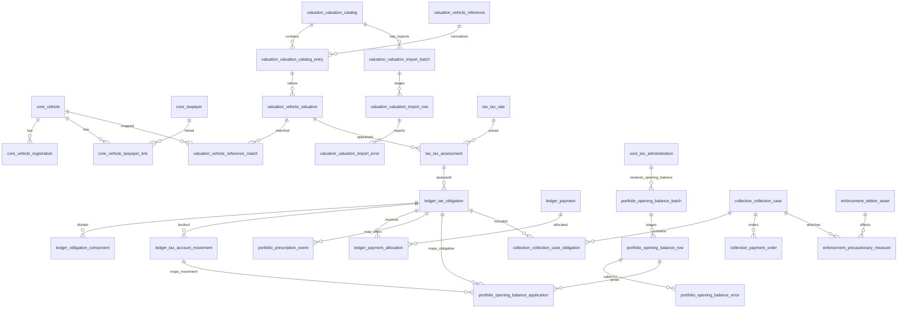
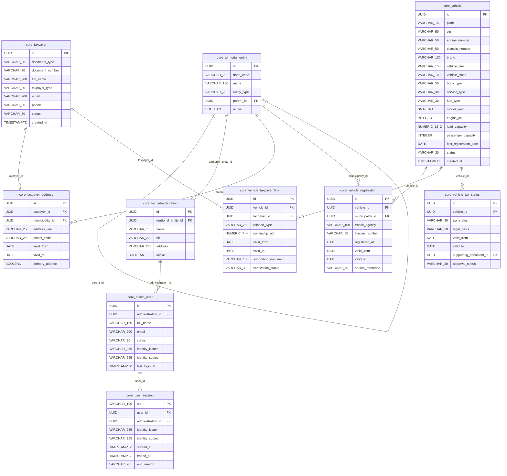
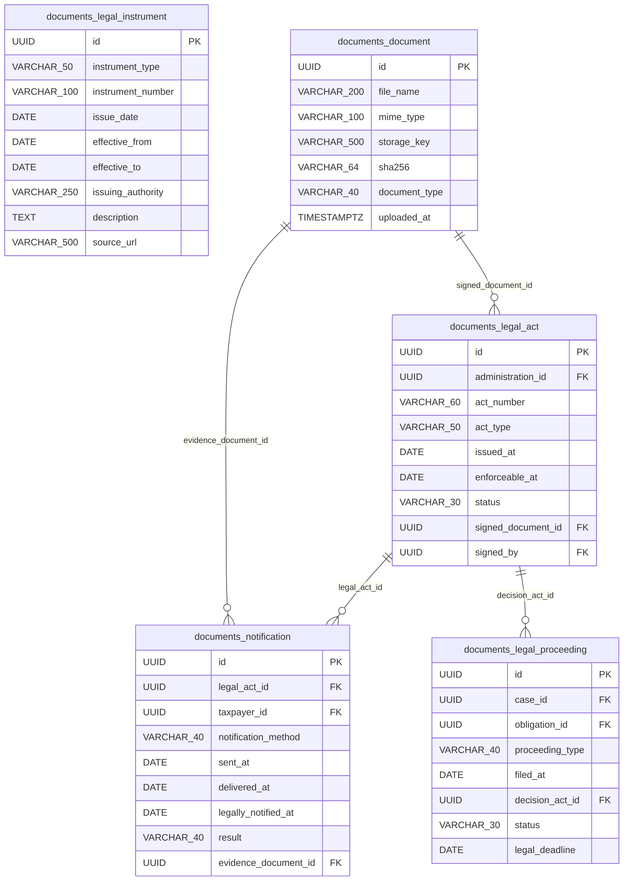
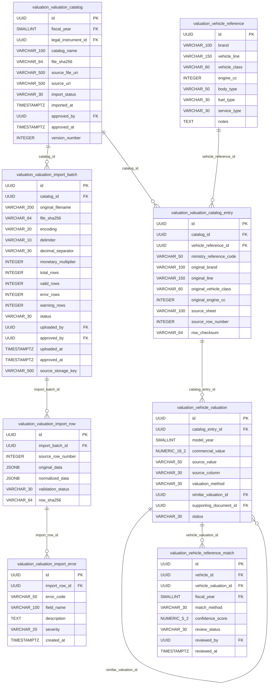
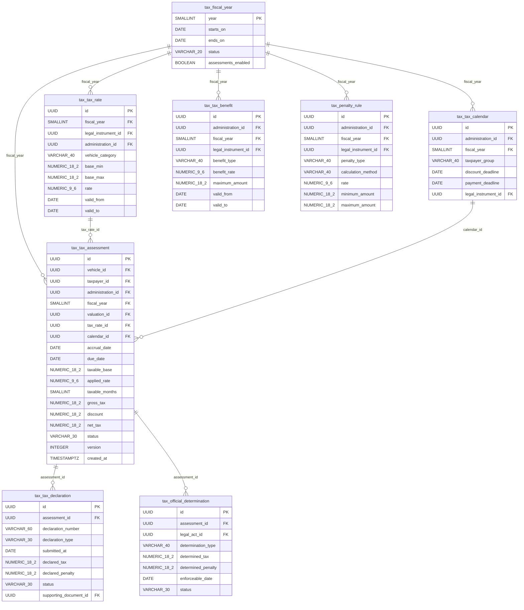
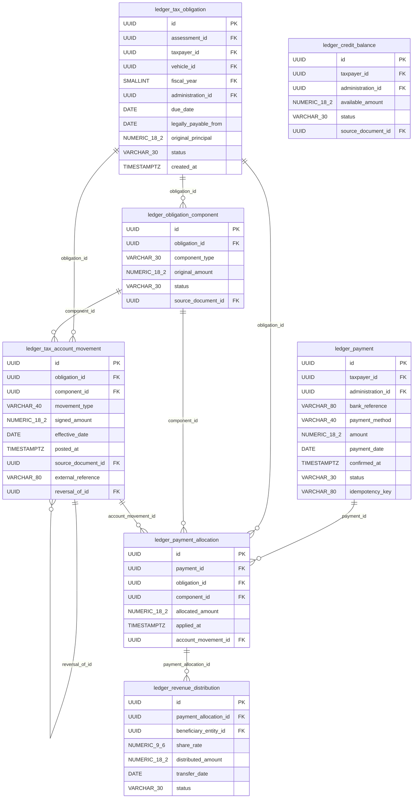
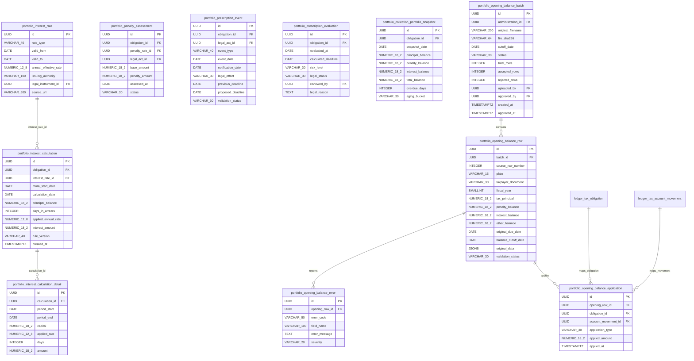
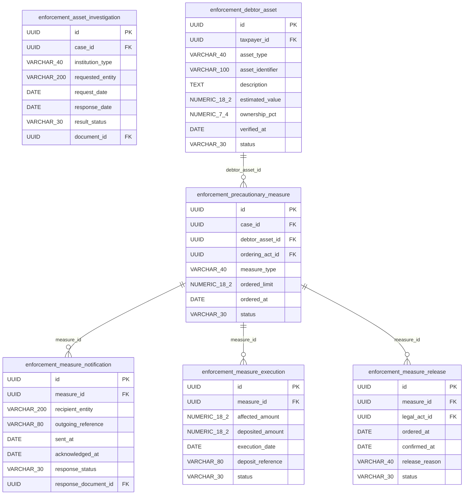
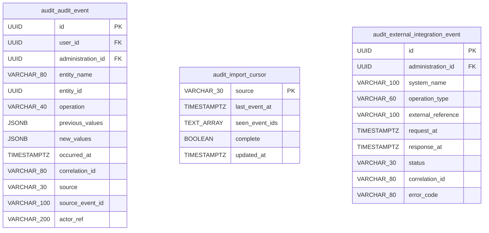
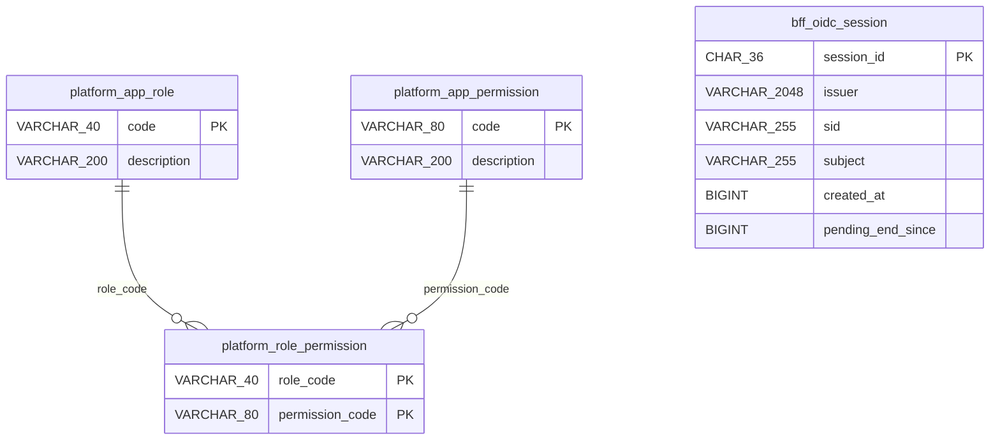

# ERD definitivo propuesto — Impuesto vehicular

> Basado en el catálogo lógico inicial de 63 tablas y 563 campos (65 tablas desde la versión 2.1). Validación estructural; no supone aprobación jurídica ni despliegue de PostgreSQL.
>
> **Versión:** 2.1 — registra los ajustes al modelo que el responsable funcional aprobó en H2 de la feature 001 · Inicio de sesión (2026-11-01). Agrega `core.user_session` y `audit.import_cursor`, que dejan el catálogo en 65 tablas. Cambian `core.admin_user` y `audit.audit_event`. Además, documenta los esquemas técnicos `platform` y `bff`, que no son parte del catálogo funcional (ver «Esquemas técnicos»).

## Hallazgos prioritarios de validación

1. **Avalúos:** mantener la estructura `valuation_catalog` → `valuation_catalog_entry` → `vehicle_valuation` con `model_year` en la última; preservar encabezado y posición fuente, unidades y versión de archivo.
2. **Integridad territorial:** FK compuestas o validación transaccional para evitar mezclar `administration_id` de distintas entidades en liquidaciones, pagos y expedientes.
3. **Liquidación y obligación:** impedir doble obligación activa del mismo sujeto/vehículo/vigencia/concepto salvo responsabilidad solidaria o rectificación formal; distinguir `assessment` técnico de título legal.
4. **Pagos:** validación de que la suma de imputaciones no exceda el pago confirmado y que el componente corresponda a la obligación.
5. **Años fiscales:** garantizar que `vehicle_reference_match.fiscal_year` coincida con `valuation_catalog.fiscal_year` de la referencia seleccionada.
6. **Intereses y sanciones:** registrar versiones normativas, período, tasa y bases; ningún cálculo es automáticamente una sanción exigible.
7. **Prescripción:** revisar título, hecho generador del cómputo, notificaciones e interrupciones; no automatizar declaración jurídica.
8. **Embargos:** impedir que monto ejecutado exceda límite permitido; controlar bien, destinatario, consignación y levantamiento.
9. **Notificaciones:** diferenciar fecha de expedición, entrega, notificación legal y ejecutoria con prueba.
10. **Importación CSV de avalúos:** staging con archivo inmutable (hash), separador, codificación, multiplicador de unidades, vista previa, validación, dos roles (carga/aprobación) y publicación atómica; no permitir sobrescritura del catálogo publicado.
11. **Apertura de cartera histórica:** lote CSV/Excel independiente del catálogo ministerial; importar como saldo recibido, conciliar y aprobar antes de contabilizar; soportar vigencia, sujeto, vehículo, capital, sanciones e intereses con fecha de corte; vincular al título y expediente si existen.
12. **Faltantes para producción:** catálogos de estados, controles de concurrencia, RLS, políticas de retención y vínculos de actos/facturas al título ejecutivo.

## ERD general (relaciones principales)

## CORE — Registro automotor y contribuyentes (10 tablas)

**Tablas y funciones:**

- `core.territorial_entity` — Catálogo DANE de departamentos, distritos y municipios.
- `core.tax_administration` — Autoridad competente que administra el impuesto.
- `core.taxpayer` — Contribuyentes identificados por documento.
- `core.taxpayer_address` — Historial de direcciones de contribuyentes.
- `core.vehicle` — Inventario maestro de automotores.
- `core.vehicle_registration` — Historial de matrícula, radicación y traslado.
- `core.vehicle_taxpayer_link` — Historial de propietarios, poseedores y relaciones con vehículo.
- `core.vehicle_tax_status` — Clasificación histórica de sujeción, exclusión y beneficios por vehículo.
- `core.admin_user` — Usuarios funcionarios y responsables de actos y auditoría. Feature 001:
  - `status` vale `ACTIVE` o `INACTIVE`; un usuario `INACTIVE` no entra (001-05);
  - `identity_issuer` e `identity_subject` son el vínculo con el proveedor de identidad (emisor y `sub`), único por usuario. LIV identifica al usuario por su `id`, no por el proveedor (001-21);
  - `last_login_at` es el último inicio de sesión aceptado.
- `core.user_session` — Sesiones de los usuarios (feature 001), una por sesión del proveedor (`sid`). Apunta a su usuario con la FK compuesta `(user_id, administration_id, identity_issuer, identity_subject)` → `core.admin_user`. La abre `StartSession` y la cierra `EndSession` con `end_reason`: `LOGOUT` (salir), `IDLE` (inactividad), `ABSOLUTE` (duración máxima) o `PROVIDER` (el proveedor la cerró). Cerrarla dos veces no cambia nada. La FK compuesta impide apuntar a un usuario de otra administración o a otra identidad.
- `core.territorial_entity.entity_type` (feature 001) vale `DEPARTAMENTO`, `DISTRITO_CAPITAL`, `DISTRITO` o `MUNICIPIO`, los mismos tipos de `jurisdiccion.tipo` de los YAML de jurisdicción.

**Relaciones externas:**

- `core.vehicle_tax_status.supporting_document_id` → `documents.document`

## DOCUMENTS — Normas y expediente documental (5 tablas)

**Tablas y funciones:**

- `documents.legal_instrument` — Registro de normas, resoluciones y actos regulatorios.
- `documents.document` — Repositorio de archivos electrónicos con integridad criptográfica.
- `documents.legal_act` — Actos administrativos con firma, estado y ejecutoria.
- `documents.notification` — Prueba de envío, entrega y notificación legal de actos.
- `documents.legal_proceeding` — Recursos, excepciones y controversias que afectan obligaciones o expedientes.

**Relaciones externas:**

- `documents.legal_act.administration_id` → `core.tax_administration`
- `documents.legal_act.signed_by` → `core.admin_user`
- `documents.notification.taxpayer_id` → `core.taxpayer`
- `documents.legal_proceeding.case_id` → `collection.collection_case`
- `documents.legal_proceeding.obligation_id` → `ledger.tax_obligation`

## VALUATION — Avalúos ministeriales e importación CSV (8 tablas)

**Tablas y funciones:**

- `valuation.valuation_catalog` — Versión e importación de cada tabla oficial de avalúos del Ministerio.
- `valuation.vehicle_reference` — Identidad técnica normalizada de variantes vehiculares.
- `valuation.valuation_catalog_entry` — Representa una fila original del catálogo ministerial en una vigencia.
- `valuation.vehicle_valuation` — Avalúo oficial por referencia del catálogo anual y año modelo.
- `valuation.vehicle_reference_match` — Aprobación de asociación entre un vehículo real y su avalúo por vigencia.
- `valuation.valuation_import_batch` — Un archivo CSV recibido, su origen, formato, unidades monetarias, totales de validación y aprobación.
- `valuation.valuation_import_row` — Fila de staging con datos originales y normalizados; no afecta los avalúos publicados.
- `valuation.valuation_import_error` — Errores y advertencias por fila/campo durante validación.

**Flujo del importador:** `UPLOADED` → `VALIDATING` → `VALIDATED` → `APPROVED` → `PUBLISHED`, con `REJECTED` / `FAILED` cuando corresponda. Una fila inválida bloquea la publicación del lote; una advertencia requiere política de aprobación. Solo se materializa una versión nueva de catálogo después de aprobación y publicación transaccional. Las filas del CSV con columnas por año modelo se normalizan a `vehicle_valuation` conservando encabezado, fila y unidad de origen. Los valores publicados no se sobrescriben: una corrección produce otra versión del catálogo.

**Relaciones externas:**

- `valuation.valuation_catalog.fiscal_year` → `tax.fiscal_year`
- `valuation.valuation_catalog.legal_instrument_id` → `documents.legal_instrument`
- `valuation.valuation_catalog.approved_by` → `core.admin_user`
- `valuation.vehicle_valuation.supporting_document_id` → `documents.document`
- `valuation.vehicle_reference_match.vehicle_id` → `core.vehicle`
- `valuation.vehicle_reference_match.fiscal_year` → `tax.fiscal_year`
- `valuation.vehicle_reference_match.reviewed_by` → `core.admin_user`
- `valuation.valuation_import_batch.uploaded_by` → `core.admin_user`
- `valuation.valuation_import_batch.approved_by` → `core.admin_user`

## TAX — Determinación tributaria (8 tablas)

**Tablas y funciones:**

- `tax.fiscal_year` — Apertura y cierre de vigencias fiscales.
- `tax.tax_rate` — Tarifas y umbrales por vigencia, jurisdicción y clase.
- `tax.tax_calendar` — Vencimientos y fechas de descuentos por administración y año.
- `tax.tax_benefit` — Descuentos, exenciones y alivios tributarios autorizados.
- `tax.penalty_rule` — Reglas de sanciones tributarias legalmente aplicables.
- `tax.tax_assessment` — Cálculo versionado del impuesto sobre un vehículo y vigencia.
- `tax.tax_declaration` — Declaraciones privadas radicadas por el contribuyente.
- `tax.official_determination` — Liquidación o determinación oficial distinta de cálculo interno.

**Relaciones externas:**

- `tax.tax_rate.legal_instrument_id` → `documents.legal_instrument`
- `tax.tax_rate.administration_id` → `core.tax_administration`
- `tax.tax_calendar.administration_id` → `core.tax_administration`
- `tax.tax_calendar.legal_instrument_id` → `documents.legal_instrument`
- `tax.tax_benefit.administration_id` → `core.tax_administration`
- `tax.tax_benefit.legal_instrument_id` → `documents.legal_instrument`
- `tax.penalty_rule.administration_id` → `core.tax_administration`
- `tax.penalty_rule.legal_instrument_id` → `documents.legal_instrument`
- `tax.tax_assessment.vehicle_id` → `core.vehicle`
- `tax.tax_assessment.taxpayer_id` → `core.taxpayer`
- `tax.tax_assessment.administration_id` → `core.tax_administration`
- `tax.tax_assessment.valuation_id` → `valuation.vehicle_valuation`
- `tax.tax_declaration.supporting_document_id` → `documents.document`
- `tax.official_determination.legal_act_id` → `documents.legal_act`

## LEDGER — Cuenta corriente y recaudo (7 tablas)

**Tablas y funciones:**

- `ledger.tax_obligation` — Obligación individual por vehículo, vigencia y sujeto con control de exigibilidad.
- `ledger.obligation_component` — Desglosa impuesto, sanciones, intereses, costas y otros rubros.
- `ledger.tax_account_movement` — Libro mayor inmutable de débitos, créditos y ajustes por obligación.
- `ledger.payment` — Recaudos confirmados y conciliables.
- `ledger.payment_allocation` — Imputación de cada pago a deuda y concepto.
- `ledger.credit_balance` — Saldos a favor disponibles y su disposición.
- `ledger.revenue_distribution` — Distribución del recaudo tributario según participaciones territoriales.

**Relaciones externas:**

- `ledger.tax_obligation.assessment_id` → `tax.tax_assessment`
- `ledger.tax_obligation.taxpayer_id` → `core.taxpayer`
- `ledger.tax_obligation.vehicle_id` → `core.vehicle`
- `ledger.tax_obligation.fiscal_year` → `tax.fiscal_year`
- `ledger.tax_obligation.administration_id` → `core.tax_administration`
- `ledger.obligation_component.source_document_id` → `documents.document`
- `ledger.tax_account_movement.source_document_id` → `documents.document`
- `ledger.payment.taxpayer_id` → `core.taxpayer`
- `ledger.payment.administration_id` → `core.tax_administration`
- `ledger.credit_balance.taxpayer_id` → `core.taxpayer`
- `ledger.credit_balance.administration_id` → `core.tax_administration`
- `ledger.credit_balance.source_document_id` → `documents.document`
- `ledger.revenue_distribution.beneficiary_entity_id` → `core.territorial_entity`

## PORTFOLIO — Mora, sanciones y prescripción (11 tablas)

**Tablas y funciones:**

- `portfolio.interest_rate` — Tasas certificadas y parámetros para liquidar mora.
- `portfolio.interest_calculation` — Ejecución de cálculo de intereses a una fecha determinada.
- `portfolio.interest_calculation_detail` — Trazabilidad de tramos de capital y reglas dentro del cálculo.
- `portfolio.penalty_assessment` — Registro de sanciones determinadas y sus soportes.
- `portfolio.prescription_event` — Hechos con potencial efecto sobre el cómputo de prescripción.
- `portfolio.prescription_evaluation` — Dictamen trazable sobre término de prescripción por obligación.
- `portfolio.collection_portfolio_snapshot` — Corte histórico de saldos y antigüedad para reportes.

- `portfolio.opening_balance_batch` — Lote de migración de cartera y conciliación de totales, con separación entre operador y aprobador.
- `portfolio.opening_balance_row` — Fila íntegra de la fuente, componentes de deuda, identificación y fecha de corte.
- `portfolio.opening_balance_error` — Inconsistencias y advertencias por fila, sin modificar los datos originales.
- `portfolio.opening_balance_application` — Trazabilidad de cada aplicación aprobada sobre obligación y movimiento financiero, sin duplicar saldos.

**Relaciones externas:**

- `portfolio.interest_rate.legal_instrument_id` → `documents.legal_instrument`
- `portfolio.interest_calculation.obligation_id` → `ledger.tax_obligation`
- `portfolio.penalty_assessment.obligation_id` → `ledger.tax_obligation`
- `portfolio.penalty_assessment.penalty_rule_id` → `tax.penalty_rule`
- `portfolio.penalty_assessment.legal_act_id` → `documents.legal_act`
- `portfolio.prescription_event.obligation_id` → `ledger.tax_obligation`
- `portfolio.prescription_event.legal_act_id` → `documents.legal_act`
- `portfolio.prescription_evaluation.obligation_id` → `ledger.tax_obligation`
- `portfolio.prescription_evaluation.reviewed_by` → `core.admin_user`
- `portfolio.collection_portfolio_snapshot.obligation_id` → `ledger.tax_obligation`
- `portfolio.opening_balance_batch.administration_id` → `core.tax_administration`
- `portfolio.opening_balance_batch.uploaded_by` → `core.admin_user`
- `portfolio.opening_balance_batch.approved_by` → `core.admin_user`
- `portfolio.opening_balance_application.obligation_id` → `ledger.tax_obligation`
- `portfolio.opening_balance_application.account_movement_id` → `ledger.tax_account_movement`

## COLLECTION — Cobro persuasivo y coactivo (7 tablas)

**Tablas y funciones:**

- `collection.collection_case` — Expediente persuasivo o coactivo abierto contra un deudor.
- `collection.collection_case_obligation` — Relación muchos-a-muchos expediente / obligaciones.
- `collection.collection_action` — Cronología de gestiones y actuaciones de cobranza.
- `collection.enforcement_title` — Identificación y validación del título ejecutivo por obligación.
- `collection.payment_order` — Mandamiento de pago del procedimiento coactivo.
- `collection.payment_facility` — Facilidades de pago otorgadas por acto competente.
- `collection.facility_installment` — Calendario de cuotas de una facilidad de pago.

**Relaciones externas:**

- `collection.collection_case.administration_id` → `core.tax_administration`
- `collection.collection_case.taxpayer_id` → `core.taxpayer`
- `collection.collection_case.assigned_officer_id` → `core.admin_user`
- `collection.collection_case_obligation.obligation_id` → `ledger.tax_obligation`
- `collection.collection_action.legal_act_id` → `documents.legal_act`
- `collection.enforcement_title.obligation_id` → `ledger.tax_obligation`
- `collection.enforcement_title.source_document_id` → `documents.document`
- `collection.payment_order.legal_act_id` → `documents.legal_act`
- `collection.payment_facility.approving_act_id` → `documents.legal_act`

## ENFORCEMENT — Bienes y medidas cautelares (6 tablas)

**Tablas y funciones:**

- `enforcement.asset_investigation` — Solicitudes y respuestas para investigar bienes del deudor.
- `enforcement.debtor_asset` — Bienes o derechos patrimoniales identificados como del deudor.
- `enforcement.precautionary_measure` — Orden judicial o administrativa de medida cautelar en cobro.
- `enforcement.measure_notification` — Oficios de inscripción o comunicación a terceros para ejecutar medida.
- `enforcement.measure_execution` — Ejecución material y recursos retenidos por medida cautelar.
- `enforcement.measure_release` — Levantamientos totales o parciales de medidas cautelares.

**Relaciones externas:**

- `enforcement.asset_investigation.case_id` → `collection.collection_case`
- `enforcement.asset_investigation.document_id` → `documents.document`
- `enforcement.debtor_asset.taxpayer_id` → `core.taxpayer`
- `enforcement.precautionary_measure.case_id` → `collection.collection_case`
- `enforcement.precautionary_measure.ordering_act_id` → `documents.legal_act`
- `enforcement.measure_notification.response_document_id` → `documents.document`
- `enforcement.measure_release.legal_act_id` → `documents.legal_act`

## AUDIT — Auditoría e integraciones (3 tablas)

**Tablas y funciones:**

- `audit.audit_event` — Bitácora inmutable de cambios administrativos y financieros. Feature 001:
  - `administration_id`: la administración del evento, para el aislamiento por RLS. Puede ser nula: los eventos de plataforma (como un inicio rechazado de alguien sin administración) y los importados del proveedor no la tienen, y la aplicación no los lee. Si hay `user_id`, la administración es obligatoria (CHECK), y la FK compuesta `(user_id, administration_id)` → `core.admin_user` impide mezclar administraciones;
  - `source` (`LIV` o `IDENTITY_PROVIDER`) y `source_event_id`, obligatorios y únicos juntos, para que un evento importado dos veces quede una sola vez;
  - `actor_ref`: quién actuó cuando no es un usuario de LIV (por ejemplo, el nombre intentado en un inicio fallido, enmascarado);
  - los eventos de sesión se guardan con `entity_name` = `session` o `identity_provider`, `operation` = el tipo de evento, y `new_values` = `{result, reason, truncated_ip, masked_attempted_username}`, sin contraseñas ni códigos (001-18).
- `audit.import_cursor` — Hasta dónde se importaron los eventos del proveedor de identidad a `audit.audit_event` (feature 001); `source` solo vale `IDENTITY_PROVIDER`: el último instante, los ids ya vistos en ese instante y si la última lectura fue completa.
- `audit.external_integration_event` — Trazabilidad de llamadas a fuentes, RUNT, bancos y pasarelas.

**Relaciones externas:**

- `audit.audit_event.user_id` → `core.admin_user`, con `administration_id` en una FK compuesta
- `audit.audit_event.administration_id` → `core.tax_administration`
- `audit.external_integration_event.administration_id` → `core.tax_administration`

## Esquemas técnicos (plataforma y BFF)

No son parte del catálogo funcional: los usa la plataforma, no el negocio. Los aprobó el responsable en H2 de la feature 001 (2026-11-01). Sus roles de base de datos están en `docs/arquitectura/02` §5.2.

**Tablas:**

| Esquema | Tabla | Para qué |
|---|---|---|
| `platform` | `app_role`, `app_permission`, `role_permission` | Roles, permisos y qué permisos tiene cada rol (matriz en Doc. 01 §4.1). El rol de una persona llega del proveedor de identidad |
| `platform` | `event_publication` | Eventos entre módulos que aún no se procesan (Spring Modulith). No se dibuja: su estructura es la de Spring Modulith |
| `platform` | `shedlock` | Bloqueo de las tareas programadas de la API: con varias réplicas, una sola a la vez. No se dibuja: es la tabla estándar de ShedLock |
| `bff` | `spring_session`, `spring_session_attributes` | Sesiones del BFF en el servidor; los *tokens* van cifrados en un atributo |
| `bff` | `oidc_session` | Qué sesión del BFF es de qué sesión del proveedor (`sid`), para el cierre por canal trasero, y los avisos a LIV pendientes |
| `bff` | `shedlock` | Bloqueo del barrido de las sesiones vencidas del BFF |

## Reglas de implementación de apertura de cartera histórica

1. **Carga independiente:** `opening_balance_*` no puede reutilizar `valuation_import_*`; los archivos y procesos tienen distinta finalidad.
2. **Unidad de apertura:** cada fila identifica un sujeto, vehículo, administración, vigencia, concepto(s), saldos y fecha de corte; no se debe asumir que la placa identifica por sí sola al deudor histórico.
3. **Staging y conciliación:** las filas se cargan sin afectar el libro mayor. Comparar totales del archivo, subtotales por componente, duplicados y obligaciones preexistentes.
4. **Aprobación segregada:** el aprobador debe ser distinto del cargador; nunca publicar lotes con errores críticos o diferencias no explicadas.
5. **Asiento controlado:** publicar en una transacción que cree o vincule la obligación y movimientos `OPENING_BALANCE` respaldados por `opening_balance_application`.
6. **Idempotencia:** clave única de origen por administración, lote y fila; además impedir reaplicaciones de una obligación/componente por reinicios de importación.
7. **Intereses:** registrar el importe recibido, su fecha de corte y soporte; no capitalizarlo ni contabilizarlo dos veces al hacer futuros recálculos.
8. **Validez jurídica:** distinguir `RECEIVED`, `RECONCILED`, `POSTED`, `LEGALLY_REVIEWED` y `COLLECTIBLE`; migrar un saldo no acredita por sí solo título ejecutivo ni interrumpe prescripción.
9. **Archivo inmutable:** conservar fuente, SHA-256 y JSONB original; las correcciones requieren otro lote o movimientos reversos auditados.
10. **Extensiones para producción:** vincular `source_system`, identificador de obligación origen, comprobantes, actos de determinación, fechas de ejecutoria, notificaciones y mandamientos; agregar índice de conciliación por `(administration_id, fiscal_year)` y controles de tenant.

## Checklist de aceptación previo a Flyway

_Feature 001: en H2 (2026-11-01) el responsable autorizó migrar, antes de cerrar esta lista, las tablas de `platform`, `bff`, `core.territorial_entity`, `core.tax_administration`, `core.admin_user`, `core.user_session` y `audit`. Ninguna es tributaria. La lista sigue abierta para el resto del modelo._

- [ ] Confirmar que cada FK referencia registros de la misma entidad territorial donde corresponda.
- [ ] Congelar catálogos de avalúos publicados y registrar correcciones con versión distinta.
- [ ] Validar CSV UTF-8/BOM, separador, encabezados de años modelo, valor de miles/pesos, hash y duplicados.
- [ ] Comprobar staging, reporte de errores, aprobación por usuario diferente al cargador y publicación transaccional.
- [ ] Definir UNIQUE por (catalog_id, ministry_reference_code, model_year) y por (batch_id, source_row_number), ajustando las claves a las filas originales reales.
- [ ] Definir índices únicos parciales e intervalos sin solapamientos para matrículas, propietarios y tasas.
- [ ] Documentar reglas de redondeo, facturación y sanciones por año/jurisdicción.
- [ ] Formalizar controles de auditoría, estados jurídicos, documentos y permisos de funcionarios.
- [ ] Validar ERD con expertos tributarios de Bogotá antes de migraciones.
- [ ] Probar importación de cartera histórica, conciliación, rollback y publicación idempotente.
- [ ] Verificar prescripción y exigibilidad por obligación antes de habilitar cobro coactivo.

## Reglas de implementación de la carga CSV

1. Los CSV se reciben con delimitador configurable (`;` o `,`) y codificación declarada (preferiblemente UTF-8); el parser debe manejar comillas, campos vacíos y BOM.
2. Cada fila original se conserva íntegra en `valuation_import_row.original_data`. El parser genera una versión validada en `normalized_data`, que puede contener varios años modelo.
3. `source_row_number` es el número físico de la fila CSV, y la columna concreta debe permanecer vinculada a cada avalúo normalizado para auditoría.
4. `monetary_multiplier` vale 1000 si las cifras fuente están en miles de pesos y 1 si están en pesos. Unidades y separadores decimales se validan antes de convertir a `NUMERIC(18,2)`.
5. Los registros inválidos se documentan en `valuation_import_error`; no se publican parcialmente archivos con errores críticos.
6. `catalog_id` refiere a la versión que se pretende publicar; una corrección requiere otra versión, sin actualizar avalúos ya utilizados en liquidaciones.
7. El estado `PUBLISHED` solo se asigna tras una transacción completa y una comprobación de totales e integridad referencial.
8. La publicación debe ser idempotente por `file_sha256`, catálogo y versión. Debe existir separación de funciones entre cargador y aprobador.
9. El archivo fuente se conserva en almacenamiento documental con control de acceso; el hash SHA-256 identifica su contenido.
10. El CSV oficial no sustituye el PDF/resolución ministerial: la aprobación debe contrastar datos y soporte normativo.

## Observación

Las relaciones se derivan de las FK descritas en el catálogo; los enlaces de `model_year` a la celda del anexo requieren prueba real de importación. Este diagrama es lógico y no sustituye las migraciones SQL.