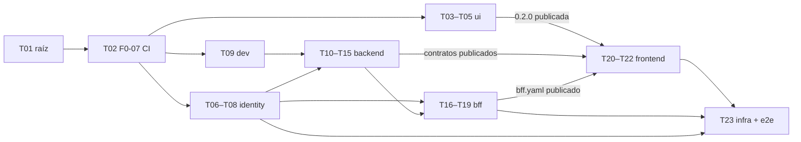

# 001 · Inicio de sesión — Tareas

_Checklist accionable derivada del `plan.md` (versión 4, aprobado H2). Tareas pequeñas y concretas; cada una cabe en un PR revisable (≤ ~400 líneas). Cada tarea indica los archivos que puede tocar y la prueba que se escribe primero (TDD: rojo → verde → refactorizar). Marca `[x]` al completarlas._

**Cómo se trabaja cada tarea:**
- **Rama y PR.** Cada tarea es un PR de un solo proyecto (IN‑07), con la rama `feat/001-inicio-de-sesion-<proyecto>-<tema>`.
- **Revisión.** Antes del PR se hacen la revisión adversarial y las cuatro lentes: es un cambio crítico.
- **Modelo.** Implementar es nivel estándar; revisar es nivel alto (`AGENTS.md` §10).
- **Si una prueba no se puede escribir como dice la tarea,** se actualiza esta lista y se avisa antes de seguir.

## Orden y paralelismo

Las tareas de `ui/`, `backend/identity/` y `backend/dev/` pueden ir en paralelo; cada una toca sus propios archivos.

## Raíz

- [x] **T01** · Documentación de la feature y ADR 0023–0025 — Archivos: `spec/features/001-inicio-de-sesion/**`, `docs/adr/ADR-0023…0025`, `docs/arquitectura/00`, `01`, `02`, `AGENTS.md` (§4.3, §6.2, §10), `CLAUDE.md`, `spec/constitution/**`, `.claude/**`, `ESTADO.md` — Prueba primero: no aplica (documentación). Se revisan los enlaces y la consistencia de los códigos de criterio. — Hecha: PR #7.
- [x] **T02** · Requisito previo F0‑07: CI de PR mínimo por proyecto. Cambia CI, así que requiere aprobación humana explícita (`AGENTS.md` §4.5). — Hecha: PR #8 (Dependabot se retiró en el PR #21).
  - Archivos: `.github/workflows/{backend-pr,frontend-pr,ui-pr,sistema-pr}.yml`, `.github/CODEOWNERS` (Dependabot se retiró después por decisión del responsable).
  - Contenido:
    - por proyecto, con filtro de ruta y `working-directory`: compilación, formato, *lint*, pruebas y arquitectura (Q01–Q03 en backend y frontend; en `ui`, solo Q01 hasta que T03 agregue pruebas e historias);
    - en todo PR: título en Conventional Commits (Q13) y búsqueda de secretos con gitleaks;
    - acciones fijadas por SHA, permisos mínimos y `concurrency`.
  - Prueba primero: los comandos de cada *workflow* ejecutados en local; los *workflows* corren sobre su propio PR. La expresión del título se probó con casos válidos e inválidos.
  - **Fuera de T02**, cada parte con la tarea que crea lo que publica: publicación de imágenes y de contratos (`backend-main`, `frontend-main`) con T08, T16 y T21 (la de T08, que incluye construir la imagen de identidad y correr `check.sh`, quedó como pendiente aparte con aprobación del responsable, 2026-11-03); el trabajo de PR del BFF (`.github/workflows/bff-pr.yml`, Q01–Q03), aprobado por el responsable el 2026-11-04, va aparte antes de T17; la de los contratos del backend y su comparador de cambios incompatibles, en una tarea aparte de F0‑07 antes de T20 (decisión del responsable, 2026-11-02; ver abajo); verificación de secretos de prueba del *realm* con T07; cobertura, mutación, Sonar y guardián SDD en el resto de F0‑07.
- [x] **Tarea aparte de F0‑07** · Comparador de cambios incompatibles de los contratos (Q08) y su publicación. Requisito de T20. Cambia CI y agrega una herramienta: diseño y herramienta aprobados por el responsable (2026-11-03), ADR 0027. — En revisión: PR #69 (`backend/`) y PR #70 (`.github/`), que se integra después del #69. — Hecha: PR #69, #70 y #71 (ADR 0027); primera publicación de los contratos el 2026-11-05.
  - Archivos: `backend/pom.xml` (`openapi-diff-maven` 2.1.7, solo en `pluginManagement`), `backend/contracts/scripts/**`, `backend/README.md`, `backend/CHANGELOG.md`, `.github/workflows/{backend-contracts-pr,backend-main}.yml`, y la etiqueta `contrato-incompatible` del repositorio.
  - Contenido:
    - **Versión:** `info.version` de cada contrato sube si el contrato cambia.
    - **Aprobación:** un cambio incompatible, o quitar un contrato, exige la etiqueta `contrato-incompatible`, que pone una persona, y la versión mayor subida.
    - **Publicación:** al integrar en `main`, cada versión nueva sale como *release* `contract-<nombre>-vX.Y.Z` con el YAML y su SHA-256. Antes se juzga contra la *release* publicada más alta de su contrato, con la etiqueta del PR integrado, que solo aprueba los contratos que cambia su commit.
    - **Quién juzga:** en CI, los *scripts* de la base, no los del PR.
  - Prueba primero: `contracts/scripts/test/run.sh`, con 79 casos. Entre ellos, quitar un campo requerido de la respuesta falla con `[INCOMPATIBLE]`; los demás cubren el modo Git y la publicación con un `gh` falso.
  - **Decisiones del responsable:**
    - el BFF tendrá su propia copia de los *scripts* (ver T18);
    - dos PR, uno por proyecto;
    - por ahora no se activan las *releases* inmutables ni un *ruleset* de etiquetas;
    - los huecos conocidos de `openapi-diff` 2.1.7 se documentan: no detecta `minLength` más estricto en la petición ni un campo de la respuesta que pasa a `nullable`.

## `ui/` — `liv-components` 0.2.0

- [x] **T03** · *Tokens* nuevos (4 estilos y la colección `Layout`) y los componentes `Icon` (38 SVG de Lucide), `Logo`, `Spinner`, `Skeleton`, `Badge` y `Avatar`. — Hecha: PR #30, con el ADR 0026 (PR #31) para sus dependencias de desarrollo; el PR #32 corrige `npm run storybook` y `format:check` en Windows.
  - Archivos: `ui/projects/liv-components/src/{styles/theme.css,lib/icon/**,lib/logo/**,lib/spinner/**,lib/skeleton/**,lib/badge/**,lib/avatar/**,public-api.ts}`, `ui/.storybook/**`, `ui/THIRD_PARTY_NOTICES.md`, `ui/package.json`.
  - **Desviaciones declaradas:**
    - se tocaron además `angular.json`, `README.md`, `.postcssrc.json`, `tsconfig.lib.json`, `tsconfig.spec.json`, `src/testing/axe.ts`, `src/lib/tailwind-reference.css` y `scripts/copy-notices.mjs`, necesarios para Vitest, Tailwind y el aviso de licencia;
    - el PR superó las ~400 líneas (unas 1.650 sin el *lockfile*: 297 de datos de iconos, 390 de pruebas y 269 de historias), porque Storybook, Tailwind y los componentes se prueban juntos;
    - dependencias de desarrollo nuevas, aprobadas en el ADR 0026.
  - Prueba primero: por componente, variantes, propiedades y atributos ARIA (`aria-hidden` en el icono decorativo; texto alternativo en `Logo`), más axe.
- [x] **T04** · `Button` (tamaños, iconos, `Loading`), `IconButton`, `TextField` (icono, acción, `Content`), `CodeInput` y `Alert`. — Hecha: PR #36.
  - Archivos: `ui/projects/liv-components/src/lib/{button,icon-button,text-field,code-input,alert}/**`, `public-api.ts`.
  - **Desviaciones declaradas:**
    - se agregó `ui/projects/liv-components/src/testing/css.ts`, un ayudante de pruebas como `testing/axe.ts`: lee el valor declarado de una propiedad CSS, porque jsdom no calcula `border-color` con `var()`;
    - el PR superó las ~400 líneas (unas 2.140, de ellas 1.310 de pruebas e historias), porque son cinco componentes;
    - Loading anuncia la entrada `loadingLabel` y el texto visible no cambia, como en Figma. La prueba en rojo pedía anunciar el texto del botón, que no se puede leer de forma fiable con zone.js;
    - nombres respecto de Figma: `Title` de `Alert` es `heading`, para no chocar con el atributo `title`; `Label` y `Message` se proyectan como contenido; `State=Error` se activa con la entrada `error`.
  - **Decisiones del responsable (2026-11-02)** sobre lo que dejó abierto la revisión:
    - **contraste:** «Corregir antes de T05», en la tarea T04a;
    - **icono de ayuda:** «Ajustar Figma a 16 px», también en T04a; `Icon` mantiene 16, 20 y 24;
    - **formularios de Angular:** «Decidir con la primera pantalla». Se mantiene `[(value)]`, y el ADR para `@angular/forms` se escribe cuando la primera pantalla de Angular con formulario lo necesite;
    - **tooltip:** «Provisional y al backlog». `IconButton` sigue con `title` nativo, y un componente `Tooltip` queda en el backlog (primero en Figma).
  - Prueba primero:
    - `Loading` no emite clic;
    - `TextField` en error expone `aria-invalid` y `aria-describedby`;
    - `CodeInput` usa `inputmode="numeric"` y `autocomplete="one-time-code"`;
    - `Alert` de error usa `role="alert"`.
- [x] **T04a** · Contraste de *tokens* e icono de ayuda (decisión del responsable, 2026-11-02). **Cambio de *tokens*: crítico.** Primero en Figma y después en el código. — Hecha: PR #38.
  - **En Figma (LIV‑Diseño):**
    - oscurecer los estilos `border/strong` y `focus/ring` hasta un contraste mínimo de 3:1 sobre `bg/surface` (WCAG 1.4.11);
    - que el texto de ejemplo (placeholder) de `TextField` y `CodeInput` use un estilo de texto con 4,5:1 sobre `bg/surface` (WCAG 1.4.3) en lugar de `text/disabled`; `text/muted` (≈4,8:1) es el candidato;
    - pasar a 16 px el icono de ayuda de `TextField` y `CodeInput`.
  - Archivos:
    - `ui/projects/liv-components/src/styles/theme.css`;
    - `ui/projects/liv-components/src/lib/{text-field,code-input}/**`: el placeholder y sus pruebas, y quitar la nota de «decisión pendiente» del icono de ayuda;
    - las pruebas de contraste de los *tokens* y las capturas de referencia de los componentes afectados.
  - Prueba primero:
    - contraste de `border/strong` y `focus/ring` sobre `bg/surface`, cada uno ≥ 3:1;
    - contraste del *token* del placeholder sobre `bg/surface` ≥ 4,5:1;
    - `TextField` y `CodeInput` usan ese *token* en el placeholder.
  - **Valores aprobados por el responsable (2026-11-02)**, aplicados en Figma y en `theme.css`:
    - `border/strong`: `#cbd5e1` → `#64748b` (4,76:1 sobre `bg/surface`; 4,34:1 sobre `bg/subtle`);
    - `focus/ring`: de `#2563eb` al 40 % a `0 0 0 2px #ffffff, 0 0 0 4px #2563eb`, un anillo opaco (5,17:1) con 2 px de separación en `bg/surface`. La separación es una **segunda decisión**, tomada durante la revisión: el anillo opaco quedaba pegado al relleno de `Button` Primary (1,30:1) y al borde de Error;
    - placeholder de `CodeInput`: `text/disabled` → `text/muted` (4,76:1). `TextField` ya lo usaba; deshabilitado pasa a `text/disabled`, como su variante de Figma;
    - icono de ayuda de `TextField` y `CodeInput`: 16 px en Figma (14 variantes); en código ya era 16.
  - **Desviaciones declaradas:**
    - ayudantes de prueba nuevos: `src/testing/contrast.ts` (con `contrast.spec.ts`) y `src/testing/text-imports.d.ts`, y en `css.ts` `declaredPlaceholderStyle`, `declaredShadow`, `paintsShadow` y `cssVariable`. `theme.css` se lee como texto con `with { loader: 'text' }` del compilador de Angular, sin agregar `@types/node`;
    - se tocaron las pruebas de `button` e `icon-button`, que no estaban declaradas: el *token* `focus/ring` cambia también en esos componentes;
    - no hay capturas de referencia, porque `ui/` todavía no tiene regresión visual (Q14). La verificación fue manual, en Storybook frente a Figma.
- [x] **T05** · `Dialog`, `ResultState`, `NavItem`, `SideNav`, `AppHeader`, `PageHeader` y `ModuleCard`. Versión 0.2.0 y `CHANGELOG.md`. **Un humano publica.** Depende de T04a: la 0.2.0 sale con los *tokens* corregidos. — Hecha: PR #43.
  - Pendientes que deja T04a:
    - `CHANGELOG.md` registra en «Cambiado» los *tokens* `border/strong` y `focus/ring` (antes, después y motivo) y el placeholder de `CodeInput`: cambian la apariencia de las aplicaciones;
    - medir el anillo de foco y los textos sobre los fondos oscuros que usen `SideNav` y `AppHeader`. `#2563eb` da ≈2,8:1 sobre `bg/inverse-subtle`; si no alcanza 3:1, se decide primero en Figma.
  - Archivos: `ui/projects/liv-components/src/lib/{dialog,result-state,nav-item,side-nav,app-header,page-header,module-card}/**`, `public-api.ts`, `projects/liv-components/package.json`, `CHANGELOG.md`.
  - Prueba primero:
    - `Dialog` atrapa el foco y cierra con Escape;
    - `NavItem` activo con `aria-current="page"` y deshabilitado con `aria-disabled` sin navegar (001-15);
    - capturas de referencia por variante (Q14): no se hicieron, ver «Desviaciones».
  - **Pendientes de T04a, resueltos:**
    - `CHANGELOG.md` (sección 0.2.0) registra en «Cambiado» `border/strong`, `focus/ring` y el placeholder de `CodeInput`, con antes, después y motivo, y marca como **incompatible** la anulación de la escala de espaciado y de radios de Tailwind;
    - `SideNav` y `AppHeader` son **claros** (`bg/surface`) en Figma, no usan `bg/inverse-subtle`: el anillo mide ≥ 4,72:1 sobre los fondos claros que usan y las parejas de texto nuevas llegan a 4,5:1 (`styles/theme-components.spec.ts`). No hubo que decidir nada en Figma.
  - **Decisiones de diseño de la implementación:**
    - `NavItem` y `ModuleCard` emiten `navigate` con el destino en un clic normal (la librería no importa `@angular/router`); con Ctrl, Cmd, Mayús, Alt o el botón central el navegador abre el enlace. Sin `href` quedan inertes;
    - `Dialog` emite `closeRequested` (no `closed`): Escape solo pide cerrar y la pantalla decide. Con varios abiertos, solo el último atrapa el foco y atiende Escape. El foco inicial va al elemento con `data-initial-focus` porque el *lint* de plantillas prohíbe `autofocus`;
    - `NavSection` (la etiqueta de sección del menú, que Figma dibuja dentro de `SideNav`) se exporta como componente aparte;
    - **decisión del responsable (2026-11-02): `Icon` admite 28 px.** El círculo de `ResultState` dibuja su icono a 28 px, como en Figma, en lugar de bajarlo a 24 px. `IconSize` pasa a `16 | 20 | 24 | 28`. Primero se actualizó Figma (la descripción de los 38 iconos dice «16, 20, 24 o 28 px») y después el código, con prueba en rojo. Es un cambio crítico (`AGENTS.md` §4.3) por modificar un componente existente, aprobado por el responsable en el chat; compatible con lo anterior. `lib/icon/**` queda tocado, fuera de la lista de archivos.
  - **Desviaciones declaradas:**
    - sin capturas de referencia por variante (Q14), porque `ui/` todavía no tiene regresión visual. La verificación fue manual, en Storybook frente a Figma;
    - archivos fuera de la lista: `lib/icon/**` (28 px, ver la decisión), `lib/shared/link-click.ts` (ayudante de los enlaces), `src/testing/css.ts` (`usesToken`, que compara el *token* exacto y no un prefijo) y `src/styles/theme-components.spec.ts` (contraste de las parejas nuevas);
    - la etiqueta de sección de `SideNav` no tiene estilo de texto en Figma: usa `label/sm` con 6 % de espaciado entre letras (`tracking-[0.06em]`);
    - medidas literales sin *token* de espaciado: 2, 6 y 44 px, y los anchos de 272, 440, 480 y 720 px;
    - el icono de «Salir» toma el color del botón Ghost (`text/link`) y no `text/primary` como en la instancia de Figma.
  - **Decisiones abiertas para el responsable:**
    - crear en Figma el estilo de texto de la etiqueta de sección y transcribirlo a `theme.css`;
    - `PageHeader` (máximo dos líneas) y `AppHeader` (administración truncada) pierden texto con zoom alto o pantallas angostas (WCAG 1.4.10);
    - opciones deshabilitadas del menú: hoy explican el motivo solo con `title` y no son enfocables (`item` y `subitem`; el `group` sí). Un `Tooltip` accesible está en el *backlog*;
    - foco inicial por defecto de `Dialog`: el primer enfocable. La pantalla del aviso de sesión debe marcar la acción segura con `data-initial-focus`.
  - **Revisión:** adversarial con dos revisores ciegos y lente de riesgo a nivel alto; resiliencia y confiabilidad a nivel estándar; legibilidad a nivel económico (`AGENTS.md` §10.1). Ningún crítico y 3 altos: dos de la adversarial, corregidos con prueba en rojo primero (estilos del grupo de `NavItem` que se filtraban a sus subopciones; disputa de foco entre dos `Dialog`), y uno de confiabilidad, las capturas de referencia (Q14), que queda como desviación. Segunda ronda de la adversarial, solo sobre lo corregido, sin críticos ni altos. Resumen por severidad en el PR #43.
- [x] **T05a** · `NavItem` de tres niveles: tipos `subgroup` y `nested` en `liv-components`. Versión 0.3.0 y `CHANGELOG.md`. **Un humano publica.** Sale de la decisión del responsable sobre el tercer nivel del menú (T22, 2026-11-05). — Hecha: PR [#91](https://github.com/jorgearaujoSap/liv/pull/91) (`ui/`), con las decisiones y los riesgos para el responsable que lista el PR.
  - Diseño: aprobado por el responsable funcional el 2026-11-05 (Figma, `NavItem` `Type=Subgroup` y `Type=Nested`, y el marco [Menú · tres niveles](https://www.figma.com/design/s2r2Kdu31sQW5CmVeQNyZb/LIV-Dise%C3%B1o?node-id=51-1519)).
  - Archivos: `ui/projects/liv-components/src/lib/nav-item/**`, `ui/projects/liv-components/src/styles/theme-components.spec.ts`, `ui/projects/liv-components/package.json`, `ui/CHANGELOG.md`, `ui/README.md`.
  - Prueba primero: `Subgroup` (botón con `aria-expanded`, sin icono, Active sin relleno, Disabled sin chevron) y `Nested` (enlace a 60 px con `aria-current`), con axe por estado.
  - **Desviaciones declaradas:**
    - `ui/README.md` y `theme-components.spec.ts` (el par de contraste del texto de `Subgroup` Active) estaban fuera de la lista;
    - sin capturas de referencia de regresión visual (Q14): el repositorio aún no tiene el mecanismo, como en T05; las historias de Storybook son la referencia;
    - unas 470 líneas (la mayoría, pruebas e historias).
  - **Qué hace, además de lo pedido:** `NavItemType` pasa a `'item' | 'group' | 'subgroup' | 'subitem' | 'nested'` (compatible en ejecución; un `switch` exhaustivo o un `Record<NavItemType, …>` debe cubrir los valores nuevos). El JSDoc documenta la anidación válida y que la rama activa debe estar expandida (`[(expanded)]`).
  - **Pendientes de decisión humana** (listados en el PR): el peso del texto de `Subgroup` Active como única señal sin color (y una señal en `forced-colors`), el Hover del subgrupo activo y Active+Disabled, que Figma no define.
  - **Revisión:** adversarial con dos `liv-revisor-critico` ciegos y las cuatro lentes (riesgo en nivel alto, resiliencia y confiabilidad en estándar, legibilidad en económico). Primera ronda: ningún crítico ni alto; medios y bajos coincidentes de pruebas que no habrían fallado con el código roto, historias y documentación, corregidos con prueba primero. Segunda ronda, solo sobre lo corregido: ningún crítico ni alto; 3 medios y 6 bajos, entre ellos dos errores de la propia corrección (una nota duplicada en el `CHANGELOG.md` y un `href` heredado en una historia). **No hubo tercera ronda** (regla de dos rondas): esas últimas correcciones quedan sin un tercer juicio independiente.
  - **Falta:** el uso en `frontend/` (otro PR) una vez que un humano publique la 0.3.0.
- [x] **T05b** · `ModuleCard` se estira con su celda: en una cuadrícula, las tarjetas de una misma fila miden lo mismo, como en el *frame* Inicio (Figma, nodo 26-793: las 9 miden 352×158). Versión 0.3.1 y `CHANGELOG.md`. **Un humano publica.** Sale de la prueba de Inicio del responsable (2026-11-05: «las cards de los módulos deberían tener el mismo tamaño… el diseño ya lo plantea de esa forma»). — PR [#92](https://github.com/jorgearaujoSap/liv/pull/92) (`ui/`).
  - Archivos: `ui/projects/liv-components/src/lib/module-card/**`, `ui/projects/liv-components/package.json`, `ui/CHANGELOG.md`, `ui/README.md`.
  - Prueba primero: el anfitrión es `flex`, sin altura ni `align-items` propios, y el enlace tiene `flex-grow: 1`. Como jsdom no calcula el diseño, la igualdad se midió en un navegador, en la historia «Cuadrícula de Inicio».
  - Después de publicar, **T22a** en el frontend.

## `backend/identity/`

- [x] **T06** · *Spike* de Keycloak con la versión fijada. — Hecha: PR #23. Decisiones del responsable: mensaje único (enmienda 2 de la spec) y sin mensaje de motivo.
  - Archivos: `backend/identity/spike/RESULTADOS.md`.
  - Responder:
    1. cómo distingue el tema la cuenta bloqueada (001-04);
    2. cómo llega al tema el motivo (`logout`, `expired`, `denied`);
    3. si revocar el *refresh token* (RFC 7009) cierra la sesión del usuario;
    4. qué eventos emite.
  - Prueba primero: no aplica. **Si alguna respuesta obliga a escribir una extensión de Keycloak o cambia una decisión del plan, se detiene y se lleva al responsable.**
- [x] **T07** · *Realm* como código. — Hecha: PR #26.
  - Archivos: `backend/identity/config/base/liv-realm.yaml`, `backend/identity/README.md`, `backend/src/test/java/**/identityconfig/RealmConfigTest.java`.
  - **Desviaciones declaradas:**
    - la prueba está en `backend/src/test/java`, porque Maven no corre pruebas desde `backend/identity/test/`;
    - la capa de desarrollo quedó en `backend/dev/keycloak/` (no en `identity/config/dev/`) y sin TOTP; los usuarios con TOTP conocido pasan a T23;
    - se tocaron archivos de T09: `backend/dev/compose.yaml` (servicio `keycloak-config`), `check.sh` (verificación del *realm* aplicado), `.env.example` y `README.md`;
    - que un TOTP equivocado cuente para el bloqueo es comportamiento de Keycloak: lo verificará el e2e de T23.
  - Prueba primero: `RealmConfigTest`, en rojo, que verifica:
    - roles; clientes `liv-bff` y `liv-bff-service` (solo *client credentials*, audiencia `liv-internal`); sin `offline_access`;
    - `administration_id` editable solo por un administrador;
    - bloqueo de 5 intentos y 15 minutos que también cuenta TOTP (001-04, 001-07);
    - TOTP obligatorio para los 7 roles de 001-06;
    - tiempos resueltos con los valores de producción y la desigualdad de la inactividad (001-10);
    - política de contraseñas (D-001-7);
    - eventos activados;
    - consola de cuenta desactivada;
    - ningún secreto de `config/dev` en `config/base`.
- [x] **T08** · Tema `liv` y la imagen de Keycloak. — Hecha en dos PR, porque no cabía en ~400 líneas: PR #57 (imagen, plantilla común con `Keycloak/BrandPanel`, inicio de sesión en escritorio y móvil con sus estados, y página de error) y PR #58 (contraseña nueva, configurar el segundo factor y pedir su código). Usa `liv-components` 0.2.0 con versión exacta y solo sus *tokens*.
  - Archivos: `backend/identity/theme/liv/**`, `backend/identity/theme/package.json` (Tailwind y `liv-components`), `backend/identity/Dockerfile`.
  - Prueba primero: `backend/identity/theme/check.sh`, en rojo antes de cada parte. Usa Docker y `curl`, levanta un entorno desechable y no agrega dependencias. Comprueba:
    - en el inicio de sesión y la página de error: el tema, el español y que solo se usen colores de los *tokens*;
    - que contraseña incorrecta, usuario inexistente, cuenta bloqueada y usuario desactivado reciban la **misma página** (001-03, 001-04, 001-05);
    - en contraseña nueva, configurar el segundo factor y pedir su código: los campos que lee Keycloak y los errores en su campo;
    - que con datos correctos se entre (001-06, 001-07);
    - que 5 códigos inválidos bloqueen la cuenta (001-07);
    - que la imagen arranque con `start --optimized`.
  - **Decisiones del responsable (2026-11-03):**
    - la prueba visual contra los *frames* y axe pasan a T23, porque el ADR 0023 no aprueba Playwright ni axe en `backend/identity/`;
    - el tema se activa con `loginTheme: liv` en el *realm* base, y `dev/compose.yaml` construye la imagen;
    - fuente del sistema, sin archivos de Inter;
    - al guardar la contraseña nueva o activar el segundo factor se cierran las demás sesiones del usuario (`logout-sessions`);
    - subtítulo neutro en «Actualizar contraseña», también en Figma, porque las contraseñas no vencen (D-001-7);
    - al configurar el segundo factor, el código inválido no avisa de un bloqueo que en esa acción no ocurre;
    - la latencia del bloqueo de Keycloak queda como riesgo aceptado (plan, «Riesgos»).
  - **Desviaciones declaradas:**
    - se tocaron `backend/identity/config/base/liv-realm.yaml` (una línea, `loginTheme`) y `backend/dev/compose.yaml` (servicio `keycloak` con `build`, etiqueta `LIV_IDENTITY_IMAGE` y `pull_policy: build`);
    - archivos de soporte: `theme/check.sh`, `theme/package-lock.json`, `theme/.npmrc` (sin instalar Angular, *peer* de `liv-components`), `theme/.gitignore`, `identity/.dockerignore`, `identity/THIRD_PARTY_NOTICES.md` (licencias de los iconos), `identity/README.md` y `backend/CHANGELOG.md`;
    - la prueba no es Playwright sino `check.sh`, por la primera decisión.
  - **Revisión:** adversarial con dos revisores ciegos y lente de riesgo a nivel alto en cada parte; resiliencia y confiabilidad a nivel estándar; legibilidad antes de cada commit. Dos rondas en cada PR:
    - **PR #57:** un alto confirmado por los tres revisores de nivel alto. La cuenta desactivada se distinguía por el marcado (Keycloak manda ese error sin campo); se corrigió con prueba en rojo. Segunda ronda sin críticos ni altos.
    - **PR #58:** dos altos. La prueba no verificaba los nombres de campo ni los caminos de éxito, y no se cerraban las demás sesiones. Se corrigieron; segunda ronda sin críticos ni altos.
  - **Pendiente, fuera de T08** (cambia CI y requiere aprobación del responsable): un trabajo de CI que construya `backend/identity/Dockerfile`, ejecute `check.sh`, revise la imagen con Trivy y la publique. Va con las demás publicaciones de F0‑07.

- [x] **T08b** · Perfil del *realm* con los largos del registro de LIV (ajustes de T13). — Hecha: PR #62.
  - Archivos: `backend/identity/config/base/liv-realm.yaml`, `backend/src/test/**/identityconfig/**`, `backend/src/test/**/platform/RealKeycloak.java`, `backend/CHANGELOG.md`.
  - Prueba primero:
    - `RealmConfigTest`: los largos caben en el registro, leídos de su migración, y nombre y apellido son obligatorios;
    - `RealmProfileLimitsTest`, contra Keycloak real: acepta los largos exactos y rechaza, nombrando el campo, los mayores, la falta de nombre o de apellido y los espacios que alargan el nombre.
  - Decisiones del responsable: nombre y apellido obligatorios, y el reparto 74/75.

## `backend/dev/`

- [x] **T09** · Entorno local. — Hecha: PR #20. La verificación del *realm* queda pendiente hasta T07.
  - Archivos: `backend/dev/compose.yaml`, `backend/dev/.env.example`, `backend/dev/initdb/**` (roles de BD y dos bases), `backend/dev/seed/**` (Ipiales y la administración B), `backend/dev/README.md`.
  - Prueba primero: `backend/dev/check.sh`, que falla si no responden PostgreSQL (con sus roles), Keycloak o el *realm* importado.

## `backend/` — `liv-api`

- [x] **T10** · Migraciones, roles, funciones y RLS. — Hecha: PR #25 (esquemas, *outbox*, `core.*`, `find_user_by_identity`, perfiles de Flyway) y PR #28 (roles y permisos, auditoría, ShedLock). Se dividió en dos porque no cabía en ~400 líneas (1500 y 980, de ellas unas 1200 y 700 de pruebas).
  - Archivos: `backend/src/main/resources/db/migration/V202611010900…0920__*.sql`, `backend/pom.xml` (Flyway, PostgreSQL, Testcontainers), `backend/src/test/**/isolation/**`.
  - **Desviaciones declaradas:**
    - archivos fuera de la lista: `backend/src/main/resources/application.yml` (era de T12: usuario `liv_app` fijo, URL y contraseña sin valor por defecto), `backend/config/application-dev.yml` (perfil `dev` fuera del jar, con la semilla), `backend/src/test/resources/application-test.yml`, `backend/src/test/java/**/LivApplicationTests.java`, `backend/dev/initdb/01-roles-y-bases.sh` (membresía de `liv_owner` en los dueños de las funciones), `backend/dev/README.md`, `backend/dev/seed/`, `backend/README.md` y `backend/CHANGELOG.md`;
    - `AuditPlatformRowsTest` quedó como `PlatformAuditRowsTest` (el importador y la marca de plataforma) y `RecordPlatformSessionDeniedTest` (la función); se agregaron `LivAppGrantsTest`, `FirstMigrationContractTest`, `FlywayProfilesTest`, `DevSeedTest`, `AuditEventIntegrityTest` y `PlatformTablesTest`;
    - dependencias (ADR 0023): `spring-boot-starter-flyway`, `flyway-database-postgresql`, `postgresql` y `testcontainers-postgresql`; `testcontainers-junit-jupiter` y `spring-boot-testcontainers` no hicieron falta;
    - ajustes de diseño y decisiones pendientes: ver `plan.md` › Decisiones (ajustes de T10).
  - **Pasa a otras tareas:**
    - T12: `spring.modulith.events.jdbc.schema=platform` al agregar el *starter* JDBC (pasa a T13 o T15); comprobar que el rol conectado es `liv_app` (hecho en T12 parte 2: en cada conexión nueva);
    - T13: alta con `INSERT … ON CONFLICT ON CONSTRAINT admin_user_identity_key DO NOTHING` y relectura con la función; `EndSession` con `UPDATE … WHERE ended_at IS NULL`, `SessionEnded` según las filas cambiadas y `ended_at` con la hora de la base; los errores `23505` con datos de otra administración se traducen a un error genérico;
    - T15: filas de plataforma con `INSERT … ON CONFLICT DO NOTHING` sin objetivo ni `RETURNING`; `id` y `occurred_at` de la aplicación; la marca `app.platform_job` con alcance de transacción y una prueba con un *pool* de una conexión; el `import_cursor` con `WHERE last_event_at <= :nuevo`; la función de rechazos recibe el `occurred_at` original.
  - Prueba primero (Testcontainers con `liv_app`):
    - `AdministrationIsolationTest`: 001-17, sin contexto y con otra administración;
    - `FindUserByIdentityTest`: llamada desde otro rol, conflicto con otra administración y `search_path`;
    - `AuditPlatformRowsTest`: solo los dos caminos permitidos;
    - `AuditAppendOnlyTest`.
- [x] **T11** · Contratos y generación. — Hecha: PR #40.
  - Archivos: `backend/contracts/openapi/{core,platform,core-internal}.yaml`, `backend/pom.xml` (`openapi-generator-maven-plugin`).
  - **Desviaciones declaradas:**
    - se agregaron `backend/src/test/**/architecture/ContractRules*.java`, `backend/src/test/**/contracts/**`, `backend/README.md` y `backend/CHANGELOG.md`;
    - el PR tiene unas 1.200 líneas, la mayoría pruebas y contratos;
    - la publicación de los contratos en CI pasa a una tarea aparte de F0‑07 (ver T02);
    - la segunda ronda de revisión trajo un alto, corregido con TDD; el responsable decidió no hacer tercera ronda.
  - Prueba primero: una regla de ArchUnit que exige que los controladores implementen las interfaces generadas, y una validación del OpenAPI en el *build*.
- [x] **T12** · Seguridad de `platform`: servidor de recursos, `ClaimsAdapter`, `CurrentUserFilter`, `AdministrationContext` y el gestor de transacciones que fija el contexto, correlación y Problem Details. — **Parte 1 hecha** (PR #45): servidor de recursos, filtros, Problem Details, correlación y enmascarado. **Parte 2 hecha** (PR #47):
    - contexto RLS fijado siempre al empezar cada transacción, y abrir otra administración dentro de una transacción falla;
    - comprobación de `liv_app` al crear cada conexión, impuesta en código, con la base en la sonda de *readiness*;
    - `azp = liv-bff` y `https://` (plan › Decisiones, ajustes de T12).

  **Parte 3 hecha** (PR #49, aparte por decisión del responsable): la prueba de la API contra Keycloak real con el *realm* como código, aplicado por keycloak-config-cli como en `dev/compose.yaml`:
    - la forma real de los tokens (`typ`, audiencias, `azp`, roles planos);
    - cada token en su lugar y ninguno en el del otro;
    - 001-17 con un usuario real de otra administración;
    - PKCE exigido.

    Sin dependencias nuevas. La renovación, la revocación y el cierre por canal trasero se prueban con el BFF (T16 y T17).
  - **Desviaciones de la parte 2:**
    - archivos fuera de la lista: `pom.xml` (`spring-boot-starter-data-jpa`, ADR 0023), `config/application-dev.yml`, `src/test/resources/config/application.yml`, `isolation/LivAppConnectionTest.java`, `README.md` y `CHANGELOG.md`;
    - `spring.modulith.events.jdbc.schema=platform` (de T10) queda para la tarea que agregue el *starter* JDBC del *outbox* (T13 o T15): sin él no tiene efecto;
    - un oyente con `@ApplicationModuleListener` no puede abrir otra administración. El ayudante para esos oyentes va en T13 o T15.
  - Archivos: `backend/src/main/java/co/com/sapenlinea/liv/platform/**`, `application.yml`, `backend/src/test/**/platform/**`, `ArchitectureRulesTest` (sin `org.keycloak`).
  - **Desviaciones de la parte 1:**
    - archivos fuera de la lista:
      - `core/infrastructure/UserDirectoryAdapter.java` (era de T13: sin él, el contexto no arranca);
      - `logback-spring.xml`;
      - `config/application-dev.yml`;
      - `pom.xml` (el *starter* del servidor de recursos, ADR 0023);
      - `isolation/LivDatabase.java` y `FlywayProfilesTest.java`;
      - `LivApplicationTests.java`;
      - `README.md` y `CHANGELOG.md`;
    - unas 2.500 líneas, la mayoría pruebas;
    - los controladores de prueba de `/internal/v1/sessions` (`PlatformWebTest`) chocarán con los de T13, que los quitará;
    - códigos técnicos `SYS-<estado>` para los errores sin criterio (404, 500, 503), confirmados por el responsable.
  - **Decisiones del responsable (2026-11-02)** sobre lo que salió de la revisión: ver plan › Decisiones, ajustes de T12. Van a la parte 2 `azp`, `https://` y la prueba contra Keycloak; se queda solo `typ: JWT` y `SYS-<estado>`; los datos personales y el JSON pasan a F0‑09.
  - **De T11:**
    - el filtro valida `X-User-Token` antes de llegar al controlador: si falta o es inválido, 401 con `001-14`;
    - el límite de tamaño de cabeceras admite `Authorization` más un `X-User-Token` de hasta 8.192 caracteres;
    - `X-User-Token` se enmascara en los *logs*;
    - ningún modelo generado (`..api.contract.model..`) se pasa a un *logger*: su `toString` incluye datos personales.
  - Prueba primero:
    - 001-14: seis casos contra `mock-oauth2-server` con la configuración de producción, un `sub` registrado y el código `001-14`;
    - RLS con un *pool* de una sola conexión, la petición de A y luego la de B;
    - el contexto en `REQUIRES_NEW` y en los oyentes;
    - correlación solo como UUID;
    - 001-20, parte de la API.
- [x] **T13** · `core`: `UserDirectoryAdapter`, `StartSession`, `EndSession`, `GET /me`, `core.user_session` y los eventos. — **Parte 1 hecha** (PR #51): `StartSession`, `EndSession`, `JdbcSessionStore` y los eventos, con las decisiones del responsable (plan › Decisiones, ajustes de T13). **Parte 2 hecha** (PR #53): `GET /me` con los datos del registro, los roles del token que están en el catálogo de LIV y sus permisos (puerto `PermissionCatalog` de `platform`, en `platform/authorization`, que T14 reutilizará).
  - Archivos: `backend/src/main/java/co/com/sapenlinea/liv/core/**`, `backend/src/test/**/core/**`.
  - **Desviaciones de la parte 1:**
    - archivos fuera de la lista: en `platform`, `TokenUser`, `VerifiedUserToken`, `RequestRefusedException`, `ClaimsAdapter`, `UserTokenFilter`, `SecurityConfiguration` y `ProblemDetailsHandler`; `contracts/openapi/core-internal.yaml` (solo descripciones); `application.yml`; pruebas de `platform/**` e `isolation/LivDatabase.java`; `README.md` y `CHANGELOG.md`;
    - unas 1.600 líneas, la mayoría pruebas;
    - los eventos no se persisten hasta T15 (*outbox* JDBC y oyentes de auditoría): no desplegar sin T15.
  - **De T11:** los controladores implementan `CurrentUserApi` e `InternalSessionsApi`. `StartSession` exige que el `sid` del cuerpo sea el del *token* (401 con `001-14`) y es idempotente (200 con la sesión ya creada). `EndSession` responde siempre 204. Prueba de `EndSession` con `Accept: application/json`.
  - Prueba primero:
    - 001-13: `/me` con datos del servidor;
    - 001-17 y 001-05: rechazos en el inicio de sesión y en cada petición;
    - 001-21: identificador de LIV y vínculo (emisor, `sub`);
    - primer ingreso concurrente;
    - `EndSession` idempotente y verificado contra el `sid`;
    - un *token* de usuario que pidió todos los alcances recibe 401 en `/internal`.
- [x] **T14** · Autorización y capacidades: `@RequiresPermission`, catálogo de menú, `GetCapabilities` y la matriz de permisos. — Hecha: PR #55, con las decisiones del responsable (plan › Decisiones, ajustes de T14).
  - **Desviaciones declaradas:**
    - archivos fuera de la lista:
      - `platform/RequiresPermission.java` y `platform/OpenUseCase.java`, en el paquete raíz porque los usan los demás módulos;
      - `platform/api/CapabilitiesController.java`, porque los modelos generados solo se usan en la capa `api`;
      - `@OpenUseCase` en `core/application/{GetCurrentUser,StartSession,EndSession}.java`;
      - `README.md` y `CHANGELOG.md`;
    - unas 2.300 líneas, la mayoría pruebas: dos rondas de revisión adversarial de nivel alto y las cuatro lentes;
    - el contrato `platform.yaml` no declara 503 para `/me/capabilities`, aunque la API lo devuelve si la base no responde. Agregarlo es un cambio de contrato que queda para decisión humana.
  - Archivos: `backend/src/main/java/co/com/sapenlinea/liv/platform/{authorization,navigation}/**`, `backend/src/main/resources/platform/menu-catalog.yaml`, `backend/src/test/**`.
  - Prueba primero:
    - 001-15: matriz rol → opciones visibles contra una tabla esperada escrita aparte;
    - 001-16: caso de uso y controlador de prueba, 200 con el permiso y 403 sin él;
    - ArchUnit: `@RequiresPermission` en los servicios de `application`, con su lista de excepciones.
- [x] **T15** · `audit`: oyentes, función de rechazos e importador de eventos del proveedor (adaptador, cursor, ShedLock, enmascarado). — Hecha: PR #60, con las decisiones del responsable (plan › Decisiones, ajustes de T15).
  - **Desviaciones declaradas:**
    - archivos fuera de la lista:
      - en `core`, los cuatro eventos (`eventId`, fecha y `correlationId`; `SessionDenied` sin emisor ni `sub`), `StartSession`, `JdbcSessionStore` y sus pruebas;
      - en `platform`, `Correlation`, `time`, `async`, `scheduling`, `persistence/OutboxConfiguration`, `persistence/OutboxResubmissionJob` y `web/CorrelationIdFilter`;
      - `application.yml` y `config/application-dev.yml`;
      - las migraciones `V202611031000` y `V202611031010`;
      - en las pruebas, `LivDatabase`, `RealKeycloak`, `LivAppGrantsTest`, `FlywayProfilesTest` y las de arquitectura;
      - `README.md` y `CHANGELOG.md`;
    - la lista cerrada de `@OpenUseCase` suma los cuatro oyentes y el importador;
    - unas 3.300 líneas, la mayoría pruebas;
    - tres rondas de revisión, la segunda en un solo commit `fix:`;
    - quedan bajos documentados en el PR: empates de milisegundo en el borde de una página, el supuesto de relojes sincronizados y la reentrega sin tope de un evento que siempre falla.
  - Archivos: `backend/src/main/java/co/com/sapenlinea/liv/audit/**`, `platform/infrastructure/identity/**`, `backend/pom.xml` (Modulith JDBC, ShedLock, `oauth2-client`), `backend/src/test/**/audit/**`.
  - Prueba primero:
    - 001-18 por tipo de evento: inicio, rechazo con y sin administración, fin por cada motivo, intento fallido, bloqueo y cambio de rol en la consola;
    - idempotencia del oyente y del importador;
    - enmascarado sin el usuario en claro;
    - ModularityTest con las flechas del ADR 0025.

## `backend/bff/`

- [x] **T16** · *Spike* de Spring Cloud Gateway con Spring Boot 4.1 y esqueleto del proyecto: Maven, Spotless, ArchUnit, Flyway del esquema `bff` y `README.md`/`AGENTS.md` del BFF. — Hecha: PR #66.
  - Archivos: `backend/bff/**`.
  - Prueba primero: la regla de ArchUnit sin `org.keycloak` y la carga del contexto. **Si no hay versión compatible, se detiene y se lleva el plan B al responsable.**
  - **Resultado del *spike*:** Spring Cloud 2025.1.3 (Gateway Server MVC 5.0.3) es compatible con Boot 4.1.2; no hace falta el plan B. Ver plan › Decisiones, «Ajustes de T16».
  - **Desviaciones declaradas:**
    - la migración no crea tablas: solo comprueba el contrato de los roles y fija los permisos del esquema. Las tablas llegan con las tareas que las usan;
    - el PR supera las ~400 líneas (unas 1.700: 484 del *wrapper* copiado, 764 de pruebas, 142 de documentación y unas 313 de código y configuración), porque partir el esqueleto dejaría proyectos que no compilan solos;
    - dependencias de prueba y de *build* (`spring-boot-starter-webmvc-test`, `testcontainers-postgresql`, `archunit-junit5` y Spotless) iguales a las de `backend/`. La fila del BFF del ADR 0023 no las nombra; falta que el responsable lo confirme;
    - el CI de PR del backend no compila ni prueba `backend/bff/`, así que la verificación de T16 fue local. El trabajo de CI del BFF se aprobó el 2026-11-04 y está en `.github/workflows/bff-pr.yml`.
> **Alcance del BFF (decisión del responsable, 2026-11-03).** Primero un BFF mínimo, que basta para validar con usuarios: T17 y T18. El endurecimiento de T19 se hace **antes de producción**. Ver plan › Decisiones, «Alcance del BFF».

- [x] **T17** · Inicio y cierre de sesión. — Hecha: PR #79, con las decisiones y los riesgos para el responsable que lista el PR (plan › Decisiones, «Ajustes de T17»).
  - Contenido:
    - cliente OIDC con `prompt=login` y `returnTo` validado;
    - cambio de id de sesión;
    - `StartSession` con los dos *tokens*; un 200 es un reintento con la sesión ya creada (T11);
    - Spring Session JDBC con *tokens* cifrados;
    - `/bff/logout` con revocación, `EndSession` y la ruta de LIV;
    - rechazo con revocación y vuelta a `/bff/login`, sin parámetro de motivo.
  - Archivos: `backend/bff/src/main/**` (paquetes de login y logout), `backend/bff/src/main/resources/db/migration/**` (tablas de Spring Session), `backend/bff/src/test/**`.
  - Prueba primero:
    - 001-01 (`returnTo` y redirección abierta);
    - 001-09 (salir termina la sesión en LIV y en el proveedor);
    - 001-11: ninguna respuesta contiene un JWT, cookie `HttpOnly`, `Secure`, `SameSite=Strict`;
    - 001-20: flujo completo contra `mock-oauth2-server`.
  - **Desviaciones declaradas:**
    - archivos fuera de la lista: los paquetes `session` y `web`, `pom.xml`, `application.yml`, `config/application-dev.yml`, `README.md`, `CHANGELOG.md`, la comprobación del rol `liv_bff` en cada conexión (`BffConnectionCheck`, pendiente de T16) y las pruebas de T16 que la configuración nueva obligó a ajustar;
    - unas 3.900 líneas, más de la mitad pruebas y *fixtures*;
    - dependencias del ADR 0023, con una diferencia de nombre: `spring-boot-starter-oauth2-client` y `spring-boot-starter-session-jdbc` (el ADR nombra `spring-session-jdbc`; en Boot 4 su configuración automática viene en el *starter*). **Falta que el responsable lo confirme.** Sin dependencias de prueba nuevas: el proveedor es la imagen `mock-oauth2-server`.
  - **Resuelto en esta tarea:** la comprobación del rol `liv_bff` en cada conexión, que T16 dejó para la primera tarea que usara la base del BFF.
  - **Qué hace, además de lo pedido:**
    - los *tokens* van cifrados (AES-256-GCM) en un atributo de la sesión, y el contexto de seguridad guarda solo emisor, `sub` y `sid`;
    - un fallo de `StartSession` sin respuesta clara (5xx, *timeout*) se compensa con `EndSession(PROVIDER)`;
    - un nuevo `GET /bff/login` con una sesión abierta la cierra antes, si es una navegación del navegador;
    - `POST /bff/logout` responde `{"redirectTo":"/bff/login"}`: el frontend (T21) navega a esa ruta.
  - **Revisión:** adversarial con dos revisores críticos ciegos y las cuatro lentes (riesgo en nivel alto, resiliencia y confiabilidad en estándar, legibilidad en económico). Primera ronda: ningún crítico y los mismos 2 altos en los dos revisores (si no se obtenía el *token* de servicio, el inicio dejaba una sesión a medias y salir no cerraba nada), corregidos con prueba en rojo primero. Segunda ronda, solo sobre lo corregido: ningún crítico ni alto. Resumen por severidad en el PR #79.
- [x] **T18** · Reenvío a la API y sesión mínima. — Hecha: PR #80, con las decisiones y los riesgos para el responsable que lista el PR (plan › Decisiones, «Ajustes de T18»).
  - Contenido:
    - enrutamiento de `/api/**` con *TokenRelay* y bloqueo de `/internal/**`;
    - CSRF y `Cache-Control: no-store`;
    - inactividad de 15 minutos (expiración de Spring Session) y límite absoluto de 8 horas, comprobado en cada petición;
    - `keepalive`, y `/bff/session` sin extender la sesión;
    - fallo de renovación (`invalid_grant`) lleva a 401;
    - contrato `bff/contracts/openapi/bff.yaml`, que el frontend necesita en T20;
    - copia de `backend/contracts/scripts/` en `backend/bff/contracts/scripts/` y `openapi-diff-maven` en `pluginManagement` del `pom.xml` del BFF, para que Q08 y la publicación de `bff.yaml` corran en el BFF. Los *workflows* ya lo recorren, y se activan solos cuando aparece el *script* (ADR 0027; decisión del responsable, 2026-11-03).
  - Archivos: `backend/bff/src/main/**` (paquetes web y de sesión), `backend/bff/contracts/**`, `backend/bff/pom.xml`, `backend/bff/src/test/**`.
  - Prueba primero:
    - 001-10, en la petición del usuario (inactividad y límite absoluto);
    - 001-12: mutación sin el *token* CSRF es rechazada;
    - 001-22: `keepalive` renueva siempre;
    - `/bff/session` no extiende la sesión;
    - `/internal/**` responde 404 desde el BFF;
    - `invalid_grant` lleva a 401.
  - **Desviaciones declaradas:**
    - un filtro propio (`TokenRelayFilter`) en lugar del `TokenRelay` de Spring Cloud Gateway, que exige una autenticación OAuth2 y la sesión solo guarda emisor, `sub` y `sid`;
    - archivos fuera de la lista: `login/LoginSuccessHandler` (marca el inicio de la duración máxima), `application.yml`, `config/application-dev.yml`, `README.md`, `CHANGELOG.md` y, en las pruebas, el *pool* de conexiones y la caché de contextos, porque la docena de contextos distintos agotaba las 100 conexiones del PostgreSQL de pruebas;
    - unas 2.500 líneas sin los 63 archivos copiados de `contracts/scripts/` (unas 820 de código y configuración, el resto pruebas);
    - sin dependencias nuevas salvo `openapi-diff-maven` en `pluginManagement` (ADR 0027).
  - **Qué hace, además de lo pedido:**
    - lo que responde la API no puede poner cookies ni permitir caché; el `scope` del navegador no llega al proveedor al renovar; el *token* anti-CSRF solo se lee de la cabecera;
    - salir o volver a `/bff/login` pasado el límite se audita como `ABSOLUTE`;
    - si el proveedor falla un momento y al *token* aún le queda vida, la petición sigue con él; sin *refresh token* o con `invalid_grant` o `invalid_token`, la sesión termina.
  - **Revisión:** adversarial con dos revisores críticos ciegos y las cuatro lentes (riesgo en nivel alto, resiliencia y confiabilidad en estándar, legibilidad en económico). Primera ronda: ningún crítico ni alto; los medios coincidentes (el `scope` del navegador, el *token* CSRF como parámetro, la auditoría `LOGOUT` en lugar de `ABSOLUTE`, la API con cookies, el 502 sin contrato, `keepalive` sin prueba de extensión) se corrigieron con prueba en rojo primero. Segunda ronda, solo sobre lo corregido: ningún crítico ni alto. Resumen por severidad en el PR #80.
- [ ] **T19** · Endurecimiento del BFF. **Antes de producción**, no antes de validar con usuarios.
  - Contenido:
    - `SessionTerminator` con repositorio decorado: una sesión vencida que nadie vuelve a leer se revoca en el proveedor y se avisa a LIV (`EndSession` con `IDLE` o `ABSOLUTE`), para que la expiración quede auditada (001-18);
    - barrido programado con ShedLock;
    - cierre por canal trasero en `/bff/backchannel-logout` con `bff.oidc_session`. Hay que fijar el puerto del BFF en `LIV_BFF_BACKCHANNEL_URL` de `backend/dev/.env.example`, que hoy apunta a `host.docker.internal:4200`, el proxy del frontend;
    - limitación de tasa por usuario e IP;
    - cabeceras de doc. 02 §8;
    - **desde T21** (decisiones del responsable, 2026-11-05):
      - `returnTo` con `%2F`: el BFF lo acepta cuando, decodificado, sigue siendo una ruta propia de LIV;
      - en el frontend, la CSP estricta con un *nonce* por petición y `inlineCritical` desactivado, en lugar de `style-src 'unsafe-inline'`. Va en un PR aparte del frontend.
  - Archivos: `backend/bff/src/main/**` (paquetes de sesión y web), `backend/bff/src/main/resources/db/migration/**`, `backend/bff/src/test/**`, `backend/dev/.env.example`.
  - Prueba primero:
    - 001-10, sin que el usuario vuelva: la sesión vencida queda auditada y revocada;
    - canal trasero con dos instancias;
    - 429 al superar el límite;
    - cabeceras de doc. 02 §8.

## `frontend/`

- [x] **T20** · Adoptar `liv-components` 0.2.0 y los contratos. — Hecha: PR #82 (`frontend/`), con las decisiones para el responsable que lista el PR.
  - Archivos: `frontend/package.json`, `package-lock.json`, `frontend/api-spec/**`, `frontend/scripts/api-update.*`, `frontend/src/app/api/**` (generado), `frontend/proxy.conf.json`.
  - Los contratos se descargan de las *releases* `contract-<nombre>-vX.Y.Z` (`https://github.com/jorgearaujoSap/liv/releases/download/<etiqueta>/<nombre>.yaml`, sin *token*). `api-spec/versions.json` fija la versión y el SHA-256 de cada uno, y `npm run api:update` verifica ese SHA-256 al descargar (ADR 0027).
  - Prueba primero: compila el cliente generado para `/me`, `/me/capabilities` y `/bff/session`; la regla de ESLint prohíbe `HttpClient` fuera de los servicios de datos.
  - **Desviaciones declaradas:**
    - archivos fuera de la lista: `frontend/angular.json` (necesario para `proxyConfig`), `eslint.config.js` y `scripts/lint-rules.test.mjs` (la regla de ESLint que pide la tarea y su prueba), `frontend/.gitattributes` (`api-spec/*.yaml -text`, para que el SHA-256 no dependa de `core.autocrlf`, y el cliente generado en LF), `frontend/.prettierignore`, `scripts/api-update.test.mjs`, y el `README.md` y el `CHANGELOG.md` del frontend;
    - `npm test` ejecuta también las pruebas de los *scripts* y de las reglas de ESLint (`node --test`); el *workflow* `frontend-pr` no cambia;
    - dependencias: `ng-openapi-gen` 1.1.0 (ADR 0023), sin ADR nuevo.
  - **Qué hace, además de lo pedido:**
    - un cliente por contrato (`src/app/api/{core,platform,bff}/`, con `CoreApi`, `PlatformApi` y `BffApi`);
    - `api:generate` y `api:verify` sin red; `api:update` valida `versions.json` (sin rutas ni URL que se salgan de lo esperado), pone tiempo límite y tope de tamaño a la descarga, y no cambia nada si un SHA-256 no coincide;
    - la regla de ESLint cubre `HttpClient`, `HttpBackend`, `HttpHandler`, `fetch`, `XMLHttpRequest` y el `import()` de `@angular/common/http` fuera de las carpetas de los contratos. Para esta tarea, «servicios de datos» es el cliente generado (doc. 01 §11); si T21 necesita `HttpClient` en otro sitio, se amplía la regla.
  - **Revisión:** adversarial con dos `liv-revisor` ciegos (cambio normal) y la lente de legibilidad. Primera ronda: ningún crítico, 1 alto (la regla de ESLint se eludía por varias vías) y medios, corregidos con prueba en rojo primero; un hallazgo era falso (la prueba del cliente sí existe). Segunda ronda, solo sobre lo corregido: ningún crítico y 2 altos (`HttpHandler` y `window.fetch`, corregidos). Se aceptan y se declaran en el PR: la regla evita el uso accidental, no una elusión deliberada; `api:update` no es transaccional entre `api-spec/` y el cliente (lo detecta `npm test`); no se restringen `WebSocket`, `EventSource` ni `sendBeacon`.
- [x] **T21** · Núcleo: `SessionService`, `authGuard`, `capabilityGuard`, interceptor, `IdleService` con `BroadcastChannel`, cierre de sesión con navegación completa y nginx con sus cabeceras. — Hecha: PR #84 (`frontend/`), con las decisiones y los riesgos para el responsable que lista el PR.
  - Archivos: `frontend/src/app/core/**`, `frontend/nginx.conf`, `frontend/Dockerfile`.
  - Prueba primero:
    - 001-01 (`authGuard` con `returnTo`);
    - 001-16 (`capabilityGuard`: 403 y Próximamente);
    - el interceptor reintenta solo en métodos seguros;
    - 001-22 (`IdleService` avisa a los 13 minutos, sincroniza pestañas y no hace peticiones de fondo).
  - **Desviaciones declaradas:**
    - archivos fuera de la lista: `frontend/src/app/app.config.ts` y `app.config.spec.ts` (registrar `provideLivHttp()`), `frontend/.dockerignore`, `frontend/scripts/nginx-conf.test.mjs` (pruebas de `nginx.conf` y del `Dockerfile`), `frontend/README.md` y `frontend/CHANGELOG.md`;
    - unas 2.900 líneas (1.830 de pruebas): siete piezas con sus pruebas y dos rondas de revisión;
    - **la regla de ESLint de T20 no se amplió:** solo restringe `HttpClient`, `HttpBackend` y `HttpHandler`, y el interceptor usa `HttpInterceptorFn`, `HttpHandlerFn` y `HttpErrorResponse`. Ningún servicio escrito a mano usa `HttpClient`;
    - imagen base nueva, `nginxinc/nginx-unprivileged:1.30.6-alpine` fijada por digest (ADR 0023: «imagen base de nginx»).
  - **Qué hace, además de lo pedido:**
    - los 401 simultáneos comparten una sola consulta a `/bff/session` y una sola redirección, con la ruta de la navegación en curso como `returnTo`; `returnTo` nunca es una ruta del BFF ni de la API ni lleva caracteres de control;
    - las consultas a `/bff/session`, `keepalive` y `logout` tienen un tiempo límite de 10 s (si el cierre no responde, igual navega a `/bff/login`, que cierra la sesión abierta);
    - aviso aparte a 5 minutos del límite absoluto de 8 horas, donde «Seguir conectado» no sirve; consulta al volver a ver la pestaña o al restaurarla de la memoria del navegador (`pageshow`);
    - el cierre de sesión en otra pestaña se confirma con `/bff/session` antes de navegar;
    - la imagen corre con el usuario 101 y sistema de archivos de solo lectura, con `no-store` salvo los archivos con hash (solo respuestas 200 y 304), `/api`, `/bff`, `/internal`, `/login/oauth2` y `/oauth2` responden 404 y el registro de accesos no guarda la consulta de la URL.
  - **Revisión:** adversarial con dos `liv-revisor-critico` ciegos y las cuatro lentes (riesgo en nivel alto, resiliencia y confiabilidad en estándar, legibilidad en económico). Primera ronda: ningún crítico y 2 altos (las consultas de sesión sin tiempo límite y el canal entre pestañas sin pruebas con `BroadcastChannel` real), más medios confirmados por varios revisores; todo corregido con prueba en rojo primero. Segunda ronda, solo sobre lo corregido: ningún crítico y **2 altos** (una bandera de consulta que podía quedar colgada y una ráfaga de consultas cerca del límite, regresiones de la primera ronda), corregidos con prueba en rojo primero. **No hubo tercera ronda** (regla de dos rondas): esos dos altos quedan corregidos pero sin un tercer juicio independiente. Resumen por severidad en el PR #84.
- [x] **T22** · Pantallas y catálogo de presentación del menú. — Hecha: PR [#89](https://github.com/jorgearaujoSap/liv/pull/89) (`frontend/`), con las decisiones y los riesgos para el responsable que lista el PR.
  - Pantallas: estructura general, Inicio, Aviso de sesión, Sin permiso, Próximamente, Cargando y Error.
  - Archivos: `frontend/src/app/features/{shell,home,errors}/**`, `frontend/src/app/core/navigation/menu-presentation.ts`.
  - Prueba primero:
    - 001-02 (nombre, administración y rol en la cabecera);
    - 001-15 (menú filtrado y opciones `COMING_SOON` deshabilitadas);
    - axe por pantalla (001-19);
    - las pantallas solo usan componentes de `liv-components` (ESLint).
  - **Hecha:** las seis pantallas se leyeron de Figma (nodos `26:793`, `26:1157`, `26:1454`, `29:1689`, `26:1640` y `26:1672`) y se compararon a mano con los diseños en el navegador, con un servidor simulado. El contrato `bff` 1.1.0 está adoptado (`api:update`, SHA-256 verificado contra la *release*).
  - **Desviaciones declaradas:**
    - archivos fuera de la lista:
      - `core/capabilities/capability.guard.ts` (`capabilityParam`: una sola ruta, `opcion/:code`, abre cualquier opción por URL, 001-16), `capability.service.ts` (tiempo límite de 10 s) y `core/session/session.service.ts` (`isRedirecting`), con sus pruebas;
      - `core/app-paths.ts`, `app.routes.ts` y su prueba;
      - `eslint.config.js` y `scripts/lint-rules.test.mjs` (la regla que pide la tarea);
      - `features/testing/fixtures.ts` y `features/accessibility.spec.ts`;
      - `package.json` y `package-lock.json` (`axe-core`);
      - `README.md` y `CHANGELOG.md` del frontend;
    - **`axe-core` 4.14.0 como dependencia de desarrollo de `frontend/`**: no estaba en el ADR 0023 y `AGENTS.md` §4.5 exige un ADR. **ADR 0029, aceptado por el responsable el 2026-11-05**;
    - unas 2.900 líneas (1.700 de pruebas): dos rondas de revisión y tres ciclos test→fix.
  - **Qué hace, además de lo pedido:**
    - la regla de ESLint cubre las plantillas y el código de los componentes de `features/`: sin `style`, `class`, `[className]`, `[innerHTML]`, `<style>`, `styles` ni `host.class`/`host.style`, sin `@HostBinding` de clase o estilo, sin `ViewEncapsulation.None`, sin controles nativos ni roles de control, y solo elementos `liv-*`, `app-*` y `router-outlet`;
    - `WorkspaceService` carga la persona y las capacidades con un tiempo límite de 10 s y vuelve a pedir la persona cuando cambian las capacidades (el rol y la administración de la cabecera no quedan viejos tras un 403);
    - una rama del menú lleva a su primera opción disponible, y los códigos que no son un número de opción se descartan;
    - el aviso dice si «Seguir conectado» falla y lo anuncia en una región viva; un 401 al cargar solo se calla si ya se va a iniciar sesión.
  - **Decisiones del responsable (2026-11-05):**
    - **`axe-core`:** ADR 0029 aceptado; la prueba de accesibilidad de cada pantalla queda en el frontend y el contraste, en T23;
    - **aviso del límite de 8 horas:** se aprueba el texto actual (solo «Cerrar sesión»);
    - **grupo de módulo en el menú lateral:** se deja habilitado, como en Figma, aunque todo lo suyo esté sin construir;
    - **tercer nivel del menú (1.5.x y 1.6.x):** se diseña ahora, primero en Figma y, si hace falta un componente o variante, en `ui/`, en otro PR. **Diseño aprobado por el responsable funcional el 2026-11-05 en Figma:** `NavItem` con `Type=Subgroup` y `Type=Nested`, y el marco [Menú · tres niveles](https://www.figma.com/design/s2r2Kdu31sQW5CmVeQNyZb/LIV-Dise%C3%B1o?node-id=51-1519). Siguen la variante en `ui/` (otro PR, con versión nueva) y su uso en el frontend (otro PR); hasta entonces se pintan dos niveles;
    - **pantalla local de «sesión terminada»:** sigue sin inventarse; si hace falta, se propone aparte.
  - **Revisión:** adversarial con dos `liv-revisor-critico` ciegos y las cuatro lentes (riesgo en nivel alto, resiliencia y confiabilidad en estándar, legibilidad en económico). Primera ronda: ningún crítico y altos de `axe-core` sin ADR, la carga sin tiempo límite, la persona que no se refrescaba y «Seguir conectado» que fallaba en silencio; además una regla de ESLint para `<style>` que buscaba la letra «s» (error propio), ramas del menú con una ruta sin pantalla y un 401 pisado por «Error». Segunda ronda, solo sobre lo corregido: ningún crítico y **1 alto** (callar el 401 dejaba «Cargando» colgado si `/bff/session` también fallaba, una regresión de la primera corrección), corregido con prueba en rojo primero junto con el resto de los medios. **No hubo tercera ronda** (regla de dos rondas): esas correcciones quedan sin un tercer juicio independiente. Resumen por severidad en el PR.

- [x] **T22a** · Adoptar `liv-components` 0.3.1 (trae también la 0.3.0) y filas iguales en la cuadrícula de Inicio (`grid-auto-rows: 1fr`), para que **todas** las tarjetas midan lo mismo, como en Figma. Después de que un humano publique la 0.3.1 (T05b). — Hecha: PR [#95](https://github.com/jorgearaujoSap/liv/pull/95) (`frontend/`).
  - Archivos: `frontend/package.json`, `package-lock.json`, `frontend/src/app/features/home/**` y lo que pida el cambio de `NavItemType` de la 0.3.0.
  - Prueba primero: la cuadrícula de Inicio declara filas iguales; *lint*, pruebas y *build* con la 0.3.1.
  - **Resultado:** `auto-rows-fr`, que Tailwind 4 escribe como `minmax(0, 1fr)`. El cambio de `NavItemType` de la 0.3.0 no afecta al menú, que sigue con dos niveles; el tercero va en otro PR. La medida real (352×158) queda para las pruebas e2e de T23.
  - **Para decidir:** a una sola columna, todas las tarjetas miden lo que la más alta; por debajo de unos 368 px la columna desborda, como ya pasaba antes. Figma no tiene diseño móvil.

- [x] **T22b** · Menú lateral de tres niveles (1.5.x y 1.6.x), con el diseño aprobado (Figma, «Menú · tres niveles», nodo 51-1519) y `NavItem` `subgroup`/`nested` de la 0.3.0 (001-15). — Hecha: PR [#99](https://github.com/jorgearaujoSap/liv/pull/99) (`frontend/`).
  - Archivos: `frontend/src/app/features/shell/**`, `frontend/src/app/features/accessibility.spec.ts`, `frontend/CHANGELOG.md`.
  - Prueba primero: subgrupo con sus anidadas, navegación de tercer nivel, ramas activas y abiertas, contraer y volver a navegar, y axe con el menú abierto.
  - **Además:** la estructura guarda qué ramas están abiertas (`[(expanded)]`). La persona puede contraerlas y ninguna se cierra sola; esto corrige también el módulo, que antes se cerraba al salir de él.
  - **Para decidir:** si un subgrupo con todas sus opciones sin construir debe poder abrirse para mostrarlas deshabilitadas, como un módulo. Hoy queda cerrado y deshabilitado.
- [x] **T21b** · La aplicación no arranca durante la precarga del navegador (001-01). Al escribir la dirección, Chrome y Edge precargan la página; Angular redirigía a `/bff/login` y el BFF, que no abre un inicio de sesión desde una precarga, respondía 404. Lo encontró el responsable en la prueba local de Inicio (2026-11-05). — Hecha: PR [#97](https://github.com/jorgearaujoSap/liv/pull/97) (`frontend/`).
  - Archivos: `frontend/src/main.ts`, `frontend/src/app/core/browser/when-opened.*`, `frontend/CHANGELOG.md`.
  - Prueba primero: `startWhenOpened` no arranca antes de `prerenderingchange`, y arranca de inmediato sin precarga.
  - **Revisión:** dos revisores adversariales de nivel alto. La primera versión aplazaba solo la navegación, y eso podía cerrar una sesión abierta mientras tanto; se rehízo esperando en el arranque. La segunda ronda dejó solo bajos, ya corregidos.
  - **Falta:** probarlo en Chrome con el sistema levantado; la prueba e2e de 001-01 va en T23.
## Sistema

- [ ] **T23** · `infra/` y `e2e/`.
  - **Desde T21** (decisión del responsable, 2026-11-05): el trabajo de CI de la imagen del frontend (construirla, `nginx -t`, Trivy, SBOM y publicarla), con su aprobación, porque cambia CI.
  - Archivos: `infra/compose.yaml` (solo imágenes publicadas), `infra/keycloak/e2e-users.yaml` (usuarios con TOTP conocido; la capa de desarrollo no los trae, ver T07), `infra/e2e/seed.sql`, `infra/caddy/**`, `e2e/**`.
  - Prueba primero: las especificaciones de Playwright de 001-01 a 001-22, escritas en rojo, incluidas:
    - el aviso y "Seguir conectado";
    - volver a entrar tras la expiración;
    - usuario desactivado y cambio de rol o de administración con la sesión abierta;
    - la URL de cierre sin *tokens*;
    - el botón "atrás" tras salir;
    - el TOTP obligatorio y el código incorrecto;
    - el bloqueo;
    - **desde T08** (decisión del responsable, 2026-11-03): la prueba visual de las 8 páginas de acceso contra los *frames* aprobados, con capturas de referencia aprobadas por el responsable, y axe en esas páginas (001-19). Debe cubrir también:
      - el contraste del texto del panel de marca sobre los círculos decorativos, que axe no calcula;
      - el comportamiento de `liv.js`: mostrar la contraseña, «Ingresando…», pegar el código y volver con «atrás».

## Trazabilidad criterio → tareas

| Criterio | Tareas | Criterio | Tareas |
|---|---|---|---|
| 001-01 | T17, T21, T23 | 001-12 | T18, T23 |
| 001-02 | T13, T22, T23 | 001-13 | T13 |
| 001-03 | T08, T23 | 001-14 | T12 |
| 001-04 | T06, T07, T08, T23 | 001-15 | T05, T14, T22 |
| 001-05 | T08, T13, T23 | 001-16 | T14, T21, T23 |
| 001-06 | T07, T23 | 001-17 | T10, T12, T13 |
| 001-07 | T07, T23 | 001-18 | T15, T19 |
| 001-08 | T07, T23 | 001-19 | T08, T22, T23 |
| 001-09 | T17, T21, T23 | 001-20 | T12, T16, T17 |
| 001-10 | T07, T18, T19, T23 | 001-21 | T13 |
| 001-11 | T17, T23 | 001-22 | T18, T21, T23 |

## Cierre

- [ ] Actualizar documentación si aplica: el ERD con los ajustes al modelo aprobados en H2 y la matriz de permisos aprobada en Doc. 01 §4 (cambio aparte), además del glosario.
- [ ] Revisión adversarial independiente de lo implementado, PR por PR; hallazgos resueltos o justificados.
- [ ] Validar contra los criterios de aceptación de `spec.md`: cada uno marcado `[x]` con la prueba que lo demuestra.
- [ ] Compuertas de CI en verde y PR aprobado por un humano (H3, dos aprobaciones por ser crítico).
- [ ] Mover la feature a "Hecho" en `../../constitution/roadmap.md` y actualizar `ESTADO.md`.
