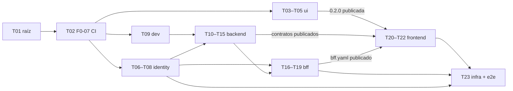

# 001 · Inicio de sesión — Tareas

_Checklist accionable derivada del `plan.md` (versión 4, aprobado H2). Tareas pequeñas y concretas; cada una cabe en un PR revisable (≤ ~400 líneas). Cada tarea indica los archivos que puede tocar y la prueba que se escribe primero (TDD: rojo → verde → refactorizar). Marca `[x]` al completarlas._

**Cómo se trabaja cada tarea:**
- **Rama y PR.** Cada tarea es un PR de un solo proyecto (IN‑07), con la rama `feat/001-inicio-de-sesion-<proyecto>-<tema>`.
- **Revisión.** Antes del PR se hacen la revisión adversarial y las cuatro lentes: es un cambio crítico.
- **Modelo.** Implementar es nivel estándar; revisar es nivel alto (`AGENTS.md` §10).
- **Si una prueba no se puede escribir como dice la tarea,** se actualiza esta lista y se avisa antes de seguir.

## Orden y paralelismo

Las tareas de `ui/`, `backend/identity/` y `backend/dev/` pueden ir en paralelo; cada una toca sus propios archivos.

## Raíz

- [x] **T01** · Documentación de la feature y ADR 0023–0025 — Archivos: `spec/features/001-inicio-de-sesion/**`, `docs/adr/ADR-0023…0025`, `docs/arquitectura/00`, `01`, `02`, `AGENTS.md` (§4.3, §6.2, §10), `CLAUDE.md`, `spec/constitution/**`, `.claude/**`, `ESTADO.md` — Prueba primero: no aplica (documentación). Se revisan los enlaces y la consistencia de los códigos de criterio. — Hecha: PR #7.
- [x] **T02** · Requisito previo F0‑07: CI de PR mínimo por proyecto. Cambia CI, así que requiere aprobación humana explícita (`AGENTS.md` §4.5). — Hecha: PR #8 (Dependabot se retiró en el PR #21).
  - Archivos: `.github/workflows/{backend-pr,frontend-pr,ui-pr,sistema-pr}.yml`, `.github/CODEOWNERS` (Dependabot se retiró después por decisión del responsable).
  - Contenido:
    - por proyecto, con filtro de ruta y `working-directory`: compilación, formato, *lint*, pruebas y arquitectura (Q01–Q03 en backend y frontend; en `ui`, solo Q01 hasta que T03 agregue pruebas e historias);
    - en todo PR: título en Conventional Commits (Q13) y búsqueda de secretos con gitleaks;
    - acciones fijadas por SHA, permisos mínimos y `concurrency`.
  - Prueba primero: los comandos de cada *workflow* ejecutados en local; los *workflows* corren sobre su propio PR. La expresión del título se probó con casos válidos e inválidos.
  - **Fuera de T02**, cada parte con la tarea que crea lo que publica: publicación de imágenes y de contratos (`backend-main`, `frontend-main`) con T08, T16 y T21; la de los contratos del backend y su comparador de cambios incompatibles, en una tarea aparte de F0‑07 antes de T20 (decisión del responsable, 2026-11-02); verificación de secretos de prueba del *realm* con T07; cobertura, mutación, Sonar y guardián SDD en el resto de F0‑07.

## `ui/` — `liv-components` 0.2.0

- [x] **T03** · *Tokens* nuevos (4 estilos y la colección `Layout`) y los componentes `Icon` (38 SVG de Lucide), `Logo`, `Spinner`, `Skeleton`, `Badge` y `Avatar`. — Hecha: PR #30, con el ADR 0026 (PR #31) para sus dependencias de desarrollo; el PR #32 corrige `npm run storybook` y `format:check` en Windows.
  - Archivos: `ui/projects/liv-components/src/{styles/theme.css,lib/icon/**,lib/logo/**,lib/spinner/**,lib/skeleton/**,lib/badge/**,lib/avatar/**,public-api.ts}`, `ui/.storybook/**`, `ui/THIRD_PARTY_NOTICES.md`, `ui/package.json`.
  - **Desviaciones declaradas:**
    - se tocaron además `angular.json`, `README.md`, `.postcssrc.json`, `tsconfig.lib.json`, `tsconfig.spec.json`, `src/testing/axe.ts`, `src/lib/tailwind-reference.css` y `scripts/copy-notices.mjs`, necesarios para Vitest, Tailwind y el aviso de licencia;
    - el PR superó las ~400 líneas (unas 1.650 sin el *lockfile*: 297 de datos de iconos, 390 de pruebas y 269 de historias), porque Storybook, Tailwind y los componentes se prueban juntos;
    - dependencias de desarrollo nuevas, aprobadas en el ADR 0026.
  - Prueba primero: por componente, variantes, propiedades y atributos ARIA (`aria-hidden` en el icono decorativo; texto alternativo en `Logo`), más axe.
- [x] **T04** · `Button` (tamaños, iconos, `Loading`), `IconButton`, `TextField` (icono, acción, `Content`), `CodeInput` y `Alert`. — Hecha: PR #36.
  - Archivos: `ui/projects/liv-components/src/lib/{button,icon-button,text-field,code-input,alert}/**`, `public-api.ts`.
  - **Desviaciones declaradas:**
    - se agregó `ui/projects/liv-components/src/testing/css.ts`, un ayudante de pruebas como `testing/axe.ts`: lee el valor declarado de una propiedad CSS, porque jsdom no calcula `border-color` con `var()`;
    - el PR superó las ~400 líneas (unas 2.140, de ellas 1.310 de pruebas e historias), porque son cinco componentes;
    - Loading anuncia la entrada `loadingLabel` y el texto visible no cambia, como en Figma. La prueba en rojo pedía anunciar el texto del botón, que no se puede leer de forma fiable con zone.js;
    - nombres respecto de Figma: `Title` de `Alert` es `heading`, para no chocar con el atributo `title`; `Label` y `Message` se proyectan como contenido; `State=Error` se activa con la entrada `error`.
  - **Decisiones del responsable (2026-11-02)** sobre lo que dejó abierto la revisión:
    - **contraste:** «Corregir antes de T05», en la tarea T04a;
    - **icono de ayuda:** «Ajustar Figma a 16 px», también en T04a; `Icon` mantiene 16, 20 y 24;
    - **formularios de Angular:** «Decidir con la primera pantalla». Se mantiene `[(value)]`, y el ADR para `@angular/forms` se escribe cuando la primera pantalla de Angular con formulario lo necesite;
    - **tooltip:** «Provisional y al backlog». `IconButton` sigue con `title` nativo, y un componente `Tooltip` queda en el backlog (primero en Figma).
  - Prueba primero:
    - `Loading` no emite clic;
    - `TextField` en error expone `aria-invalid` y `aria-describedby`;
    - `CodeInput` usa `inputmode="numeric"` y `autocomplete="one-time-code"`;
    - `Alert` de error usa `role="alert"`.
- [x] **T04a** · Contraste de *tokens* e icono de ayuda (decisión del responsable, 2026-11-02). **Cambio de *tokens*: crítico.** Primero en Figma y después en el código. — Hecha: PR #38.
  - **En Figma (LIV‑Diseño):**
    - oscurecer los estilos `border/strong` y `focus/ring` hasta un contraste mínimo de 3:1 sobre `bg/surface` (WCAG 1.4.11);
    - que el texto de ejemplo (placeholder) de `TextField` y `CodeInput` use un estilo de texto con 4,5:1 sobre `bg/surface` (WCAG 1.4.3) en lugar de `text/disabled`; `text/muted` (≈4,8:1) es el candidato;
    - pasar a 16 px el icono de ayuda de `TextField` y `CodeInput`.
  - Archivos:
    - `ui/projects/liv-components/src/styles/theme.css`;
    - `ui/projects/liv-components/src/lib/{text-field,code-input}/**`: el placeholder y sus pruebas, y quitar la nota de «decisión pendiente» del icono de ayuda;
    - las pruebas de contraste de los *tokens* y las capturas de referencia de los componentes afectados.
  - Prueba primero:
    - contraste de `border/strong` y `focus/ring` sobre `bg/surface`, cada uno ≥ 3:1;
    - contraste del *token* del placeholder sobre `bg/surface` ≥ 4,5:1;
    - `TextField` y `CodeInput` usan ese *token* en el placeholder.
  - **Valores aprobados por el responsable (2026-11-02)**, aplicados en Figma y en `theme.css`:
    - `border/strong`: `#cbd5e1` → `#64748b` (4,76:1 sobre `bg/surface`; 4,34:1 sobre `bg/subtle`);
    - `focus/ring`: de `#2563eb` al 40 % a `0 0 0 2px #ffffff, 0 0 0 4px #2563eb`, un anillo opaco (5,17:1) con 2 px de separación en `bg/surface`. La separación es una **segunda decisión**, tomada durante la revisión: el anillo opaco quedaba pegado al relleno de `Button` Primary (1,30:1) y al borde de Error;
    - placeholder de `CodeInput`: `text/disabled` → `text/muted` (4,76:1). `TextField` ya lo usaba; deshabilitado pasa a `text/disabled`, como su variante de Figma;
    - icono de ayuda de `TextField` y `CodeInput`: 16 px en Figma (14 variantes); en código ya era 16.
  - **Desviaciones declaradas:**
    - ayudantes de prueba nuevos: `src/testing/contrast.ts` (con `contrast.spec.ts`) y `src/testing/text-imports.d.ts`, y en `css.ts` `declaredPlaceholderStyle`, `declaredShadow`, `paintsShadow` y `cssVariable`. `theme.css` se lee como texto con `with { loader: 'text' }` del compilador de Angular, sin agregar `@types/node`;
    - se tocaron las pruebas de `button` e `icon-button`, que no estaban declaradas: el *token* `focus/ring` cambia también en esos componentes;
    - no hay capturas de referencia, porque `ui/` todavía no tiene regresión visual (Q14). La verificación fue manual, en Storybook frente a Figma.
- [x] **T05** · `Dialog`, `ResultState`, `NavItem`, `SideNav`, `AppHeader`, `PageHeader` y `ModuleCard`. Versión 0.2.0 y `CHANGELOG.md`. **Un humano publica.** Depende de T04a: la 0.2.0 sale con los *tokens* corregidos. — Hecha: PR #43.
  - Pendientes que deja T04a:
    - `CHANGELOG.md` registra en «Cambiado» los *tokens* `border/strong` y `focus/ring` (antes, después y motivo) y el placeholder de `CodeInput`: cambian la apariencia de las aplicaciones;
    - medir el anillo de foco y los textos sobre los fondos oscuros que usen `SideNav` y `AppHeader`. `#2563eb` da ≈2,8:1 sobre `bg/inverse-subtle`; si no alcanza 3:1, se decide primero en Figma.
  - Archivos: `ui/projects/liv-components/src/lib/{dialog,result-state,nav-item,side-nav,app-header,page-header,module-card}/**`, `public-api.ts`, `projects/liv-components/package.json`, `CHANGELOG.md`.
  - Prueba primero:
    - `Dialog` atrapa el foco y cierra con Escape;
    - `NavItem` activo con `aria-current="page"` y deshabilitado con `aria-disabled` sin navegar (001-15);
    - capturas de referencia por variante (Q14): no se hicieron, ver «Desviaciones».
  - **Pendientes de T04a, resueltos:**
    - `CHANGELOG.md` (sección 0.2.0) registra en «Cambiado» `border/strong`, `focus/ring` y el placeholder de `CodeInput`, con antes, después y motivo, y marca como **incompatible** la anulación de la escala de espaciado y de radios de Tailwind;
    - `SideNav` y `AppHeader` son **claros** (`bg/surface`) en Figma, no usan `bg/inverse-subtle`: el anillo mide ≥ 4,72:1 sobre los fondos claros que usan y las parejas de texto nuevas llegan a 4,5:1 (`styles/theme-components.spec.ts`). No hubo que decidir nada en Figma.
  - **Decisiones de diseño de la implementación:**
    - `NavItem` y `ModuleCard` emiten `navigate` con el destino en un clic normal (la librería no importa `@angular/router`); con Ctrl, Cmd, Mayús, Alt o el botón central el navegador abre el enlace. Sin `href` quedan inertes;
    - `Dialog` emite `closeRequested` (no `closed`): Escape solo pide cerrar y la pantalla decide. Con varios abiertos, solo el último atrapa el foco y atiende Escape. El foco inicial va al elemento con `data-initial-focus` porque el *lint* de plantillas prohíbe `autofocus`;
    - `NavSection` (la etiqueta de sección del menú, que Figma dibuja dentro de `SideNav`) se exporta como componente aparte;
    - **decisión del responsable (2026-11-02): `Icon` admite 28 px.** El círculo de `ResultState` dibuja su icono a 28 px, como en Figma, en lugar de bajarlo a 24 px. `IconSize` pasa a `16 | 20 | 24 | 28`. Primero se actualizó Figma (la descripción de los 38 iconos dice «16, 20, 24 o 28 px») y después el código, con prueba en rojo. Es un cambio crítico (`AGENTS.md` §4.3) por modificar un componente existente, aprobado por el responsable en el chat; compatible con lo anterior. `lib/icon/**` queda tocado, fuera de la lista de archivos.
  - **Desviaciones declaradas:**
    - sin capturas de referencia por variante (Q14), porque `ui/` todavía no tiene regresión visual. La verificación fue manual, en Storybook frente a Figma;
    - archivos fuera de la lista: `lib/icon/**` (28 px, ver la decisión), `lib/shared/link-click.ts` (ayudante de los enlaces), `src/testing/css.ts` (`usesToken`, que compara el *token* exacto y no un prefijo) y `src/styles/theme-components.spec.ts` (contraste de las parejas nuevas);
    - la etiqueta de sección de `SideNav` no tiene estilo de texto en Figma: usa `label/sm` con 6 % de espaciado entre letras (`tracking-[0.06em]`);
    - medidas literales sin *token* de espaciado: 2, 6 y 44 px, y los anchos de 272, 440, 480 y 720 px;
    - el icono de «Salir» toma el color del botón Ghost (`text/link`) y no `text/primary` como en la instancia de Figma.
  - **Decisiones abiertas para el responsable:**
    - crear en Figma el estilo de texto de la etiqueta de sección y transcribirlo a `theme.css`;
    - `PageHeader` (máximo dos líneas) y `AppHeader` (administración truncada) pierden texto con zoom alto o pantallas angostas (WCAG 1.4.10);
    - opciones deshabilitadas del menú: hoy explican el motivo solo con `title` y no son enfocables (`item` y `subitem`; el `group` sí). Un `Tooltip` accesible está en el *backlog*;
    - foco inicial por defecto de `Dialog`: el primer enfocable. La pantalla del aviso de sesión debe marcar la acción segura con `data-initial-focus`.
  - **Revisión:** adversarial con dos revisores ciegos y lente de riesgo a nivel alto; resiliencia y confiabilidad a nivel estándar; legibilidad a nivel económico (`AGENTS.md` §10.1). Ningún crítico y 3 altos: dos de la adversarial, corregidos con prueba en rojo primero (estilos del grupo de `NavItem` que se filtraban a sus subopciones; disputa de foco entre dos `Dialog`), y uno de confiabilidad, las capturas de referencia (Q14), que queda como desviación. Segunda ronda de la adversarial, solo sobre lo corregido, sin críticos ni altos. Resumen por severidad en el PR #43.

## `backend/identity/`

- [x] **T06** · *Spike* de Keycloak con la versión fijada. — Hecha: PR #23. Decisiones del responsable: mensaje único (enmienda 2 de la spec) y sin mensaje de motivo.
  - Archivos: `backend/identity/spike/RESULTADOS.md`.
  - Responder:
    1. cómo distingue el tema la cuenta bloqueada (001-04);
    2. cómo llega al tema el motivo (`logout`, `expired`, `denied`);
    3. si revocar el *refresh token* (RFC 7009) cierra la sesión del usuario;
    4. qué eventos emite.
  - Prueba primero: no aplica. **Si alguna respuesta obliga a escribir una extensión de Keycloak o cambia una decisión del plan, se detiene y se lleva al responsable.**
- [x] **T07** · *Realm* como código. — Hecha: PR #26.
  - Archivos: `backend/identity/config/base/liv-realm.yaml`, `backend/identity/README.md`, `backend/src/test/java/**/identityconfig/RealmConfigTest.java`.
  - **Desviaciones declaradas:**
    - la prueba está en `backend/src/test/java`, porque Maven no corre pruebas desde `backend/identity/test/`;
    - la capa de desarrollo quedó en `backend/dev/keycloak/` (no en `identity/config/dev/`) y sin TOTP; los usuarios con TOTP conocido pasan a T23;
    - se tocaron archivos de T09: `backend/dev/compose.yaml` (servicio `keycloak-config`), `check.sh` (verificación del *realm* aplicado), `.env.example` y `README.md`;
    - que un TOTP equivocado cuente para el bloqueo es comportamiento de Keycloak: lo verificará el e2e de T23.
  - Prueba primero: `RealmConfigTest`, en rojo, que verifica:
    - roles; clientes `liv-bff` y `liv-bff-service` (solo *client credentials*, audiencia `liv-internal`); sin `offline_access`;
    - `administration_id` editable solo por un administrador;
    - bloqueo de 5 intentos y 15 minutos que también cuenta TOTP (001-04, 001-07);
    - TOTP obligatorio para los 7 roles de 001-06;
    - tiempos resueltos con los valores de producción y la desigualdad de la inactividad (001-10);
    - política de contraseñas (D-001-7);
    - eventos activados;
    - consola de cuenta desactivada;
    - ningún secreto de `config/dev` en `config/base`.
- [ ] **T08** · Tema `liv` y la imagen de Keycloak.
  - Archivos: `backend/identity/theme/liv/**`, `backend/identity/theme/package.json` (Tailwind y `liv-components`), `backend/identity/Dockerfile`.
  - Prueba primero: con Playwright contra Keycloak en contenedor, una prueba visual de las 8 páginas contra los *frames* aprobados, más axe (001-19). También comprueba que el mensaje de credenciales incorrectas y el de cuenta desactivada sean el mismo texto genérico (001-03, 001-05).

## `backend/dev/`

- [x] **T09** · Entorno local. — Hecha: PR #20. La verificación del *realm* queda pendiente hasta T07.
  - Archivos: `backend/dev/compose.yaml`, `backend/dev/.env.example`, `backend/dev/initdb/**` (roles de BD y dos bases), `backend/dev/seed/**` (Ipiales y la administración B), `backend/dev/README.md`.
  - Prueba primero: `backend/dev/check.sh`, que falla si no responden PostgreSQL (con sus roles), Keycloak o el *realm* importado.

## `backend/` — `liv-api`

- [x] **T10** · Migraciones, roles, funciones y RLS. — Hecha: PR #25 (esquemas, *outbox*, `core.*`, `find_user_by_identity`, perfiles de Flyway) y PR #28 (roles y permisos, auditoría, ShedLock). Se dividió en dos porque no cabía en ~400 líneas (1500 y 980, de ellas unas 1200 y 700 de pruebas).
  - Archivos: `backend/src/main/resources/db/migration/V202611010900…0920__*.sql`, `backend/pom.xml` (Flyway, PostgreSQL, Testcontainers), `backend/src/test/**/isolation/**`.
  - **Desviaciones declaradas:**
    - archivos fuera de la lista: `backend/src/main/resources/application.yml` (era de T12: usuario `liv_app` fijo, URL y contraseña sin valor por defecto), `backend/config/application-dev.yml` (perfil `dev` fuera del jar, con la semilla), `backend/src/test/resources/application-test.yml`, `backend/src/test/java/**/LivApplicationTests.java`, `backend/dev/initdb/01-roles-y-bases.sh` (membresía de `liv_owner` en los dueños de las funciones), `backend/dev/README.md`, `backend/dev/seed/`, `backend/README.md` y `backend/CHANGELOG.md`;
    - `AuditPlatformRowsTest` quedó como `PlatformAuditRowsTest` (el importador y la marca de plataforma) y `RecordPlatformSessionDeniedTest` (la función); se agregaron `LivAppGrantsTest`, `FirstMigrationContractTest`, `FlywayProfilesTest`, `DevSeedTest`, `AuditEventIntegrityTest` y `PlatformTablesTest`;
    - dependencias (ADR 0023): `spring-boot-starter-flyway`, `flyway-database-postgresql`, `postgresql` y `testcontainers-postgresql`; `testcontainers-junit-jupiter` y `spring-boot-testcontainers` no hicieron falta;
    - ajustes de diseño y decisiones pendientes: ver `plan.md` › Decisiones (ajustes de T10).
  - **Pasa a otras tareas:**
    - T12: `spring.modulith.events.jdbc.schema=platform` al agregar el *starter* JDBC (pasa a T13 o T15); comprobar que el rol conectado es `liv_app` (hecho en T12 parte 2: en cada conexión nueva);
    - T13: alta con `INSERT … ON CONFLICT ON CONSTRAINT admin_user_identity_key DO NOTHING` y relectura con la función; `EndSession` con `UPDATE … WHERE ended_at IS NULL`, `SessionEnded` según las filas cambiadas y `ended_at` con la hora de la base; los errores `23505` con datos de otra administración se traducen a un error genérico;
    - T15: filas de plataforma con `INSERT … ON CONFLICT DO NOTHING` sin objetivo ni `RETURNING`; `id` y `occurred_at` de la aplicación; la marca `app.platform_job` con alcance de transacción y una prueba con un *pool* de una conexión; el `import_cursor` con `WHERE last_event_at <= :nuevo`; la función de rechazos recibe el `occurred_at` original.
  - Prueba primero (Testcontainers con `liv_app`):
    - `AdministrationIsolationTest`: 001-17, sin contexto y con otra administración;
    - `FindUserByIdentityTest`: llamada desde otro rol, conflicto con otra administración y `search_path`;
    - `AuditPlatformRowsTest`: solo los dos caminos permitidos;
    - `AuditAppendOnlyTest`.
- [x] **T11** · Contratos y generación. — Hecha: PR #40.
  - Archivos: `backend/contracts/openapi/{core,platform,core-internal}.yaml`, `backend/pom.xml` (`openapi-generator-maven-plugin`).
  - **Desviaciones declaradas:**
    - se agregaron `backend/src/test/**/architecture/ContractRules*.java`, `backend/src/test/**/contracts/**`, `backend/README.md` y `backend/CHANGELOG.md`;
    - el PR tiene unas 1.200 líneas, la mayoría pruebas y contratos;
    - la publicación de los contratos en CI pasa a una tarea aparte de F0‑07 (ver T02);
    - la segunda ronda de revisión trajo un alto, corregido con TDD; el responsable decidió no hacer tercera ronda.
  - Prueba primero: una regla de ArchUnit que exige que los controladores implementen las interfaces generadas, y una validación del OpenAPI en el *build*.
- [x] **T12** · Seguridad de `platform`: servidor de recursos, `ClaimsAdapter`, `CurrentUserFilter`, `AdministrationContext` y el gestor de transacciones que fija el contexto, correlación y Problem Details. — **Parte 1 hecha** (PR #45): servidor de recursos, filtros, Problem Details, correlación y enmascarado. **Parte 2 hecha** (PR #47):
    - contexto RLS fijado siempre al empezar cada transacción, y abrir otra administración dentro de una transacción falla;
    - comprobación de `liv_app` al crear cada conexión, impuesta en código, con la base en la sonda de *readiness*;
    - `azp = liv-bff` y `https://` (plan › Decisiones, ajustes de T12).

  **Parte 3 hecha** (PR #49, aparte por decisión del responsable): la prueba de la API contra Keycloak real con el *realm* como código, aplicado por keycloak-config-cli como en `dev/compose.yaml`:
    - la forma real de los tokens (`typ`, audiencias, `azp`, roles planos);
    - cada token en su lugar y ninguno en el del otro;
    - 001-17 con un usuario real de otra administración;
    - PKCE exigido.

    Sin dependencias nuevas. La renovación, la revocación y el cierre por canal trasero se prueban con el BFF (T16 y T17).
  - **Desviaciones de la parte 2:**
    - archivos fuera de la lista: `pom.xml` (`spring-boot-starter-data-jpa`, ADR 0023), `config/application-dev.yml`, `src/test/resources/config/application.yml`, `isolation/LivAppConnectionTest.java`, `README.md` y `CHANGELOG.md`;
    - `spring.modulith.events.jdbc.schema=platform` (de T10) queda para la tarea que agregue el *starter* JDBC del *outbox* (T13 o T15): sin él no tiene efecto;
    - un oyente con `@ApplicationModuleListener` no puede abrir otra administración. El ayudante para esos oyentes va en T13 o T15.
  - Archivos: `backend/src/main/java/co/com/sapenlinea/liv/platform/**`, `application.yml`, `backend/src/test/**/platform/**`, `ArchitectureRulesTest` (sin `org.keycloak`).
  - **Desviaciones de la parte 1:**
    - archivos fuera de la lista:
      - `core/infrastructure/UserDirectoryAdapter.java` (era de T13: sin él, el contexto no arranca);
      - `logback-spring.xml`;
      - `config/application-dev.yml`;
      - `pom.xml` (el *starter* del servidor de recursos, ADR 0023);
      - `isolation/LivDatabase.java` y `FlywayProfilesTest.java`;
      - `LivApplicationTests.java`;
      - `README.md` y `CHANGELOG.md`;
    - unas 2.500 líneas, la mayoría pruebas;
    - los controladores de prueba de `/internal/v1/sessions` (`PlatformWebTest`) chocarán con los de T13, que los quitará;
    - códigos técnicos `SYS-<estado>` para los errores sin criterio (404, 500, 503), confirmados por el responsable.
  - **Decisiones del responsable (2026-11-02)** sobre lo que salió de la revisión: ver plan › Decisiones, ajustes de T12. Van a la parte 2 `azp`, `https://` y la prueba contra Keycloak; se queda solo `typ: JWT` y `SYS-<estado>`; los datos personales y el JSON pasan a F0‑09.
  - **De T11:**
    - el filtro valida `X-User-Token` antes de llegar al controlador: si falta o es inválido, 401 con `001-14`;
    - el límite de tamaño de cabeceras admite `Authorization` más un `X-User-Token` de hasta 8.192 caracteres;
    - `X-User-Token` se enmascara en los *logs*;
    - ningún modelo generado (`..api.contract.model..`) se pasa a un *logger*: su `toString` incluye datos personales.
  - Prueba primero:
    - 001-14: seis casos contra `mock-oauth2-server` con la configuración de producción, un `sub` registrado y el código `001-14`;
    - RLS con un *pool* de una sola conexión, la petición de A y luego la de B;
    - el contexto en `REQUIRES_NEW` y en los oyentes;
    - correlación solo como UUID;
    - 001-20, parte de la API.
- [ ] **T13** · `core`: `UserDirectoryAdapter`, `StartSession`, `EndSession`, `GET /me`, `core.user_session` y los eventos.
  - Archivos: `backend/src/main/java/co/com/sapenlinea/liv/core/**`, `backend/src/test/**/core/**`.
  - **De T11:** los controladores implementan `CurrentUserApi` e `InternalSessionsApi`. `StartSession` exige que el `sid` del cuerpo sea el del *token* (401 con `001-14`) y es idempotente (200 con la sesión ya creada). `EndSession` responde siempre 204. Prueba de `EndSession` con `Accept: application/json`.
  - Prueba primero:
    - 001-13: `/me` con datos del servidor;
    - 001-17 y 001-05: rechazos en el inicio de sesión y en cada petición;
    - 001-21: identificador de LIV y vínculo (emisor, `sub`);
    - primer ingreso concurrente;
    - `EndSession` idempotente y verificado contra el `sid`;
    - un *token* de usuario que pidió todos los alcances recibe 401 en `/internal`.
- [ ] **T14** · Autorización y capacidades: `@RequiresPermission`, catálogo de menú, `GetCapabilities` y la matriz de permisos.
  - Archivos: `backend/src/main/java/co/com/sapenlinea/liv/platform/{authorization,navigation}/**`, `backend/src/main/resources/platform/menu-catalog.yaml`, `backend/src/test/**`.
  - Prueba primero:
    - 001-15: matriz rol → opciones visibles contra una tabla esperada escrita aparte;
    - 001-16: caso de uso y controlador de prueba, 200 con el permiso y 403 sin él;
    - ArchUnit: `@RequiresPermission` en los servicios de `application`, con su lista de excepciones.
- [ ] **T15** · `audit`: oyentes, función de rechazos e importador de eventos del proveedor (adaptador, cursor, ShedLock, enmascarado).
  - Archivos: `backend/src/main/java/co/com/sapenlinea/liv/audit/**`, `platform/infrastructure/identity/**`, `backend/pom.xml` (Modulith JDBC, ShedLock, `oauth2-client`), `backend/src/test/**/audit/**`.
  - Prueba primero:
    - 001-18 por tipo de evento: inicio, rechazo con y sin administración, fin por cada motivo, intento fallido, bloqueo y cambio de rol en la consola;
    - idempotencia del oyente y del importador;
    - enmascarado sin el usuario en claro;
    - ModularityTest con las flechas del ADR 0025.

## `backend/bff/`

- [ ] **T16** · *Spike* de Spring Cloud Gateway con Spring Boot 4.1 y esqueleto del proyecto: Maven, Spotless, ArchUnit, Flyway del esquema `bff` y `README.md`/`AGENTS.md` del BFF.
  - Archivos: `backend/bff/**`.
  - Prueba primero: la regla de ArchUnit sin `org.keycloak` y la carga del contexto. **Si no hay versión compatible, se detiene y se lleva el plan B al responsable.**
- [ ] **T17** · Inicio y cierre de sesión.
  - Contenido:
    - cliente OIDC con `prompt=login` y `returnTo` validado;
    - cambio de id de sesión;
    - `StartSession` con los dos *tokens*; un 200 es un reintento con la sesión ya creada (T11);
    - Spring Session JDBC con *tokens* cifrados;
    - `/bff/logout` con revocación y la ruta de LIV;
    - cierre por canal trasero en `/bff/backchannel-logout`: fijar el puerto del BFF en `LIV_BFF_BACKCHANNEL_URL` de `backend/dev/.env.example` (hoy apunta a `host.docker.internal:4200`, el proxy del frontend);
    - rechazo con revocación y vuelta a `/bff/login`, sin parámetro de motivo.
  - Archivos: `backend/bff/src/main/**` (paquetes de login y logout), `backend/bff/src/test/**`.
  - Prueba primero:
    - 001-01 (`returnTo` y redirección abierta);
    - 001-09;
    - 001-11: ninguna respuesta contiene un JWT, cookie `HttpOnly`, `Secure`, `SameSite=Strict`;
    - 001-20: flujo completo contra `mock-oauth2-server`.
- [ ] **T18** · Ciclo de vida de la sesión: `SessionTerminator` con repositorio decorado, límite absoluto, barrido con ShedLock, `keepalive`, `/bff/session` sin extender, cierre por canal trasero con `bff.oidc_session` y fallo de renovación.
  - Archivos: `backend/bff/src/main/**` (paquete de sesión), `backend/bff/src/main/resources/db/migration/**`, `backend/bff/src/test/**`.
  - Prueba primero:
    - 001-10 (inactividad y absoluto, el usuario vuelve tarde y queda auditado y revocado);
    - 001-22 (`keepalive` renueva siempre);
    - `/bff/session` no extiende la sesión;
    - canal trasero con dos instancias;
    - `invalid_grant` lleva a 401.
- [ ] **T19** · Seguridad de borde y contrato.
  - Contenido: CSRF, cabeceras, `no-store`, limitación de tasa por usuario e IP, enrutamiento de `/api/**` con *TokenRelay*, bloqueo de `/internal/**` y `bff/contracts/openapi/bff.yaml`.
  - Archivos: `backend/bff/src/main/**` (paquete web), `backend/bff/contracts/**`, `backend/bff/src/test/**`.
  - Prueba primero:
    - 001-12: mutación sin el *token* CSRF es rechazada;
    - `/internal/**` responde 404 desde el BFF;
    - 429 al superar el límite;
    - cabeceras de doc. 02 §8.

## `frontend/`

- [ ] **T20** · Adoptar `liv-components` 0.2.0 y los contratos.
  - Archivos: `frontend/package.json`, `package-lock.json`, `frontend/api-spec/**`, `frontend/scripts/api-update.*`, `frontend/src/app/api/**` (generado), `frontend/proxy.conf.json`.
  - Prueba primero: compila el cliente generado para `/me`, `/me/capabilities` y `/bff/session`; la regla de ESLint prohíbe `HttpClient` fuera de los servicios de datos.
- [ ] **T21** · Núcleo: `SessionService`, `authGuard`, `capabilityGuard`, interceptor, `IdleService` con `BroadcastChannel`, cierre de sesión con navegación completa y nginx con sus cabeceras.
  - Archivos: `frontend/src/app/core/**`, `frontend/nginx.conf`, `frontend/Dockerfile`.
  - Prueba primero:
    - 001-01 (`authGuard` con `returnTo`);
    - 001-16 (`capabilityGuard`: 403 y Próximamente);
    - el interceptor reintenta solo en métodos seguros;
    - 001-22 (`IdleService` avisa a los 13 minutos, sincroniza pestañas y no hace peticiones de fondo).
- [ ] **T22** · Pantallas y catálogo de presentación del menú.
  - Pantallas: estructura general, Inicio, Aviso de sesión, Sin permiso, Próximamente, Cargando y Error.
  - Archivos: `frontend/src/app/features/{shell,home,errors}/**`, `frontend/src/app/core/navigation/menu-presentation.ts`.
  - Prueba primero:
    - 001-02 (nombre, administración y rol en la cabecera);
    - 001-15 (menú filtrado y opciones `COMING_SOON` deshabilitadas);
    - axe por pantalla (001-19);
    - las pantallas solo usan componentes de `liv-components` (ESLint).

## Sistema

- [ ] **T23** · `infra/` y `e2e/`.
  - Archivos: `infra/compose.yaml` (solo imágenes publicadas), `infra/keycloak/e2e-users.yaml` (usuarios con TOTP conocido; la capa de desarrollo no los trae, ver T07), `infra/e2e/seed.sql`, `infra/caddy/**`, `e2e/**`.
  - Prueba primero: las especificaciones de Playwright de 001-01 a 001-22, escritas en rojo, incluidas:
    - el aviso y "Seguir conectado";
    - volver a entrar tras la expiración;
    - usuario desactivado y cambio de rol o de administración con la sesión abierta;
    - la URL de cierre sin *tokens*;
    - el botón "atrás" tras salir;
    - el TOTP obligatorio y el código incorrecto;
    - el bloqueo.

## Trazabilidad criterio → tareas

| Criterio | Tareas | Criterio | Tareas |
|---|---|---|---|
| 001-01 | T17, T21, T23 | 001-12 | T19, T23 |
| 001-02 | T13, T22, T23 | 001-13 | T13 |
| 001-03 | T08, T23 | 001-14 | T12 |
| 001-04 | T06, T07, T08, T23 | 001-15 | T05, T14, T22 |
| 001-05 | T08, T13, T23 | 001-16 | T14, T21, T23 |
| 001-06 | T07, T23 | 001-17 | T10, T12, T13 |
| 001-07 | T07, T23 | 001-18 | T15 |
| 001-08 | T07, T23 | 001-19 | T08, T22, T23 |
| 001-09 | T17, T21, T23 | 001-20 | T12, T16, T17 |
| 001-10 | T07, T18, T23 | 001-21 | T13 |
| 001-11 | T17, T23 | 001-22 | T18, T21, T23 |

## Cierre

- [ ] Actualizar documentación si aplica: el ERD con los ajustes al modelo aprobados en H2 y la matriz de permisos aprobada en Doc. 01 §4 (cambio aparte), además del glosario.
- [ ] Revisión adversarial independiente de lo implementado, PR por PR; hallazgos resueltos o justificados.
- [ ] Validar contra los criterios de aceptación de `spec.md`: cada uno marcado `[x]` con la prueba que lo demuestra.
- [ ] Compuertas de CI en verde y PR aprobado por un humano (H3, dos aprobaciones por ser crítico).
- [ ] Mover la feature a "Hecho" en `../../constitution/roadmap.md` y actualizar `ESTADO.md`.
