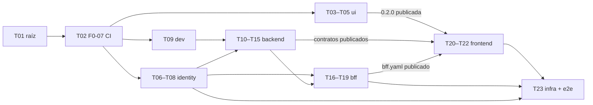

# 001 · Inicio de sesión — Tareas

_Checklist accionable derivada del `plan.md` (versión 4, aprobado H2). Tareas pequeñas y concretas; cada una cabe en un PR revisable (≤ ~400 líneas). Cada tarea indica los archivos que puede tocar y la prueba que se escribe primero (TDD: rojo → verde → refactorizar). Marca `[x]` al completarlas._

**Cómo se trabaja cada tarea:**
- **Rama y PR.** Cada tarea es un PR de un solo proyecto (IN‑07), con la rama `feat/001-inicio-de-sesion-<proyecto>-<tema>`.
- **Revisión.** Antes del PR se hacen la revisión adversarial y las cuatro lentes: es un cambio crítico.
- **Modelo.** Implementar es nivel estándar; revisar es nivel alto (`AGENTS.md` §10).
- **Si una prueba no se puede escribir como dice la tarea,** se actualiza esta lista y se avisa antes de seguir.

## Orden y paralelismo

Las tareas de `ui/`, `backend/identity/` y `backend/dev/` pueden ir en paralelo; cada una toca sus propios archivos.

## Raíz

- [x] **T01** · Documentación de la feature y ADR 0023–0025 — Archivos: `spec/features/001-inicio-de-sesion/**`, `docs/adr/ADR-0023…0025`, `docs/arquitectura/00`, `01`, `02`, `AGENTS.md` (§4.3, §6.2, §10), `CLAUDE.md`, `spec/constitution/**`, `.claude/**`, `ESTADO.md` — Prueba primero: no aplica (documentación). Se revisan los enlaces y la consistencia de los códigos de criterio. — Hecha: PR #7.
- [x] **T02** · Requisito previo F0‑07: CI de PR mínimo por proyecto. Cambia CI, así que requiere aprobación humana explícita (`AGENTS.md` §4.5). — Hecha: PR #8 (Dependabot se retiró en el PR #21).
  - Archivos: `.github/workflows/{backend-pr,frontend-pr,ui-pr,sistema-pr}.yml`, `.github/CODEOWNERS` (Dependabot se retiró después por decisión del responsable).
  - Contenido:
    - por proyecto, con filtro de ruta y `working-directory`: compilación, formato, *lint*, pruebas y arquitectura (Q01–Q03 en backend y frontend; en `ui`, solo Q01 hasta que T03 agregue pruebas e historias);
    - en todo PR: título en Conventional Commits (Q13) y búsqueda de secretos con gitleaks;
    - acciones fijadas por SHA, permisos mínimos y `concurrency`.
  - Prueba primero: los comandos de cada *workflow* ejecutados en local; los *workflows* corren sobre su propio PR. La expresión del título se probó con casos válidos e inválidos.
  - **Fuera de T02**, cada parte con la tarea que crea lo que publica: publicación de imágenes y de contratos (`backend-main`, `frontend-main`) con T08, T11, T16 y T21; verificación de secretos de prueba del *realm* con T07; cobertura, mutación, Sonar y guardián SDD en el resto de F0‑07.

## `ui/` — `liv-components` 0.2.0

- [ ] **T03** · *Tokens* nuevos (4 estilos y la colección `Layout`) y los componentes `Icon` (38 SVG de Lucide), `Logo`, `Spinner`, `Skeleton`, `Badge` y `Avatar`.
  - Archivos: `ui/projects/liv-components/src/{styles/theme.css,lib/icon/**,lib/logo/**,lib/spinner/**,lib/skeleton/**,lib/badge/**,lib/avatar/**,public-api.ts}`, `ui/.storybook/**`, `ui/THIRD_PARTY_NOTICES.md`, `ui/package.json`.
  - Prueba primero: por componente, variantes, propiedades y atributos ARIA (`aria-hidden` en el icono decorativo; texto alternativo en `Logo`), más axe.
- [ ] **T04** · `Button` (tamaños, iconos, `Loading`), `IconButton`, `TextField` (icono, acción, `Content`), `CodeInput` y `Alert`.
  - Archivos: `ui/projects/liv-components/src/lib/{button,icon-button,text-field,code-input,alert}/**`, `public-api.ts`.
  - Prueba primero:
    - `Loading` no emite clic;
    - `TextField` en error expone `aria-invalid` y `aria-describedby`;
    - `CodeInput` usa `inputmode="numeric"` y `autocomplete="one-time-code"`;
    - `Alert` de error usa `role="alert"`.
- [ ] **T05** · `Dialog`, `ResultState`, `NavItem`, `SideNav`, `AppHeader`, `PageHeader` y `ModuleCard`. Versión 0.2.0 y `CHANGELOG.md`. **Un humano publica.**
  - Archivos: `ui/projects/liv-components/src/lib/{dialog,result-state,nav-item,side-nav,app-header,page-header,module-card}/**`, `public-api.ts`, `projects/liv-components/package.json`, `CHANGELOG.md`.
  - Prueba primero:
    - `Dialog` atrapa el foco y cierra con Escape;
    - `NavItem` activo con `aria-current="page"` y deshabilitado con `aria-disabled` sin navegar (001-15);
    - capturas de referencia por variante (Q14).

## `backend/identity/`

- [x] **T06** · *Spike* de Keycloak con la versión fijada. — Hecha: PR #23. Decisiones del responsable: mensaje único (enmienda 2 de la spec) y sin mensaje de motivo.
  - Archivos: `backend/identity/spike/RESULTADOS.md`.
  - Responder:
    1. cómo distingue el tema la cuenta bloqueada (001-04);
    2. cómo llega al tema el motivo (`logout`, `expired`, `denied`);
    3. si revocar el *refresh token* (RFC 7009) cierra la sesión del usuario;
    4. qué eventos emite.
  - Prueba primero: no aplica. **Si alguna respuesta obliga a escribir una extensión de Keycloak o cambia una decisión del plan, se detiene y se lleva al responsable.**
- [ ] **T07** · *Realm* como código.
  - Archivos: `backend/identity/config/base/liv-realm.yaml`, `backend/identity/config/dev/**`, `backend/identity/README.md`, pruebas de configuración en `backend/identity/test/**`.
  - Prueba primero: `RealmConfigTest`, en rojo, que verifica:
    - roles; clientes `liv-bff` y `liv-bff-service` (solo *client credentials*, audiencia `liv-internal`); sin `offline_access`;
    - `administration_id` editable solo por un administrador;
    - bloqueo de 5 intentos y 15 minutos que también cuenta TOTP (001-04, 001-07);
    - TOTP obligatorio para los 7 roles de 001-06;
    - tiempos resueltos con los valores de producción y la desigualdad de la inactividad (001-10);
    - política de contraseñas (D-001-7);
    - eventos activados;
    - consola de cuenta desactivada;
    - ningún secreto de `config/dev` en `config/base`.
- [ ] **T08** · Tema `liv` y la imagen de Keycloak.
  - Archivos: `backend/identity/theme/liv/**`, `backend/identity/theme/package.json` (Tailwind y `liv-components`), `backend/identity/Dockerfile`.
  - Prueba primero: con Playwright contra Keycloak en contenedor, una prueba visual de las 8 páginas contra los *frames* aprobados, más axe (001-19). También comprueba que el mensaje de credenciales incorrectas y el de cuenta desactivada sean el mismo texto genérico (001-03, 001-05).

## `backend/dev/`

- [x] **T09** · Entorno local. — Hecha: PR #20. La verificación del *realm* queda pendiente hasta T07.
  - Archivos: `backend/dev/compose.yaml`, `backend/dev/.env.example`, `backend/dev/initdb/**` (roles de BD y dos bases), `backend/dev/seed/**` (Ipiales y la administración B), `backend/dev/README.md`.
  - Prueba primero: `backend/dev/check.sh`, que falla si no responden PostgreSQL (con sus roles), Keycloak o el *realm* importado.

## `backend/` — `liv-api`

- [ ] **T10** · Migraciones, roles, funciones y RLS.
  - Archivos: `backend/src/main/resources/db/migration/V202611010900…0920__*.sql`, `backend/pom.xml` (Flyway, PostgreSQL, Testcontainers), `backend/src/test/**/isolation/**`.
  - Prueba primero (Testcontainers con `liv_app`):
    - `AdministrationIsolationTest`: 001-17, sin contexto y con otra administración;
    - `FindUserByIdentityTest`: llamada desde otro rol, conflicto con otra administración y `search_path`;
    - `AuditPlatformRowsTest`: solo los dos caminos permitidos;
    - `AuditAppendOnlyTest`.
- [ ] **T11** · Contratos y generación.
  - Archivos: `backend/contracts/openapi/{core,platform,core-internal}.yaml`, `backend/pom.xml` (`openapi-generator-maven-plugin`).
  - Prueba primero: una regla de ArchUnit que exige que los controladores implementen las interfaces generadas, y una validación del OpenAPI en el *build*.
- [ ] **T12** · Seguridad de `platform`: servidor de recursos, `ClaimsAdapter`, `CurrentUserFilter`, `AdministrationContext` y el gestor de transacciones que fija el contexto, correlación y Problem Details.
  - Archivos: `backend/src/main/java/co/com/sapenlinea/liv/platform/**`, `application.yml`, `backend/src/test/**/platform/**`, `ArchitectureRulesTest` (sin `org.keycloak`).
  - Prueba primero:
    - 001-14: seis casos contra `mock-oauth2-server` con la configuración de producción, un `sub` registrado y el código `001-14`;
    - RLS con un *pool* de una sola conexión, la petición de A y luego la de B;
    - el contexto en `REQUIRES_NEW` y en los oyentes;
    - correlación solo como UUID;
    - 001-20, parte de la API.
- [ ] **T13** · `core`: `UserDirectoryAdapter`, `StartSession`, `EndSession`, `GET /me`, `core.user_session` y los eventos.
  - Archivos: `backend/src/main/java/co/com/sapenlinea/liv/core/**`, `backend/src/test/**/core/**`.
  - Prueba primero:
    - 001-13: `/me` con datos del servidor;
    - 001-17 y 001-05: rechazos en el inicio de sesión y en cada petición;
    - 001-21: identificador de LIV y vínculo (emisor, `sub`);
    - primer ingreso concurrente;
    - `EndSession` idempotente y verificado contra el `sid`;
    - un *token* de usuario que pidió todos los alcances recibe 401 en `/internal`.
- [ ] **T14** · Autorización y capacidades: `@RequiresPermission`, catálogo de menú, `GetCapabilities` y la matriz de permisos.
  - Archivos: `backend/src/main/java/co/com/sapenlinea/liv/platform/{authorization,navigation}/**`, `backend/src/main/resources/platform/menu-catalog.yaml`, `backend/src/test/**`.
  - Prueba primero:
    - 001-15: matriz rol → opciones visibles contra una tabla esperada escrita aparte;
    - 001-16: caso de uso y controlador de prueba, 200 con el permiso y 403 sin él;
    - ArchUnit: `@RequiresPermission` en los servicios de `application`, con su lista de excepciones.
- [ ] **T15** · `audit`: oyentes, función de rechazos e importador de eventos del proveedor (adaptador, cursor, ShedLock, enmascarado).
  - Archivos: `backend/src/main/java/co/com/sapenlinea/liv/audit/**`, `platform/infrastructure/identity/**`, `backend/pom.xml` (Modulith JDBC, ShedLock, `oauth2-client`), `backend/src/test/**/audit/**`.
  - Prueba primero:
    - 001-18 por tipo de evento: inicio, rechazo con y sin administración, fin por cada motivo, intento fallido, bloqueo y cambio de rol en la consola;
    - idempotencia del oyente y del importador;
    - enmascarado sin el usuario en claro;
    - ModularityTest con las flechas del ADR 0025.

## `backend/bff/`

- [ ] **T16** · *Spike* de Spring Cloud Gateway con Spring Boot 4.1 y esqueleto del proyecto: Maven, Spotless, ArchUnit, Flyway del esquema `bff` y `README.md`/`AGENTS.md` del BFF.
  - Archivos: `backend/bff/**`.
  - Prueba primero: la regla de ArchUnit sin `org.keycloak` y la carga del contexto. **Si no hay versión compatible, se detiene y se lleva el plan B al responsable.**
- [ ] **T17** · Inicio y cierre de sesión.
  - Contenido:
    - cliente OIDC con `prompt=login` y `returnTo` validado;
    - cambio de id de sesión;
    - `StartSession` con los dos *tokens*;
    - Spring Session JDBC con *tokens* cifrados;
    - `/bff/logout` con revocación y la ruta de LIV;
    - rechazo con revocación y vuelta a `/bff/login`, sin parámetro de motivo.
  - Archivos: `backend/bff/src/main/**` (paquetes de login y logout), `backend/bff/src/test/**`.
  - Prueba primero:
    - 001-01 (`returnTo` y redirección abierta);
    - 001-09;
    - 001-11: ninguna respuesta contiene un JWT, cookie `HttpOnly`, `Secure`, `SameSite=Strict`;
    - 001-20: flujo completo contra `mock-oauth2-server`.
- [ ] **T18** · Ciclo de vida de la sesión: `SessionTerminator` con repositorio decorado, límite absoluto, barrido con ShedLock, `keepalive`, `/bff/session` sin extender, cierre por canal trasero con `bff.oidc_session` y fallo de renovación.
  - Archivos: `backend/bff/src/main/**` (paquete de sesión), `backend/bff/src/main/resources/db/migration/**`, `backend/bff/src/test/**`.
  - Prueba primero:
    - 001-10 (inactividad y absoluto, el usuario vuelve tarde y queda auditado y revocado);
    - 001-22 (`keepalive` renueva siempre);
    - `/bff/session` no extiende la sesión;
    - canal trasero con dos instancias;
    - `invalid_grant` lleva a 401.
- [ ] **T19** · Seguridad de borde y contrato.
  - Contenido: CSRF, cabeceras, `no-store`, limitación de tasa por usuario e IP, enrutamiento de `/api/**` con *TokenRelay*, bloqueo de `/internal/**` y `bff/contracts/openapi/bff.yaml`.
  - Archivos: `backend/bff/src/main/**` (paquete web), `backend/bff/contracts/**`, `backend/bff/src/test/**`.
  - Prueba primero:
    - 001-12: mutación sin el *token* CSRF es rechazada;
    - `/internal/**` responde 404 desde el BFF;
    - 429 al superar el límite;
    - cabeceras de doc. 02 §8.

## `frontend/`

- [ ] **T20** · Adoptar `liv-components` 0.2.0 y los contratos.
  - Archivos: `frontend/package.json`, `package-lock.json`, `frontend/api-spec/**`, `frontend/scripts/api-update.*`, `frontend/src/app/api/**` (generado), `frontend/proxy.conf.json`.
  - Prueba primero: compila el cliente generado para `/me`, `/me/capabilities` y `/bff/session`; la regla de ESLint prohíbe `HttpClient` fuera de los servicios de datos.
- [ ] **T21** · Núcleo: `SessionService`, `authGuard`, `capabilityGuard`, interceptor, `IdleService` con `BroadcastChannel`, cierre de sesión con navegación completa y nginx con sus cabeceras.
  - Archivos: `frontend/src/app/core/**`, `frontend/nginx.conf`, `frontend/Dockerfile`.
  - Prueba primero:
    - 001-01 (`authGuard` con `returnTo`);
    - 001-16 (`capabilityGuard`: 403 y Próximamente);
    - el interceptor reintenta solo en métodos seguros;
    - 001-22 (`IdleService` avisa a los 13 minutos, sincroniza pestañas y no hace peticiones de fondo).
- [ ] **T22** · Pantallas y catálogo de presentación del menú.
  - Pantallas: estructura general, Inicio, Aviso de sesión, Sin permiso, Próximamente, Cargando y Error.
  - Archivos: `frontend/src/app/features/{shell,home,errors}/**`, `frontend/src/app/core/navigation/menu-presentation.ts`.
  - Prueba primero:
    - 001-02 (nombre, administración y rol en la cabecera);
    - 001-15 (menú filtrado y opciones `COMING_SOON` deshabilitadas);
    - axe por pantalla (001-19);
    - las pantallas solo usan componentes de `liv-components` (ESLint).

## Sistema

- [ ] **T23** · `infra/` y `e2e/`.
  - Archivos: `infra/compose.yaml` (solo imágenes publicadas), `infra/keycloak/e2e-users.yaml`, `infra/e2e/seed.sql`, `infra/caddy/**`, `e2e/**`.
  - Prueba primero: las especificaciones de Playwright de 001-01 a 001-22, escritas en rojo, incluidas:
    - el aviso y "Seguir conectado";
    - volver a entrar tras la expiración;
    - usuario desactivado y cambio de rol o de administración con la sesión abierta;
    - la URL de cierre sin *tokens*;
    - el botón "atrás" tras salir;
    - el TOTP obligatorio y el código incorrecto;
    - el bloqueo.

## Trazabilidad criterio → tareas

| Criterio | Tareas | Criterio | Tareas |
|---|---|---|---|
| 001-01 | T17, T21, T23 | 001-12 | T19, T23 |
| 001-02 | T13, T22, T23 | 001-13 | T13 |
| 001-03 | T08, T23 | 001-14 | T12 |
| 001-04 | T06, T07, T08, T23 | 001-15 | T05, T14, T22 |
| 001-05 | T08, T13, T23 | 001-16 | T14, T21, T23 |
| 001-06 | T07, T23 | 001-17 | T10, T12, T13 |
| 001-07 | T07, T23 | 001-18 | T15 |
| 001-08 | T07, T23 | 001-19 | T08, T22, T23 |
| 001-09 | T17, T21, T23 | 001-20 | T12, T16, T17 |
| 001-10 | T07, T18, T23 | 001-21 | T13 |
| 001-11 | T17, T23 | 001-22 | T18, T21, T23 |

## Cierre

- [ ] Actualizar documentación si aplica: el ERD con los ajustes al modelo aprobados en H2 y la matriz de permisos aprobada en Doc. 01 §4 (cambio aparte), además del glosario.
- [ ] Revisión adversarial independiente de lo implementado, PR por PR; hallazgos resueltos o justificados.
- [ ] Validar contra los criterios de aceptación de `spec.md`: cada uno marcado `[x]` con la prueba que lo demuestra.
- [ ] Compuertas de CI en verde y PR aprobado por un humano (H3, dos aprobaciones por ser crítico).
- [ ] Mover la feature a "Hecho" en `../../constitution/roadmap.md` y actualizar `ESTADO.md`.
