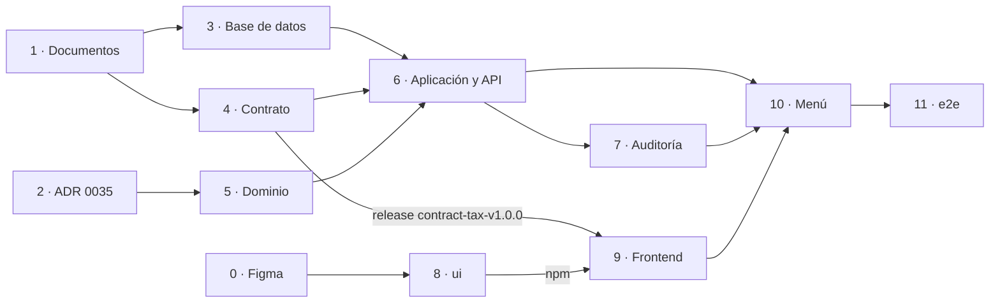

# 007 · Vigencias fiscales — Plan

_Cómo se implementa lo descrito en `spec.md`. Debe respetar la `constitution/` y la arquitectura (`docs/arquitectura/`)._

**Estado:** borrador para la H2, con las dos rondas de la revisión adversarial y un alto de la ronda 2 corregido sin volver a verificar (véase «Revisión»)
_(borrador → aprobado (H2))_

## Enfoque

La vigencia es el primer agregado del módulo `tax` y el primer código de un módulo hexagonal completo (`docs/arquitectura/01` §4.1):
- un dominio en Java puro con la máquina de estados y las reglas de creación (V‑01, V‑02 y la regla nueva de la primera vigencia);
- casos de uso con su permiso;
- persistencia con JPA en `tax/infrastructure/persistence`, como pide la constitución para escribir agregados (`spec/constitution/tech-stack.md`);
- un controlador que implementa la interfaz generada de un contrato nuevo, `tax.yaml`.

La auditoría sigue el patrón de la feature 001 (ADR 0025): `tax` publica eventos en su paquete raíz y `audit` los escucha, así que ningún módulo depende de `audit`. La lista de preparación se arma en el dominio con los nueve puntos del Doc. 01 §6.1. Hoy solo se verifica el punto 1; los demás salen como «Opción aún no disponible» hasta que la feature de cada opción conecte su verificación.

El modelo de datos es el de la decisión 3 de la H1: el año sigue nacional y el estado es de cada administración. La base de datos hace cumplir lo que no debe depender de la aplicación:
- el aislamiento, con RLS y FK compuestas;
- un año por administración, con un `UNIQUE`;
- la única transición de la 007 (*Planeada* → *En preparación*), con la política RLS de `UPDATE`;
- que `assessments_enabled` siga en falso: `liv_app` no puede cambiar esa columna y un `CHECK` la fija.

El trabajo va en PR de un solo proyecto (`AGENTS.md` §4.6):
- en la raíz: los documentos y el ADR;
- en el *backend*: cinco PR (base de datos, contrato, dominio, aplicación y adaptadores, auditoría) y uno al final para abrir la opción del menú;
- `ui/`, si el diseño pide componentes;
- el *frontend*;
- `e2e/`.

## Ajustes al modelo de datos

Aprobados como alcance en la H1 (decisión 3). Van al ERD 2.3 en el PR de documentos (paso 1). La autorización para migrar estas tablas con la lista previa a Flyway abierta es la decisión H2‑1 (abajo).

**`tax.fiscal_year`** (nacional; ya está en el ERD, cambia su contenido y quién la escribe)

| Columna | Tipo | Regla |
|---|---|---|
| `year` | `SMALLINT` PK | — |
| `starts_on` | `DATE NOT NULL` | `CHECK (starts_on = make_date(year, 1, 1))` (V‑01; decisión H2‑2) |
| `ends_on` | `DATE NOT NULL` | `CHECK (ends_on = make_date(year, 12, 31))` (V‑01; decisión H2‑2) |

- Pierde `status` y `assessments_enabled`, que pasan a la tabla nueva. Es un cambio del modelo lógico: la tabla todavía no existe en ninguna migración, así que no hace falta *expand/contract*.
- Es un dato nacional de referencia, sin `administration_id` ni RLS: `liv_app` solo la lee (`docs/arquitectura/02` §5.1).
- La migración la llena con un **rango técnico y provisional** de años, 1999 a 2100 (decisión H2‑2):
  - basta para cualquier vigencia que se pueda crear;
  - no decide qué vigencias históricas se cargarán, que sigue siendo el pendiente 5 del Doc. 01;
  - ampliarlo es una migración nueva.

**`tax.administration_fiscal_year`** (nueva; una fila por administración y año)

| Columna | Tipo | Regla |
|---|---|---|
| `id` | `UUID` PK `DEFAULT uuidv7()` | — |
| `administration_id` | `UUID NOT NULL` | FK a `core.tax_administration (id)` |
| `fiscal_year` | `SMALLINT NOT NULL` | FK a `tax.fiscal_year (year)` |
| `status` | `VARCHAR(20) NOT NULL DEFAULT 'PLANEADA'` | `CHECK (status IN ('PLANEADA', 'EN_PREPARACION', 'LISTA', 'HABILITADA', 'CERRADA'))`, los códigos del Doc. 01 §5 |
| `assessments_enabled` | `BOOLEAN NOT NULL DEFAULT false` | `CHECK (NOT assessments_enabled)` en la 007. La regla definitiva (con *Habilitada* y quizá *Cerrada*) la pone la 1.5.1 cuando se responda la decisión 1b |
| `created_by` | `UUID NOT NULL` | FK compuesta (`created_by`, `administration_id`) a `core.admin_user (id, administration_id)` |
| `created_at` | `TIMESTAMPTZ NOT NULL DEFAULT now()` | — |
| `updated_by` | `UUID` | FK compuesta (`updated_by`, `administration_id`) a `core.admin_user` |
| `updated_at` | `TIMESTAMPTZ` | — |

- **Restricciones únicas:**
  - `UNIQUE (administration_id, fiscal_year)` (V‑01, 007-05);
  - `UNIQUE (id, administration_id)`, para las FK compuestas de las tablas que vendrán (catálogos, configuración, calendario).
- **RLS**, una política por operación, como `core.user_session` (`liv-migracion`, paso 2.4). Todas son `TO liv_app` y se apoyan en `NULLIF(current_setting('app.administration_id', true), '')::uuid`:
  - `SELECT`, de la administración;
  - `INSERT`, de la administración y solo con `status = 'PLANEADA'`;
  - `UPDATE`, con `USING` sobre la administración y `status = 'PLANEADA'`, y `WITH CHECK` sobre la administración y `status = 'EN_PREPARACION'`;
  - ninguna de `DELETE`.

  Así, ni un defecto del dominio puede saltar a otro estado o volver atrás. La 1.5.1 amplía la política de `UPDATE` con su migración.
- **Permisos de `liv_app`:**
  - `SELECT` e `INSERT` sobre la tabla;
  - `UPDATE` solo sobre `status`, `updated_by` y `updated_at`;
  - sin `UPDATE` de `assessments_enabled` y sin `DELETE` (007-12).
- **Esquema y versión:** la migración crea el esquema `tax`, con `GRANT USAGE` a `liv_app`. También comprueba que existe `uuidv7()` (PostgreSQL 18), porque la primera migración solo exige la 16.

**Lo que no cambia todavía.** El ERD dibuja FK hacia `tax.fiscal_year` desde `tax.tax_rate`, `tax.tax_calendar`, `tax.tax_benefit`, `tax.penalty_rule`, `tax.tax_assessment`, `valuation.valuation_catalog`, `valuation.vehicle_reference_match`, `core.jurisdiction_config` y `ledger.tax_obligation`. Las decide la feature de cada tabla:
- las nacionales apuntarán a `tax.fiscal_year (year)`;
- las de una administración, a (`administration_id`, `fiscal_year`) de la tabla nueva.

El ERD 2.3 lo deja anotado.

### Lista de aceptación previa a Flyway (ERD)

La lista sigue abierta. La 001 pidió autorización para migrar sus tablas antes de cerrarla, y la 007 hace lo mismo con las dos tablas de `tax` (decisión H2‑1).

| Punto de la lista | En la 007 |
|---|---|
| FK de la misma entidad territorial | Se cumple: FK compuestas con `administration_id` y RLS |
| Catálogos publicados congelados | No aplica: no hay catálogos |
| CSV, staging, aprobación por otro usuario, publicación transaccional, `UNIQUE` de catálogo y lote | No aplica |
| Índices únicos e intervalos sin solapamientos | Se cumple para lo suyo: `UNIQUE (administration_id, fiscal_year)` |
| Reglas de redondeo, facturación y sanciones | No aplica |
| Controles de auditoría y permisos de funcionarios | Se cumple para lo suyo: auditoría por evento (paso 7) y permisos de acción con su prueba de matriz (paso 3) |
| Validar el ERD con expertos tributarios antes de migrar | **Abierto.** Lo decide la persona en la decisión H2‑1 |
| Cartera histórica, prescripción y cobro coactivo | No aplica |

## Decisiones que pide la H2

_Lo que la persona aprueba con este plan, además del plan en sí (`AGENTS.md` §4.5)._

| # | Decisión | Recomendación |
|---|---|---|
| H2‑1 | Migrar `tax.fiscal_year` y `tax.administration_fiscal_year` con la lista previa a Flyway abierta, sin la validación del ERD por expertos tributarios que la lista pide «antes de migraciones», sin distinguir tablas | Lo decide la persona. A favor de autorizar, como en la 001: las dos tablas no tienen tarifas, montos ni reglas de cálculo. Si se autoriza, se anota en el ERD 2.3 |
| H2‑2 | Excepción a CC‑01 (`docs/arquitectura/04` y `AGENTS.md` §4.5, «ningún valor tributario en el código»): las fechas del año calendario quedan en un `CHECK` de la base de datos, y el rango técnico 1999–2100 queda en la migración | Aprobar. La decisión 6 de la H1 fijó el año calendario; con el `CHECK`, ni la aplicación puede escribir otra cosa. Si una norma exige otras fechas, se cambia con una migración y una versión del Doc. 01. *Alternativa:* fechas derivadas solo en el dominio, sin `CHECK` |
| H2‑3 | Permisos nuevos `tax.fiscal-year.create` y `tax.fiscal-year.prepare`, solo para `ADMIN_SISTEMA` | Aprobar: es la fila «Crear / abrir vigencia fiscal» del Doc. 01 §4 |
| H2‑4 | Políticas RLS de la tabla nueva y permisos de `liv_app` («Ajustes al modelo de datos») | Aprobar |
| H2‑5 | Dependencias entre módulos `audit → tax` y `tax → platform`, y el error de negocio en `shared` (ADR 0035). `platform → shared` ya está en la figura de `docs/arquitectura/01` §3.2; lo nuevo es que `ModularityTest` la admita | Aprobar con el ADR 0035 |
| H2‑6 | **Enmienda 1 a la spec (cambia una regla: decide la persona como responsable funcional).** Además de V‑02, solo se puede crear un año que no pase del siguiente al año en curso: `V‑05` con motivo `FUTURE_LIMIT`, que cambia 007-06 («crear N + 1 sí se permite» pasa a «si no pasa del año siguiente al en curso»). El diálogo de creación advierte que una vigencia no se puede borrar y que, una vez creada, los años anteriores a la más antigua quedan como históricos | Aprobar. Sin el límite, se pueden encadenar años futuros (2027, 2028…) sin forma de corregirlos, porque no hay borrado. Es una regla nueva del Doc. 01 v0.5, como V‑01: va en el dominio y en el documento, no en la configuración de jurisdicción, porque no cambia entre jurisdicciones. Si la persona prefiere que el «+1» se configure, se dice en la H2 |
| H2‑7 | **Enmienda 2 a la spec:** en 007-20, la entidad auditada es `tax.administration_fiscal_year` (no `tax.fiscal_year`), con el `id` de su fila como `entity_id`. El Doc. 01 §8 se ajusta igual | Aprobar: `entity_id` es un `UUID` y la fila que cambia es la de la administración |
| H2‑8 | **Enmienda 3 a la spec (cambia los códigos de una regla: decide la persona como responsable funcional).** Los rechazos usan códigos de regla del Doc. 01 v0.5: `V‑05` para la primera vigencia (`FIRST_YEAR`, hoy 007-08) y el límite de años futuros (`FUTURE_LIMIT`, H2‑6); `V‑06` para una transición no permitida desde el estado actual (hoy 007-10) | Aprobar: un contrato no debe publicar números de criterios de una feature como códigos de error |
| H2‑9 | Cómo se repiten las pruebas de `e2e/`, si la vigencia no se puede borrar | Un comando de desarrollo del *backend*, `backend/dev/limpiar-vigencias.sh` (paso 10), que vacía `tax.administration_fiscal_year` de la base **local** por `docker compose exec` y se niega fuera del contenedor de desarrollo. La persona lo corre antes de `npm test` en `e2e/`, como ya hace con `iniciar.sh`; `e2e/` no lo llama y sigue usando solo HTTP (ADR 0030). Si la administración de prueba tiene vigencias, la preparación de `e2e/` lo detecta por la API y se detiene con un mensaje claro |
| H2‑10 | El diseño de Figma (paso 0) antes de aprobar la H2, y una segunda revisión de los pasos 8 y 9 cuando esté | Aprobar: la API de los componentes nuevos y los cambios a los existentes se conocen solo con el diseño |

## Implementación

_Los pasos están en orden de dependencia. Cada uno dice su proyecto; «Dependencias y recursos» dice qué corre en paralelo._

### 0. Diseño en Figma — paso previo a la H2 (raíz, Figma)

Decisión 5 de la H1. Con la *skill* `liv-figma`, en LIV‑Diseño:

1. En `02 Componentes`, los componentes que falten:
   - seguro, una **tabla** (`Table`: encabezados, filas, celda con `Badge`, fila que lleva al detalle, estado vacío), diseñada pensando en las consultas 1.6 (filtros, orden, paginación del servidor);
   - probablemente, un elemento de **lista de preparación** (icono de estado, texto, motivo y enlace a la opción);
   - quizá, un **selector** del año (`RadioGroup` o `Select`), si el diálogo ofrece los años como opciones; si los ofrece como botones, basta `Button`.

   Se confirman al diseñar.
2. Las **modificaciones de componentes existentes** que pida el diseño, cada una declarada aparte, porque modificar un componente es un cambio crítico (`AGENTS.md` §4.3 y §4.5). Las probables:
   - `Button` inhabilitado con una descripción accesible de por qué (`aria-describedby`), para «Habilitar liquidación»;
   - iconos nuevos en `Icon` para los estados de la lista.
3. En `03 Pantallas`, la sección «1.4 · Vigencias fiscales» con las tres pantallas de la spec:
   - *Vigencias*, con su estado vacío y la vista sin la acción de crear;
   - *Crear vigencia*, con los rechazos y la advertencia de H2‑6;
   - *Detalle y preparación*.
4. La persona aprueba los *frames* y los componentes antes de la H2, y `ESTADO.md` §4 se actualiza con los nodos.

**Bloqueo conocido:** el servidor MCP de Figma de esta sesión pide autorización (`/mcp`). Mientras la persona no lo habilite, este paso no lo puede hacer un agente: lo hace una sesión con Figma autorizado, o la persona. Los nombres de componentes de este plan son provisionales hasta ese diseño.

### 1. Documentos (raíz, PR propio) — `docs(007)`

Integrado **antes** del paso 3, porque la prueba de la matriz de permisos y el documento deben coincidir (`docs/arquitectura/02` §4.4).

- **ERD 2.3:**
  - `tax.fiscal_year` sin `status` ni `assessments_enabled`, con sus `CHECK` y su rango técnico;
  - la tabla nueva `tax.administration_fiscal_year` en el diagrama y en la lista del esquema `tax`;
  - la nota sobre las FK futuras;
  - la autorización H2‑1 en la lista previa a Flyway;
  - el conteo de tablas pasa de 79 a 80, también en su encabezado.
- **Doc. 01 v0.5:**
  - encabezado: 80 tablas;
  - §1: la liquidación exige `assessments_enabled` de la vigencia **de la administración**;
  - §3: el mapa del menú, 1.4 → `tax.fiscal_year` y `tax.administration_fiscal_year`;
  - §5: el modelo (una vigencia por administración sobre un año nacional), las reglas nuevas `V‑05` y `V‑06` (H2‑6 y H2‑8), la tabla de permisos de acción de la opción 1.4 y la nota de que la habilitación, *Lista* y el cierre van en la 1.5.1;
  - §6.1, punto 1: la verificación lee `tax.administration_fiscal_year.status`;
  - §8: la entidad de la vigencia es `tax.administration_fiscal_year` (H2‑7);
  - §11: el pendiente 5 remite a la feature 5.1, y se agrega como pendiente el cierre y la reapertura (V‑04, decisión 1b).
- **Doc. 02 v0.3:** LQ‑P01 y el diagrama del §B.2 leen el estado y `assessments_enabled` de la vigencia de la administración.
- **Registro entre documentos**, como en el Doc. 03 §7: en el Doc. 01 v0.5, la lista de lo que cambió en el ERD y en el Doc. 02.
- **`AGENTS.md` §3.1:** 80 tablas y ERD versión 2.3.
- **Glosario** (`docs/arquitectura/01` §15): «vigencia de la administración» (`administration_fiscal_year`) y «lista de preparación». Como el ADR 0035 cambia la figura del §3.2, `docs/arquitectura/01` sube de versión.
- **Spec:** las enmiendas 1 a 3 (H2‑6 a H2‑8), si se aprueban, con la H1 firmada de nuevo para los criterios que cambian (007-06, 007-08, 007-10 y 007-20).
- No toca el Doc. 03: el ajuste del §5.2 es de la feature 1.5.9 (decisión 6).

### 2. ADR 0035 (raíz, PR propio) — *skill* `liv-adr`

«Dependencias entre módulos y errores de negocio de la feature 007». Integrado **antes** de los pasos 5 a 7, porque el código de `tax` ya usa `platform` y `shared`. Registra:
- **`audit → tax` (nueva):** `audit` escucha los eventos de la vigencia, como `audit → core` en el ADR 0025;
- **`tax → platform` (nueva como flecha directa):** `@RequiresPermission`, `CurrentUser` y el contexto de la administración;
- **`tax → shared` y `platform → shared`:** el error de negocio con código de regla (siguiente punto);
- ningún módulo depende de `audit`;
- **el error de negocio:** `shared.RuleViolation`, una excepción con el código de la regla, su tipo (`CONFLICT` o `UNPROCESSABLE`) y sus detalles (por ejemplo, `reason`).
  - El dominio la lanza sin saber de HTTP, y `ProblemDetailsHandler`, en `platform`, traduce el tipo a 409 o 422. Así `platform` no conoce a `tax` y no hay ciclos.
  - Es el «error con código de regla» que `docs/arquitectura/01` §3.1 ya pone en `shared`.
  - «No existe» no es una regla: sigue siendo el 404 `SYS-404` que ya existe.
  - `shared` queda como un módulo normal de Spring Modulith, con sus flechas explícitas, y no como `sharedModules`: así `ModularityTest` sigue viendo quién lo usa;
- **la zona tributaria:** el `Clock` de `platform` sigue en UTC (no cambia nada de lo que ya lo usa). Una propiedad nueva, `liv.business-zone` (`America/Bogota` en `application.yml`), da la zona con la que `tax` calcula «el año en curso»: `LocalDate.now(clock.withZone(zona))`;
- **los puntos de la lista de preparación:** sus verificaciones vivirán en `tax/infrastructure` y consultarán las fachadas del paquete raíz de cada módulo. `tax → valuation` y `tax → jurisdiction` ya están en la figura; `tax → documents` (punto 2) será una flecha nueva con su propio ADR, en la feature 1.3.

Actualiza la figura de `docs/arquitectura/01` §3.2.

### 3. Base de datos (`backend/`, PR propio) — *skill* `liv-migracion`

Después del paso 1.

1. **Rojo:**
   - `AdministrationIsolationTest` (CA‑12 · 007-18 y 007-19): con el contexto de A no se ven ni se escriben filas de B; sin contexto no se ve nada; A y B tienen cada una su 2026.
   - `LivAppGrantsTest`: las columnas y los permisos esperados de las dos tablas.
   - Una prueba nueva, `FiscalYearSchemaTest`:
     - los `CHECK` de V‑01 y de `assessments_enabled` (007-12);
     - el `UNIQUE` (007-05);
     - que existen los años 1999 a 2100;
     - que `liv_app` **no** puede insertar una vigencia en otro estado que *Planeada*, ni cambiar `assessments_enabled`, ni borrar (error de permiso o de política);
     - que `WITH CHECK` rechaza con el error 42501 pasar de *Planeada* a *Habilitada*, *Lista* o *Cerrada*;
     - que `USING` deja intactas las vigencias que no están en *Planeada*: volver de *En preparación* a *Planeada* y tocar solo `updated_at` de una *En preparación* actualizan **0 filas** y el estado no cambia. PostgreSQL no da error en ese caso, así que la prueba cuenta filas.
   - La prueba de la matriz que ya existe, `PlatformTablesTest.permissionMatrixIsTheApprovedOne`, compara la tabla completa de permisos con la esperada. Se amplía con `tax.fiscal-year.create` y `tax.fiscal-year.prepare`, y sigue siendo la única matriz esperada, igual a la del Doc. 01 v0.5 (`docs/arquitectura/02` §4.4): asignar `create` a `JURIDICO` o a `AUDITOR` la hace fallar. El documento y la prueba van en PR distintos porque un PR toca un solo proyecto (`AGENTS.md` §4.6); por eso el paso 1 se integra antes.
2. **Verde:**
   - `V<marca>__tax_fiscal_years.sql`: la comprobación de `uuidv7()`, el esquema, las dos tablas, los años, la RLS y los permisos;
   - `V<marca>__platform_fiscal_year_permissions.sql`: los permisos de acción y su asignación.

### 4. Contrato (`backend/`, PR propio) — *skill* `liv-endpoint`, paso 1

`backend/contracts/openapi/tax.yaml` 1.0.0, con su ejecución de `openapi-generator` en `backend/pom.xml` (sin dependencias nuevas). Primero `OpenApiContractTest` (rojo), luego el contrato. Los endpoints están en «Datos, API y seguridad».

### 5. Dominio (`backend/`, PR propio) — `tax/domain` y `shared`

Después del paso 2. Java puro, con pruebas unitarias primero (`@DisplayName` con el código del criterio):

- `shared.RuleViolation` (ADR 0035).
- `FiscalYearStatus`: los cinco estados del Doc. 01 §5. La 007 solo permite `PLANEADA → EN_PREPARACION`; las demás transiciones no existen todavía.
- `AdministrationFiscalYear`: el agregado (administración, año, estado y `assessmentsEnabled`). `openPreparation()` rechaza cualquier estado distinto de `PLANEADA` con `V‑06`.
- `FiscalYearOpeningPolicy`: a partir de los años de la administración, del año en curso y de los años nacionales, decide si un año se puede crear:
  - si ya existe, `V‑01`;
  - si deja un hueco, `V‑02` con motivo `GAP` (007-06);
  - si es histórico, `V‑02` con motivo `HISTORICAL` (007-07);
  - si la primera vigencia no es el año en curso ni el siguiente, `V‑05` con motivo `FIRST_YEAR` (007-08);
  - si pasa del año siguiente al en curso, `V‑05` con motivo `FUTURE_LIMIT` (H2‑6).

  También dice qué años se pueden crear (`creatableYears`), siempre dentro de la tabla nacional. Un año fuera de esa tabla es una invariante técnica, no una regla: el contrato lo rechaza antes con 400.
- `PreparationChecklist`:
  - los nueve puntos del Doc. 01 §6.1, cada uno con su número, su obligatoriedad (1 a 5, 8 y 9 obligatorios; 6 y 7 opcionales) y la opción del menú a la que lleva;
  - el punto 1 se cumple desde `EN_PREPARACION` (007-11);
  - los demás salen de un puerto, `PreparationItemCheck`, que en la 007 no tiene implementaciones y da «Opción aún no disponible»;
  - `canEnable()` es verdadero solo con todos los obligatorios cumplidos, cosa imposible en la 007 (V‑03 · CA‑14 · 007-12).

  El estado «con observación» del Doc. 01 §6.1 lo agregará la primera feature cuyo punto pueda tenerlo.

Este paso va en dos PR si pasa de ~400 líneas: 5a (`RuleViolation`, estados, agregado y política) y 5b (lista de preparación).

### 6. Aplicación, persistencia y API (`backend/`, PR propio)

Después de los pasos 3, 4 y 5.

- **Casos de uso** (un `@Service` por acción, con `@RequiresPermission`):

| Caso de uso | Permiso | Criterios |
|---|---|---|
| `ListFiscalYears` | `tax.fiscal-year.read` | 007-01, 007-03 |
| `GetFiscalYear` (con su lista de preparación) | `tax.fiscal-year.read` | 007-11, 007-12 |
| `CreateFiscalYear` | `tax.fiscal-year.create` | 007-04 a 007-08 |
| `OpenFiscalYearPreparation` | `tax.fiscal-year.prepare` | 007-10 |

  - `CreateFiscalYear` y `OpenFiscalYearPreparation` son `@Transactional`: la lectura, la decisión y la escritura van en una sola transacción.
  - El año en curso sale del `Clock` y de la zona de `liv.business-zone` (ADR 0035).
  - Los eventos `FiscalYearCreated` y `FiscalYearStatusChanged` van en el paquete raíz `tax`, como `core.SessionStarted`. Llevan `eventId`, `administrationId`, `userId`, el `id` de la fila, el año, el estado anterior (nulo al crear) y el nuevo, el instante y el `correlationId`.
- **Persistencia** con JPA en `tax/infrastructure/persistence`: una entidad para la fila de la administración, otra de solo lectura para el año nacional y sus repositorios, que implementan el puerto `FiscalYears`.
  - **La entidad JPA respeta los permisos por columna y los valores por omisión de la tabla.**
    - `id`, `status`, `assessments_enabled` y `created_at` van con `insertable = false` y `@Generated`: los pone la base de datos (`uuidv7()` y los `DEFAULT`) y Hibernate los lee después del `INSERT`.
    - Todas las columnas salvo `status`, `updated_by` y `updated_at` van con `updatable = false`, para que ningún `UPDATE` toque una columna sin permiso.
  - **Creación.** Primero un bloqueo por administración en la transacción del caso de uso: una operación del puerto, `lockForCreation(administrationId)`, con `pg_advisory_xact_lock` sobre una clave propia de las vigencias y la administración. Después se leen los años, se decide y se guarda con `saveAndFlush` dentro del adaptador.
    - El bloqueo hace falta: sin él, dos creaciones que cruzan la medianoche del 31 de diciembre pueden ver la administración vacía con relojes de años distintos y dejar {2026, 2028}, un hueco que no se puede borrar.
    - Una violación del `UNIQUE`, reconocida por el nombre de la restricción, se traduce allí mismo a `V‑01` (007-05), nunca a un 500.
  - **Apertura.** Un `UPDATE … SET status, updated_by, updated_at WHERE id = ? AND status = 'PLANEADA'` explícito (`@Modifying`) que devuelve las filas afectadas.
    - Antes se lee la fila: si no existe en la administración, 404.
    - Si el `UPDATE` afecta 0 filas, otra petición ya la cambió y la respuesta es `V‑06`, nunca el 503 que el manejador actual da a los errores transitorios de datos.
    - Un reintento después de un éxito también da `V‑06`, con la vigencia ya *En preparación*, y la pantalla vuelve a leerla.
  - Los eventos se publican en la misma transacción (registro de Spring Modulith).
- **API:** `tax/api/FiscalYearsController` implementa la interfaz generada, sin lógica (CC‑07). `ProblemDetailsHandler` traduce `RuleViolation` (ADR 0035). Una vigencia de otra administración da el mismo 404 que una que no existe (CA‑12), con el código `SYS-404` que ya existe.
- **Pruebas:**
  - Con `PlatformWebTest` y Testcontainers:
    - las respuestas y los errores del contrato;
    - 401 y 403 (007-02 y 007-09);
    - dos creaciones del mismo año a la vez: una da 201 y la otra 409 `V-01`, nunca 500 (007-05);
    - dos aperturas a la vez: una da 200 y la otra 409 `V-06`, nunca 503 (007-10);
    - el aislamiento por la API (CA‑12 · 007-18).
  - Cada prueba que necesite una administración sin vigencias la crea con el dueño de los objetos, porque el contenedor se comparte y `liv_app` no puede borrar.
  - **La frontera del año**, en una prueba de aplicación de `CreateFiscalYear` con `Clock.fixed(2027-01-01T04:30Z)` (31 de diciembre de 2026 a las 23:30 en Bogotá), la zona `America/Bogota` y un doble del puerto: `creatableYears` es {2026, 2027} y 2028 se rechaza con `V‑05`. No reemplaza el `Clock` de `PlatformWebTest`, que es el de producción. Aparte, una prueba de configuración comprueba que `liv.business-zone` vale `America/Bogota`.
  - **El bloqueo:** dos creaciones a la vez en una administración vacía, cada una con un reloj de un lado de la medianoche y un doble que las obliga a intercalarse. Con el bloqueo, la segunda ve la primera; sin él, la prueba falla.
  - `ModularityTest`, en el mismo PR: `platform` pasa de no depender de nadie a depender solo de `shared` (`containsExactly("shared")`; la flecha ya está en la figura de `docs/arquitectura/01` §3.2), y `tax` depende de `platform` y `shared`. Nadie depende de `audit`.
- Agrega a la *skill* `liv-endpoint` el ejemplo de un módulo hexagonal (`tax`), como pide la misma *skill*.

### 7. Auditoría (`backend/`, PR propio)

Después del paso 6.

- `audit/infrastructure/FiscalYearEventsListener` (`@TransactionalEventListener`, asíncrono e idempotente por `eventId`, como `SessionEventsListener`) y `audit/application/RecordFiscalYearEvents`.
- `AuditLog.Entry` gana `previousValues`, que la tabla ya tiene (`previous_values`):
  - admite nulo (el mapa se copia solo si existe), y sus siete usos actuales pasan `null`;
  - el `INSERT` de `JdbcAuditLog` agrega la columna, que hoy no escribe;
  - el *javadoc* de `entityName` agrega la entidad nueva;
  - una prueba comprueba que las filas de sesión siguen con `previous_values` nulo.
- **La fila:**
  - `entity_name`: `tax.administration_fiscal_year` (H2‑7);
  - `entity_id`: el `id` de la fila;
  - `operation`: `FISCAL_YEAR_CREATED` o `FISCAL_YEAR_STATUS_CHANGED`;
  - `previous_values`: `{status}`, nulo al crear;
  - `new_values`: `{year, status}`, la lista blanca;
  - `user_id`, `administration_id`, `occurred_at` y `correlation_id`, los del evento.
- **Pruebas:**
  - `FiscalYearAuditTest` comprueba cada uno de esos valores (007-20);
  - el evento llega aunque el consumidor falle una vez (registro de eventos);
  - `ModularityTest`: `audit` depende de `core`, `platform` y `tax`.

### 8. Componentes (`ui/`, PR propio, si el diseño los pide) — *skill* `liv-componente`

Después del paso 0.
- Cada componente nuevo lleva su prueba por variante y estado, axe, su historia de Storybook enlazada a Figma y su API pública.
- Cada modificación de un componente existente va en su propio PR crítico, con la revisión adversarial y las cuatro lentes.
- La versión sube a 0.4.0, y la persona publica en npm después de integrar.

### 9. Pantallas (`frontend/`, PR propio) — *skill* `liv-pantalla`

Después del paso 4, publicado como *release* `contract-tax-v1.0.0`, y del paso 8, publicado en npm.

- `api-spec/versions.json` con el contrato `tax` y su `sha256`, y `npm run api:update`.
- `package.json` con la versión exacta nueva de `liv-components`.
- En `src/app/features/fiscal-years/`:
  - la lista, en la ruta `${OPTION_ROUTE}/1.4`;
  - el diálogo de creación, con la advertencia de H2‑6;
  - el detalle con la preparación, en la ruta `${OPTION_ROUTE}/1.4/:year`;
  - `FiscalYearsService`, sobre el cliente generado.
- Las dos rutas llevan `capabilityGuard` con `capability: '1.4'` y se declaran antes de la genérica. Con la opción todavía en *Próximamente* (paso 10), las dos llevan a «Próximamente», y sin permiso dan 403 (007-02).
- Las acciones se muestran según lo que dice el *backend* (`canCreate` y `availableActions`), no según el rol (007-09).
- Pruebas primero:
  - cada pantalla, con Vitest y los dobles de `fixtures.ts`;
  - las rutas nuevas, en `accessibility.spec.ts` (007-21);
  - el 403 por URL en las dos rutas.

### 10. Abrir la opción del menú (`backend/`, PR propio)

Se integra después de los pasos 6, 7 y 9. Así la opción no se muestra habilitada mientras lleva a «Próximamente» (Doc. 01 §4.1, 001-15), ni antes de que existan la API y su auditoría.

- `menu-catalog.yaml`: la opción 1.4 pasa a `AVAILABLE`, con su ajuste en `MenuCatalogTest`.
- `backend/dev/limpiar-vigencias.sh` (H2‑9), junto a `check.sh`:
  - solo usa `docker compose -f dev/compose.yaml exec postgres psql …`, y se niega si el contenedor no es el de desarrollo;
  - toca únicamente `tax.administration_fiscal_year`;
  - `tools/dev/` puede invocarlo, como invoca los demás comandos de cada proyecto (`AGENTS.md` §4.6).

  El e2e en CI (la T24 de la feature 001, antes de producción) necesitará otro mecanismo, porque usará imágenes publicadas.
- **Validación del paso 9:** el PR del *frontend* se valida en local con la rama de este paso aplicada: con la opción abierta, se ven las pantallas, se comparan con Figma y se corre `e2e/` (ADR 0030). Su resultado se cita en el PR del *frontend*, y este PR se integra después.

### 11. Pruebas de navegador (`e2e/`, PR propio) — *skill* `liv-prueba-e2e`

Al final, con el sistema levantado y `backend/dev/limpiar-vigencias.sh` ejecutado (ADR 0030 y H2‑9). Las pruebas se escriben en rojo mientras se implementa el paso 9.
- **Usuario de la administración B:** `preparar.ts` crea un `e2e.admin.b` (`ADMIN_SISTEMA` de la administración de prueba B), con un TOTP conocido, por la API de administración de Keycloak, y `limpiar.ts` lo borra, como ya se hace con `e2e.totp`. No va en el *realm* de desarrollo: `ADMIN_SISTEMA` exige TOTP, y la capa de desarrollo no puede llevar uno conocido.
- **Recorridos:**
  - el estado vacío;
  - crear la primera vigencia y la siguiente;
  - abrir la preparación;
  - ver la lista con «Habilitar liquidación» inhabilitado;
  - `dev.consulta`, sin las acciones;
  - `dev.liquidador`, con 403;
  - `e2e.admin.b`, sin ver las de Ipiales.
- Los años salen de `creatableYears`, no del calendario de la prueba.
- Lleva capturas de referencia de las tres pantallas, con máscara sobre los años y las fechas, que aprueba la persona, y axe.

## Datos, API y seguridad

- **Migraciones:** las del paso 3. No modifican ninguna migración aplicada.
- **Contrato OpenAPI** (`tax.yaml` 1.0.0, nuevo, sin cambios incompatibles). `year` es un entero con `minimum: 1999` y `maximum: 2100`, el rango de la tabla nacional; fuera de él, 400 por validación.

| Operación | Ruta | Respuesta | Errores |
|---|---|---|---|
| `listFiscalYears` | `GET /api/v1/fiscal-years` | `{ items: [{ year, startsOn, endsOn, status, assessmentsEnabled }], canCreate, creatableYears }`, del más reciente al más antiguo | 401, 403 |
| `getFiscalYear` | `GET /api/v1/fiscal-years/{year}` | La vigencia, `availableActions` y `preparation: { items: [{ number, required, option, status, reason }], canEnable, missing }` | 400, 401, 403, 404 `SYS-404` |
| `createFiscalYear` | `POST /api/v1/fiscal-years` con `{ year }` | 201 y la vigencia | 400, 401, 403, 409 `V-01`, 422 `V-02` (`reason`: `GAP` o `HISTORICAL`), 422 `V-05` (`reason`: `FIRST_YEAR` o `FUTURE_LIMIT`) |
| `openFiscalYearPreparation` | `POST /api/v1/fiscal-years/{year}/preparation` | 200 y la vigencia | 400, 401, 403, 404 `SYS-404`, 409 `V-06` |

  - **Valores que crecerán sin romper el contrato.** `openapi-diff` (Q08) marca como incompatible agregar un valor a un `enum` de una respuesta, así que:
    - el `status` de la vigencia declara desde la 1.0.0 los cinco estados del Doc. 01 §5;
    - el `status` de un punto de la lista declara `MET`, `PENDING` y `OBSERVED` (el «con observación» del Doc. 01 §6.1, que todavía nadie usa). «Opcional» no es un estado, sino `required: false` (007-11);
    - `availableActions` es una lista de cadenas con sus valores documentados (hoy solo `OPEN_PREPARATION`), y el *frontend* ignora los que no conoce. Así la 1.5.1 puede agregar los suyos.
  - **`canCreate`** es verdadero solo si el usuario tiene `tax.fiscal-year.create` y `creatableYears` no está vacío. Si tiene el permiso pero no hay años disponibles (la más reciente ya es el año siguiente al en curso), la pantalla lo explica.
  - Un año fuera de la tabla nacional lo rechaza el contrato con 400, y el dominio nunca lo ofrece en `creatableYears`: no es una regla funcional ni lleva código del Doc. 01.

  - Las rutas usan el año, no el `id`: dentro de una administración el año es único, y así no se exponen identificadores que se puedan probar contra otra (CA‑12).
  - No hay ninguna operación que habilite la liquidación (decisión 1).
  - Los códigos `V-05` y `V-06` dependen de la enmienda 3 (H2‑8). Si no se aprueba, se usan `007-08` y `007-10`.
- **Permisos** (decisión H2‑3):

| Permiso | Roles | Origen |
|---|---|---|
| `tax.fiscal-year.read` | `ADMIN_SISTEMA`, `CARGADOR_TABLAS`, `APROBADOR_TABLAS`, `CONSULTA`, `AUDITOR` | Ya existe (Doc. 01 §4.1) |
| `tax.fiscal-year.create` (nuevo) | `ADMIN_SISTEMA` | Doc. 01 §4, «Crear / abrir vigencia fiscal» |
| `tax.fiscal-year.prepare` (nuevo) | `ADMIN_SISTEMA` | Doc. 01 §4, «Crear / abrir vigencia fiscal» |

  La segregación de la doble firma no se implementa aquí (decisión 1): la 1.5.1 agregará su permiso y su regla en el dominio, con 007-15 y 007-16.
- **Dependencias nuevas:** ninguna (JPA, Flyway y `openapi-generator` ya están en el `pom.xml`).
- **Amenazas** (`docs/arquitectura/02` §2):

| Amenaza | Control |
|---|---|
| Acceso a datos de otra administración | RLS, FK compuestas, administración tomada de la sesión, 404 indistinguible y pruebas de aislamiento en la base de datos, la API y el navegador |
| Elevación de privilegios | Permisos por caso de uso en el *backend*, con la prueba de la matriz (`PlatformTablesTest.permissionMatrixIsTheApprovedOne`); la interfaz solo oculta |
| Cambio de estado sin control | La política RLS de `UPDATE` solo admite *Planeada* → *En preparación* |
| Habilitar la liquidación sin control | No hay operación, `liv_app` no puede cambiar la columna y un `CHECK` la fija en falso |
| Repudio | Auditoría inmutable con usuario, estados y `correlation_id`, entregada por el registro de eventos (al menos una vez, consumidor idempotente) |
| Inferencia entre administraciones | Los años nacionales vienen de la migración, no de lo que crean las administraciones |

## Diseño de interfaz

| Pantalla | Diseño en Figma | Componentes de `liv-components` |
|---|---|---|
| 1.4 · Vigencias | Por diseñar en el paso 0 (sección «1.4 · Vigencias fiscales» de `03 Pantallas`) | `PageHeader`, `Button`, `Badge`, `ResultState` (vacío y error), `Skeleton`. **Nuevo:** `Table` |
| 1.4 · Crear vigencia | Por diseñar en el paso 0 | `Dialog`, `Button`, `Alert` (rechazos con su código y la advertencia de H2‑6). **Quizá nuevo:** un selector del año |
| 1.4 · Detalle y preparación | Por diseñar en el paso 0 | `PageHeader`, `Badge`, `Alert`, `Icon` (quizá con iconos nuevos). `Button` inhabilitado, quizá modificado con su descripción accesible. **Probablemente nuevo:** un elemento de la lista de preparación |

No aplica la excepción de reutilización de `AGENTS.md` §6.2: hacen falta componentes nuevos.

## Dependencias y recursos

- **Depende de:** nada integrado más allá de `main`. Como prerrequisito humano, habilitar Figma (paso 0) y aprobar el diseño antes de la H2.
- **Recursos compartidos:**

| Recurso | Pasos |
|---|---|
| Migraciones de `backend/` | 3 (ninguna otra tarea las toca) |
| `backend/pom.xml` y el contrato `tax.yaml` | 4 |
| `shared`, `platform/web/ProblemDetailsHandler`, `ModularityTest` | 5 y 6 |
| `AuditLog` y `ModularityTest` | 7 |
| `menu-catalog.yaml`, `MenuCatalogTest` y `backend/dev/` | 10 |
| `e2e/preparar.ts` y `e2e/limpiar.ts` (usuario `e2e.admin.b`) | 11 |
| La versión de `liv-components` y su publicación en npm, que hace la persona | 8 |
| `frontend/api-spec/` y `frontend/package.json` | 9 |
| El entorno local y las capturas de referencia de `e2e/` | 11 |
| Figma | 0 |

- **Orden entre proyectos:**

  - Desde la H2 pueden empezar a la vez los pasos 1 y 2, y el 8 si el diseño está aprobado.
  - El 3 y el 4 empiezan cuando se integre el 1: la prueba de la matriz y los códigos `V‑05` y `V‑06` del contrato salen del Doc. 01 v0.5. El 5 empieza cuando se integre el 2.
  - Los pasos 3, 4 y 5 son del mismo proyecto, pero no comparten archivos: el dominio no usa los modelos generados, que solo ve el controlador.
  - El 6 necesita el 3, el 4 y el 5, y el 7 necesita el 6.
  - El 9 necesita la *release* del contrato y la versión publicada de `liv-components`. Se valida en local con la rama del paso 10 (paso 10, «Validación del paso 9»).
  - El 10 se integra después del 6, el 7 y el 9, y el 11, al final.

## Decisiones

- **Los años nacionales los pone la migración, no la aplicación.** `docs/arquitectura/02` §5.1 dice que los datos nacionales los escribe solo el proceso de publicación. Así `liv_app` solo lee, no hay carreras entre administraciones y nadie puede inferir qué años abrió otra. Se descartaron dos alternativas:
  - que la aplicación cree el año con `INSERT … ON CONFLICT DO NOTHING`, porque escribiría un dato compartido y filtraría su existencia;
  - una función `SECURITY DEFINER`, porque agrega superficie para lo mismo.

  El rango es técnico y provisional (H2‑2).
- **Los estados, con los códigos del Doc. 01 §5** (`PLANEADA`…) en la base de datos, el contrato y el `enum` de Java, como `core.jurisdiction_config` usa `PUBLICADA`. Así la traducción no tiene dónde equivocarse.
- **Los cinco estados en el `CHECK` desde ya**, aunque la 007 solo use dos. Lo que impide llegar a los otros tres son la política RLS de `UPDATE` y el dominio, que la 1.5.1 amplía.
- **`assessments_enabled` fijo en falso en la 007**, sin atarlo todavía a un estado. Cómo se relaciona con *Cerrada* depende de la decisión 1b, que la H1 dejó abierta.
- **Auditoría por eventos**, con el patrón del ADR 0025, y no llamando a `audit` desde `tax`. La auditoría sigue siendo automática (doc. 02 §9) y nadie depende de `audit`. Cuesta una flecha nueva, `audit → tax` (ADR 0035).
- **JPA para el agregado**, como dice la constitución. Se descartó copiar el `JdbcClient` de `core`, que usa el estilo simplificado de los registros.
- **El error de negocio en `shared`**, traducido por `platform`. Se descartaron dos alternativas:
  - que `ProblemDetailsHandler` conozca las excepciones de `tax`, porque crea un ciclo;
  - que el dominio lance excepciones de `platform`, porque rompe el dominio puro.
- **La zona tributaria como propiedad**, sin tocar el `Clock` en UTC que ya usan las sesiones y la auditoría.
- **Rutas por año y no por `id`.** El año es la forma en que la gente habla de la vigencia, y no deja probar identificadores de otra administración.
- **La lista de preparación en el dominio de `tax`**, con un puerto por punto. Cada feature 1.5.x conectará su verificación sin tocar las demás. Se descartó calcularla en el *frontend*, que no decide reglas.
- **`creatableYears` en la respuesta.** La pantalla ofrece solo los años permitidos y evita casi todos los rechazos; la API los sigue validando todos.
- **Un bloqueo por administración en la creación** (paso 6), porque sin él dos creaciones que cruzan la medianoche del 31 de diciembre pueden dejar un hueco permanente. Se descartó `SELECT … FOR UPDATE` sobre `core.tax_administration`, que exige un permiso de `UPDATE` que `liv_app` no tiene.
- **El cambio de estado con un `UPDATE` explícito que cuenta filas**, y no con el *dirty checking* de JPA. Con la política RLS, una carrera perdida da 0 filas, y Hibernate lo convertiría en un error de concurrencia optimista que hoy sale como 503.

## Riesgos

| Riesgo | Mitigación |
|---|---|
| El diseño no se puede hacer con un agente mientras Figma pida autorización | Se declara como paso previo. Sin él no hay H2 ni pasos 8 a 11. Los pasos 1 a 7 no dependen de él, pero empiezan después de la H2 |
| La tabla de `liv-components` es más grande que la 007 | Se diseña pensando en las consultas 1.6, pero se implementa solo lo que usa la 007: encabezados, filas, estado vacío y celda con insignia. Filtros, orden y paginación entran con la primera feature 1.6 |
| Modificar un componente existente (`Button`, `Icon`) | Cada modificación, en su propio PR crítico (paso 8). Si el diseño puede evitarla, mejor |
| El año en curso cerca del 31 de diciembre | La zona tributaria (ADR 0035) y la prueba de aplicación de la frontera (paso 6) |
| Una vigencia creada por error no se puede borrar | El límite de años futuros y la advertencia del diálogo (H2‑6) |
| Pérdida de un evento de auditoría | El registro de Spring Modulith lo guarda en la misma transacción y lo reintenta; el consumidor es idempotente por `eventId` (paso 7) |
| Las pruebas de `e2e/` dependen de datos que no se borran | `backend/dev/limpiar-vigencias.sh` y la comprobación previa (H2‑9). En CI, con imágenes (la T24 de la feature 001), hará falta otro mecanismo |
| JPA choca con los permisos por columna, los valores por omisión y el manejador de errores | Las columnas de la entidad, el `UPDATE` explícito y la traducción del `UNIQUE` del paso 6, con pruebas de las dos carreras que esperan 409 y nunca 500 ni 503 |
| El primer código hexagonal sienta el patrón | El paso 6 agrega el ejemplo de `tax` a la *skill* `liv-endpoint` |
| Tamaño de los PR | El *backend* ya va en cinco PR (pasos 3 a 7), y el 5 se puede dividir en dos. Cada uno se mide antes de abrirse |

## Trazabilidad de los criterios

| Criterio | Prueba prevista (paso) |
|---|---|
| 007-01, 007-03 | `FiscalYearsApiTest` (6); `fiscal-years.spec.ts` (9); e2e (11) |
| 007-02, 007-09 | `PlatformTablesTest.permissionMatrixIsTheApprovedOne` (3); `FiscalYearsApiTest` (6); `app.routes.spec.ts` (9); e2e (11) |
| V‑01 · 007-04 | `FiscalYearOpeningPolicyTest` (5); `FiscalYearSchemaTest` (3); `FiscalYearsApiTest` (6) |
| V‑01 · 007-05 | `FiscalYearSchemaTest` (3); `FiscalYearsApiTest`, con dos creaciones a la vez (6) |
| V‑02 · 007-06, V‑02 · 007-07, 007-08 | `FiscalYearOpeningPolicyTest` (5); `FiscalYearsApiTest`, con la frontera del año en la zona tributaria (6) |
| 007-10 | `AdministrationFiscalYearTest` (5); `FiscalYearSchemaTest`, con las transiciones que la base de datos rechaza (3); `FiscalYearsApiTest` (6) |
| 007-11 | `PreparationChecklistTest` (5); `fiscal-year-detail.spec.ts` (9) |
| V‑03 · CA‑14 · 007-12 | `PreparationChecklistTest` (5); `LivAppGrantsTest` y `FiscalYearSchemaTest` (3); `fiscal-year-detail.spec.ts` (9); e2e (11) |
| CA‑12 · 007-18, 007-19 | `AdministrationIsolationTest` (3); `FiscalYearsApiTest` (6); e2e con `e2e.admin.b` (11) |
| 007-20 | `FiscalYearAuditTest` (7) |
| 007-21 | `accessibility.spec.ts` (9); e2e con axe y capturas (11) |

## Revisión

**Ronda 1 (2026-11-12).** Dos revisores ciegos de nivel alto (`liv-revisor-critico`). Hallazgos: el revisor 1, 0 críticos, 2 altos, 8 medios y 5 bajos; el revisor 2, 0 críticos, 2 altos, 7 medios y 6 bajos.

- **Confirmados por los dos, y corregidos:**
  - la lista previa a Flyway, ahora con su subsección y la decisión H2‑1;
  - el `Clock` que ya existía, ahora con la zona como propiedad y una prueba de integración que falla en UTC;
  - la RLS de `UPDATE`, que no protegía la máquina de estados: ahora una política por operación, con su prueba;
  - los documentos dependientes que faltaban, ahora en la lista del paso 1;
  - `entity_name` y `entity_id` de la auditoría, ahora definidos (H2‑7);
  - el orden de la opción del menú, ahora en el paso 10, después del *frontend*, con `capabilityGuard` en las dos rutas;
  - la matriz de permisos: ahora la prueba cubre cada par (rol, permiso) y el paso 1 va antes del 3;
  - las fechas y el rango de años en la migración, ahora un rango técnico sin efecto sobre la cartera histórica, con la excepción para la persona (H2‑2).
- **De un solo revisor, verificados y corregidos:**
  - cómo llegan los errores de `tax` a Problem Details sin ciclo: `shared.RuleViolation` (ADR 0035);
  - `JdbcClient` contra la constitución: ahora JPA;
  - años fuera de rango, que daban un 500: ahora `minimum` y `maximum` en el contrato y `OUT_OF_RANGE` en el dominio;
  - la lista de preparación: ahora con la opción del menú; «con observación» queda para su primera feature;
  - las vigencias creadas por error, que no se pueden corregir: el límite y la advertencia de la enmienda 1 (H2‑6);
  - `uuidv7()` frente a la guarda de PostgreSQL 16;
  - el bloqueo de la creación, mal ubicado: en la ronda 1 se quitó y en la ronda 2 volvió, en la transacción del caso de uso (abajo); el reintento de la apertura, definido;
  - el `CHECK` de `assessments_enabled`, que prejuzgaba el cierre: ahora fijo en falso;
  - las pruebas de `e2e/`, que no se podían repetir (H2‑9);
  - el puerto de la lista, que invitaba a un ciclo: dónde viven sus implementaciones, en el ADR 0035;
  - el orden de los pasos, ahora con 2 → 5 y 1 → 3;
  - los códigos `007-08` y `007-10` en el contrato: ahora `V‑05` y `V‑06` (H2‑8);
  - las modificaciones de componentes existentes, ahora declaradas en el paso 0 (H2‑10);
  - el tamaño de los PR, ahora con el *backend* dividido en cinco.
- **Descartados:** ninguno.

**Ronda 2 (2026-11-12), solo sobre lo corregido.** Los mismos dos revisores de nivel alto. Hallazgos: el revisor 1, 0 críticos, 1 alto, 5 medios y 4 bajos; el revisor 2, 0 críticos, 1 alto, 6 medios y 5 bajos.

- **Confirmados por los dos, y corregidos en el plan:**
  - **El alto de los dos:** JPA chocaba con los permisos por columna, que hacían fallar toda apertura, y con el manejador de errores, que convertía una carrera en 503 y un `UNIQUE` en 500. Ahora la entidad tiene columnas no actualizables y valores de la base de datos, la apertura es un `UPDATE` explícito que cuenta filas y la creación traduce el `UNIQUE` en el adaptador. Hay pruebas de las dos carreras (paso 6);
  - el bloqueo de la creación hacía falta (dos relojes a ambos lados de la medianoche dejan un hueco): vuelve, en la transacción del caso de uso, con una prueba que falla sin él;
  - la prueba de la frontera del año reemplazaba el `Clock` de `PlatformWebTest`: ahora es una prueba de aplicación, con otra de configuración aparte;
  - `ModularityTest`: `platform` pasa a depender de `shared`, declarado y no «arreglado» (paso 6);
  - el orden: el paso 10 va después del 6 y del 7, y el *frontend* se valida con la rama del 10;
  - `limpiar-vigencias.sh` pasa a `backend/dev/`;
  - `previousValues` admite nulo y el `INSERT` de la auditoría escribe la columna;
  - las enmiendas H2‑6 y H2‑8 pasan a ser decisiones de la persona como responsable funcional, con la H1 firmada de nuevo, y se elige `V‑05` (no `V‑02`) para el límite de años futuros.
- **De un solo revisor, verificados y corregidos:**
  - `e2e.admin.b` lo crea `preparar.ts` con TOTP conocido, en lugar de un usuario del *realm*;
  - los valores de los `enum` del contrato que crecerán sin romperlo;
  - los motivos de `V‑05` (`FIRST_YEAR` y `FUTURE_LIMIT`), y `OUT_OF_RANGE` sale de las reglas;
  - qué es `canCreate`;
  - las pruebas de `USING`, que ahora cuentan filas;
  - la matriz: una sola, `PlatformTablesTest`, ampliada;
  - la flecha 1 → 4, las FK futuras que faltaban, `application.yml`, la versión del ERD en `AGENTS.md` y la de `docs/arquitectura/01`;
  - el 404 con `SYS-404`;
  - H2‑1 sin el argumento que el ERD no respalda.
- **Descartados:** ninguno.
- **Resultado:** en la segunda ronda volvió a aparecer un hallazgo alto. La *skill* `liv-revision-adversarial` (§4) dice que en ese caso se detiene y se escala a la persona: el alto está corregido en el plan, pero ninguna ronda posterior lo verificó. La persona decide en la H2 si lo acepta así o pide una tercera ronda solo sobre el paso 6.

- [ ] Revisión adversarial independiente del plan ejecutada; hallazgos resueltos o justificados (falta la decisión de la persona sobre el alto de la ronda 2).
- [ ] Aprobación H2: <quién, fecha>.
