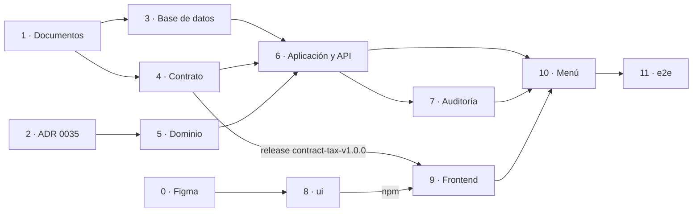
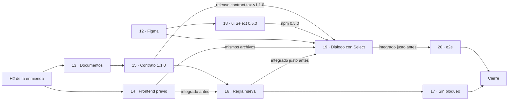

# 007 · Vigencias fiscales — Plan

_Cómo se implementa lo descrito en `spec.md`. Debe respetar la `constitution/` y la arquitectura (`docs/arquitectura/`)._

**Estado:** aprobado (H2) — 2026-11-13, por la persona que dirige el trabajo, con las correcciones de los dos altos de la verificación acotada (véase «H2» y «Revisión»)
**Enmienda 4:** plan en borrador, H2 pendiente (véase «Enmienda 4 · Años de 2002 al año siguiente al año en curso»).
_(borrador → aprobado (H2))_

## H2

La persona que dirige el trabajo resolvió la H2 el 2026-11-12 con las quince recomendaciones («Aceptar todas (Recomendado)»):
- H2‑1 quedó autorizado;
- H2‑13 se resolvió con la fecha larga para fechas sueltas;
- la aprobación del plan se escribe después de una verificación acotada del alto de la ronda 2, que ya se hizo (véase abajo).

El 2026-11-13 aprobó la H2 aceptando las correcciones de los dos altos de esa verificación («Sí, apruebo la H2»). La revisión adversarial del código del paso 6 los comprobará.

El detalle de cada decisión está en «Decisiones de la H2». Lo que queda después de la H2:
- **En Figma:**
  - ✅ hechos y aprobados por la persona el 2026-11-13: la propiedad `Tone` de `Dialog` (H2‑11), el componente `RadioGroup` (H2‑12) y quitar el mensaje «Sin permiso» del diálogo (H2‑14). Están en «Diseño de interfaz»;
  - ⏳ **pendiente de aprobación:** la etiqueta de un año pasado en el diálogo de creación (`relation: PAST`, por ejemplo «Año anterior al año en curso»), que salió de la verificación acotada y no está en el *frame* 67:3040. Se diseña ahora y es requisito del PR que la use (9a).
- **Los dos altos de la verificación acotada** están corregidos en el plan y se comprobarán en la revisión adversarial del código del paso 6 (véase «Revisión»).

## Enfoque

La vigencia es el primer agregado del módulo `tax` y el primer código de un módulo hexagonal completo (`docs/arquitectura/01` §4.1):
- un dominio en Java puro con la máquina de estados y las reglas de creación (V‑01, V‑02 y la regla nueva de la primera vigencia);
- casos de uso con su permiso;
- persistencia con JPA en `tax/infrastructure/persistence`, como pide la constitución para escribir agregados (`spec/constitution/tech-stack.md`);
- un controlador que implementa la interfaz generada de un contrato nuevo, `tax.yaml`.

La auditoría sigue el patrón de la feature 001 (ADR 0025): `tax` publica eventos en su paquete raíz y `audit` los escucha, así que ningún módulo depende de `audit`. La lista de preparación se arma en el dominio con los nueve puntos del Doc. 01 §6.1. Hoy solo se verifica el punto 1; los demás salen como «Opción aún no disponible» hasta que la feature de cada opción conecte su verificación.

El modelo de datos es el de la decisión 3 de la H1: el año sigue nacional y el estado es de cada administración. La base de datos hace cumplir lo que no debe depender de la aplicación:
- el aislamiento, con RLS y FK compuestas;
- un año por administración, con un `UNIQUE`;
- la única transición de la 007 (*Planeada* → *En preparación*), con la política RLS de `UPDATE`;
- que `assessments_enabled` siga en falso: `liv_app` no puede cambiar esa columna y un `CHECK` la fija.

El trabajo va en PR de un solo proyecto (`AGENTS.md` §4.6):
- en la raíz: los documentos y el ADR;
- en el *backend*: cinco PR (base de datos, contrato, dominio, aplicación y adaptadores, auditoría) y uno al final para abrir la opción del menú;
- `ui/`, si el diseño pide componentes;
- el *frontend*;
- `e2e/`.

## Ajustes al modelo de datos

Aprobados como alcance en la H1 (decisión 3). Van al ERD 2.3 en el PR de documentos (paso 1). La autorización para migrar estas tablas con la lista previa a Flyway abierta es la decisión H2‑1 (abajo).

**`tax.fiscal_year`** (nacional; ya está en el ERD, cambia su contenido y quién la escribe)

| Columna | Tipo | Regla |
|---|---|---|
| `year` | `SMALLINT` PK | — |
| `starts_on` | `DATE NOT NULL` | `CHECK (starts_on = make_date(year, 1, 1))` (V‑01; decisión H2‑2) |
| `ends_on` | `DATE NOT NULL` | `CHECK (ends_on = make_date(year, 12, 31))` (V‑01; decisión H2‑2) |

- Pierde `status` y `assessments_enabled`, que pasan a la tabla nueva. Es un cambio del modelo lógico: la tabla todavía no existe en ninguna migración, así que no hace falta *expand/contract*.
- Es un dato nacional de referencia, sin `administration_id` ni RLS: `liv_app` solo la lee (`docs/arquitectura/02` §5.1).
- La migración la llena con un **rango técnico y provisional** de años, 1999 a 2100 (decisión H2‑2):
  - basta para cualquier vigencia que se pueda crear;
  - no decide qué vigencias históricas se cargarán, que sigue siendo el pendiente 5 del Doc. 01;
  - ampliarlo es una migración nueva.

**`tax.administration_fiscal_year`** (nueva; una fila por administración y año)

| Columna | Tipo | Regla |
|---|---|---|
| `id` | `UUID` PK `DEFAULT uuidv7()` | — |
| `administration_id` | `UUID NOT NULL` | FK a `core.tax_administration (id)` |
| `fiscal_year` | `SMALLINT NOT NULL` | FK a `tax.fiscal_year (year)` |
| `status` | `VARCHAR(20) NOT NULL DEFAULT 'PLANEADA'` | `CHECK (status IN ('PLANEADA', 'EN_PREPARACION', 'LISTA', 'HABILITADA', 'CERRADA'))`, los códigos del Doc. 01 §5 |
| `assessments_enabled` | `BOOLEAN NOT NULL DEFAULT false` | `CHECK (NOT assessments_enabled)` en la 007. La regla definitiva (con *Habilitada* y quizá *Cerrada*) la pone la 1.5.1 cuando se responda la decisión 1b |
| `created_by` | `UUID NOT NULL` | FK compuesta (`created_by`, `administration_id`) a `core.admin_user (id, administration_id)` |
| `created_at` | `TIMESTAMPTZ NOT NULL DEFAULT now()` | — |
| `updated_by` | `UUID` | FK compuesta (`updated_by`, `administration_id`) a `core.admin_user` |
| `updated_at` | `TIMESTAMPTZ` | — |

- **Restricciones únicas:**
  - `UNIQUE (administration_id, fiscal_year)` (V‑01, 007-05);
  - `UNIQUE (id, administration_id)`, para las FK compuestas de las tablas que vendrán (catálogos, configuración, calendario).
- **RLS**, una política por operación, como `core.user_session` (`liv-migracion`, paso 2.4). Todas son `TO liv_app` y se apoyan en `NULLIF(current_setting('app.administration_id', true), '')::uuid`:
  - `SELECT`, de la administración;
  - `INSERT`, de la administración y solo con `status = 'PLANEADA'`;
  - `UPDATE`, con `USING` sobre la administración y `status = 'PLANEADA'`, y `WITH CHECK` sobre la administración y `status = 'EN_PREPARACION'`;
  - ninguna de `DELETE`.

  Así, ni un defecto del dominio puede saltar a otro estado o volver atrás. La 1.5.1 amplía la política de `UPDATE` con su migración.
- **Permisos de `liv_app`:**
  - `SELECT` e `INSERT` sobre la tabla;
  - `UPDATE` solo sobre `status`, `updated_by` y `updated_at`;
  - sin `UPDATE` de `assessments_enabled` y sin `DELETE` (007-12).
- **Esquema y versión:** la migración crea el esquema `tax`, con `GRANT USAGE` a `liv_app`. También comprueba que existe `uuidv7()` (PostgreSQL 18), porque la primera migración solo exige la 16.

**Lo que no cambia todavía.** El ERD dibuja FK hacia `tax.fiscal_year` desde `tax.tax_rate`, `tax.tax_calendar`, `tax.tax_benefit`, `tax.penalty_rule`, `tax.tax_assessment`, `valuation.valuation_catalog`, `valuation.vehicle_reference_match`, `core.jurisdiction_config` y `ledger.tax_obligation`. Las decide la feature de cada tabla:
- las nacionales apuntarán a `tax.fiscal_year (year)`;
- las de una administración, a (`administration_id`, `fiscal_year`) de la tabla nueva.

El ERD 2.3 lo deja anotado.

### Lista de aceptación previa a Flyway (ERD)

La lista sigue abierta. La 001 pidió autorización para migrar sus tablas antes de cerrarla, y la 007 hace lo mismo con las dos tablas de `tax` (decisión H2‑1).

| Punto de la lista | En la 007 |
|---|---|
| FK de la misma entidad territorial | Se cumple: FK compuestas con `administration_id` y RLS |
| Catálogos publicados congelados | No aplica: no hay catálogos |
| CSV, staging, aprobación por otro usuario, publicación transaccional, `UNIQUE` de catálogo y lote | No aplica |
| Índices únicos e intervalos sin solapamientos | Se cumple para lo suyo: `UNIQUE (administration_id, fiscal_year)` |
| Reglas de redondeo, facturación y sanciones | No aplica |
| Controles de auditoría y permisos de funcionarios | Se cumple para lo suyo: auditoría por evento (paso 7) y permisos de acción con su prueba de matriz (paso 3) |
| Validar el ERD con expertos tributarios antes de migrar | Resuelto en H2‑1: autorizado sin esa validación, como en la 001 |
| Cartera histórica, prescripción y cobro coactivo | No aplica |

## Decisiones de la H2

_Lo que la persona aprobó con este plan, además del plan en sí (`AGENTS.md` §4.5). Todas se resolvieron el 2026-11-12 como se recomendaban; la columna «Resultado» dice cómo._

| # | Decisión | Resultado |
|---|---|---|
| H2‑1 | Migrar `tax.fiscal_year` y `tax.administration_fiscal_year` con la lista previa a Flyway abierta, sin la validación del ERD por expertos tributarios que la lista pide «antes de migraciones», sin distinguir tablas | ✅ **Autorizado.** Como en la 001: las dos tablas no tienen tarifas, montos ni reglas de cálculo. Se anota en el ERD 2.3 (paso 1) |
| H2‑2 | Excepción a CC‑01 (`docs/arquitectura/04` y `AGENTS.md` §4.5, «ningún valor tributario en el código»): las fechas del año calendario quedan en un `CHECK` de la base de datos, y el rango técnico 1999–2100 queda en la migración | ✅ **Aprobado.** La decisión 6 de la H1 fijó el año calendario; con el `CHECK`, ni la aplicación puede escribir otra cosa. Si una norma exige otras fechas, se cambia con una migración y una versión del Doc. 01. *Alternativa:* fechas derivadas solo en el dominio, sin `CHECK` |
| H2‑3 | Permisos nuevos `tax.fiscal-year.create` y `tax.fiscal-year.prepare`, solo para `ADMIN_SISTEMA` | ✅ **Aprobado.** Es la fila «Crear / abrir vigencia fiscal» del Doc. 01 §4 |
| H2‑4 | Políticas RLS de la tabla nueva y permisos de `liv_app` («Ajustes al modelo de datos») | ✅ **Aprobado.** |
| H2‑5 | Dependencias entre módulos `audit → tax` y `tax → platform`, y el error de negocio en `shared` (ADR 0035). `platform → shared` ya está en la figura de `docs/arquitectura/01` §3.2; lo nuevo es que `ModularityTest` la admita | ✅ **Aprobado.** |
| H2‑6 | **Enmienda 1 a la spec (cambia una regla: decide la persona como responsable funcional).** Además de V‑02, solo se puede crear un año que no pase del siguiente al año en curso: `V‑05` con motivo `FUTURE_LIMIT`, que cambia 007-06 («crear N + 1 sí se permite» pasa a «si no pasa del año siguiente al en curso»). El diálogo de creación advierte que una vigencia no se puede borrar y que, una vez creada, los años anteriores a la más antigua quedan como históricos | ✅ **Aprobado.** Sin el límite, se pueden encadenar años futuros (2027, 2028…) sin forma de corregirlos, porque no hay borrado. Es una regla nueva del Doc. 01 v0.5, como V‑01: va en el dominio y en el documento, no en la configuración de jurisdicción, porque no cambia entre jurisdicciones. El «+1» queda en el dominio y en el Doc. 01, no en la configuración |
| H2‑7 | **Enmienda 2 a la spec:** en 007-20, la entidad auditada es `tax.administration_fiscal_year` (no `tax.fiscal_year`), con el `id` de su fila como `entity_id`. El Doc. 01 §8 se ajusta igual | ✅ **Aprobado.** `entity_id` es un `UUID` y la fila que cambia es la de la administración |
| H2‑8 | **Enmienda 3 a la spec (cambia los códigos de una regla: decide la persona como responsable funcional).** Los rechazos usan códigos de regla del Doc. 01 v0.5: `V‑05` para la primera vigencia (`FIRST_YEAR`, hoy 007-08) y el límite de años futuros (`FUTURE_LIMIT`, H2‑6); `V‑06` para una transición no permitida desde el estado actual (hoy 007-10) | ✅ **Aprobado.** Un contrato no debe publicar números de criterios de una feature como códigos de error |
| H2‑9 | Cómo se repiten las pruebas de `e2e/`, si la vigencia no se puede borrar | ✅ **Aprobado.** Un comando de desarrollo del *backend*, `backend/dev/limpiar-vigencias.sh` (paso 10), que vacía `tax.administration_fiscal_year` de la base **local** por `docker compose exec` y se niega fuera del contenedor de desarrollo. La persona lo corre antes de `npm test` en `e2e/`, como ya hace con `iniciar.sh`; `e2e/` no lo llama y sigue usando solo HTTP (ADR 0030). Si la administración de prueba tiene vigencias, la preparación de `e2e/` lo detecta por la API y se detiene con un mensaje claro |
| H2‑10 | El diseño de Figma (paso 0) antes de aprobar la H2, y una revisión de los pasos 8 y 9 cuando esté | ✅ Hecho: el diseño se aprobó el 2026-11-12 y la revisión de los pasos 8 y 9 (ronda 1) se hizo ese día (véase «Revisión»). Dejó las decisiones H2‑11 a H2‑15 |
| H2‑11 | **`Dialog` (cambia el diseño aprobado).** El mosaico del icono de `Dialog` es siempre de advertencia, y el diálogo de creación lo pinta en el color de la acción principal (`action/primary-subtle`). La propuesta aprobada (65:472) dice que lo demás queda igual, así que ese tono no está diseñado como propiedad | ✅ **Aprobado.** Agregar a la propuesta de `Dialog` en Figma una propiedad `Tone` (`Warning` por omisión, `Primary`) y aprobarla antes del PR 8f. En los dos casos, el cuerpo es una ranura con nombre y el ancho de 520 px es un tamaño `lg`, con 440 por omisión, para no cambiar el aviso de sesión de la 001 |
| H2‑12 | **El grupo de opciones del año (agrega un componente al diseño).** En Figma es un marco de la pantalla, pero su comportamiento (nombre accesible, teclado, un solo Tab) no puede vivir en la pantalla (`AGENTS.md` §6.1) | ✅ **Aprobado.** Un componente `RadioGroup` en `liv-components` (`fieldset`, `legend` y radios nativos), diseñado en `02 Componentes` junto a `RadioOption` y aprobado antes del PR 8c. Visualmente es el marco que ya está en las pantallas |
| H2‑13 | **El formato de las fechas.** El diseño muestra «1 de enero de 2026»; `frontend/AGENTS.md` («Localización») y la *skill* `liv-pantalla` piden `dd/mm/aaaa` | ✅ **Fecha larga para fechas sueltas.** En una vigencia, la fecha larga se lee mejor y no hay columnas de montos que alinear. `frontend/AGENTS.md` y `liv-pantalla` admiten el formato largo para fechas sueltas (los ajusta el PR 9a), y el formateador de la librería (8b) ofrece los dos. Si no, el diseño pasa a `dd/mm/aaaa` |
| H2‑14 | **El 403 dentro del diálogo.** El interceptor del *frontend* lleva a «Sin permiso» ante cualquier 403 de la API (001-16), así que el mensaje «Sin permiso» del diseño (67:3284) nunca se vería | ✅ **Aprobado.** Dejar el comportamiento de 001-16 y quitar ese mensaje del diseño. La acción solo aparece con `canCreate`, así que el 403 dentro del diálogo solo pasa si el permiso cambia a mitad de la sesión, y entonces llevar a «Sin permiso» es correcto |
| H2‑15 | **La versión de `liv-components` en una serie de PR.** `ui/AGENTS.md` pide subirla en el mismo PR | ✅ **Aprobado.** Una excepción para la serie 8a a 8f: los cinco primeros van a «Sin publicar» y el último sube a 0.4.0. Nada se publica hasta que la persona lo haga después de integrar el 8f |

## Implementación

_Los pasos están en orden de dependencia. Cada uno dice su proyecto; «Dependencias y recursos» dice qué corre en paralelo._

### 0. Diseño en Figma — ✅ aprobado el 2026-11-12 (raíz, Figma)

Decisión 5 de la H1. Lo hizo la sesión «007 · Diseño en Figma de vigencias (paso 0)» con la *skill* `liv-figma`, y la persona lo aprobó entero el 2026-11-12: los componentes nuevos, las modificaciones de `Button`, `Dialog` e `Icon`, y las tres pantallas de la 1.4. Las modificaciones son un cambio crítico de `liv-components` (`AGENTS.md` §4.3), aprobado de forma explícita. No hay estilos ni variables nuevos. Los nodos y la API están en «Diseño de interfaz»; `ESTADO.md` §4 lo actualiza el orquestador.

### 1. Documentos (raíz, PR propio) — `docs(007)`

Integrado **antes** del paso 3, porque la prueba de la matriz de permisos y el documento deben coincidir (`docs/arquitectura/02` §4.4).

- **ERD 2.3:**
  - `tax.fiscal_year` sin `status` ni `assessments_enabled`, con sus `CHECK` y su rango técnico;
  - la tabla nueva `tax.administration_fiscal_year` en el diagrama y en la lista del esquema `tax`;
  - la nota sobre las FK futuras;
  - la autorización H2‑1 en la lista previa a Flyway;
  - el conteo de tablas pasa de 79 a 80, también en su encabezado.
- **Doc. 01 v0.5:**
  - encabezado: 80 tablas;
  - §1: la liquidación exige `assessments_enabled` de la vigencia **de la administración**;
  - §3: el mapa del menú, 1.4 → `tax.fiscal_year` y `tax.administration_fiscal_year`;
  - §5: el modelo (una vigencia por administración sobre un año nacional), las reglas nuevas `V‑05` y `V‑06` (H2‑6 y H2‑8), la tabla de permisos de acción de la opción 1.4 y la nota de que la habilitación, *Lista* y el cierre van en la 1.5.1;
  - §6.1, punto 1: la verificación lee `tax.administration_fiscal_year.status`;
  - §8: la entidad de la vigencia es `tax.administration_fiscal_year` (H2‑7);
  - §11: el pendiente 5 remite a la feature 5.1, y se agrega como pendiente el cierre y la reapertura (V‑04, decisión 1b).
- **Doc. 02 v0.3:** LQ‑P01 y el diagrama del §B.2 leen el estado y `assessments_enabled` de la vigencia de la administración.
- **Registro entre documentos**, como en el Doc. 03 §7: en el Doc. 01 v0.5, la lista de lo que cambió en el ERD y en el Doc. 02.
- **`AGENTS.md` §3.1:** 80 tablas y ERD versión 2.3.
- **Glosario** (`docs/arquitectura/01` §15): «vigencia de la administración» (`administration_fiscal_year`) y «lista de preparación». Como el ADR 0035 cambia la figura del §3.2, `docs/arquitectura/01` sube de versión.
- **Spec:** no cambia en este PR: las enmiendas 1 a 3 (H2‑6 a H2‑8) ya están en `spec.md`, aprobadas en la H2 con la H1 firmada de nuevo para 007-04, 007-06, 007-08, 007-10 y 007-20.
- No toca el Doc. 03: el ajuste del §5.2 es de la feature 1.5.9 (decisión 6).

### 2. ADR 0035 (raíz, PR propio) — *skill* `liv-adr`

«Dependencias entre módulos y errores de negocio de la feature 007». Integrado **antes** de los pasos 5 a 7, porque el código de `tax` ya usa `platform` y `shared`. Registra:
- **`audit → tax` (nueva):** `audit` escucha los eventos de la vigencia, como `audit → core` en el ADR 0025;
- **`tax → platform` (nueva como flecha directa):** `@RequiresPermission`, `CurrentUser` y el contexto de la administración;
- **`tax → shared` y `platform → shared`:** el error de negocio con código de regla (siguiente punto);
- ningún módulo depende de `audit`;
- **el error de negocio:** `shared.RuleViolation`, una excepción sin marcar con el código de la regla, su tipo (`CONFLICT` o `UNPROCESSABLE`) y sus detalles (por ejemplo, `reason`), y `shared.NotFound`, para lo que no existe en la administración.
  - El dominio la lanza sin saber de HTTP, y `ProblemDetailsHandler`, en `platform`, traduce el tipo a 409 o 422. Así `platform` no conoce a `tax` y no hay ciclos.
  - Es el «error con código de regla» que `docs/arquitectura/01` §3.1 ya pone en `shared`.
  - «No existe» no es una regla: `NotFound` se traduce al 404 `SYS-404` que ya existe.
  - `shared` queda como un módulo normal de Spring Modulith, con sus flechas explícitas, y no como `sharedModules`: así `ModularityTest` sigue viendo quién lo usa;
- **la zona tributaria:** el `Clock` de `platform` sigue en UTC (no cambia nada de lo que ya lo usa). Una propiedad nueva, `liv.business-zone` (`America/Bogota` en `application.yml`), da la zona con la que `tax` calcula «el año en curso»: `LocalDate.now(clock.withZone(zona))`;
- **los puntos de la lista de preparación:** sus verificaciones vivirán en `tax/infrastructure` y consultarán las fachadas del paquete raíz de cada módulo. `tax → valuation` y `tax → jurisdiction` ya están en la figura; `tax → documents` (punto 2) será una flecha nueva con su propio ADR, en la feature 1.3.

Actualiza la figura de `docs/arquitectura/01` §3.2.

### 3. Base de datos (`backend/`, PR propio) — *skill* `liv-migracion`

Después del paso 1.

1. **Rojo:**
   - `AdministrationIsolationTest` (CA‑12 · 007-18 y 007-19): con el contexto de A no se ven ni se escriben filas de B; sin contexto no se ve nada; A y B tienen cada una su 2026.
   - `LivAppGrantsTest`: las columnas y los permisos esperados de las dos tablas.
   - Una prueba nueva, `FiscalYearSchemaTest`:
     - los `CHECK` de V‑01 y de `assessments_enabled` (007-12);
     - el `UNIQUE` (007-05);
     - que existen los años 1999 a 2100;
     - que `liv_app` **no** puede insertar una vigencia en otro estado que *Planeada*, ni cambiar `assessments_enabled`, ni borrar (error de permiso o de política);
     - que `WITH CHECK` rechaza con el error 42501 pasar de *Planeada* a *Habilitada*, *Lista* o *Cerrada*;
     - que `USING` deja intactas las vigencias que no están en *Planeada*: volver de *En preparación* a *Planeada* y tocar solo `updated_at` de una *En preparación* actualizan **0 filas** y el estado no cambia. PostgreSQL no da error en ese caso, así que la prueba cuenta filas.
   - La prueba de la matriz que ya existe, `PlatformTablesTest.permissionMatrixIsTheApprovedOne`, compara la tabla completa de permisos con la esperada. Se amplía con `tax.fiscal-year.create` y `tax.fiscal-year.prepare`, y sigue siendo la única matriz esperada, igual a la del Doc. 01 v0.5 (`docs/arquitectura/02` §4.4): asignar `create` a `JURIDICO` o a `AUDITOR` la hace fallar. El documento y la prueba van en PR distintos porque un PR toca un solo proyecto (`AGENTS.md` §4.6); por eso el paso 1 se integra antes.
2. **Verde:**
   - `V<marca>__tax_fiscal_years.sql`: la comprobación de `uuidv7()`, el esquema, las dos tablas, los años, la RLS y los permisos;
   - `V<marca>__platform_fiscal_year_permissions.sql`: los permisos de acción y su asignación.

### 4. Contrato (`backend/`, PR propio) — *skill* `liv-endpoint`, paso 1

`backend/contracts/openapi/tax.yaml` 1.0.0, con su ejecución de `openapi-generator` en `backend/pom.xml` (sin dependencias nuevas). Primero `OpenApiContractTest` (rojo), luego el contrato. Los endpoints están en «Datos, API y seguridad».

### 5. Dominio (`backend/`, PR propio) — `tax/domain` y `shared`

Después del paso 2. Java puro, con pruebas unitarias primero (`@DisplayName` con el código del criterio):

- `shared.RuleViolation` y `shared.NotFound` (ADR 0035), las dos sin marcar (`RuntimeException`), para que un rechazo deshaga la transacción sin que Spring intente confirmarla.
- `FiscalYearStatus`: los cinco estados del Doc. 01 §5. La 007 solo permite `PLANEADA → EN_PREPARACION`; las demás transiciones no existen todavía.
- `AdministrationFiscalYear`: el agregado (administración, año, estado y `assessmentsEnabled`). `openPreparation()` rechaza cualquier estado distinto de `PLANEADA` con `V‑06`.
- `FiscalYearOpeningPolicy`: a partir de los años de la administración, del año en curso y de los años nacionales, decide si un año se puede crear:
  - si ya existe, `V‑01`;
  - si es histórico, `V‑02` con motivo `HISTORICAL` (007-07);
  - si la administración no tiene vigencias y el año no es el en curso ni el siguiente, `V‑05` con motivo `FIRST_YEAR` (007-08);
  - si deja un hueco, `V‑02` con motivo `GAP` (007-06);
  - si pasa del año siguiente al en curso, `V‑05` con motivo `FUTURE_LIMIT` (H2‑6).

  **Se aplican en ese orden**, y el primero que falla es el que se responde: así cada caso da un solo motivo con sus extensiones (por ejemplo, 2029 en una administración cuya más reciente es 2026 da `GAP`, que dice qué crear primero). Las pruebas comprueban el código, el motivo y las extensiones de cada combinación.

  También dice qué años se pueden crear (`creatableYears`) y, si no queda ninguno, por qué (`createBlocked`), siempre dentro de la tabla nacional. Cada año trae sus fechas y su relación con el año en curso: `CURRENT`, `NEXT` o `PAST`. `PAST` existe porque un año pasado puede seguir pendiente: si la más reciente es 2026, estamos en 2028 y nadie creó 2027, el único año que se puede crear es 2027 (V‑02). `FiscalYearOpeningPolicyTest` prueba ese caso. Un año fuera de esa tabla es una invariante técnica, no una regla: el contrato lo rechaza antes con 400.
- `PreparationChecklist`:
  - los nueve puntos del Doc. 01 §6.1, cada uno con su número, su obligatoriedad (1 a 5, 8 y 9 obligatorios; 6 y 7 opcionales) y la opción del menú a la que lleva;
  - el punto 1 se cumple desde `EN_PREPARACION` (007-11);
  - los demás salen de un puerto, `PreparationItemCheck`, que en la 007 no tiene implementaciones y da «Opción aún no disponible»;
  - `canEnable()` es verdadero solo con todos los obligatorios cumplidos, cosa imposible en la 007 (V‑03 · CA‑14 · 007-12).

  El estado «con observación» del Doc. 01 §6.1 lo agregará la primera feature cuyo punto pueda tenerlo.

Este paso va en dos PR si pasa de ~400 líneas: 5a (`RuleViolation`, estados, agregado y política) y 5b (lista de preparación).

### 6. Aplicación, persistencia y API (`backend/`, PR propio)

Después de los pasos 3, 4 y 5.

- **Casos de uso** (un `@Service` por acción, con `@RequiresPermission`):

| Caso de uso | Permiso | Criterios |
|---|---|---|
| `ListFiscalYears` | `tax.fiscal-year.read` | 007-01, 007-03 |
| `GetFiscalYear` (con su lista de preparación) | `tax.fiscal-year.read` | 007-11, 007-12 |
| `CreateFiscalYear` | `tax.fiscal-year.create` | 007-04 a 007-08 |
| `OpenFiscalYearPreparation` | `tax.fiscal-year.prepare` | 007-10 |

  - `CreateFiscalYear` y `OpenFiscalYearPreparation` son `@Transactional(isolation = READ_COMMITTED)`: la lectura, la decisión y la escritura van en una sola transacción. El nivel se fija a propósito: el bloqueo de la creación solo sirve si cada sentencia ve lo confirmado después de obtenerlo, y con `REPEATABLE READ` la foto de los datos se tomaría con el `set_config` del dialecto, antes del bloqueo.
  - **El año en curso** sale de un solo componente de `tax/application`, `BusinessYear`, que combina el `Clock` con la zona de `liv.business-zone` (ADR 0035). Lo usan `ListFiscalYears` y `CreateFiscalYear`, así que la lista nunca ofrece un año que la creación rechace.
  - Los eventos `FiscalYearCreated` y `FiscalYearStatusChanged` van en el paquete raíz `tax`, como `core.SessionStarted`. Llevan `eventId`, `administrationId`, `userId`, el `id` de la fila, el año, el estado anterior (nulo al crear) y el nuevo, el instante y el `correlationId`.
- **Persistencia** con JPA en `tax/infrastructure/persistence`: una entidad para la fila de la administración, otra de solo lectura para el año nacional y sus repositorios, que implementan el puerto `FiscalYears`.
  - **La entidad solo se lee y se inserta; nunca se actualiza por *dirty checking*.**
    - `id`, `status`, `assessments_enabled` y `created_at` van con `insertable = false` y `@Generated`: los pone la base de datos (`uuidv7()` y los `DEFAULT`) y Hibernate los lee después del `INSERT`. En Hibernate 7, `@Generated` sirve también en el `@Id`.
    - **Todas** las columnas van con `updatable = false`. El estado solo cambia con el `UPDATE` explícito de la apertura, así que ningún `UPDATE` de Hibernate puede tocar una columna sin permiso ni chocar con la política RLS.
  - **Creación.**
    - Primero el bloqueo por administración, en la transacción del caso de uso: una operación del puerto, `lockForCreation(administrationId)`, que ejecuta `SELECT 1 FROM pg_advisory_xact_lock(:espacio, hashtext(:administrationId))` como consulta nativa. La forma con `SELECT 1` evita leer una columna `void`.
    - Después se leen los años, se decide y se guarda con `saveAndFlush` dentro del adaptador.
    - El bloqueo hace falta: sin él, dos creaciones que cruzan la medianoche del 31 de diciembre pueden ver la administración vacía con relojes de años distintos y dejar {2026, 2028}, un hueco que no se puede borrar.
    - Si el `INSERT` viola el `UNIQUE` (otra creación que no pasó por el bloqueo), el adaptador lo reconoce por el SQLState `23505` y por el nombre de la restricción que da `PSQLException.getServerErrorMessage().getConstraint()`, que no depende del idioma del servidor, y lo traduce allí mismo a `V‑01` (007-05), nunca a un 500.
  - **Apertura.**
    - Primero se lee la fila. Si no existe en la administración, `shared.NotFound`.
    - Después, un `UPDATE … SET status, updated_by, updated_at WHERE id = ? AND status = 'PLANEADA'` explícito, con `@Modifying(flushAutomatically = true, clearAutomatically = true)`, que devuelve las filas afectadas.
    - Haya cambiado o no, se vuelve a leer la fila desde la base de datos: el contexto de persistencia quedó limpio, así que la lectura es real. Con 1 fila, la respuesta y el evento llevan `EN_PREPARACION`. Con 0, otra petición ya la cambió: la respuesta es `V‑06` con el estado que se acaba de leer, nunca el 503 que el manejador actual da a los errores transitorios de datos.
    - Un reintento después de un éxito también da `V‑06`, con la vigencia ya *En preparación*, y la pantalla vuelve a leerla.
  - Los eventos se publican en la misma transacción (registro de Spring Modulith).
- **API:** `tax/api/FiscalYearsController` implementa la interfaz generada, sin lógica (CC‑07). `ProblemDetailsHandler` traduce `RuleViolation` a 409 o 422 y `NotFound` a 404 con el código `SYS-404` que ya existe (ADR 0035). Hoy ese 404 solo sale de los errores de Spring MVC, y sin `NotFound` una vigencia inexistente caería en el manejador genérico como 500. Una vigencia de otra administración da exactamente el mismo cuerpo que una que no existe (CA‑12).
- **Pruebas del adaptador**, con Testcontainers y el adaptador JPA real. Son las que demuestran las correcciones, porque cada una fuerza su intercalación:
  - **`UNIQUE`:** el dueño de los objetos inserta la vigencia 2026; después, `save` de 2026 sin pasar por el bloqueo debe dar `RuleViolation` `V‑01`, no `DataIntegrityViolationException`.
  - **Apertura que pierde la carrera:** con dos `TransactionTemplate`, T1 lee la fila; T2 la abre y confirma; T1 ejecuta su `UPDATE`. Debe afectar 0 filas y dar `V‑06` con el estado `EN_PREPARACION`.
  - **Apertura que gana:** el cuerpo dice `EN_PREPARACION`, y un contador de sentencias de Hibernate comprueba que no emite ningún `UPDATE` propio.
  - **El bloqueo:** dos instancias de `CreateFiscalYear`, cada una con su `Clock.fixed` a un lado de la medianoche del 31 de diciembre en Bogotá, sobre el adaptador real.
    - Un espía detiene a A justo después de obtener el bloqueo, y la prueba comprueba que B sigue esperando durante un tiempo límite.
    - Al liberar a A, el resultado es {2026} y B recibe `V‑02` `GAP`.
    - La misma prueba con un `lockForCreation` vacío da {2026, 2028}: así se demuestra que la prueba detecta la falta del bloqueo.
- **Pruebas de la API**, con `PlatformWebTest` y Testcontainers:
  - las respuestas y los errores del contrato;
  - 401 y 403 (007-02 y 007-09);
  - una vigencia de otra administración y un año inexistente dan el mismo 404;
  - el aislamiento por la API (CA‑12 · 007-18);
  - dos creaciones y dos aperturas a la vez, como prueba de humo: nunca 500 ni 503.

  Cada prueba que necesite una administración sin vigencias la crea con el dueño de los objetos, porque el contenedor se comparte y `liv_app` no puede borrar.
- **La frontera del año**, en pruebas de aplicación de `CreateFiscalYear` y de `ListFiscalYears` con `Clock.fixed(2027-01-01T04:30Z)` (31 de diciembre de 2026 a las 23:30 en Bogotá) y un doble del puerto: los años que se pueden crear son 2026 (`CURRENT`) y 2027 (`NEXT`), y 2028 se rechaza con `V‑05` `FUTURE_LIMIT` y su `maxYear`. No reemplazan el `Clock` de `PlatformWebTest`, que es el de producción. Aparte, una prueba en el contexto real comprueba que `BusinessYear` usa la zona `America/Bogota`.
- `ModularityTest`, en el mismo PR: `platform` pasa de no depender de nadie a depender solo de `shared` (`containsExactly("shared")`; la flecha ya está en la figura de `docs/arquitectura/01` §3.2), y `tax` depende de `platform` y `shared`. Nadie depende de `audit`.
- Agrega a la *skill* `liv-endpoint` el ejemplo de un módulo hexagonal (`tax`), como pide la misma *skill*.

### 7. Auditoría (`backend/`, PR propio)

Después del paso 6.

- `audit/infrastructure/FiscalYearEventsListener` (`@TransactionalEventListener`, asíncrono e idempotente por `eventId`, como `SessionEventsListener`) y `audit/application/RecordFiscalYearEvents`.
- `AuditLog.Entry` gana `previousValues`, que la tabla ya tiene (`previous_values`):
  - admite nulo (el mapa se copia solo si existe), y sus siete usos actuales pasan `null`;
  - el `INSERT` de `JdbcAuditLog` agrega la columna, que hoy no escribe;
  - el *javadoc* de `entityName` agrega la entidad nueva;
  - una prueba comprueba que las filas de sesión siguen con `previous_values` nulo.
- **La fila:**
  - `entity_name`: `tax.administration_fiscal_year` (H2‑7);
  - `entity_id`: el `id` de la fila;
  - `operation`: `FISCAL_YEAR_CREATED` o `FISCAL_YEAR_STATUS_CHANGED`;
  - `previous_values`: `{status}`, nulo al crear;
  - `new_values`: `{year, status}`, la lista blanca;
  - `user_id`, `administration_id`, `occurred_at` y `correlation_id`, los del evento.
- **Pruebas:**
  - `FiscalYearAuditTest` comprueba cada uno de esos valores (007-20);
  - el evento llega aunque el consumidor falle una vez (registro de eventos);
  - `ModularityTest`: `audit` depende de `core`, `platform` y `tax`.

### 8. Componentes (`ui/`, varios PR) — *skill* `liv-componente`

Después del paso 0. Los componentes son los de «Diseño de interfaz». Cada uno lleva su prueba por variante y estado, axe en cada combinación, su historia de Storybook enlazada a su nodo y su exportación en `public-api.ts`. Ninguno sabe de rutas ni de HTTP.

| PR | Contenido | Tipo |
|---|---|---|
| 8a | `Table`, `TableRow` y `TableCell`, solo lo que usa la 007 | Normal (componentes nuevos) |
| 8b | `ChecklistItem`, `DescriptionItem`, `Panel` y el formateador de fechas | Normal |
| 8c | `RadioGroup` y `RadioOption` (H2‑12), antes del 8f | Normal |
| 8d | Iconos `plus` y `circle` en `Icon` | Crítico (modifica un componente) |
| 8e | `Button` con `disabledReason` | Crítico |
| 8f | `Dialog` con cuerpo, tamaño y tono (H2‑11) | Crítico |

**Cómo es cada uno en código**

- **`Table` (8a):**
  - una tabla HTML real: `table[livTable]`, `tr[livTableRow]`, `th[livTableCell]` con `scope="col"` y `td[livTableCell]`, con selectores de atributo para que las filas y las celdas sigan en el árbol de accesibilidad;
  - un nombre accesible obligatorio (`caption` o `aria-label`) y `aria-busy` en *Loading*;
  - la celda de enlace dibuja su propio `<a href>` y emite `navigate`, como `NavItem`: la pantalla navega con el enrutador y la librería no depende de él. Un `<a>` proyectado por la pantalla no recibiría los estilos de la celda (la encapsulación de Angular lo impide y `::ng-deep` está prohibido). Una prueba comprueba el color del enlace por *token*;
  - solo el enlace del año recibe el foco: la fila pinta *Hover* y *Focus* con `:focus-within`, y el chevron de la celda *Action* es decorativo (`aria-hidden`);
  - el estado *Empty* no entra: la 007 usa `ResultState` para el vacío (*frames* 66:2793 y 66:3041). Entra, como la barra y la paginación (64:450), con la primera feature 1.6.
- **`ChecklistItem` (8b):** el estado `Observed` se implementa aunque la 007 no lo use, porque el contrato ya lo declara (paso 6) y el diseño lo aprobó.
- **Formateador de fechas (8b):** `docs/arquitectura/01` §11 pone los formateadores en la librería. Formatea una fecha de negocio (`AAAA-MM-DD`) **sin convertir de zona**, porque `new Date('2026-01-01')` en Bogotá muestra el 31 de diciembre de 2025. Da la fecha larga («1 de enero de 2026», H2‑13) y la corta (`dd/mm/aaaa`). La prueba fija `process.env.TZ = 'America/Bogota'` en su configuración y comprueba al empezar que la zona está activa (`new Date(2026, 0, 1).getTimezoneOffset() === 300`); si no, falla, porque en UTC el defecto no se vería.
- **`RadioGroup` y `RadioOption` (8c, H2‑12):** un `<fieldset>` con su `<legend>` y radios nativos con un `name` común.
  - Las flechas y el Tab que solo entra a la opción marcada los da el navegador. jsdom no los implementa, así que se prueban en `e2e/` (paso 11); en el 8c se prueban el nombre accesible, el valor y el cambio de selección.
  - La variante `Disabled` se implementa porque está diseñada.
- **Iconos (8d):** `plus` y `circle`. `chevron-left` solo lo usa la paginación, así que entra con la 1.6. La prueba de `icon.component.spec.ts` que cuenta los iconos y la descripción en Figma se actualizan. Los iconos toman el color de su contenedor (`currentColor`), como ya hacen `Button` y `ResultState`.
- **`Button` (8e):**
  - `disabledReason` solo cuenta con `disabled`;
  - con motivo, el botón usa `aria-disabled="true"` para seguir recibiendo el foco, y un estado propio en el anfitrión (por ejemplo, `data-state="disabled"`) le da el aspecto inhabilitado. Las reglas de *hover* y de «cargando» (`.button[aria-disabled='true']`) se excluyen con ese estado. jsdom no evalúa `:hover`, así que una prueba comprueba el texto de esas reglas y la revisión manual en Storybook lo confirma;
  - el motivo va debajo del botón, enlazado con `aria-describedby`, con una entrada para su alineación (`reasonAlign`: `start` o `end`), porque el diseño lo alinea a la derecha en la lista (66:2513) y a la izquierda en el detalle (68:3460);
  - pruebas: el aspecto es igual con motivo y sin él; no emite clic con el ratón, con Enter, con Espacio ni como `submit` de un formulario; `aria-describedby` apunta al texto visible; sin `disabled`, el motivo no se muestra; la combinación con `loading` tiene la precedencia de hoy.
- **`Dialog` (8f, H2‑11):**
  - el cuerpo es una ranura con nombre (`<ng-content select="[livDialogBody]">`); el contenido sin selector siguen siendo las acciones, como hoy;
  - `size`: `md` (440 px, por omisión) o `lg` (520 px);
  - `tone`: `warning` (por omisión, como hoy) o `primary`, para el mosaico del icono;
  - **la trampa de foco** cuenta, de cada grupo de radios, el marcado o, si no hay ninguno, el primero habilitado al avanzar y el último al retroceder; excluye los radios de un `fieldset` inhabilitado. La misma regla vale para el primer foco al abrir;
  - las pruebas de teclado de un `RadioGroup` dentro de un `Dialog` (uno y dos años, con y sin opción marcada) van aquí, en el 8f, porque dependen de esa trampa. El 8f se integra después del 8c;
  - una prueba del uso por omisión (sin cuerpo, sin `size` ni `tone`) fija 440 px, el tono de advertencia y que todo el contenido sin selector va a las acciones. Es el uso del aviso de sesión de la 001, que `ui/` no puede leer; el PR 9a corre la prueba propia del *frontend* de ese aviso con 0.4.0 y la cita.

**Versión y publicación (H2‑15).** `ui/AGENTS.md` pide subir la versión en el mismo PR. Para una serie de seis PR, la H2 aprobó una excepción: los cinco primeros (8a a 8e) van a «Sin publicar» en el `CHANGELOG.md`, y el 8f sube a 0.4.0 y mueve las entradas. La persona publica en npm después de integrarlo, y hasta entonces nada se publica. 0.4.0 es correcto: los cambios son compatibles, y en 0.x una versión nueva compatible sube el número del medio.

**Capturas de referencia.** `ui/` no tiene regresión visual (Q14): agregarla sería una dependencia nueva, con su ADR. En los PR críticos la comparación con Figma es una revisión manual en Storybook, con capturas en la descripción del PR.

### 9. Pantallas (`frontend/`, dos PR) — *skill* `liv-pantalla`

Después del paso 4, publicado como *release* `contract-tax-v1.0.0`, y del paso 8, publicado en npm. El *frontend* no calcula reglas: todo lo que muestra sobre años, fechas y motivos viene del contrato (paso 6), y ninguna pantalla usa `new Date()` para decidir.

**9a · Lista y creación**
- `api-spec/versions.json` con el contrato `tax` y su `sha256`, `npm run api:update`, y en `package.json` la versión exacta nueva de `liv-components`.
- `FiscalYearsService`, sobre el cliente generado, en `src/app/features/fiscal-years/`.
- La lista, en la ruta `${OPTION_ROUTE}/1.4`, con sus siete estados (*frames* 66:1967 a 66:3493):
  - «Crear vigencia» se muestra solo con `canCreate`;
  - si `createBlocked` viene, el botón queda inhabilitado con su motivo.
- El diálogo de creación (67:3040):
  - las opciones salen de `creatableYears`, con su etiqueta y sus fechas;
  - lleva la advertencia de H2‑6;
  - mientras se envía, el botón está en `loading` y Escape no cierra.
- Los rechazos (67:3284) se arman con el código y las extensiones del Problem Details. La alerta se crea de nuevo en cada intento, para que se anuncie aunque el texto se repita. Después de un `V‑01`, la lista se vuelve a leer: queda marcado el primer año que siga disponible, y si ya no queda ninguno (`createBlocked`), el diálogo se cierra y la lista muestra el botón inhabilitado con su motivo. El grupo de años siempre tiene una opción marcada mientras el diálogo está abierto.
- **El 403 dentro del diálogo (H2‑14):** el interceptor sigue llevando a «Sin permiso» ante cualquier 403 de la API (001-16), y el mensaje «Sin permiso» sale del diseño (67:3284).
- **Fechas (H2‑13):** el mismo PR ajusta `frontend/AGENTS.md` («Localización») y la *skill* `liv-pantalla` (paso 5) para admitir la fecha larga en fechas sueltas, con `dd/mm/aaaa` en tablas de consulta y exportaciones. Son reglas del proyecto `frontend/`, así que van en su PR y no en el de documentos de la raíz.

**9b · Detalle y preparación**
- El detalle, en la ruta `${OPTION_ROUTE}/1.4/:year`, con sus estados (68:3460 a 68:4474):
  - la pantalla valida el parámetro antes de llamar a la API: un año no numérico o fuera de 1999–2100 se muestra como «no encontrada», igual que el 404, sin llamar a la API;
  - otro error (500 o tiempo agotado), con el `ResultState` de error de la lista;
  - un `V‑06` al abrir la preparación muestra su alerta encima de los datos y vuelve a leer la vigencia.
- La lista de preparación:
  - el título de cada punto sale de su `code`, y la frase de obligatorios y opcionales se arma con `required`, no con números fijos;
  - «Habilitar liquidación» se muestra con `disabledReason` a partir de `missing`.
- **`Shell`:** hoy marca la opción del menú solo si la ruta es exactamente la de la opción, así que en `/opcion/1.4/2026` «Vigencias fiscales» no quedaría activa ni se abriría «Administración». Se cambia `shell.ts` para que también la marque en sus rutas hijas, con su prueba.

**En los dos PR**
- Las dos rutas llevan `capabilityGuard` con `capability: '1.4'` y se declaran antes de la genérica. Con la opción todavía en *Próximamente* (paso 10), llevan a «Próximamente», y sin permiso dan 403 (007-02).
- Las acciones se muestran según lo que dice el *backend* (`canCreate`, `createBlocked`, `availableActions`), no según el rol (007-09). Un valor de `availableActions` que la pantalla no conoce se ignora.
- Las fechas se muestran con el formateador de la librería (8b), en el formato que decida H2‑13.
- **Pruebas primero**, en `fiscal-years.spec.ts` y `fiscal-year-detail.spec.ts`:
  - `canCreate` en falso, sin la acción (007-09);
  - `createBlocked`, con el botón inhabilitado y su motivo;
  - cada rechazo con su código y sus años (007-05 a 007-08);
  - la vigencia sin `OPEN_PREPARATION`, sin la acción (007-10), y con un valor desconocido de `availableActions`;
  - un año `PAST` en `creatableYears`, con su etiqueta;
  - el parámetro `:year` inválido, que muestra «no encontrada» sin llamar a la API;
  - los puntos de la lista y el botón con motivo (007-11 y 007-12);
  - axe con el diálogo abierto, con un rechazo y con el botón inhabilitado con motivo, además de las rutas en `accessibility.spec.ts` (007-21). El contraste no se mide en jsdom: lo cubre `e2e/`;
  - el 403 por URL en las dos rutas, y la opción del menú activa en el detalle.

### 10. Abrir la opción del menú (`backend/`, PR propio)

Se integra después de los pasos 6, 7 y 9. Así la opción no se muestra habilitada mientras lleva a «Próximamente» (Doc. 01 §4.1, 001-15), ni antes de que existan la API y su auditoría.

- `menu-catalog.yaml`: la opción 1.4 pasa a `AVAILABLE`, con su ajuste en `MenuCatalogTest`.
- `backend/dev/limpiar-vigencias.sh` (H2‑9), junto a `check.sh`:
  - solo usa `docker compose -f dev/compose.yaml exec postgres psql …`, y se niega si el contenedor no es el de desarrollo;
  - toca únicamente `tax.administration_fiscal_year`;
  - `tools/dev/` puede invocarlo, como invoca los demás comandos de cada proyecto (`AGENTS.md` §4.6).

  El e2e en CI (la T24 de la feature 001, antes de producción) necesitará otro mecanismo, porque usará imágenes publicadas.
- **Validación del paso 9:** el PR del *frontend* se valida en local con la rama de este paso aplicada: con la opción abierta, se ven las pantallas, se comparan con Figma y se corre `e2e/` (ADR 0030). Su resultado se cita en el PR del *frontend*, y este PR se integra después.

### 11. Pruebas de navegador (`e2e/`, PR propio) — *skill* `liv-prueba-e2e`

Al final, con el sistema levantado y `backend/dev/limpiar-vigencias.sh` ejecutado (ADR 0030 y H2‑9). Las pruebas se escriben en rojo mientras se implementa el paso 9.
- **Usuario de la administración B:** `preparar.ts` crea un `e2e.admin.b` (`ADMIN_SISTEMA` de la administración de prueba B), con un TOTP conocido, por la API de administración de Keycloak, y `limpiar.ts` lo borra, como ya se hace con `e2e.totp`. No va en el *realm* de desarrollo: `ADMIN_SISTEMA` exige TOTP, y la capa de desarrollo no puede llevar uno conocido.
- **Pruebas de la 001 que cambian:** `estructura.spec.ts` usa la opción 1.4 como ejemplo de «Próximamente» y la muestra en la captura del menú del administrador. Pasan a usar otra opción que siga en *Próximamente*, y la persona vuelve a aprobar esas capturas.
- **Recorridos:**
  - el estado vacío;
  - crear la primera vigencia y la siguiente;
  - abrir la preparación;
  - ver la lista con «Habilitar liquidación» inhabilitado;
  - `dev.consulta`, sin las acciones;
  - `dev.liquidador`, con 403;
  - `e2e.admin.b`, sin ver las de Ipiales.
- Los años salen de `creatableYears`, no del calendario de la prueba.
- **El teclado del grupo de años** en el navegador real: las flechas cambian la opción y Tab entra solo a la marcada, dentro del diálogo.
- Lleva capturas de referencia de las tres pantallas, con máscara sobre los años y las fechas, que aprueba la persona, y axe.

## Datos, API y seguridad

- **Migraciones:** las del paso 3. No modifican ninguna migración aplicada.
- **Contrato OpenAPI** (`tax.yaml` 1.0.0, nuevo, sin cambios incompatibles). `year` es un entero con `minimum: 1999` y `maximum: 2100`, el rango de la tabla nacional; fuera de él, 400 por validación.

| Operación | Ruta | Respuesta | Errores |
|---|---|---|---|
| `listFiscalYears` | `GET /api/v1/fiscal-years` | `{ items: [{ year, startsOn, endsOn, status, assessmentsEnabled }], canCreate, createBlocked, creatableYears: [{ year, startsOn, endsOn, relation }] }`, del más reciente al más antiguo | 401, 403 |
| `getFiscalYear` | `GET /api/v1/fiscal-years/{year}` | La vigencia, `availableActions` y `preparation: { items: [{ number, code, required, option, status, reason }], canEnable, missing }` | 400, 401, 403, 404 `SYS-404` |
| `createFiscalYear` | `POST /api/v1/fiscal-years` con `{ year }` | 201 y la vigencia | 400, 401, 403, 409 `V‑01`, 422 `V‑02` (`reason`: `GAP` o `HISTORICAL`), 422 `V‑05` (`reason`: `FIRST_YEAR` o `FUTURE_LIMIT`) |
| `openFiscalYearPreparation` | `POST /api/v1/fiscal-years/{year}/preparation` | 200 y la vigencia | 400, 401, 403, 404 `SYS-404`, 409 `V‑06` |

  - **Valores que crecerán sin romper el contrato.** `openapi-diff` (Q08) marca como incompatible agregar un valor a un `enum` de una respuesta, así que:
    - el `status` de la vigencia declara desde la 1.0.0 los cinco estados del Doc. 01 §5;
    - el `status` de un punto de la lista declara `MET`, `PENDING` y `OBSERVED` (el «con observación» del Doc. 01 §6.1, que todavía nadie usa). «Opcional» no es un estado, sino `required: false` (007-11);
    - `availableActions` es una lista de cadenas con sus valores documentados (hoy solo `OPEN_PREPARATION`), y el *frontend* ignora los que no conoce. Así la 1.5.1 puede agregar los suyos.
  - **El *backend* da todo lo que la pantalla muestra sobre los años**, para que el *frontend* no calcule reglas con el reloj del navegador, que está en otra zona:
    - `canCreate` dice si el usuario tiene `tax.fiscal-year.create`: sin él, la pantalla no muestra la acción;
    - `creatableYears` trae cada año con sus fechas (V‑01) y su relación con el año en curso (`relation`: `PAST`, `CURRENT` o `NEXT`), para la etiqueta del diálogo («Año siguiente al año en curso»). `relation` y el motivo de `createBlocked` son cadenas con sus valores documentados, como `availableActions`, para poder crecer sin romper el contrato;
    - `createBlocked` viene cuando hay permiso pero ningún año disponible, con su motivo (`FUTURE_LIMIT`) y `maxYear`, para el botón inhabilitado («Ya existe la vigencia 2027, la última que se puede crear»);
    - el estado vacío de la lista usa los años de `creatableYears`, no los calcula.
  - **Los rechazos llevan los años que cita el diseño**, como extensiones del Problem Details, para que la pantalla arme el mensaje sin calcular reglas:
    - `V‑01`: `year`;
    - `V‑02` `GAP`: `requiredYear`; `V‑02` `HISTORICAL`: `oldestYear`;
    - `V‑05` `FIRST_YEAR`: `currentYear` y `nextYear`; `V‑05` `FUTURE_LIMIT`: `maxYear`;
    - `V‑06`: `year` y el `status` actual.
  - **Cada punto de la lista trae un `code`** (por ejemplo, `FISCAL_YEAR_IN_PREPARATION` o `VALUATION_RESOLUTION`) que dice qué punto es, y su `reason` también es un código (`MET`, `FISCAL_YEAR_PLANNED`, `OPTION_NOT_AVAILABLE`). La pantalla pone los textos del diseño a partir de esos códigos, y el contrato documenta sus valores como cadenas, para que una feature 1.5.x pueda agregar los suyos sin romperlo.
  - Un año fuera de la tabla nacional lo rechaza el contrato con 400, y el dominio nunca lo ofrece en `creatableYears`: no es una regla funcional ni lleva código del Doc. 01.

  - Las rutas usan el año, no el `id`: dentro de una administración el año es único, y así no se exponen identificadores que se puedan probar contra otra (CA‑12).
  - No hay ninguna operación que habilite la liquidación (decisión 1).
  - Los códigos `V‑05` y `V‑06` son los de la enmienda 3 (H2‑8), aprobada.
- **Permisos** (decisión H2‑3):

| Permiso | Roles | Origen |
|---|---|---|
| `tax.fiscal-year.read` | `ADMIN_SISTEMA`, `CARGADOR_TABLAS`, `APROBADOR_TABLAS`, `CONSULTA`, `AUDITOR` | Ya existe (Doc. 01 §4.1) |
| `tax.fiscal-year.create` (nuevo) | `ADMIN_SISTEMA` | Doc. 01 §4, «Crear / abrir vigencia fiscal» |
| `tax.fiscal-year.prepare` (nuevo) | `ADMIN_SISTEMA` | Doc. 01 §4, «Crear / abrir vigencia fiscal» |

  La segregación de la doble firma no se implementa aquí (decisión 1): la 1.5.1 agregará su permiso y su regla en el dominio, con 007-15 y 007-16.
- **Dependencias nuevas:** ninguna (JPA, Flyway y `openapi-generator` ya están en el `pom.xml`).
- **Amenazas** (`docs/arquitectura/02` §2):

| Amenaza | Control |
|---|---|
| Acceso a datos de otra administración | RLS, FK compuestas, administración tomada de la sesión, 404 indistinguible y pruebas de aislamiento en la base de datos, la API y el navegador |
| Elevación de privilegios | Permisos por caso de uso en el *backend*, con la prueba de la matriz (`PlatformTablesTest.permissionMatrixIsTheApprovedOne`); la interfaz solo oculta |
| Cambio de estado sin control | La política RLS de `UPDATE` solo admite *Planeada* → *En preparación* |
| Habilitar la liquidación sin control | No hay operación, `liv_app` no puede cambiar la columna y un `CHECK` la fija en falso |
| Repudio | Auditoría inmutable con usuario, estados y `correlation_id`, entregada por el registro de eventos (al menos una vez, consumidor idempotente) |
| Inferencia entre administraciones | Los años nacionales vienen de la migración, no de lo que crean las administraciones |

## Diseño de interfaz

**Aprobado por la persona el 2026-11-12** (paso 0): los componentes nuevos, las modificaciones de `Button`, `Dialog` e `Icon`, y las tres pantallas. Archivo LIV‑Diseño; sección [66:1966](https://www.figma.com/design/s2r2Kdu31sQW5CmVeQNyZb/LIV-Dise%C3%B1o?node-id=66-1966) «1.4 · Vigencias fiscales» de `03 Pantallas`. El detalle completo, con valores y estilos, está en cada nodo de Figma.

**Pantallas**

| Pantalla | *Frames* | Componentes de `liv-components` |
|---|---|---|
| 1.4 · Vigencias | [66:1967](https://www.figma.com/design/s2r2Kdu31sQW5CmVeQNyZb/LIV-Dise%C3%B1o?node-id=66-1967) administrador con una fila; [66:2250](https://www.figma.com/design/s2r2Kdu31sQW5CmVeQNyZb/LIV-Dise%C3%B1o?node-id=66-2250) consulta, sin crear; [66:2513](https://www.figma.com/design/s2r2Kdu31sQW5CmVeQNyZb/LIV-Dise%C3%B1o?node-id=66-2513) sin años disponibles («Crear vigencia» inhabilitado con motivo); [66:2793](https://www.figma.com/design/s2r2Kdu31sQW5CmVeQNyZb/LIV-Dise%C3%B1o?node-id=66-2793) vacía, administrador; [66:3041](https://www.figma.com/design/s2r2Kdu31sQW5CmVeQNyZb/LIV-Dise%C3%B1o?node-id=66-3041) vacía, consulta; [66:3271](https://www.figma.com/design/s2r2Kdu31sQW5CmVeQNyZb/LIV-Dise%C3%B1o?node-id=66-3271) cargando; [66:3493](https://www.figma.com/design/s2r2Kdu31sQW5CmVeQNyZb/LIV-Dise%C3%B1o?node-id=66-3493) error | `PageHeader` (migaja de pan y descripción), `Button`, `Table`, `Badge`, `ResultState`, `Skeleton` |
| 1.4 · Crear vigencia | [67:3040](https://www.figma.com/design/s2r2Kdu31sQW5CmVeQNyZb/LIV-Dise%C3%B1o?node-id=67-3040) diálogo con la advertencia de H2‑6; [67:3163](https://www.figma.com/design/s2r2Kdu31sQW5CmVeQNyZb/LIV-Dise%C3%B1o?node-id=67-3163) con el rechazo `V‑01`; [67:3284](https://www.figma.com/design/s2r2Kdu31sQW5CmVeQNyZb/LIV-Dise%C3%B1o?node-id=67-3284) los mensajes de rechazo (`V‑01`, `V‑02` `GAP` y `HISTORICAL`, `V‑05` `FIRST_YEAR` y `FUTURE_LIMIT`, y `V‑06`; el del 403 sale del diseño por H2‑14) | `Dialog` (modificado), `RadioGroup` y `RadioOption`, `DescriptionItem`, `Alert`, `Button` |
| 1.4 · Detalle y preparación | [68:3460](https://www.figma.com/design/s2r2Kdu31sQW5CmVeQNyZb/LIV-Dise%C3%B1o?node-id=68-3460) *En preparación*; [68:3846](https://www.figma.com/design/s2r2Kdu31sQW5CmVeQNyZb/LIV-Dise%C3%B1o?node-id=68-3846) *Planeada*, con «Abrir preparación»; [68:4235](https://www.figma.com/design/s2r2Kdu31sQW5CmVeQNyZb/LIV-Dise%C3%B1o?node-id=68-4235) no encontrada (404); [68:4474](https://www.figma.com/design/s2r2Kdu31sQW5CmVeQNyZb/LIV-Dise%C3%B1o?node-id=68-4474) cargando | `PageHeader`, `Button` (modificado), `Panel`, `DescriptionItem`, `ChecklistItem`, `Badge`, `Alert`, `ResultState`, `Skeleton` |

**Componentes nuevos** (`02 Componentes`)

| Componente | Nodo | Variantes y propiedades |
|---|---|---|
| `TableCell` | [63:283](https://www.figma.com/design/s2r2Kdu31sQW5CmVeQNyZb/LIV-Dise%C3%B1o?node-id=63-283) | `Type`: `Header`, `Text`, `Link`, `Badge` o `Action` (chevron decorativo); `Text` |
| `TableRow` | [63:352](https://www.figma.com/design/s2r2Kdu31sQW5CmVeQNyZb/LIV-Dise%C3%B1o?node-id=63-352) | `Type`: `Header` o `Body`; en `Body`, `State`: `Default`, `Hover` o `Focus` |
| `Table` | [64:446](https://www.figma.com/design/s2r2Kdu31sQW5CmVeQNyZb/LIV-Dise%C3%B1o?node-id=64-446) | `State`: `Default`, `Empty` o `Loading` (con `aria-busy`); `Show toolbar`, `Show pagination` (falsos en la 007), `Empty title`, `Empty description`. Referencia para la 1.6: [64:450](https://www.figma.com/design/s2r2Kdu31sQW5CmVeQNyZb/LIV-Dise%C3%B1o?node-id=64-450) |
| `ChecklistItem` | [64:573](https://www.figma.com/design/s2r2Kdu31sQW5CmVeQNyZb/LIV-Dise%C3%B1o?node-id=64-573) | `Status`: `Met`, `Pending` u `Observed`; `Number`, `Title`, `Reason`, `Show reason`, `Link`, `Show link`, `Optional` |
| `RadioOption` | [64:629](https://www.figma.com/design/s2r2Kdu31sQW5CmVeQNyZb/LIV-Dise%C3%B1o?node-id=64-629) | `Selected` × `State` (`Default`, `Hover`, `Focus`, `Disabled`); `Label`, `Description`, `Show description`. El grupo (`role="radiogroup"`) es un marco en Figma |
| `DescriptionItem` | [64:583](https://www.figma.com/design/s2r2Kdu31sQW5CmVeQNyZb/LIV-Dise%C3%B1o?node-id=64-583) | `Type`: `Text` o `Badge`; `Label`, `Value` |
| `Panel` | [64:631](https://www.figma.com/design/s2r2Kdu31sQW5CmVeQNyZb/LIV-Dise%C3%B1o?node-id=64-631) | `Title`, `Description`, `Show description`; contenido proyectado |

**Modificaciones** (sección [65:455](https://www.figma.com/design/s2r2Kdu31sQW5CmVeQNyZb/LIV-Dise%C3%B1o?node-id=65-455); propuestas como componentes aparte, sin tocar los aprobados)

| Componente | Nodo | Cambio |
|---|---|---|
| `Button` | [65:456](https://www.figma.com/design/s2r2Kdu31sQW5CmVeQNyZb/LIV-Dise%C3%B1o?node-id=65-456) | Entrada nueva `disabledReason`: un texto visible debajo, enlazado con `aria-describedby`; con motivo, el botón usa `aria-disabled="true"` en lugar de `disabled`, para seguir recibiendo foco. No cambia su aspecto |
| `Dialog` (y H2‑11) | Conjunto [73:482](https://www.figma.com/design/s2r2Kdu31sQW5CmVeQNyZb/LIV-Dise%C3%B1o?node-id=73-482): variantes `Tone=Warning` [65:472](https://www.figma.com/design/s2r2Kdu31sQW5CmVeQNyZb/LIV-Dise%C3%B1o?node-id=65-472) y `Tone=Primary` [73:467](https://www.figma.com/design/s2r2Kdu31sQW5CmVeQNyZb/LIV-Dise%C3%B1o?node-id=73-467) | Un cuerpo con contenido proyectado entre la descripción y las acciones, y 520 px de ancho (el aprobado mide 440). La propiedad `Tone` (H2‑11, aprobada el 2026-11-13) da el mosaico de advertencia o el de la acción principal. En código: el cuerpo en una ranura con nombre, el ancho como tamaño `lg` y `tone` con `warning` por omisión, para que el aviso de sesión de la 001 no cambie |
| `Icon` | [63:243](https://www.figma.com/design/s2r2Kdu31sQW5CmVeQNyZb/LIV-Dise%C3%B1o?node-id=63-243) | Tres iconos Lucide: `plus`, `circle` y `chevron-left`. La 007 implementa los dos primeros; `chevron-left`, solo de la paginación, entra con la 1.6 |

**Cambios aprobados el 2026-11-13**, después de la H2

| Cambio | Nodo | Estado |
|---|---|---|
| `RadioGroup` (H2‑12), el grupo de opciones del año como componente | [73:514](https://www.figma.com/design/s2r2Kdu31sQW5CmVeQNyZb/LIV-Dise%C3%B1o?node-id=73-514) | ✅ Aprobado. Requisito del PR 8c |
| `Tone` de `Dialog` (H2‑11) | [73:482](https://www.figma.com/design/s2r2Kdu31sQW5CmVeQNyZb/LIV-Dise%C3%B1o?node-id=73-482) | ✅ Aprobado. Requisito del PR 8f |
| Sin el mensaje «Sin permiso» del diálogo (H2‑14) | [67:3284](https://www.figma.com/design/s2r2Kdu31sQW5CmVeQNyZb/LIV-Dise%C3%B1o?node-id=67-3284) | ✅ Aprobado |
| Etiqueta de un año pasado (`relation: PAST`) en el diálogo de creación | — | ⏳ Se diseña ahora y se aprueba después. Requisito del PR 9a: sin ella, ese PR no se abre |

**Composiciones sin componente propio** (el diseño las arma con *auto layout*): el encabezado (`PageHeader` + `Button`), el estado centrado (`ResultState`), el grupo de opciones del año (que pasa a ser el componente `RadioGroup`, H2‑12), las fechas del diálogo (dos `DescriptionItem`) y el fondo del diálogo. En Figma, `Panel` se desacopla en las pantallas porque Figma no tiene espacios de contenido.

No aplica la excepción de reutilización de `AGENTS.md` §6.2: hay componentes nuevos.

## Dependencias y recursos

- **Depende de:** nada integrado más allá de `main`. Como prerrequisito humano, habilitar Figma (paso 0) y aprobar el diseño antes de la H2.
- **Recursos compartidos:**

| Recurso | Pasos |
|---|---|
| Migraciones de `backend/` | 3 (ninguna otra tarea las toca) |
| `backend/pom.xml` y el contrato `tax.yaml` | 4 |
| `shared`, `platform/web/ProblemDetailsHandler`, `ModularityTest` | 5 y 6 |
| `AuditLog` y `ModularityTest` | 7 |
| `menu-catalog.yaml`, `MenuCatalogTest` y `backend/dev/` | 10 |
| `e2e/preparar.ts` y `e2e/limpiar.ts` (usuario `e2e.admin.b`) | 11 |
| La versión de `liv-components` y su publicación en npm, que hace la persona | 8 |
| `frontend/api-spec/` y `frontend/package.json` | 9 |
| El entorno local y las capturas de referencia de `e2e/` | 11 |
| Figma | 0 |

- **Orden entre proyectos:**

  - Desde la H2 pueden empezar a la vez los pasos 1 y 2, y el 8 si el diseño está aprobado.
  - El 3 y el 4 empiezan cuando se integre el 1: la prueba de la matriz y los códigos `V‑05` y `V‑06` del contrato salen del Doc. 01 v0.5. El 5 empieza cuando se integre el 2.
  - Los pasos 3, 4 y 5 son del mismo proyecto, pero no comparten archivos: el dominio no usa los modelos generados, que solo ve el controlador.
  - El 6 necesita el 3, el 4 y el 5, y el 7 necesita el 6.
  - El 9 necesita la *release* del contrato y la versión publicada de `liv-components`. Se valida en local con la rama del paso 10 (paso 10, «Validación del paso 9»).
  - El 10 se integra después de los pasos 6, 7 y 9; el 11 va al final.

## Decisiones

- **Los años nacionales los pone la migración, no la aplicación.** `docs/arquitectura/02` §5.1 dice que los datos nacionales los escribe solo el proceso de publicación. Así `liv_app` solo lee, no hay carreras entre administraciones y nadie puede inferir qué años abrió otra. Se descartaron dos alternativas:
  - que la aplicación cree el año con `INSERT … ON CONFLICT DO NOTHING`, porque escribiría un dato compartido y filtraría su existencia;
  - una función `SECURITY DEFINER`, porque agrega superficie para lo mismo.

  El rango es técnico y provisional (H2‑2).
- **Los estados, con los códigos del Doc. 01 §5** (`PLANEADA`…) en la base de datos, el contrato y el `enum` de Java, como `core.jurisdiction_config` usa `PUBLICADA`. Así la traducción no tiene dónde equivocarse.
- **Los cinco estados en el `CHECK` desde ya**, aunque la 007 solo use dos. Lo que impide llegar a los otros tres son la política RLS de `UPDATE` y el dominio, que la 1.5.1 amplía.
- **`assessments_enabled` fijo en falso en la 007**, sin atarlo todavía a un estado. Cómo se relaciona con *Cerrada* depende de la decisión 1b, que la H1 dejó abierta.
- **Auditoría por eventos**, con el patrón del ADR 0025, y no llamando a `audit` desde `tax`. La auditoría sigue siendo automática (doc. 02 §9) y nadie depende de `audit`. Cuesta una flecha nueva, `audit → tax` (ADR 0035).
- **JPA para el agregado**, como dice la constitución. Se descartó copiar el `JdbcClient` de `core`, que usa el estilo simplificado de los registros.
- **El error de negocio en `shared`**, traducido por `platform`. Se descartaron dos alternativas:
  - que `ProblemDetailsHandler` conozca las excepciones de `tax`, porque crea un ciclo;
  - que el dominio lance excepciones de `platform`, porque rompe el dominio puro.
- **La zona tributaria como propiedad**, sin tocar el `Clock` en UTC que ya usan las sesiones y la auditoría.
- **Rutas por año y no por `id`.** El año es la forma en que la gente habla de la vigencia, y no deja probar identificadores de otra administración.
- **La lista de preparación en el dominio de `tax`**, con un puerto por punto. Cada feature 1.5.x conectará su verificación sin tocar las demás. Se descartó calcularla en el *frontend*, que no decide reglas.
- **`creatableYears` en la respuesta.** La pantalla ofrece solo los años permitidos y evita casi todos los rechazos; la API los sigue validando todos.
- **Un bloqueo por administración en la creación** (paso 6), porque sin él dos creaciones que cruzan la medianoche del 31 de diciembre pueden dejar un hueco permanente. Se descartó `SELECT … FOR UPDATE` sobre `core.tax_administration`, que exige un permiso de `UPDATE` que `liv_app` no tiene.
- **El cambio de estado con un `UPDATE` explícito que cuenta filas**, y no con el *dirty checking* de JPA. Con la política RLS, una carrera perdida da 0 filas, y Hibernate lo convertiría en un error de concurrencia optimista que hoy sale como 503.

## Riesgos

| Riesgo | Mitigación |
|---|---|
| El diseño dependía de que Figma estuviera autorizado | Resuelto: una sesión con Figma autorizado lo hizo y la persona lo aprobó el 2026-11-12 |
| La tabla de `liv-components` es más grande que la 007 | Se diseña pensando en las consultas 1.6, pero se implementa solo lo que usa la 007: encabezados, filas, estado vacío y celda con insignia. Filtros, orden y paginación entran con la primera feature 1.6 |
| Modificar un componente existente (`Button`, `Icon`) | Cada modificación, en su propio PR crítico (paso 8). Si el diseño puede evitarla, mejor |
| El año en curso cerca del 31 de diciembre | La zona tributaria (ADR 0035) y la prueba de aplicación de la frontera (paso 6) |
| Una vigencia creada por error no se puede borrar | El límite de años futuros y la advertencia del diálogo (H2‑6) |
| Pérdida de un evento de auditoría | El registro de Spring Modulith lo guarda en la misma transacción y lo reintenta; el consumidor es idempotente por `eventId` (paso 7) |
| Las pruebas de `e2e/` dependen de datos que no se borran | `backend/dev/limpiar-vigencias.sh` y la comprobación previa (H2‑9). En CI, con imágenes (la T24 de la feature 001), hará falta otro mecanismo |
| JPA choca con los permisos por columna, los valores por omisión y el manejador de errores | Las columnas de la entidad, el `UPDATE` explícito y la traducción del `UNIQUE` del paso 6, con pruebas de las dos carreras que esperan 409 y nunca 500 ni 503 |
| El primer código hexagonal sienta el patrón | El paso 6 agrega el ejemplo de `tax` a la *skill* `liv-endpoint` |
| Tamaño de los PR | El *backend* ya va en cinco PR (pasos 3 a 7), y el 5 se puede dividir en dos. Cada uno se mide antes de abrirse |

## Trazabilidad de los criterios

| Criterio | Prueba prevista (paso) |
|---|---|
| 007-01, 007-03 | `FiscalYearsApiTest` (6); `fiscal-years.spec.ts` (9a); e2e (11) |
| 007-02, 007-09 | `PlatformTablesTest.permissionMatrixIsTheApprovedOne` (3); `FiscalYearsApiTest` (6); `fiscal-years.spec.ts`, `fiscal-year-detail.spec.ts` y `app.routes.spec.ts` (9); e2e (11) |
| V‑01 · 007-04 | `FiscalYearOpeningPolicyTest` (5); `FiscalYearSchemaTest` (3); `FiscalYearsApiTest` (6) |
| V‑01 · 007-05 | `FiscalYearSchemaTest` (3); `JpaFiscalYearsTest`, con el `UNIQUE` real, y `FiscalYearsApiTest` (6); `fiscal-years.spec.ts`, el mensaje (9a) |
| V‑02 · 007-06, V‑02 · 007-07, 007-08 | `FiscalYearOpeningPolicyTest` (5); `CreateFiscalYearTest` y `ListFiscalYearsTest`, con la frontera del año en la zona tributaria; la prueba del bloqueo con dos relojes, y `FiscalYearsApiTest` (6); `fiscal-years.spec.ts`, los mensajes (9a) |
| 007-10 | `AdministrationFiscalYearTest` (5); `FiscalYearSchemaTest`, con las transiciones que la base de datos rechaza (3); `JpaFiscalYearsTest`, con la apertura que pierde la carrera, y `FiscalYearsApiTest` (6); `fiscal-year-detail.spec.ts`, sin la acción fuera de *Planeada* (9b) |
| 007-11 | `PreparationChecklistTest` (5); `fiscal-year-detail.spec.ts` (9b) |
| V‑03 · CA‑14 · 007-12 | `PreparationChecklistTest` (5); `LivAppGrantsTest` y `FiscalYearSchemaTest` (3); `fiscal-year-detail.spec.ts` (9); e2e (11) |
| CA‑12 · 007-18, 007-19 | `AdministrationIsolationTest` (3); `FiscalYearsApiTest` (6); e2e con `e2e.admin.b` (11) |
| 007-20 | `FiscalYearAuditTest` (7) |
| 007-21 | Axe por variante y estado de cada componente (8); `accessibility.spec.ts` y axe del diálogo, los rechazos y el botón con motivo (9); e2e con axe, contraste y capturas (11) |

## Enmienda 4 · Años de 2002 al año siguiente al año en curso

_Plan de la enmienda 4 de la spec («Enmienda 4», H1 del 2026-11-16, decisiones E4‑1 a E4‑7). Lo que esta sección no cambia sigue como lo aprobó la H2 del 2026-11-13. Los pasos y las decisiones de la H2 siguen la numeración del plan: pasos 12 a 20 y decisiones H2‑16 a H2‑20._

**Estado:** borrador. Falta la H2 de la enmienda. El diseño de Figma está aprobado (2026-11-16, «Diseño de interfaz (E4)»).

### Enfoque (E4)

- **La regla cambia en un solo lugar**, `FiscalYearOpeningPolicy`:
  - V‑02 deja de rechazar;
  - V‑05 pasa a ser un rango cerrado, de 2002 al año siguiente al año en curso, igual para la primera vigencia y las demás.
- **Nada más del *backend* cambia de fondo:** ni la tabla nacional, ni la migración, ni los permisos, ni la RLS, ni la auditoría, ni el aislamiento, ni la máquina de estados. Un año pasado se crea, se audita y se aísla como cualquier otro (spec, «Lo que se vuelve a verificar»).
- **El contrato sube a `tax.yaml` 1.1.0, compatible** (decidido en la H1):
  - agrega valores de motivo y extensiones opcionales;
  - documenta el orden de `creatableYears`;
  - deja de emitir motivos sin quitarlos del esquema.
- **La pantalla sigue sin calcular años.** La lista de años, su orden, su relación con el año en curso, el rango del estado vacío y el motivo del bloqueo salen del servidor. La pantalla solo aplica la regla de E4‑3: elige el año `CURRENT` si viene en la lista, y si no, ninguno.
- **El diálogo cambia el `RadioGroup` por un `Select` nuevo** de `liv-components` 0.5.0 (E4‑2).
- **El orden de integración evita el riesgo 6 de la spec:** en `main` nunca hay un *frontend* que elija por omisión un año pasado. Para eso, un cambio pequeño del *frontend* va antes que el *backend* (paso 14). Después, la regla nueva, el diálogo y las pruebas de navegador se integran seguidos, ya aprobados los tres (H2‑19).
- **Primero los documentos, como en el resto de la feature:** el motivo `PAST_LIMIT` del contrato sale del Doc. 01 v0.6. `ALL_CREATED` es el motivo de la API para 007-23, como lo era `FUTURE_LIMIT` para el botón inhabilitado, y no es una regla del Doc. 01.

### Implementación (E4)

| Paso | PR | Proyecto | *Skill* | Depende de | Tipo |
|---|---|---|---|---|---|
| 12 | — | Figma | `liv-figma` | H1 de la enmienda | Aprobación de la persona |
| 13 | 4D · Documentos | raíz | Proceso de los documentos funcionales (`AGENTS.md` §3.1) | H2 de la enmienda | Documentos funcionales |
| 14 | 4F0 · Año elegido sin años pasados | `frontend/` | `liv-pantalla` | H2 de la enmienda | Normal |
| 15 | 4B1 · Contrato 1.1.0 | `backend/` | `liv-endpoint`, paso 1 | 13; se integra cuando el 16 está aprobado | Crítico (`backend/contracts/**`) |
| 16 | 4B2 · La regla nueva | `backend/` | `liv-endpoint` | Se apila sobre la rama del 15 y se aprueba allí; se integra con el 14 y el 15 ya integrados y el 19 y el 20 aprobados | Crítico (`backend/**/liv/tax/**`) |
| 17 | 4B3 · Sin el bloqueo de creación | `backend/` | `liv-endpoint` | 16 y H2‑16 | Crítico (`backend/**/liv/tax/**`) |
| 18 | 4U · `Select` y 0.5.0 | `ui/` | `liv-componente` | 12 (el `Select` aprobado) | Crítico (`ui/**`) |
| 19 | 4F · El diálogo con `Select` | `frontend/` | `liv-pantalla` | 12, 14, la *release* `contract-tax-v1.1.0` (sale al integrar el 15), 0.5.0 publicada en npm y, si H2‑18 cambia 007-22, el criterio firmado de nuevo; se integra justo después del 16 | Normal |
| 20 | 4E · Pruebas de navegador | `e2e/` | `liv-prueba-e2e` | Se integra justo después del 19 | Normal |

#### 12 · Diseño en Figma — ✅ aprobado el 2026-11-16

Lo hizo otra sesión con la *skill* `liv-figma`, y la persona lo aprobó el 2026-11-16. Los nodos están en «Diseño de interfaz (E4)». Era requisito de dos pasos:
- del 18: el componente `Select` aprobado en `02 Componentes`;
- del 19: el diálogo, el estado vacío y el motivo del botón inhabilitado, aprobados en `03 Pantallas`.

El paso 14 no lo necesita: no cambia nada que se vea, salvo que puede abrir sin opción marcada, un estado de `RadioOption` que ya está diseñado.

#### 13 · Documentos (raíz, PR 4D)

Los cambios que la spec propone en «Cambios propuestos a los documentos funcionales», todos como propuesta pendiente de revisión jurídica (`AGENTS.md` §8). Este plan solo fija lo que la spec dejaba abierto:

- **Doc. 01 v0.6:**
  - el pendiente nuevo para retirar una vigencia que no se puede liquidar (E4‑7) es el **9** del §11 (hoy hay 8), y remite a la feature 1.5.1 junto con el cierre (pendiente 7);
  - el ejemplo nuevo del orden de evaluación usa 2026 como año en curso, la vigencia 2026 creada y tres solicitudes: 2001 da `V‑05` `PAST_LIMIT`, 2026 da `V‑01` y 2028 da `V‑05` `FUTURE_LIMIT`;
  - V‑05 registra el motivo y la fecha de 2002 (E4‑1) y la excepción explícita a `AGENTS.md` §4.5.
- **Doc. 02 v0.4:**
  - el prerrequisito nuevo es **`LQ‑P05`** (hoy existen `LQ‑P01` a `LQ‑P04`), con el enunciado de E4‑6 y nada más: no se liquida un año pasado sin un concepto jurídico sobre la prescripción del cobro (Doc. 05 §6), la firmeza y la competencia de la administración ese año (`competencia.modalidades`, Doc. 03 §9.5);
  - **su alcance no se decide aquí** (H2‑20): qué cuenta como «año pasado» y desde cuándo, y cómo se registra el concepto y quién lo da, van como puntos abiertos del pendiente 7 del §12, para la feature del motor (Fase 2) con jurídica. Entre esos puntos va, como pregunta, si una corrección de una vigencia hecha después de su año (`LQ‑P04`) necesita el concepto;
  - el pendiente 7 nombra además, como pide el riesgo 3 de la spec, las tasas de usura desde la fecha límite de cada año pasado que se liquide en LIV: el pendiente 7 del Doc. 05 solo pide las de los años que se migran con `RECALCULAR`.
- **Doc. 05 v0.2:** el pendiente nuevo va con el siguiente número libre del §11.
- **ERD 2.4:**
  - la descripción de `tax.fiscal_year` dice que V‑05 fija el límite inferior;
  - una nota dice que el comentario de la migración `V202611131000` quedó desactualizado y que no se edita porque está aplicada.
- **`AGENTS.md` §3.1:** solo los dos números de versión, como hizo el paso 1: el ERD pasa de «versión 2.3» a «versión 2.4», y el Doc. 05 de «borrador (v0.1)» a «borrador (v0.2)».
- **La constitución cita «Doc. 05 v0.1»** (`spec/constitution/mission.md` y `roadmap.md`). Este PR no la toca, porque cambiarla exige un ADR (`AGENTS.md` §4.2). Queda como referencia desactualizada: el orquestador la anota en `ESTADO.md` para que la persona decida.
- **No cambian:** el Doc. 03, el Doc. 04, los YAML de `anexos/`, el glosario, los ADR ni la constitución (E4‑1).
- **Revisión:**
  - la lente de legibilidad;
  - un `liv-revisor` que compruebe la coherencia entre documentos (V‑02, V‑05, el orden de evaluación, los pendientes y el §13);
  - la aprobación de la persona como responsable funcional.
- **Registro:** la bitácora de `ESTADO.md` la escribe el orquestador (`AGENTS.md` §7).

#### 14 · El año elegido sin años pasados (`frontend/`, PR 4F0)

Es la mitigación del riesgo 6 de la spec. Es compatible con el contrato 1.0.0 y con el 1.1.0, y va **antes** del paso 16.

- **Qué cambia,** en `create-fiscal-year-dialog.ts`:
  - **`pickYear`:**
    - si el año que estaba marcado sigue disponible, se queda;
    - si no, se marca el año `CURRENT`; si no viene, el `NEXT`; si tampoco viene, ninguno;
    - nunca se marca un año `PAST`, ni por su posición en la lista;
    - sin año marcado, «Crear vigencia» ya queda inhabilitado (`[disabled]="!choice()"`).
  - **`focusSelectionIfPending`:** al releer la lista, si no queda ningún año marcado, el foco va al primer radio del grupo. Hoy solo busca el marcado (`:checked`), así que el foco se perdería.
- **Qué no cambia:** la copia del contrato, la versión de la librería, los textos, el diseño, el orden en que se muestran los años y la advertencia. Sin año marcado, las fechas se ven vacías. Es un estado sin diseño, que solo dura la ventana de H2‑19.
- **Pruebas primero**, en `create-fiscal-year-dialog.spec.ts`:
  - con el orden de 1.1.0 (`NEXT`, `CURRENT`, `PAST`…) queda marcado `CURRENT`;
  - con `NEXT` y años `PAST`, queda marcado `NEXT`;
  - con solo años `PAST`, ninguno, «Crear vigencia» inhabilitado y el foco inicial en el grupo, no en «Crear vigencia»;
  - con el orden de 1.0.0 (`CURRENT`, `NEXT`), `CURRENT`;
  - al releer después de un V‑01, solo con `NEXT`, queda marcado `NEXT`;
  - al releer sin ningún año que marcar, el foco va al primer radio y no se queda en «Crear vigencia».
- **`e2e/` no cambia en este paso:** con el *backend* 1.0.0, las pruebas de navegador siguen en verde, porque todas esperan marcado el primer año, que es `CURRENT`, o el `NEXT` cuando es el único. El PR cita la corrida local. Con el *backend* del paso 16 ya no lo estarán: por eso el 16, el 19 y el 20 se integran seguidos (H2‑19).
- **Revisión:** la adversarial (`liv-revision-adversarial`) con dos `liv-revisor`, porque es una tarea de una feature crítica y la mitigación de su riesgo 6 (`AGENTS.md` §4.2, paso 7), y la lente de legibilidad.
- **Registro:** el `CHANGELOG.md` del *frontend*, en «Sin publicar».

#### 15 · Contrato `tax.yaml` 1.1.0 (`backend/`, PR 4B1)

**Primero, la prueba en rojo:** `OpenApiContractTest` con la versión 1.1.0, los motivos documentados y las propiedades nuevas.

**Qué cambia en `tax.yaml`:**

| Lugar | Cambio |
|---|---|
| `info.version` | `1.1.0` |
| `listFiscalYears` | `creatableYears` son los años que la creación acepta hoy (V‑01 y V‑05), sin V‑02 |
| `createFiscalYear` | El orden de evaluación pasa a ser `V-01`, `V-05` `PAST_LIMIT` y `V-05` `FUTURE_LIMIT` |
| Respuesta `CreationRejected` | `code` `V-05` con `reason` `PAST_LIMIT` (extensión `minYear`, el primer año que se puede crear) o `FUTURE_LIMIT` (`maxYear`). `V-02` y `FIRST_YEAR` ya no se emiten desde 1.1.0 (Doc. 01 v0.6) |
| `FiscalYearList.creatableYears` | Los años van **del más reciente al más antiguo**, en el orden en que la pantalla los muestra, sin reordenarlos. Van de 2002 (V‑05) al año siguiente al año en curso, sin los que ya existen, así que cada año hay uno más. En una administración sin vigencias, el primero es el último año que se puede crear y el último es el primero. Sale el texto «de cero a dos» años de la 1.0.0 |
| `CreatableYear.relation` | `PAST` es un año anterior al año en curso. Se quita el ejemplo de 2027 en 2028, que suponía V‑02 |
| `CreateBlocked` | `reason` documenta `ALL_CREATED`: ya existen todas las vigencias de `minYear` a `maxYear` (V‑05). `FUTURE_LIMIT` se queda documentado, con la nota de que no se emite desde 1.1.0. Se agrega la propiedad opcional `minYear` (`Year`), que siempre viene con `ALL_CREATED`. `required` sigue siendo `[reason, maxYear]` |
| `CreationRejectionExtensions` | Se agrega la propiedad opcional `minYear`. `reason` documenta `PAST_LIMIT` y `FUTURE_LIMIT`, y que `GAP`, `HISTORICAL` y `FIRST_YEAR` ya no se emiten. `requiredYear`, `oldestYear`, `currentYear` y `nextYear` se quedan como obsoletas |

**Cómo se marcan las obsoletas.**
- Las cuatro propiedades **se quedan como `$ref: Year`**, y la obsolescencia se escribe en la descripción del objeto (`CreationRejectionExtensions`, y `CreateBlocked` para `FUTURE_LIMIT`).
- Se descartó `deprecated: true`. OpenAPI 3.0.3 ignora lo que va junto a un `$ref`, así que habría que escribir cada propiedad completa (`allOf` o una copia del rango 1999 a 2100), y eso tiene dos problemas:
  - rompe la comprobación de `OpenApiContractTest` que exige `$ref: Year` en toda extensión de año, y relajarla sería debilitar una prueba (`AGENTS.md` §4.5);
  - agrega copias del rango de la tabla nacional, que el ERD pide mantener juntas (H2‑2).
- El código generado no cambia para esas propiedades.

**La compatibilidad (Q08) se comprueba de dos maneras:**
- **La estructura:** `sh contracts/scripts/compare.sh` en local, y el *check* `backend · contratos` en el PR, deben dar compatible con la versión menor subida. El PR cita la salida.
- **El significado**, que openapi-diff no ve. El PR lleva esta tabla:

  | Cambio | Juicio |
  |---|---|
  | `PAST_LIMIT` y `ALL_CREATED`, valores nuevos en cadenas con valores documentados | Compatible por diseño desde 1.0.0: el *frontend* ignora los valores que no conoce y muestra su texto general |
  | `GAP`, `HISTORICAL`, `FIRST_YEAR` y `FUTURE_LIMIT` en `createBlocked` dejan de emitirse | Compatible: un cliente solo deja de verlos |
  | `minYear` en dos objetos | Compatible: propiedad opcional nueva en una respuesta |
  | El orden de `creatableYears` pasa a estar documentado (del más reciente al más antiguo); en 1.0.0 no lo estaba y el servidor daba el contrario | Cambio de comportamiento. Los dos clientes son del repositorio: el *frontend*, que el paso 14 neutraliza, y `e2e/`, que el paso 20 adapta y se integra seguido (H2‑17 y H2‑19) |
  | Los «de cero a dos» años de la 1.0.0 pasan a ser hasta 26 en 2026, uno más cada año | Cambio de comportamiento documentado, con los mismos clientes y la misma mitigación (H2‑17) |

  Conclusión: 1.1.0 es una versión menor, sin la etiqueta `contrato-incompatible`, como decidió la H1, y H2‑17 lo confirma.

**Entre los pasos 15 y 16.** El modelo generado `CreateBlocked` gana `minYear` y el constructor con los campos obligatorios no cambia, así que el controlador sigue compilando. La *release* `contract-tax-v1.1.0` la publica `backend-main` al integrar, y una versión publicada no cambia. Para que no describa una regla que la revisión del 16 pudiera corregir:
1. el 16 se apila sobre la rama del 15 y se aprueba allí;
2. con el 16 aprobado, se integra el 15 y sale la *release*, y el 16 se rebasa sobre `main`;
3. el 19 adopta la *release* con su propio *script* (`npm run api:update`), nunca con una copia sacada de `backend/` (`AGENTS.md` §4.6), y se aprueba con CI en verde;
4. se integran el 16, el 19 y el 20, seguidos.

Entre los puntos 2 y 4 de esta lista, `main` tiene el contrato 1.1.0 y el *backend* viejo, sin ningún cliente que lo adopte todavía.

**Registro:** el `CHANGELOG.md` del *backend*, en «Sin publicar».

#### 16 · La regla nueva (`backend/`, PR 4B2)

**El límite 2002 (E4‑1).**
- **La constante:** `FiscalYearOpeningPolicy.FIRST_CREATABLE_YEAR = 2002`. Está en el dominio, junto a la regla, y no en una propiedad ni en la configuración de jurisdicción (E4‑1, alternativas descartadas).
- **Su Javadoc** registra cuatro cosas:
  - la regla: V‑05, Doc. 01 v0.6;
  - el motivo: un límite operativo que decidió el responsable funcional el 2026-11-16, no un valor tributario;
  - la excepción explícita a `AGENTS.md` §4.5 que aprobó en la H1 de la enmienda;
  - que cambiarlo exige una versión del Doc. 01.
- **Su prueba**, en `FiscalYearOpeningPolicyTest`: «V‑05 · E4‑1 · El primer año que se puede crear es 2002». Comprueba que 2002 se acepta y que 2001 da `PAST_LIMIT` con `minYear` 2002. Falla si alguien mueve la constante.

**Primero, las pruebas en rojo.** Cada una lleva el código del criterio en `@DisplayName` y en `@Tag`.

`FiscalYearOpeningPolicyTest`, reescrita:
- **V‑02 · 007-06:** con {2026} y en 2026, se pueden crear 2002, 2015 y 2027, en cualquier orden. Con {2010, 2020}, se aceptan un año anterior, uno intermedio y uno posterior. Ningún año de 1999 a 2100 da un rechazo con `V-02`.
- **V‑05 · 007-07:**
  - 2001 da `PAST_LIMIT` con `minYear`, con vigencias y sin ellas;
  - el año en curso + 2 da `FUTURE_LIMIT` con `maxYear`;
  - un año que ya existe da `V‑01` antes que cualquier `V‑05`;
  - un año fuera de la tabla nacional sigue siendo `IllegalArgumentException`, porque el contrato lo rechaza antes con 400.
- **V‑05 · 007-08:** sin vigencias, en 2026, `creatableYears` son los 26 años de 2027 a 2002, en ese orden, y cualquiera se acepta.
- **El orden:** `creatableYears` va estrictamente de mayor a menor. `relation` es `NEXT`, `CURRENT` y `PAST` en el resto. Un año que falta en la tabla nacional no se ofrece.
- **V‑05 · 007-23:** con 2002 a 2027 creados, `creatableYears` queda vacío y `createBlocked` es `ALL_CREATED`, con `minYear` 2002 y `maxYear` 2027. Si falta un solo año, no hay `createBlocked`. Si la tabla nacional no tiene algún año del rango (un fallo técnico), tampoco hay `createBlocked`, como hoy.

Las demás pruebas que cambian:
- **`CreateFiscalYearTest` y `ListFiscalYearsTest`:** la frontera del año. El 31 de diciembre a las 23:30 en Bogotá, 2027 es `NEXT`, 2028 da `FUTURE_LIMIT` y la lista va de 2027 a 2002. Además, los casos de V‑02 y de `FIRST_YEAR` salen.
- **`FiscalYearsApiTest`,** que usa el reloj real, así que **ningún año va fijo**: todos se calculan con `currentYear()` de la prueba.
  - los rechazos nuevos, con su estado, su código, su motivo y sus extensiones: 2001 da `PAST_LIMIT` y `currentYear() + 2`, `FUTURE_LIMIT`;
  - el orden de `creatableYears` en el JSON;
  - 007-23: una administración nueva con los años de 2002 a `currentYear() + 1`, que inserta el dueño de los objetos, da `createBlocked` con `ALL_CREATED`, `minYear` y `maxYear`.
- **`ErrorResponsesTest` y `RuleViolationTest`:** usan `GAP` como ejemplo; pasan a `PAST_LIMIT`, para no dejar de ejemplo un motivo que ya no existe.
- **`FakeFiscalYears`:** solo si guarda algo de la regla vieja.
- **`JpaFiscalYearsRacesTest`:** las dos pruebas de la medianoche (`theLockSerializesTheCreationsAcrossMidnight` y `withoutTheLockTheTestSeesTheGap`) esperan `V‑02` `GAP`, y esa premisa se pierde. **Se quitan.** Que {2026, 2028} sea válido ya lo prueba la política, y repetirlo con dos relojes no probaría nada de concurrencia. El bloqueo se queda hasta el paso 17, solo con `theLockIsOfTheAdministration`.
- **La *skill* `liv-endpoint`:** su tabla dice que `FiscalYearOpeningPolicy` aplica V‑01, V‑02 y V‑05; pasa a V‑01 y V‑05.

**Qué cambia en el código:**
- **`FiscalYearOpeningPolicy`:**
  - `refusalOf` evalúa `V‑01`, luego `V‑05` `PAST_LIMIT` (`minYear`) y luego `V‑05` `FUTURE_LIMIT` (`maxYear`);
  - `creatableYears()` recorre la tabla nacional de mayor a menor;
  - `createBlocked()` da `ALL_CREATED` solo si la administración tiene todos los años del rango;
  - su Javadoc cambia.
- **`CreateBlocked` (dominio):** el motivo `ALL_CREATED` reemplaza a `FUTURE_LIMIT` en el `enum` del dominio (el contrato sigue documentando los dos), y se agrega `minYear`.
- **`YearRelation`:** `PAST` es un año anterior al año en curso.
- **`FiscalYearsController`:** pasa `minYear` al `CreateBlocked` generado.
- **Lo demás:** el Javadoc de `CreateFiscalYear` y de `ListFiscalYears`.

**Tamaño.** Se mide antes de abrir el PR. La regla, el controlador y **todas** las pruebas que su cambio rompe van juntos: si se separaran, el `./mvnw verify` del primer PR fallaría (`FiscalYearsApiTest` y `JpaFiscalYearsRacesTest` esperan los motivos viejos). Si pasa de unas 400 líneas, el único corte admitido es un PR previo sin cambio de comportamiento, con solo los ejemplos de `ErrorResponsesTest` y `RuleViolationTest`. Los Javadoc van con la regla, para que `main` no describa algo que todavía no hace. Si aun así pasa, se justifica en el PR, que ya lleva las cuatro lentes.

**Condiciones de integración,** que el orquestador comprueba:
- el paso 14 ya está en `main`;
- los pasos 19 y 20 ya están aprobados, para integrarlos justo después (H2‑19).

**Registro:** el `CHANGELOG.md` del *backend*, en «Sin publicar».

**Revisión:** la adversarial con dos `liv-revisor-critico` y las cuatro lentes de `liv-revision-4r`.

#### 17 · Sin el bloqueo de creación (`backend/`, PR 4B3) — si la H2 aprueba H2‑16

**Por qué se quita.** El bloqueo por administración (`pg_advisory_xact_lock`, paso 6) solo protegía V‑02 `GAP` al cruzar la medianoche. Con el orden libre, ninguna regla depende de otras filas:
- un año repetido lo rechaza el `UNIQUE`, y el adaptador traduce su `23505` a `V‑01`;
- el rango lo decide cada petición con su reloj, y los dos resultados posibles son válidos.

Si se queda, cuesta una consulta nativa en cada creación, un método del puerto y una prueba que ya no demuestra nada.

**Es un `refactor:`.** No cambia ningún criterio: con el bloqueo, 007-05 ya se cumple. Por eso no hay una prueba que falle antes, sino una **prueba de caracterización** del diseño sin bloqueo (007-05 bajo concurrencia, como pide la spec), que va en el mismo *commit* que la quita. Está en `JpaFiscalYearsRacesTest`:
- dos `CreateFiscalYear` del mismo año, en dos transacciones reales en paralelo sobre el adaptador real;
- un espía las detiene a las dos después de leer los años, cuando las dos ven el año libre, y luego las suelta;
- una crea la vigencia y la otra recibe `RuleViolation` `V‑01`, de tipo `CONFLICT` y con `{year}`, nunca `DataIntegrityViolationException`;
- en la tabla queda una sola fila, y se publica un solo `FiscalYearCreated`, que es lo que escucha la auditoría (007-20). Para contarlo, la prueba usa un publicador espía en lugar del vacío que usa hoy el arnés.

Con el bloqueo puesto, esta prueba no podría correr: la segunda creación esperaría el bloqueo antes de leer y nunca llegaría al punto de espera.

**Qué se quita:**
- `lockForCreation` del puerto `FiscalYears`, de `AdministrationFiscalYearRepository` y de `JpaFiscalYears`, con `CREATION_LOCK_SPACE`;
- la llamada en `CreateFiscalYear`;
- su doble en `FakeFiscalYears` y en el espía de las pruebas;
- en `CreateFiscalYearTest`, el `"lock"` del orden de llamadas y `lockedAdministrations()`;
- `theLockIsOfTheAdministration` (las pruebas de la medianoche ya salieron en el paso 16).

**Qué se queda:**
- `theRealUniqueBecomesV01`;
- `READ_COMMITTED`, con su comentario ajustado: ya no lo justifica el bloqueo, y es el nivel por omisión.

**También en este PR:** la tabla del puerto en la *skill* `backend/.claude/skills/liv-endpoint/SKILL.md`, que nombra `lockForCreation`.

**Si la H2 no lo aprueba,** el paso no existe y el bloqueo se queda. Como el paso 16 quita las pruebas de la medianoche, este paso agrega en su lugar una prueba del bloqueo con el mismo año: B espera el bloqueo de A y después recibe V‑01. Así sigue habiendo una prueba que falla si se quita el bloqueo.

**Registro:** el `CHANGELOG.md` del *backend*, en «Sin publicar».

**Revisión:** la adversarial con dos `liv-revisor-critico` y las cuatro lentes de `liv-revision-4r`.

#### 18 · `Select` en `liv-components` 0.5.0 (`ui/`, PR 4U)

El componente está aprobado en Figma (paso 12; conjunto 81:629). Estos son los requisitos que este plan fija:

- **Qué envuelve:**
  - un `<select>` nativo con su `<label>` visible, enlazados por un `id` propio de cada instancia;
  - nunca una lista propia con `role="listbox"`: el teclado, el lector de pantalla y el móvil los da el navegador;
  - la lista abierta la dibuja el sistema operativo, así que ni se diseña ni se implementa.
- **Entradas:**
  - `label` (obligatoria);
  - `value` (`string | null`, con `valueChange`);
  - `options` (`{ value, label }`, en el orden recibido): se prefiere una entrada a proyectar `<option>`, para que el componente controle el valor;
  - `placeholder`: el texto de una opción vacía que se muestra mientras el valor es `null` y que no se puede volver a elegir;
  - `disabled`;
  - `help`: un texto de ayuda opcional (`Help` y `Show help` en Figma), enlazado con `aria-describedby`;
  - una entrada para el estado `Error`, que define el PR.
  No sabe de rutas ni de HTTP.
- **Estados:** los cinco del diseño, *Default*, *Focus*, *Open*, *Disabled* y *Error*, cada uno con `Filled` y `Placeholder`. Cómo es cada uno en código está en «Diseño de interfaz (E4)».
- **Estilos:**
  - Tailwind en su `.component.css`, solo con *tokens*;
  - `appearance: none` y el icono `chevron-down`, que ya existe en `Icon`, así que no se modifica ningún componente.
- **Dentro de `Dialog` (0.4.0, sin cambios):**
  - el `<select>` es una parada más de la trampa de foco;
  - con `data-initial-focus` sobre él, recibe el primer foco;
  - una prueba sintética lo comprueba con el `Dialog` real.
- **Pruebas por estado:**
  - el nombre accesible por la etiqueta;
  - el valor de entrada y de salida;
  - la opción vacía con `null`;
  - `disabled`;
  - `aria-describedby`;
  - el texto y el orden de las opciones;
  - axe en cada combinación.
  El teclado del `<select>` lo da el navegador y jsdom no lo implementa: se prueba en `e2e/` (paso 20).
- **Lo demás del componente:** su historia de Storybook enlazada al nodo, su exportación en `public-api.ts` y su fila en el `README.md`.
- **Versión:** sube a 0.5.0 en el mismo PR, como pide `ui/AGENTS.md` (un solo PR, sin la excepción de H2‑15), con su sección `[0.5.0]` en el `CHANGELOG.md` y `npm run release:check`.
  - Solo la persona publica en npm, después de integrar.
  - `RadioGroup` se queda en la librería: quitarlo sería un cambio incompatible, y nada lo exige.
- **Revisión:**
  - la comparación con Figma, a mano en Storybook, con capturas en el PR (`ui/` no tiene Q14);
  - por ser `ui/**`, la adversarial con dos `liv-revisor-critico` y las cuatro lentes.

#### 19 · El diálogo con `Select` (`frontend/`, PR 4F)

Necesita las dos versiones publicadas (`contract-tax-v1.1.0` y `liv-components` 0.5.0) y el diseño aprobado. Se desarrolla en paralelo con los pasos 15 a 17, con el servicio simulado en sus pruebas. Adopta el contrato cuando sale la *release*, al integrar el 15, y entonces se aprueba. Se integra **justo después del 16** y nunca antes (H2‑19).

- **Adopción:** `api-spec/versions.json` con `tax` 1.1.0 y su `sha256`, `npm run api:update` (regenera `creation-rejection-extensions.ts`, `fiscal-year-list.ts` y `create-blocked.ts`), y `liv-components` `0.5.0` exacta en `package.json` y `package-lock.json`.
- **`create-fiscal-year-dialog` (007-04, 007-22):**
  - el `Select`, con la etiqueta «Año de la vigencia» y la opción vacía «Elige un año»;
  - las opciones en el orden de `creatableYears`, con el texto del diseño: el número y, para `CURRENT` y `NEXT`, su etiqueta. Un año `PAST` lleva solo el número, así que sale la etiqueta de `PAST` (E4‑4);
  - el año elegido: `CURRENT` si viene en la lista, y si no, ninguno, al abrir y al releer la lista después de un V‑01. Después de un resultado que no se conoce, lo que decida H2‑18;
  - sin año elegido, «Crear vigencia» inhabilitado y sin fechas: los dos `DescriptionItem` no se muestran;
  - el foco inicial en el `Select` (`data-initial-focus`), nunca en «Crear vigencia», y de nuevo en el `Select` después de releer la lista;
  - la advertencia nueva del diseño (67:3040). Si el año elegido es `PAST`, la reemplaza la de 82:5802, «Es un año pasado», que suma en dos párrafos el aviso de que no se borra y el de E4‑6. Lo decide `relation`, no un cálculo de fechas;
  - la lista de vigencias no cambia: va completa, aunque tenga 26 filas o más, sin paginación (decisión de la persona en el diseño).
- **`fiscal-year-rejections`:**
  - el mensaje de `V‑05` `PAST_LIMIT` con `minYear`;
  - se quedan `V‑01`, `V‑05` `FUTURE_LIMIT` y `V‑06`;
  - salen `GAP`, `HISTORICAL` y `FIRST_YEAR`: si alguna vez llegaran, caen en el mensaje general.
- **`fiscal-years` (007-03, 007-23):**
  - **El estado vacío del administrador** dice el rango con el texto del diseño («de 2002 a 2027»). En una administración sin vigencias, `creatableYears` es el rango completo, del más reciente al más antiguo (contrato 1.1.0). Por eso el texto va **del último elemento** (el primer año, 2002) **al primero** (el último año, 2027). Sale `describeCreatableYear`.
  - **El motivo del botón inhabilitado:** con `ALL_CREATED`, y con `minYear` y `maxYear` enteros, el texto del diseño. Con otro motivo, el texto general. Sale la rama de `FUTURE_LIMIT`.
- **Pruebas primero:**
  - `create-fiscal-year-dialog.spec.ts`:
    - la etiqueta, la opción vacía, y el orden y el texto de las opciones;
    - `CURRENT` elegido, y ninguno sin `CURRENT`, también después de un V‑01;
    - después de un resultado que no se conoce, la regla de H2‑18;
    - las fechas solo con un año elegido;
    - el botón inhabilitado sin año;
    - el foco inicial en el `Select`, y que Enter al abrir no crea nada;
    - la advertencia de un año pasado solo con un año `PAST` elegido;
    - axe con el diálogo abierto, con un año elegido y sin él, y con un rechazo;
  - `fiscal-year-rejections.spec.ts`: `PAST_LIMIT`, y los motivos viejos dan el mensaje general;
  - `fiscal-years.spec.ts`: el estado vacío con el rango en ese orden (del último elemento al primero), `ALL_CREATED` con su motivo y un motivo desconocido;
  - `accessibility.spec.ts`, las pruebas de axe de la 1.4: hoy buscan el `fieldset` del grupo de radios dentro del diálogo y usan `createBlocked` con `FUTURE_LIMIT`. Pasan al `Select` y a `ALL_CREATED`, y se agregan el diálogo con año y sin él y con un año pasado elegido.
  La prueba del aviso de sesión de la 001 sigue en verde con 0.5.0.
- **Tamaño:** si pasa de unas 400 líneas, se corta en dos PR seguidos:
  - 19a: la adopción y `fiscal-year-rejections`;
  - 19b: el diálogo y la lista.
- **Validación local** (ADR 0030): con el *backend* del paso 16, integrado o en su rama:
  - se abre la 1.4 y se compara con Figma;
  - se corre `e2e/` con las pruebas del paso 20;
  - el resultado se cita en el PR.
- **Registro:** el `CHANGELOG.md` del *frontend*, en «Sin publicar».
- **Revisión:** la adversarial con dos `liv-revisor` (un cambio normal) y la lente de legibilidad.

#### 20 · Pruebas de navegador (`e2e/`, PR 4E)

Se escriben en rojo mientras se implementa el paso 19 y se integran justo después de él, en verde contra el entorno local, con `backend/dev/limpiar-vigencias.sh` ejecutado antes (H2‑9).

**Cómo se eligen los años:** por `relation` y por su posición en la lista del servidor, nunca por el calendario de la prueba. Se toman **una sola vez**, de la lista de la administración vacía, y no se vuelven a leer:
- `actual` es el año `CURRENT` y `siguiente`, el `NEXT`;
- `minimo` es el último de `creatableYears` (2002);
- `intermedio` es un año `PAST` del medio de la lista, para dejar huecos.

Sale la etiqueta de `PAST` de `DESCRIPCION_DE_RELACION`.

**Cambios en `vigencias.spec.ts`:**

| Prueba | Cambio |
|---|---|
| 007-03, estado vacío | El texto dice el rango (`minimo` a `siguiente`). Como `minimo` sale de la misma lista, la prueba de 007-07 comprueba además que coincide con el `minYear` del rechazo. La captura `vigencias-vacia` se vuelve a aprobar |
| 007-08, que pasa a 007-22 | Diálogo con un `combobox` llamado «Año de la vigencia» y `creatableYears.length` opciones más la vacía, en el orden y con el texto del servidor. `actual` viene elegido, con sus fechas. La captura `vigencias-crear` se vuelve a aprobar |
| 007-21, teclado | El grupo de radios pasa al `Select`. El foco inicial está en el `Select`. Enter al abrir no crea nada: el diálogo sigue abierto y no hay ningún `POST`. Tab da la vuelta dentro del diálogo. Elegir con el teclado depende de la plataforma, así que el valor se cambia con `selectOption` y el teclado se usa solo para el foco y Enter |
| 007-04 | Crear `actual` la deja *Planeada*. Con `minimo` elegido, aparece la advertencia de un año pasado |
| 007-06 | Crear `siguiente`, `minimo` e `intermedio` en ese orden, sin ningún rechazo de V‑02. La lista los muestra del más reciente al más antiguo |
| 007-07, por la API | Crear `minimo − 1` da 422 `V-05` `PAST_LIMIT` con `minYear` igual a `minimo`, y `siguiente + 1` da `FUTURE_LIMIT` con `maxYear` igual a `siguiente`. Solo HTTP, sin crear nada |
| «Sin años que crear», que pasa a 007-23 | Sale de Ipiales, donde su premisa ya no se cumple, y pasa al final de la serie de la administración B (abajo). La captura `vigencias-lista` pasa a la lista de Ipiales con las cuatro vigencias de 007-06 y se vuelve a aprobar |
| 007-09 a 007-12 | Usan `actual`. 007-09 compara las vigencias con las de la API, no con un número fijo |
| Administración B (007-05, 007-18 y 007-19) | `anioDeB` es el `CURRENT` y `anioSiguiente`, el `NEXT`. En 007-05, después del V‑01, la lista se relee y no hay ningún año elegido: se ve «Elige un año», «Crear vigencia» está inhabilitado, `anioDeB` ya no está entre las opciones y el foco está en el `Select`. El nombre de la prueba cambia |
| 007-23, última prueba de la serie de B | Crea por la API los años que le faltan a B, de `minimo` a `anioSiguiente`. Comprueba que «Crear vigencia» queda inhabilitado con el motivo de `ALL_CREATED`, que no se activa con el teclado y que pasa axe. Lleva una captura nueva, `vigencias-sin-anios`. Va al final porque deja a B sin años: las pruebas anteriores de B no cambian. `limpiar-vigencias.sh` borra todo antes de la corrida siguiente |

**Capturas:** las de detalle no cambian, porque tienen máscara sobre los años. La persona aprueba las tres que cambian y la nueva.

**También en este PR:** `e2e/README.md` dice que los rechazos V‑02 (007-06 y 007-07) y V‑05 (007-08) no se pueden provocar desde la pantalla. Pasa a decir que V‑05 (007-07) se prueba por la API, y que V‑02 ya no rechaza.

**Revisión:** la adversarial con dos `liv-revisor` y la lente de legibilidad.

#### Cierre de la enmienda (orquestador)

Lo hace el orquestador sobre la rama `docs/007-cierre`, sin integrarla antes:
- reabre los criterios que dice la spec («Lo que se vuelve a verificar»), agrega 007-22 y 007-23 y los marca con las pruebas de los pasos 14 a 20;
- agrega las tareas de la enmienda a `tasks.md`, y actualiza `ESTADO.md` y el *roadmap*;
- en «Ajustes de la H3» de esa rama, el bloqueo de creación queda reemplazado por el paso 17, si la H2 lo aprueba.

Esta sección se insertó antes de «Revisión» para no chocar con los cambios de esa rama, que tocan el bloque «H2», el paso 6, la tabla de cambios de Figma y el final del archivo.

### Datos, API y seguridad (E4)

- **Migraciones:** ninguna.
  - La tabla nacional ya tiene 1999 a 2100, así que 2002 cabe sin migración.
  - Los `CHECK`, el `UNIQUE`, la RLS y los permisos de `liv_app` no cambian.
  - El comentario desactualizado de `V202611131000` se registra en el ERD 2.4, porque una migración aplicada no se edita (`AGENTS.md` §4.5).
- **Contrato:** `tax.yaml` 1.1.0 (paso 15).
  - **Extensiones que se agregan:** `minYear` en `CreationRejectionExtensions`, para `PAST_LIMIT`, y en `CreateBlocked`, para `ALL_CREATED`.
  - **Extensiones obsoletas:** `requiredYear`, `oldestYear`, `currentYear` y `nextYear`. Siguen en el esquema como `$ref: Year`, con la nota en la descripción del objeto, y ya no se emiten.
  - **Motivos que se emiten:** `PAST_LIMIT` y `FUTURE_LIMIT` en `CreationRejected`, y `ALL_CREATED` en `createBlocked`.
  - **Motivos documentados que ya no se emiten:** `GAP`, `HISTORICAL` y `FIRST_YEAR`, y `FUTURE_LIMIT` en `createBlocked`.
- **El orden de `creatableYears`:** del más reciente al más antiguo. Lo fija el dominio (`creatableYears()` recorre la tabla nacional de mayor a menor), lo documenta el contrato y lo prueban `FiscalYearOpeningPolicyTest` y `FiscalYearsApiTest`. La pantalla no reordena (007-22).
- **Permisos:** no cambian. Crear un año pasado necesita `tax.fiscal-year.create`, como cualquier otro (E4‑5). La doble firma de la habilitación (1.5.1) es el control que compensa.
- **Dependencias nuevas:** ninguna. El `Select` usa lo que ya tiene `ui/`.
- **Amenazas (cambios frente a la tabla del plan):**

  | Amenaza | Control |
  |---|---|
  | Crear por error un año pasado, en una lista de 26 años y sin poder borrarlo | Ningún año pasado viene elegido (E4‑3). La advertencia y las fechas del año elegido se ven antes de confirmar. La creación queda auditada (007-20) |
  | Liquidar un año prescrito o sin competencia | No hay forma de liquidar en esta feature. `LQ‑P05` (Doc. 02 v0.4) y la doble firma de la 1.5.1 lo impedirán |
  | Una creación concurrente del mismo año sin el bloqueo (paso 17) | El `UNIQUE` de la base de datos y la traducción del `23505` a `V‑01`, con su prueba de dos transacciones en paralelo |
  | Inferir años de otra administración por la lista que se ofrece | No cambia: `creatableYears` sale de los años de la propia administración y de la tabla nacional (CA‑12) |

### Diseño de interfaz (E4)

**Aprobado por la persona el 2026-11-16** (paso 12). Archivo LIV‑Diseño; el detalle, con valores y estilos, está en cada nodo. No hay estilos ni *tokens* nuevos.

**Componente nuevo** (`02 Componentes`)

| Componente | Nodos | Variantes y propiedades |
|---|---|---|
| `Select` | Sección [81:490](https://www.figma.com/design/s2r2Kdu31sQW5CmVeQNyZb/LIV-Dise%C3%B1o?node-id=81-490), conjunto [81:629](https://www.figma.com/design/s2r2Kdu31sQW5CmVeQNyZb/LIV-Dise%C3%B1o?node-id=81-629) | Diez variantes: `State` (`Default`, `Focus`, `Open`, `Disabled` y `Error`) por `Content` (`Filled` o `Placeholder`). Propiedades `Label`, `Value`, `Placeholder`, `Help` y `Show help`. Alto de 44 px y radio de 8 px. La lista desplegable va sobre el `<select>` nativo, por decisión de la persona |

**Cómo es en código** (paso 18):
- las cinco variantes de `State` se implementan, porque están diseñadas, como `Disabled` de `RadioOption` en el PR 8c (paso 8), aunque la feature 007 no use `Error`;
- **`Error`:** `aria-invalid="true"` y el texto de `Help` como mensaje de error, enlazado con `aria-describedby`. La entrada que lo activa la define el PR;
- **`Open`:** es el control mientras el sistema muestra su lista. Se pinta como `Focus`, porque CSS no puede saber si un `<select>` nativo está abierto en todos los navegadores, y la lista abierta no se implementa;
- **`Placeholder`:** el texto de la opción vacía con el valor `null`;
- **`Help`:** opcional, con `Show help`.

**Pantallas** (`03 Pantallas`, sección «1.4 · Vigencias fiscales»)

| Pantalla | Nodo | Qué muestra |
|---|---|---|
| Crear vigencia | [67:3040](https://www.figma.com/design/s2r2Kdu31sQW5CmVeQNyZb/LIV-Dise%C3%B1o?node-id=67-3040) | El `Select` con el año en curso elegido, sus fechas y la advertencia, que ya no habla de años históricos |
| Crear vigencia, año pasado | [82:5802](https://www.figma.com/design/s2r2Kdu31sQW5CmVeQNyZb/LIV-Dise%C3%B1o?node-id=82-5802) | Con un año pasado elegido, **una sola advertencia**, «Es un año pasado», con dos párrafos: que una vigencia no se borra y que solo se podrá liquidar con sus tablas cargadas y el concepto jurídico (007-04, E4‑6). Reemplaza la advertencia general, no se suma a ella |
| Con el rechazo `V‑01` | [67:3163](https://www.figma.com/design/s2r2Kdu31sQW5CmVeQNyZb/LIV-Dise%C3%B1o?node-id=67-3163) | Después de releer la lista, sin año elegido («Elige un año») y con «Crear vigencia» inhabilitado |
| Mensajes de rechazo | [67:3284](https://www.figma.com/design/s2r2Kdu31sQW5CmVeQNyZb/LIV-Dise%C3%B1o?node-id=67-3284) | Salen `V‑02` `GAP` y `HISTORICAL` y `V‑05` `FIRST_YEAR`. Entra `V‑05` `PAST_LIMIT`, que cita el primer año, y `FUTURE_LIMIT` cita el último. La persona decidió mostrar los mensajes de `PAST_LIMIT` y `FUTURE_LIMIT`, aunque la pantalla casi no permita llegar a ellos. Se quedan `V‑01` y `V‑06` |
| Estado vacío del administrador | [66:2793](https://www.figma.com/design/s2r2Kdu31sQW5CmVeQNyZb/LIV-Dise%C3%B1o?node-id=66-2793) | «… Puedes crear cualquier año de 2002 a 2027.» (007-03) |
| Sin años disponibles | [66:2513](https://www.figma.com/design/s2r2Kdu31sQW5CmVeQNyZb/LIV-Dise%C3%B1o?node-id=66-2513) | «Crear vigencia» inhabilitado con el motivo de `ALL_CREATED`: «Ya existen todas las vigencias que se pueden crear: de 2002 a 2027.» (007-23) |
| Etiqueta de un año pasado | [75:4479](https://www.figma.com/design/s2r2Kdu31sQW5CmVeQNyZb/LIV-Dise%C3%B1o?node-id=75-4479) | Retirada: pasó a `99 Archivo` (E4‑4) |

**Textos aprobados:**
- **Las opciones:** «2026 · Año en curso» y «2027 · Año siguiente al año en curso». Los años pasados van sin etiqueta, solo con su número.
- **Los años de los textos** salen del servidor, nunca del diseño: 2002 y 2027 son los del ejemplo de 2026.

**La lista de vigencias no cambia.** Aunque llegue a 26 filas o más, va completa, con *scroll* de la página, sin paginación y sin cambios en la API, por decisión de la persona.

**Componentes de `liv-components` en el diálogo:** `Dialog`, `Select` (nuevo), `DescriptionItem`, `Alert` y `Button`. `RadioGroup` y `RadioOption` salen de la pantalla, pero se quedan en la librería. No aplica la excepción de reutilización de `AGENTS.md` §6.2, porque hay un componente nuevo.

### Dependencias, paralelismo y recursos (E4)

- **Orden de integración:**
  1. el 13, y el 14 en cuanto esté listo;
  2. el 18, que la persona publica en npm;
  3. con el 16 aprobado sobre la rama del 15, el 15, que publica la *release*;
  4. cuando el 19 la haya adoptado y el 19 y el 20 estén aprobados, **seguidos y el mismo día**: el 16, el 19 y el 20;
  5. el 17, después del 16, en cualquier momento antes del cierre;
  6. el cierre.

  Así la ventana de H2‑19 dura lo que tardan esas integraciones, y en ella el *frontend* es el del paso 14 y las pruebas de navegador de `main` están en rojo.
- **Paralelismo (tres sesiones de trabajo a la vez como máximo; la de Figma del paso 12 ya terminó):**
  - desde la H2: el 13, el 14 y el 18;
  - el 15 y el 16, en serie, cuando se integre el 13;
  - el 19 y el 20, cuando haya lugar: el 19 con el servicio simulado hasta que exista la *release*, y los dos validados con la rama del 16.
- **Recursos compartidos:**

  | Recurso | Pasos |
  |---|---|
  | `backend/contracts/openapi/tax.yaml` y la *release* `contract-tax-v1.1.0` | 15 |
  | `FiscalYearOpeningPolicy`, `CreateBlocked`, `FiscalYearsController` y sus pruebas | 16 |
  | El puerto `FiscalYears`, `JpaFiscalYears`, `JpaFiscalYearsRacesTest` y la *skill* `liv-endpoint` | 16 y 17, en serie |
  | `frontend/src/app/features/fiscal-years/` | 14 y 19, en serie: el 19 parte del 14 integrado |
  | `frontend/api-spec/`, `frontend/package.json` y `package-lock.json` | 19 |
  | La versión de `liv-components` y su publicación en npm, que hace la persona | 18 |
  | `e2e/pruebas/vigencias.spec.ts` y sus capturas | 20 |
  | El entorno local y su base de vigencias (`limpiar-vigencias.sh`) | 14, 19 y 20, uno a la vez |
  | Figma (LIV‑Diseño) | 12 |
  | La rama `docs/007-cierre`, `ESTADO.md`, `tasks.md` y el *roadmap* | Solo el orquestador |

### Decisiones (E4)

Son decisiones técnicas de este plan. Las que necesitan a la persona están en «Decisiones de la H2 (E4)».

- **2002 como constante del dominio, junto a la regla**, con su prueba (E4‑1). Se descartaron una propiedad de la aplicación y la configuración de jurisdicción, por los motivos de E4‑1.
- **`ALL_CREATED` en el `enum` del dominio, en lugar de `FUTURE_LIMIT`.** Con el rango completo, la única forma de no poder crear es tenerlo todo creado. El contrato conserva `FUTURE_LIMIT` documentado para no quitar un valor.
- **El rango del estado vacío sale de los extremos de `creatableYears`.** En una administración sin vigencias, la lista es el rango completo y su orden está en el contrato. Se descartó agregar `minYear` y `maxYear` a `FiscalYearList`: serían dos propiedades más, que solo hacen falta cuando ya no queda ningún año, y para ese caso `createBlocked` ya las trae.
- **Las extensiones obsoletas se quedan como `$ref: Year`,** con la nota en la descripción del objeto (paso 15). Se descartó `deprecated: true`, porque obliga a copiar el rango del año y a relajar una prueba del contrato.
- **El paso 17 es un `refactor:`,** con una prueba de caracterización en el mismo *commit*: con el bloqueo, ningún criterio falla.
- **`RadioGroup` se queda en `liv-components`.** Quitarlo es un cambio incompatible, y no hay motivo para hacerlo ahora.
- **El cambio previo del *frontend* (paso 14) es mínimo:** qué año viene marcado y adónde va el foco al releer. La regla definitiva de E4‑3 (ninguno al releer si falta `CURRENT`) y el diseño nuevo van en el paso 19, con Figma aprobado.

### Decisiones de la H2 (E4)

_Lo que la persona decide en la H2 de la enmienda, además del plan en sí, con la recomendación de este plan._

| # | Decisión | Recomendación |
|---|---|---|
| H2‑16 | **Quitar el bloqueo por administración de la creación** (paso 17). Sin V‑02, ya no protege ninguna regla: V‑01 lo protege el `UNIQUE`, con una prueba de dos transacciones en paralelo sin bloqueo | **Quitarlo.** Si se queda, es código sin regla que lo justifique y una prueba que no demuestra nada. *Alternativa:* dejarlo, sin el paso 17. Como el paso 16 quita las pruebas de la medianoche, en ese caso se agrega una prueba del bloqueo con el mismo año (paso 17, «Si la H2 no lo aprueba»): sin ella, quitar esas pruebas dejaría el bloqueo sin probar (`AGENTS.md` §4.5) |
| H2‑17 | **El significado del contrato 1.1.0.** openapi-diff no ve dos cambios de comportamiento: `creatableYears` pasa de «de cero a dos» años a hasta 26, uno más cada año, y su orden se invierte y queda documentado. ¿Se aceptan como versión menor, sin la etiqueta `contrato-incompatible`? | **Sí.** Lo pedía la H1 («compatible»). Los dos clientes son del repositorio: el *frontend*, que el paso 14 neutraliza, y `e2e/`, que el paso 20 adapta y se integra seguido. *Alternativa:* 2.0.0 con la etiqueta, que obliga al *frontend* a adoptarla de golpe y no reduce el riesgo |
| H2‑18 | **El año elegido después de un resultado que no se conoce** (tiempo agotado o error del servidor). El diálogo vuelve a leer la lista, y con la regla literal de 007-22 el año que la persona eligió, quizá uno pasado que sigue libre, se cambiaría sin aviso por el año en curso: el clic siguiente crearía otra vigencia que no se borra (riesgo 4 de la spec). Si la vigencia sí se creó, el año intentado ya no viene, y con la regla literal quedaría elegido el año en curso, con el mismo riesgo. Las opciones, **solo después de un resultado que no se conoce**: (a) conservar el año intentado si sigue en la lista, y si no, ninguno; (b) ninguno, siempre; (c) la regla literal | **(a).** Si el año intentado sigue libre, la persona lo reintenta sin volver a buscarlo. Si no, no queda elegido ningún año que ella no eligió, y la alerta le pide revisar la lista. Al abrir y después de un V‑01, la regla de E4‑3 no cambia. **Cambia el texto de 007-22,** así que la persona firma de nuevo la H1 de ese criterio, como en H2‑6. Este plan no edita la spec: se lo reporta al orquestador |
| H2‑19 | **La ventana entre el paso 16 y los pasos 19 y 20.** Con el *backend* nuevo y el *frontend* del paso 14, la 1.4 local muestra: hasta 26 radios; la advertencia de los años históricos, ya falsa; un estado vacío que enumera los años; fechas vacías cuando no hay año marcado; el texto general ante `ALL_CREATED`; y la etiqueta de un año pasado. Además, las pruebas de navegador de `main` están en rojo hasta el paso 20. Ningún año pasado viene elegido. ¿Se acepta, con la regla de integrar el 15, el 16, el 19 y el 20 seguidos el mismo día, ya aprobados los cuatro, y de no versionar ni desplegar el *backend* entre ellos? | **Sí.** No hay producción, y la ventana dura lo que tardan esas integraciones. El riesgo que importaba (un clic que crea un año pasado elegido de antemano) lo quita el paso 14. *Alternativa:* un PR de `e2e/` antes del 16 que acepte los dos *backends*. No se recomienda, porque varias pruebas de hoy (dos años exactos, el bloqueo de `FUTURE_LIMIT`) no se pueden escribir para los dos |
| H2‑20 | **El alcance de `LQ‑P05`** (paso 13). E4‑6 dice «un año pasado», sin decir pasado respecto de qué. Si fuera «anterior al año en curso al liquidar», una corrección de la vigencia 2026 hecha en 2027 (`LQ‑P04`) ya necesitaría el concepto jurídico | **No decidirlo ahora.** `LQ‑P05` lleva solo el enunciado de E4‑6, y su alcance y cómo se registra el concepto quedan como puntos abiertos del pendiente 7 del Doc. 02, para la feature del motor con jurídica. Así un documento de nivel 1 no fija una interpretación que nadie decidió. *Alternativa:* decidirlo ya, por ejemplo «las vigencias cuyo año ya era pasado cuando se crearon» |

### Riesgos (E4)

| Riesgo | Mitigación |
|---|---|
| Un despliegue intermedio, con el *backend* nuevo y el *frontend* actual, elige un año pasado o muestra la advertencia antigua (riesgo 6 de la spec) | El paso 14 va antes del 16, y el 19 y el 20 justo después, ya aprobados (H2‑19). No se versiona ni se despliega el *backend* entre ellos |
| Las pruebas de navegador de `main` quedan en rojo después del paso 16 | La misma integración seguida del 16, el 19 y el 20 (H2‑19). El 19 y el 20 se validan juntos con la rama del 16 antes de integrar |
| La *release* 1.1.0 describe una regla que la revisión del paso 16 obliga a cambiar | El 15 se integra solo con el 16 aprobado (paso 15) |
| Después de un resultado que no se conoce, el diálogo cambia sin aviso el año elegido por el año en curso | H2‑18 |
| `LQ‑P05` fija sin decisión qué es un «año pasado» y obliga al motor | H2‑20: solo el enunciado de E4‑6, y el alcance queda abierto en el pendiente 7 del Doc. 02 |
| openapi-diff da por incompatible algún cambio del contrato | Ninguno quita ni cambia un tipo: valores en cadenas abiertas, propiedades opcionales nuevas y descripciones. El PR cita la salida de `compare.sh`, y si no da compatible, se detiene y se escala a la persona |
| El significado del contrato cambia sin que Q08 lo vea | La tabla de compatibilidad del paso 15, en el PR, y H2‑17 |
| Quitar el bloqueo deja V‑01 sin protección bajo concurrencia | La prueba de caracterización del paso 17 (dos transacciones en paralelo, sin bloqueo, una fila y un evento) y `theRealUniqueBecomesV01`, que se queda |
| Las pruebas de la API dependen del calendario | Todos los años de `FiscalYearsApiTest` se calculan con `currentYear()` (paso 16) |
| 2002 se lee como un valor tributario en el código | La constante cita V‑05, E4‑1 y la excepción de §4.5, y tiene su prueba. El Doc. 01 v0.6 lo registra con la fecha y el motivo (riesgo 1 de la spec) |
| El `Select` nativo se ve distinto en cada sistema operativo, y la lista abierta no se puede pintar | Se implementa el control cerrado, y `Open` se pinta como `Focus`. La lista la da el sistema, que es accesible por defecto |
| El teclado del `<select>` cambia entre plataformas en `e2e/` | Las pruebas de navegador comprueban el foco y Enter, y eligen con `selectOption` (paso 20) |
| Las pruebas de navegador crean vigencias de años pasados que no se borran | `limpiar-vigencias.sh` antes de cada corrida y la comprobación previa de `vigencias.spec.ts` (H2‑9) |
| Los años pasados quedan en *En preparación* para siempre (riesgos 2 y 3 de la spec) | Fuera del alcance de la enmienda: `LQ‑P05`, el pendiente 9 del Doc. 01 y lo que hereden las features 1.5.3, 1.5.9 y 5.2 |
| Choques con la rama `docs/007-cierre` | Esta sección no toca las partes del plan que esa rama cambia. El orquestador concilia las marcas y las tareas al cerrar |

### Trazabilidad de los criterios (E4)

| Criterio | Pruebas previstas (paso) |
|---|---|
| 007-03 | `ListFiscalYearsTest` y `FiscalYearsApiTest`, con la lista completa y su orden (16); `fiscal-years.spec.ts`, con el rango (19); e2e y la captura `vigencias-vacia` (20) |
| V‑01 · 007-04 | `FiscalYearsApiTest` (16); `create-fiscal-year-dialog.spec.ts`, con la advertencia y la de un año pasado (19); e2e (20) |
| V‑01 · 007-05 | `FiscalYearOpeningPolicyTest`, con V‑01 antes que V‑05 (16); `theRealUniqueBecomesV01` y la prueba nueva de dos transacciones sin bloqueo (17); `create-fiscal-year-dialog.spec.ts`, sin año elegido al releer (19); e2e de la administración B (20) |
| V‑02 · 007-06 | `FiscalYearOpeningPolicyTest`, en cualquier orden, con {2026, 2028} válido y sin ningún `V-02` de 1999 a 2100 (16); e2e con `siguiente`, `minimo` e `intermedio` (20) |
| V‑05 · 007-07 | `FiscalYearOpeningPolicyTest`, con `PAST_LIMIT` y `FUTURE_LIMIT` y la constante 2002 (16); `CreateFiscalYearTest`, con la frontera del año (16); `FiscalYearsApiTest` (16); `fiscal-year-rejections.spec.ts` (19); e2e por la API (20) |
| V‑05 · 007-08 | `FiscalYearOpeningPolicyTest` y `ListFiscalYearsTest`, con 26 años sin vigencias (16) |
| 007-09 a 007-12, CA‑12 · 007-18 y 007-19 | Las del plan, sin cambios en el *backend*. En e2e, con los años elegidos por `relation` (20) |
| 007-21 | Axe por estado del `Select` (18); axe del diálogo con año y sin él, en `create-fiscal-year-dialog.spec.ts` y `accessibility.spec.ts` (19); e2e con axe, el teclado del `Select` y las capturas (20) |
| V‑05 · 007-22 | Las pruebas del `Select` (18); `create-fiscal-year-dialog.spec.ts`, que lo cubre punto por punto, con la regla de H2‑18 (19); e2e del diálogo y del teclado (20). El paso 14 no es evidencia de 007-22: es una regla transitoria que el 19 reemplaza |
| V‑05 · 007-23 | `FiscalYearOpeningPolicyTest` y `FiscalYearsApiTest` con `ALL_CREATED` (16); `fiscal-years.spec.ts` y `accessibility.spec.ts` (19); e2e al final de la serie de la administración B, con teclado, axe y captura (20) |
| 007-01, 007-02 y 007-20 | Sin cambios |

### Revisión (E4)

**Ronda 1 (2026-11-16).** Dos revisores ciegos de nivel alto (`liv-revisor-critico`). Hallazgos: el revisor 1, 0 críticos, 1 alto, 6 medios y 7 bajos; el revisor 2, 0 críticos, 1 alto, 5 medios y 7 bajos.

- **Confirmados por los dos, y corregidos:**
  - después del paso 16, las pruebas de navegador de `main` quedaban en rojo sin que el plan lo dijera, y H2‑17 suponía que el *frontend* era el único cliente (alto del revisor 1). Ahora el 15, el 16, el 19 y el 20 se integran seguidos, ya aprobados, y H2‑17 y H2‑19 lo dicen;
  - el corte del paso 16 en 16a y 16b dejaba el primer PR con `verify` en rojo: ahora la regla va con todas las pruebas que rompe;
  - `FiscalYearsApiTest` usa el reloj real, y la prueba de 007-23 tenía años fijos: ahora se calculan con `currentYear()`;
  - al releer la lista después de un resultado que no se conoce, el diálogo cambiaba sin aviso el año elegido: pasa a la persona (H2‑18);
  - las obsoletas copiaban el rango del año y rompían `OpenApiContractTest`: ahora se quedan como `$ref` y la nota va en la descripción del objeto;
  - el paso 17 decía «prueba en rojo» para un cambio sin efecto en los criterios, y olvidaba pruebas: ahora es un `refactor:` con una prueba de caracterización, y nombra la prueba de la medianoche, `CreateFiscalYearTest` y el evento único;
  - los pasos 14 y 20 llevaban la revisión del flujo directo: ahora llevan la adversarial con dos `liv-revisor`;
  - el paralelismo pasaba de tres sesiones con la de Figma;
  - faltaban el `CHANGELOG.md` de los pasos 15 a 20, la versión del Doc. 05 en `AGENTS.md` §3.1 y la tabla de la *skill* `liv-endpoint`.
- **De un solo revisor, verificados y corregidos:**
  - **`LQ‑P05` fijaba qué es un «año pasado»** (alto del revisor 2): con «anterior al año en curso al liquidar», hasta una corrección de 2026 hecha en 2027 necesitaría el concepto. Ahora lleva solo el enunciado de E4‑6, y el alcance pasa a la persona (H2‑20);
  - 007-23 sin prueba de navegador se justificaba con que las vigencias no se borran, cosa que `limpiar-vigencias.sh` sí hace: ahora va al final de la serie de la administración B;
  - `accessibility.spec.ts` busca el `fieldset` del grupo de radios: ahora está en el paso 19;
  - la *release* 1.1.0 podía publicarse antes de aprobar el paso 16: ahora el 15 se integra con el 16 aprobado;
  - el paso 14 dejaba el foco perdido al releer sin año marcado: ahora el foco va al primer radio, con su prueba;
  - el estado vacío no decía en qué orden se toman los extremos de la lista;
  - en `e2e/`, `minimo` podía volver a leerse y la prueba de 007-03 era circular;
  - el plan decía que `ALL_CREATED` salía del Doc. 01, que no define los motivos del bloqueo;
  - las tasas de usura de los años pasados faltaban en el pendiente 7 del Doc. 02 (riesgo 3 de la spec);
  - la prueba nueva de la medianoche del paso 16 no probaba nada de concurrencia: ahora se quitan las dos;
  - la trazabilidad de 007-22 citaba el paso 14;
  - `e2e/README.md` habla de rechazos de V‑02.
- **Descartados:** ninguno.

**Ronda 2 (2026-11-16), solo sobre lo corregido.** Los mismos dos revisores. Hallazgos: el revisor 1, 0 críticos, 0 altos, 2 medios y 4 bajos; el revisor 2, 0 críticos, 0 altos, 1 medio y 4 bajos. De la ronda 1 quedaron resueltos todos los del revisor 2 y 12 de los 14 del revisor 1; los otros dos abrieron los dos primeros hallazgos de abajo.

- **Confirmados por los dos, y corregidos:**
  - el paso 19 tenía que aprobarse antes de que existiera la *release* 1.1.0, con una copia del contrato sacada de `backend/`, que `AGENTS.md` §4.6 no permite. Ahora el 16 se apila sobre la rama del 15 y se aprueba allí; con el 16 aprobado se integra el 15, y el 19 adopta la *release* con `npm run api:update` antes de aprobarse;
  - la prueba de caracterización del paso 17 decía que comprobaba la auditoría, pero el arnés usa un publicador vacío: ahora cuenta el `FiscalYearCreated` con un publicador espía.
- **De un solo revisor, verificados y corregidos:**
  - con la opción (a) de H2‑18, si la vigencia sí se creó, quedaba elegido el año en curso sin aviso: ahora (a) no deja ninguno elegido en ese caso;
  - el paso 19 no dependía de que 007-22 se firmara de nuevo si H2‑18 lo cambia;
  - `LQ‑P05` llevaba una frase que fijaba parte del alcance: ahora es una pregunta del pendiente 7;
  - el PR previo del paso 16 llevaba los Javadoc de una regla que aún no existía;
  - si se rechaza H2‑16, el bloqueo quedaba sin prueba: ahora el paso 17 agrega una, y H2‑16 lo dice;
  - la constitución cita el Doc. 05 v0.1: se deja como está y se anota (paso 13);
  - dos frases que ya no coincidían (el paso 14 en «Decisiones (E4)» y el registro de los pasos 16 y 17).
- **Descartados:** ninguno.
- **Resultado:** la segunda ronda no dejó hallazgos críticos ni altos, y sus medios y bajos están corregidos. La *skill* `liv-revision-adversarial` permite dos rondas, así que estas correcciones no tuvieron una tercera; las comprobará la revisión adversarial del código de cada paso.

- [x] Revisión adversarial independiente del plan de la enmienda ejecutada (dos rondas); hallazgos resueltos o justificados.
- [x] «Diseño de interfaz (E4)» completada con los nodos aprobados el 2026-11-16.
- [ ] Aprobación H2 de la enmienda.

## Revisión

**Ronda 1 (2026-11-12).** Dos revisores ciegos de nivel alto (`liv-revisor-critico`). Hallazgos: el revisor 1, 0 críticos, 2 altos, 8 medios y 5 bajos; el revisor 2, 0 críticos, 2 altos, 7 medios y 6 bajos.

- **Confirmados por los dos, y corregidos:**
  - la lista previa a Flyway, ahora con su subsección y la decisión H2‑1;
  - el `Clock` que ya existía, ahora con la zona como propiedad y una prueba de integración que falla en UTC;
  - la RLS de `UPDATE`, que no protegía la máquina de estados: ahora una política por operación, con su prueba;
  - los documentos dependientes que faltaban, ahora en la lista del paso 1;
  - `entity_name` y `entity_id` de la auditoría, ahora definidos (H2‑7);
  - el orden de la opción del menú, ahora en el paso 10, después del *frontend*, con `capabilityGuard` en las dos rutas;
  - la matriz de permisos: ahora la prueba cubre cada par (rol, permiso) y el paso 1 va antes del 3;
  - las fechas y el rango de años en la migración, ahora un rango técnico sin efecto sobre la cartera histórica, con la excepción para la persona (H2‑2).
- **De un solo revisor, verificados y corregidos:**
  - cómo llegan los errores de `tax` a Problem Details sin ciclo: `shared.RuleViolation` (ADR 0035);
  - `JdbcClient` contra la constitución: ahora JPA;
  - años fuera de rango, que daban un 500: ahora `minimum` y `maximum` en el contrato y `OUT_OF_RANGE` en el dominio;
  - la lista de preparación: ahora con la opción del menú; «con observación» queda para su primera feature;
  - las vigencias creadas por error, que no se pueden corregir: el límite y la advertencia de la enmienda 1 (H2‑6);
  - `uuidv7()` frente a la guarda de PostgreSQL 16;
  - el bloqueo de la creación, mal ubicado: en la ronda 1 se quitó y en la ronda 2 volvió, en la transacción del caso de uso (abajo); el reintento de la apertura, definido;
  - el `CHECK` de `assessments_enabled`, que prejuzgaba el cierre: ahora fijo en falso;
  - las pruebas de `e2e/`, que no se podían repetir (H2‑9);
  - el puerto de la lista, que invitaba a un ciclo: dónde viven sus implementaciones, en el ADR 0035;
  - el orden de los pasos, ahora con 2 → 5 y 1 → 3;
  - los códigos `007-08` y `007-10` en el contrato: ahora `V‑05` y `V‑06` (H2‑8);
  - las modificaciones de componentes existentes, ahora declaradas en el paso 0 (H2‑10);
  - el tamaño de los PR, ahora con el *backend* dividido en cinco.
- **Descartados:** ninguno.

**Ronda 2 (2026-11-12), solo sobre lo corregido.** Los mismos dos revisores de nivel alto. Hallazgos: el revisor 1, 0 críticos, 1 alto, 5 medios y 4 bajos; el revisor 2, 0 críticos, 1 alto, 6 medios y 5 bajos.

- **Confirmados por los dos, y corregidos en el plan:**
  - **El alto de los dos:** JPA chocaba con los permisos por columna, que hacían fallar toda apertura, y con el manejador de errores, que convertía una carrera en 503 y un `UNIQUE` en 500. Ahora la entidad tiene columnas no actualizables y valores de la base de datos, la apertura es un `UPDATE` explícito que cuenta filas y la creación traduce el `UNIQUE` en el adaptador. Hay pruebas de las dos carreras (paso 6);
  - el bloqueo de la creación hacía falta (dos relojes a ambos lados de la medianoche dejan un hueco): vuelve, en la transacción del caso de uso, con una prueba que falla sin él;
  - la prueba de la frontera del año reemplazaba el `Clock` de `PlatformWebTest`: ahora es una prueba de aplicación, con otra de configuración aparte;
  - `ModularityTest`: `platform` pasa a depender de `shared`, declarado y no «arreglado» (paso 6);
  - el orden: el paso 10 va después del 6 y del 7, y el *frontend* se valida con la rama del 10;
  - `limpiar-vigencias.sh` pasa a `backend/dev/`;
  - `previousValues` admite nulo y el `INSERT` de la auditoría escribe la columna;
  - las enmiendas H2‑6 y H2‑8 pasan a ser decisiones de la persona como responsable funcional, con la H1 firmada de nuevo, y se elige `V‑05` (no `V‑02`) para el límite de años futuros.
- **De un solo revisor, verificados y corregidos:**
  - `e2e.admin.b` lo crea `preparar.ts` con TOTP conocido, en lugar de un usuario del *realm*;
  - los valores de los `enum` del contrato que crecerán sin romperlo;
  - los motivos de `V‑05` (`FIRST_YEAR` y `FUTURE_LIMIT`), y `OUT_OF_RANGE` sale de las reglas;
  - qué es `canCreate`;
  - las pruebas de `USING`, que ahora cuentan filas;
  - la matriz: una sola, `PlatformTablesTest`, ampliada;
  - la flecha 1 → 4, las FK futuras que faltaban, `application.yml`, la versión del ERD en `AGENTS.md` y la de `docs/arquitectura/01`;
  - el 404 con `SYS-404`;
  - H2‑1 sin el argumento que el ERD no respalda.
- **Descartados:** ninguno.
- **Resultado:** en la segunda ronda volvió a aparecer un hallazgo alto. La sección 4 de la *skill* `liv-revision-adversarial` dice que en ese caso se detiene y se escala a la persona: el alto está corregido en el plan, pero ninguna ronda posterior lo verificó. La persona decide en la H2 si lo acepta así o pide una tercera ronda solo sobre el paso 6.

**Revisión de los pasos 8 y 9, ronda 1 (H2‑10, 2026-11-12)**, con el diseño aprobado a la vista. Dos revisores ciegos de nivel alto, porque modificar componentes existentes es un cambio crítico. Hallazgos: el revisor 1, 0 críticos, 5 altos, 6 medios y 1 bajo; el revisor 2, 0 críticos, 3 altos, 7 medios y 2 bajos.

- **Confirmados por los dos, y corregidos:**
  - el contrato obligaba al *frontend* a calcular años, fechas y motivos con el reloj del navegador: ahora `creatableYears` trae fechas y relación, `createBlocked` trae el motivo, y los puntos de la lista traen su `code`;
  - `Dialog` podía romper el aviso de sesión de la 001: ahora el cuerpo va en una ranura con nombre y el ancho es un tamaño. El tono del mosaico pasa a la persona (H2‑11);
  - el grupo de opciones del año no estaba decidido y la trampa de foco del diálogo contaba todos los radios: ahora es el componente `RadioGroup` (H2‑12), con pruebas de teclado;
  - `Button` con motivo se veía como «cargando»: ahora tiene su propio estado y sus pruebas de bloqueo;
  - la `Table` no tenía semántica definida: ahora usa selectores de atributo, un foco único y no depende del enrutador; *Empty* pasa a la 1.6;
  - el formato de fecha del diseño contradice una regla del *frontend*: decide la persona (H2‑13), con un formateador en la librería que no convierte de zona;
  - el 403 dentro del diálogo nunca se vería: decide la persona (H2‑14);
  - la versión y las capturas de referencia: la excepción va a la persona (H2‑15), y las capturas son una revisión manual en Storybook;
  - las pruebas del *frontend* no demostraban 007-05 a 007-10 ni 007-21: ahora cada criterio tiene su caso.
- **De un solo revisor, verificados y corregidos:**
  - el menú no marcaba la opción en la ruta del detalle (`shell.ts`);
  - un 400 por un año inválido no tenía pantalla;
  - el paso 9 pasaba de ~400 líneas y ahora va en 9a y 9b;
  - `chevron-left` sale de la 007;
  - las pruebas de navegador de la 001 que usaban 1.4 como «Próximamente»;
  - la alerta repetida que no se anunciaba y la opción marcada después de un `V‑01`.
- **Descartados:** ninguno.
- **Resultado:** es la primera ronda de los pasos 8 y 9. Sus correcciones las revisó la verificación acotada de abajo.

**Verificación acotada (2026-11-12)**, pedida por la H2: dos revisores ciegos de nivel alto, solo sobre el paso 6 (persistencia JPA, carreras y sus pruebas) y las correcciones de los pasos 8 y 9. Hallazgos: el revisor 1, 0 críticos, 1 alto, 4 medios y 5 bajos; el revisor 2, 0 críticos, 1 alto, 5 medios y 4 bajos.

- **Lo que se sostiene:**
  - `@Generated` en el `@Id` con Hibernate 7.4.13;
  - el `INSERT` bajo la RLS;
  - la transacción con `set_config`;
  - que la apertura por `UPDATE` explícito ya no puede dar 503;
  - la ranura con nombre de `Dialog`, que no cambia el aviso de sesión;
  - las decisiones H2‑11 a H2‑15, bien aplicadas.
- **Altos, corregidos:**
  - **Las pruebas de las carreras no demostraban la corrección** (alto del revisor 2; medio del revisor 1). Por la API, la segunda petición casi siempre llegaba después del *commit* de la primera, y el dominio respondía sin pasar por el `UNIQUE` ni por el `UPDATE` de 0 filas. Ahora el paso 6 tiene pruebas del adaptador que fuerzan cada intercalación (el `UNIQUE` real, la apertura que pierde la carrera, el bloqueo con un espía), y una variante sin bloqueo que demuestra que la prueba lo detecta. Las pruebas por la API quedan como humo.
  - **`relation` no tenía valor para un año pasado que se puede crear** (alto del revisor 1): si la más reciente es 2026 y estamos en 2028, el único año disponible es 2027. Ahora existe `PAST`, `relation` y el motivo de `createBlocked` son cadenas documentadas que pueden crecer, y el caso tiene su prueba. Su etiqueta se diseña en Figma (véase «H2»).
- **Medios, corregidos:**
  - el contexto de persistencia quedaba viejo después del `UPDATE` masivo: ahora todas las columnas son no actualizables, `@Modifying` limpia el contexto y la fila se vuelve a leer;
  - el 404 no tenía mecanismo y habría salido como 500: ahora existe `shared.NotFound`;
  - la celda de enlace de `Table` no recibía estilos: ahora dibuja su propio `<a>`, como `NavItem`;
  - el orden del 8c y el 8f: las pruebas de teclado dentro del diálogo pasan al 8f, y las flechas a `e2e/`;
  - la prueba de `ui/` que citaba un archivo del *frontend*: ahora prueba el uso por omisión, y el 9a corre la prueba del aviso de sesión.
- **Bajos, corregidos:**
  - el nivel de aislamiento, ahora fijado en `READ COMMITTED`;
  - `RuleViolation`, ahora sin marcar;
  - la forma del SQL del bloqueo;
  - el `UNIQUE` reconocido por SQLState y por el nombre de la restricción, sin depender del idioma;
  - el orden de los motivos;
  - un solo proveedor del año en curso para la lista y la creación;
  - la zona en la prueba del formateador;
  - el parámetro `:year` inválido;
  - el grupo de años sin opción marcada;
  - el *hover* de `Button` con motivo.
- **Descartados:** ninguno.
- **Resultado:** aparecieron dos altos, corregidos en el plan. El 2026-11-13 la persona aprobó la H2 aceptando esas correcciones. **Los dos altos quedan para comprobarse en la revisión adversarial del código del paso 6:** que las pruebas del adaptador fuercen cada intercalación (el `UNIQUE` real, la apertura que pierde la carrera y el bloqueo, con su variante sin bloqueo) y que `relation` admita `PAST` con su prueba.

- [x] Revisión adversarial independiente del plan ejecutada; hallazgos resueltos o justificados. Los dos altos de la verificación acotada se comprueban en la revisión del código del paso 6.
- [x] Aprobación H2: la persona que dirige el trabajo, 2026-11-13, sobre el commit 8405c31.
