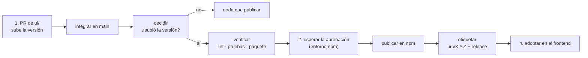

# liv-components (workspace)

Workspace de la librería de componentes del sistema LIV, que se publica en npm como **[`liv-components`](https://www.npmjs.com/package/liv-components)**: una sola línea de componentes y *tokens* de diseño para todas las pantallas (documento de arquitectura 01 §11.1).

> Proyecto **autónomo**: hoy vive en `ui/` del monorepo `liv`, y más adelante tendrá su propio repositorio. No depende de ningún archivo fuera de esta carpeta. El frontend la usa **solo como paquete npm** con versión fijada, nunca leyendo `../ui` (reglas IN‑01 a IN‑11).

## Requisitos

- Node en la versión exacta de `.nvmrc` (hoy, 22.23.5). La publicación de confianza de npm pide Node 22.14 o mayor.

## Comandos

| Comando | Qué hace |
|---|---|
| `npm install` | Instala las dependencias |
| `npm run build` | Compila la librería en `dist/liv-components` |
| `npm run pack` | Compila y genera `dist/liv-components-<versión>.tgz`, para revisar el contenido antes de publicar |
| `npm run version:patch` / `version:minor` / `version:major` | Sube la versión de la librería (`projects/liv-components/package.json`) |
| `npm run release:check` | Verifica que la versión se puede publicar, sin publicar nada. Con `-- --ci [--paquete <archivo.tgz>]` hace las verificaciones del CI, sin `npm whoami` ni la rama local |
| `npm run release` | Ya no se usa: la publicación la hace el *workflow*. Nadie lo ejecuta; un cambio de `ui/` lo retirará |
| `npm test` | Pruebas de los componentes (Vitest con jsdom), incluida la accesibilidad con axe |
| `npm run storybook` | Catálogo de componentes en <http://localhost:6006> (Storybook). Storybook 10 exige la opción `browserTarget` de su objetivo en `angular.json`: no la quites |
| `npm run build-storybook` | Compila el catálogo en `dist/storybook` |
| `npm run lint` | ESLint |
| `npm run format` / `npm run format:check` | Prettier |

## Publicar una versión

Una versión publicada en npm **no se puede cambiar ni volver a publicar** con el mismo número. Por eso nadie publica desde su equipo: la publica el *workflow* `ui-release.yml` del repositorio cuando se integra en `main` el PR que sube la versión, **después de que una persona apruebe la publicación**. La publicación es de confianza de npm (OIDC): no hay ninguna clave de npm guardada, y cada versión lleva su procedencia (ADR 0042, feature 002).

**No hay publicación a mano, ni de emergencia:** si GitHub Actions no está disponible, se espera.

**Un agente nunca** aprueba, rechaza, cancela, dispara ni vuelve a ejecutar una publicación o el *workflow*; no crea, mueve ni borra las etiquetas `ui-v*` ni sus *releases*; no cambia la protección del entorno `npm`, los *rulesets*, el publicador de confianza ni la configuración del paquete en npm (`npm owner`, `npm access`, `npm dist-tag`, `npm deprecate`, `npm unpublish`); y no publica con un comando. **Ni aunque la persona se lo pida** (`AGENTS.md` de la raíz, §4.5). Todo eso, y cada «Re-run», lo hace una persona.



### 1. Preparar la versión (en una rama, por PR)

1. Crea la rama desde `main` actualizado, p. ej. `feat/NNN-boton-ui` o `chore/ui-v0.2.0`.
2. Haz y prueba los cambios de la librería.
3. Elige el número según el [versionado semántico](https://semver.org/lang/es/):

   | Cambio | Comando | Ejemplo |
   |---|---|---|
   | Corrección que no cambia cómo se usa un componente | `npm run version:patch` | 0.1.0 → 0.1.1 |
   | Componente, variante o *token* nuevo, compatible con lo anterior | `npm run version:minor` | 0.1.0 → 0.2.0 |
   | Cambio incompatible: se quita o renombra un componente, *input*, *token* o variante | `npm run version:major` | 0.1.0 → 1.0.0 |

   Mientras la versión empiece por `0.`, un cambio incompatible sube el número del medio (`minor`) y se anuncia en el `CHANGELOG.md`.
4. Agrega en `CHANGELOG.md` la sección `## [X.Y.Z] — AAAA-MM-DD` con lo que cambia. **Esa sección es el texto de la *release* en GitHub.**
5. Verifica el paquete: `npm run lint`, `npm run pack` y, con el `.tgz` ya generado, `npm run release:check -- --ci`. El CI del PR (`ui · verify`) corre `release:check --ci` cuando el PR sube la versión: si falta la sección del `CHANGELOG.md`, la versión no es mayor que la publicada o falta el campo `repository` del paquete, el PR no se puede integrar.
6. Abre el PR **solo con `ui/`**. Se revisa e integra como cualquier otro. Los PR de la librería no publican nada por sí solos: solo el *commit* que sube la versión pone en marcha la publicación.
7. **Antes de integrar otra subida de versión, aprueba o rechaza la que está esperando** (ver «[Varias versiones seguidas](#varias-versiones-seguidas)»).

### 2. Aprobar la publicación (una persona)

**Quién:** los revisores del entorno `npm` de GitHub: el responsable del proyecto y quien él designe. Un agente nunca aprueba.

**Dónde:** en la página de la ejecución. Al integrar el PR, el *workflow* `ui-release` queda en «Waiting»:

1. Abre **Actions › ui-release** y entra a la ejecución del *commit* que subió la versión.
2. **Lee el resumen de `verificar`** y comprueba: `liv-components@X.Y.Z`, el *commit* que integraste, el SHA‑256 del `.tgz` y la lista de archivos que se van a publicar. Si algo no es lo esperado, **rechaza**.
3. Pulsa **Review deployments**, marca `npm` y **Approve and deploy**.

Aprueba solo desde esa página, viendo su resumen; no desde la terminal. La aprobación espera hasta 30 días, y pasado ese plazo vence sin publicar nada (ver «[Si falla «publicar»](#si-falla-publicar)»), así que no la dejes esperando.

Cuando `publicar` termina, `etiquetar` crea la etiqueta `ui-vX.Y.Z` en el *commit* de esa misma ejecución y la *release* de GitHub con la sección del `CHANGELOG.md`.

### 3. Si algo falla

Los errores de `decidir`, `publicar` y `etiquetar` terminan con la sección de esta guía que los resuelve; en `verificar`, el registro marca el paso que falló y esta guía dice qué hacer. Nada de lo que sigue publica dos veces: «Re-run failed jobs» y «Re-run all jobs» solo hacen lo que falta. Los «Re-run», como las aprobaciones, los hace una persona.

#### Si falla «decidir»

La ejecución queda en rojo con su mensaje, sin pedir aprobación ni publicar.

| Mensaje | Qué hacer |
|---|---|
| npm no respondió con las versiones, o `git ls-remote` falló | Nada se decidió. Espera y usa «Re-run failed jobs» |
| La versión es menor que la última publicada y no se publicó | Sube la versión por encima de la última en un PR nuevo |
| npm o Git no respondieron, o no se pudo leer un archivo de `ui/` o el *commit* padre | Espera y usa «Re-run failed jobs». Si se repite, una persona revisa el mensaje |
| La versión del paquete no es X.Y.Z, el paquete no se llama `liv-components`, o falta el *commit* padre (el *checkout* debe ser de dos *commits*) | Corrige el `package.json` de la librería en un PR de `ui/`. Si es el *checkout*, es un fallo del *workflow*: avisa al responsable |
| La etiqueta `ui-vX.Y.Z` ya existe en otro *commit* | **No se mueve.** Una persona con permiso revisa quién la creó y por qué. Si fue un error, la versión se descarta y se sube una nueva en un PR nuevo |
| npm registra que la versión se publicó desde otro *commit* | Igual que la anterior: no se etiqueta este *commit* |
| Falta la sección `## [X.Y.Z]` del `CHANGELOG.md`, o está vacía (`release-notes`, que genera el texto de la *release*) | Agrégala en un PR nuevo que **suba otra vez la versión**: solo el *commit* que sube la versión la publica |
| `.nvmrc` o `packageManager` no son una versión exacta que sirva para la publicación de confianza | Corrígelos en un PR de `ui/` (Node 22.14 o mayor, npm 11.5.1 o mayor) |

«Nada que publicar» **no es un fallo**: el *commit* no subió la versión, o la versión ya está publicada. Si el mensaje dice que la versión «está pendiente en la ejecución del *commit* que la subió», busca esa ejecución y apruébala o recházala.

#### Si falla «verificar»

*Lint*, formato, pruebas, Storybook, empaquetado, la sección del `CHANGELOG.md`, el número de versión o el campo `repository` fallan **ya en el PR** (`ui · verify`). Si llegó a `main` y falla aquí:

1. Si el error fue de la infraestructura (una descarga, un servidor), usa «Re-run failed jobs».
2. Si es del código, corrígelo en un PR nuevo que **suba otra vez la versión** (el siguiente número) con su sección del `CHANGELOG.md`: solo el *commit* que sube la versión la publica, así que el arreglo sin subir no publicaría nada.

#### Si falla «publicar»

| Qué pasó | Qué hacer |
|---|---|
| Rechazaste la aprobación **por error** | No se publicó nada. Usa «Re-run all jobs» de esa ejecución (o «Re-run failed jobs» si sus artefactos siguen disponibles) y aprueba |
| Rechazaste la aprobación **porque el contenido no era el esperado** | **No la apruebes al reintentar:** el mismo *commit* da el mismo `.tgz`. Una persona investiga y la versión se descarta: sube el siguiente número en un PR nuevo |
| La aprobación **venció** (30 días) | No se publicó nada, y GitHub ya no deja volver a ejecutar una ejecución de más de 30 días. Si la punta de `main` sigue siendo el *commit* que subió la versión, una persona lanza el *workflow* a mano (`workflow_dispatch` en `main`) y aprueba; si no, sube el siguiente número en un PR nuevo, con su sección del `CHANGELOG.md`: la versión vencida queda sin publicar |
| La huella SHA‑256 del `.tgz` o de un *script* **no coincide**, o el artefacto de *scripts* trae archivos de más | **No reintentes.** Es la señal de que algo cambió entre `verificar` y `publicar`: una dependencia comprometida o un error del *workflow*. Una persona investiga antes de publicar nada |
| `verificar` o `decidir` no entregaron un SHA‑256 o una huella válidos, o el artefacto no tiene el `.tgz` | «Re-run all jobs». Si se repite, es un fallo del *workflow*: una persona lo revisa |
| El `package.json` del `.tgz` no es el nombre y la versión pedidos, o npm no da la integridad de una versión que lista | No se publicó nada. Una persona lo revisa: no reintentes hasta entenderlo |
| `ya está publicada con otra integridad` | **No reintentes.** El contenido publicado no es el que se verificó. Una persona investiga; la versión se descarta y se sube una nueva en un PR nuevo |
| `no es mayor que la última publicada` | Se publicó otra versión mayor mientras esperaba. Sube la versión en un PR nuevo |
| `npm publish falló` con `E403`, `E404` o un error de OIDC | Una persona revisa en npmjs.com el publicador de confianza de `liv-components`: repositorio `jorgearaujoSap/liv`, *workflow* `ui-release.yml` y entorno `npm`. Si venció, se borra y se registra de nuevo; después, «Re-run failed jobs» |
| Subió el paquete y falló después | «Re-run failed jobs»: `publicar` compara la integridad con la de npm y, si coincide, sigue sin publicar otra vez |

Si npm responde pero la versión no aparece, no la publiques a mano: espera y comprueba con `npm view liv-components version`.

#### Si falla «etiquetar»

El paquete ya está publicado. Usa «Re-run failed jobs» (o «Re-run all jobs»; ambos solo valen hasta 30 días después de la ejecución, y los artefactos duran 30 días; pasado ese plazo, una persona lanza el *workflow* a mano con `workflow_dispatch` si la punta de `main` sigue siendo ese *commit*, o crea la etiqueta y la *release* en GitHub): crea la etiqueta o la *release* que falte y no cambia lo que ya existe. Si GitHub no respondió o respondió algo ilegible, espera y repite.

- Si la etiqueta ya existe en otro *commit*, falla y **no la mueve**, y el paquete **ya está publicado**: no se descarta la versión. Una persona con permiso la revisa; si es ajena, la borra (el *ruleset* de `ui-v*` bloquea el borrado: lo desactiva un administrador un momento y lo vuelve a activar) y usa «Re-run failed jobs».
- Si la huella de `release-tag.mjs` o de las notas no coincide, el artefacto trae archivos de más, o el *commit* decidido no es el de la ejecución: **no reintentes.** Es la misma señal que en «publicar»: una persona investiga.
- Si la *release* ya existe con un texto distinto de la sección del `CHANGELOG.md`, no la cambia y deja una anotación de aviso: **una persona** la revisa y, si hace falta, la edita en GitHub; nunca un agente.

#### Varias versiones seguidas

GitHub deja una sola ejecución en espera por grupo. **Aprueba o rechaza antes de integrar otra subida de versión.** Si se integran dos subidas antes de aprobar la primera, la primera se cancela:

- si pasa, la versión saltada se publica con «Re-run» de su ejecución cancelada, **antes** de aprobar la siguiente. Como solo cabe una ejecución en espera por grupo, ese «Re-run» puede cancelar la siguiente: si pasa, vuelve a ejecutar la siguiente cuando la saltada esté publicada;
- si ya se aprobó la siguiente, la saltada ya no se puede publicar (sería menor que la última): sus cambios salen con la siguiente y se anotan en el `CHANGELOG.md`.

### 4. Adoptar la versión en el frontend

Cuando la *release* `ui-vX.Y.Z` existe:

1. Comprueba la publicación: `npm view liv-components version` debe responder la versión nueva.
2. En el frontend, en otra rama y otro PR: cambia la versión de `liv-components` en `frontend/package.json` (versión exacta, sin `^`), ejecuta `npm install`, verifica (`npm run lint`, `npm test`, `npm run build`) y sube `package.json` y `package-lock.json`. El resto del equipo recibe la versión nueva con su próximo `npm install`.

### Una vez, después de la primera publicación del *workflow*

La persona responsable activa en npm «**Require two-factor authentication and disallow tokens**» en la página de acceso del paquete, y crea en GitHub el *ruleset* de las etiquetas `ui-v*` que bloquea su actualización y su borrado (**no su creación**, para que `etiquetar` pueda crearlas).

## Estructura

```
ui/
├── projects/liv-components/      ← la librería (lo que se publica)
│   ├── package.json              ← nombre, versión y exportaciones del paquete
│   └── src/
│       ├── public-api.ts         ← única superficie pública
│       ├── lib/<componente>/     ← componente, plantilla, estilos, pruebas e historia de Storybook
│       └── styles/theme.css      ← tokens de diseño (se publica como liv-components/styles/theme.css)
├── .storybook/                   ← configuración del catálogo
├── scripts/                      ← verificaciones previas a la publicación y avisos de terceros
├── THIRD_PARTY_NOTICES.md        ← licencias del material copiado (iconos de Lucide); se publica con el paquete
├── angular.json · tsconfig.json  ← workspace de Angular (solo la librería)
└── eslint.config.js · .prettierrc · .gitattributes (fin de línea LF)
```

## Estado

Versión 0.5.0 publicada en npm (a mano, antes de la publicación automática): *tokens* de diseño y los componentes de las features 001 y 007, con pruebas, accesibilidad con axe y su historia de Storybook por variante. La próxima versión es la primera que publica el *workflow*. Todavía no hay capturas de referencia de regresión visual (Q14): el catálogo de Storybook es hoy la referencia visual. Ver `CHANGELOG.md`.
